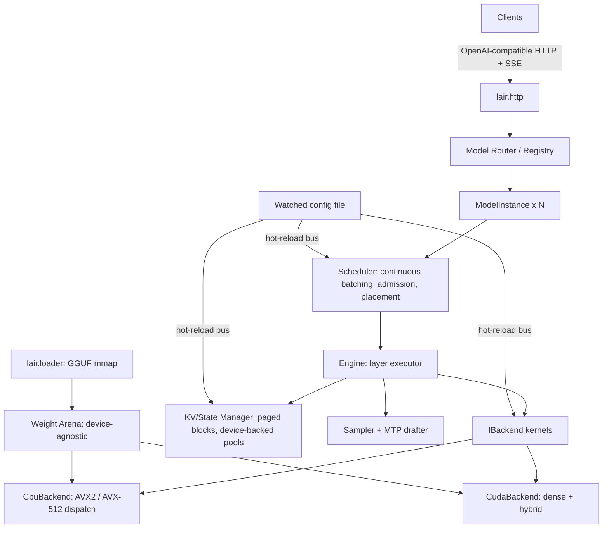

# LAIR — Local AI Inference Runtime

## Context

LAIR is a C#/.NET inference runtime for local LLMs on x64 hardware, serving CPU/RAM-only machines and hybrid CPU/GPU machines from one engine. It adopts Strata's product surface — an OpenAI-compatible API, published GGUF model packs, disk-backed weights when they exceed RAM — and Colibri's residency approach: keep only the weights a token actually touches hot (routed experts, pageable PLE tables), gathering the rest from cold RAM or NVMe. Its differentiator is multi-tenant serving: concurrent requests batched into shared decode steps, multiple models resident concurrently against explicit per-device budgets, and per-model placement policies — compute split, prefill target, KV residency — all tunable live through a config file. Development happens on an i9-13900K / 64 GB / RTX 4090 box that exercises every code path; production targets include AVX2-only Xeons (E5-2683 v4, DDR4, 128 GB) with no GPU.

## Scope

**In (v1):**

- Dense GGUF inference (Llama/Qwen-class ≤3B) at Q4_K/Q8_0, AVX2 baseline with optional AVX-512 dispatch
- OpenAI-compatible HTTP API, supporting as much of the OpenAI spec as maps to local inference: `/v1/chat/completions` (text + image input, tool calls, logprobs, penalties, `logit_bias`, seed), `/v1/completions`, `/v1/embeddings` (text), `/v1/models`, SSE streaming with usage
- Vision input for chat models: image preprocessing + vision encoder + visual-token injection
- Concurrent requests batched into shared decode steps (continuous batching), with chunked prefill interleaved into the same batch steps
- Prompt caching: prefix KV reuse across requests; conversation caching: idle conversation state retained in RAM or persisted to disk and restored
- Multiple models resident and served concurrently against per-device budgets
- Per-model placement policy: device (`cpu` | `cuda` | `hybrid` with layer split), prefill target, KV residency (`dram` | `vram` | `split`), VRAM budget, CPU thread quota
- Config-file hot-reload for every runtime knob; no admin API
- CUDA backend with Strata-style hybrid CPU/GPU inference
- MoE residency for Qwen3.8-Flash-Next: router, expert gather, RAM hot tier, pageable PLE with indexed disk gather, MTP drafting
- Tiered residency: NVMe cold expert tier, VRAM hot expert tier
- Knobs-first principle: every placement/residency combination is implemented and testable; defaults reflect measured-optimal tuning; users may deliberately choose suboptimal combinations (e.g. lower speed for lower DRAM/VRAM footprint)
- Modular weight supply: kernels receive all weights through a swappable provider, so byte-reduction experiments (layer skipping, expert pruning, dynamic quant switching, early-exit vocab) plug in without kernel rewrites
- Observability: per-model tok/s, cache hit rates, tier utilization, PCIe transfer costs — structured logs plus a CLI monitor, and a real-time Web UI showing in-flight requests with per-request stats, engine/machine usage (CPU, memory, GPU, PCIe, disk I/O) portioned by model/role, CPU and GPU power draw where obtainable, CPU/GPU/RAM temperatures where exposed by the platform, cache usage with location breakdown, and the most recent X requests; monitor is read-only — no admin API

**Out (explicit non-goals for v1):**

- Model conversion/quantization tooling — LAIR consumes published GGUF quants (rationale: the ecosystem already produces them; Decision Log 2026-10-31)
- Anthropic-compatible API — backlog idea
- Vulkan/Metal/SYCL backends — backlog; LAIR commits to CPU + CUDA only
- Audio modality (OpenAI audio/realtime APIs) — not yet; backlog
- OpenAI platform surface (fine-tuning, assistants, batch, moderation, image generation) — decided against; platform features, not inference features (Decision Log 2026-10-31)
- Admin API surface — decided against; config-file hot-reload only (rationale: single-operator local runtime; Decision Log 2026-10-31)

## Architecture



### Decisions

**Backend seam** — all compute behind `IBackend`; `CpuBackend` default, `CudaBackend` arrives MVP4 but the contract exists in MVP1.
- Rationale: dotLLM proves native C# kernels reach 66–88% of llama.cpp on decode; retrofitting a backend abstraction after the fact is costly.
- Rejected: wrapping llama.cpp wholesale (LAIR is a runtime, not bindings).
- Contract: op dispatch + tensor arena handles per device.

**Managed-first kernels + `[LibraryImport]` escape** — System.Runtime.Intrinsics everywhere; native microkernels only where measurement proves a wall.
- Rationale: dotLLM's outer-product tile needs ~23 YMM registers vs AVX2's 16 — RyuJIT spills kill tiling reuse; shims are the known fix.
- Rejected: pure-managed absolutism (ignores the register wall); native-core-first (loses the C# productivity thesis).

**Paged KV with device-backed pools** — fixed-size blocks allocated on demand from a CPU arena or a VRAM pool; runtime resize means changing pool budgets, never reallocating live sequences.
- Rationale: fits multi-tenant budgets and hot-reload; vLLM-proven.
- Rejected: contiguous per-sequence buffers (rigid budgets).
- Extension: blocks are reference-counted and copy-on-write, so a shared prompt prefix is prefilled once and reused across requests; idle conversations keep their block runs in RAM or snapshot them to the NVMe tier and restore on resume.

**Knobs-first, opinionated defaults** — every placement/residency combination (prefill device × decode split × KV residency) is implemented, tested, and user-selectable; defaults are the measured-optimal path.
- Rationale: users may trade inference speed for lower DRAM/VRAM usage; the engine must not hard-code the "optimal" combination.
- Contract: the bench harness documents the cost curve of each knob so defaults stay defensible.

**Continuous batching** — sequences share decode steps; a unified token batch is the only lever that raises arithmetic intensity on CPU decode.
- Rationale: batch-1 GEMV has zero weight reuse; batching converts GEMV toward GEMM.
- Rejected: one thread per request (bandwidth thrash, no weight sharing).
- Contract: prefill chunks interleave with decode tokens in the same batch step, so a long prompt never stalls decode latency for other sequences.

**Device-agnostic weight arena** — mmap'd GGUF tensors placed per `PlacementPolicy`; NUMA-aware first-touch; never mlock'd.
- Rationale: archive measurement shows mlock at −5%; page-cache residency is the legitimate alternative.
- Movement: weight slabs are relocatable at runtime — promotion/demotion across RAM/VRAM/NVMe tiers and migration across NUMA nodes while serving, guarded by slab reference counts and double-buffered staging so a slab in flight is never evicted mid-read.

**PCIe tax as measured cost** — the scheduler models transfer cost explicitly; KV follows decode device by default; `split` KV residency is validated by bench before it becomes a default anywhere.
- Rationale: attention reads all KV every token; bytes on the far side of PCIe are paid per token; llama.cpp's no-op-offload tax crippled hybrid runs in the archive.

**AVX2 baseline, AVX-512 optional** — both dev and production target boxes are AVX2-only (13900K and E5-2683 v4 lack AVX-512); AVX-512 is a dispatch path, never a design assumption.

**GGUF-first with GGUF-embedded tokenizer** — parse tokenizer + chat template from GGUF metadata; consume the published quant ecosystem.
- Rejected: HF tokenizer.json sidecar (extra files break the model-pack story).

**Config-file-only admin** — one watched config file pushes changes through a hot-reload bus to scheduler, KV pools, and backends.

**Read-only monitor** — the Web UI, CLI monitor, and logs all consume one metrics bus (internal engine counters + OS/driver stats) over a live stream (WebSocket/SSE); nothing on the monitor surface mutates state.
- Rationale: knobs-first tuning needs visibility; mutation stays confined to the config file so there is exactly one write path.
- Contract note: PCIe/DRAM "usage" is measured as engine counters (transfer bytes, tier hits) plus OS/driver readings for CPU/VRAM — hardware perf counters are a refine detail, not a promise. Disk I/O is both: OS counters for total device throughput, engine counters for engine-attributed traffic (expert tier streaming, PLE indexed reads, conversation snapshots) attributed per model/role. Power and temperature are best-effort: GPU via NVML (reliable for both); CPU via hwmon/RAPL sysfs on Linux and kernel-helper/third-party telemetry on Windows; RAM temperature only where the platform exposes it (server BMC/IPMI on the Xeon boxes, generally absent on consumer boards); per-model power is a utilization-weighted estimate, labeled as such.

**CPU-only deployment justified** — a CPU-only path avoids the PCIe offload tax entirely on GPU-less boxes; hybrid is opt-in on capable machines.

**Weight supply abstraction** — kernels never touch raw weight buffers; every weight access goes through an `IWeightSource` provider.
- Rationale: decode speed is bytes-per-token, so every future byte-reduction experiment (mixture-of-depths/layer skipping, expert pruning, dynamic quant switching, early-exit vocab, ternary formats) is a provider swap behind this seam, not kernel surgery.
- Rejected: kernels bound directly to mmap'd buffers (each experiment would require rewriting the hot path).

**OpenAI spec subset** — LAIR implements the OpenAI surface that maps to local inference, not the platform surface.
- In: chat completions (text + image, tool calls, logprobs, penalties, `logit_bias`, seed, streaming with usage), completions, text embeddings, models.
- Out (rationale: cloud-platform features with no local-inference meaning): fine-tuning, assistants, batch, moderation, image generation, audio/realtime.
- Contract: unmodified OpenAI SDK clients work against the supported endpoints.
- `/v1/models` extension: OpenAI baseline fields plus non-breaking metadata — `context_length`, modalities, `supported_parameters`, quant type, placement — following the Ollama/OpenRouter/llama.cpp ecosystem convention; coding tools depend on `context_length` and otherwise assume 8192.

**High lock-in (confirmed):** OpenAI-compatible wire contract · GGUF format commitment · `IBackend` contract · `PlacementPolicy` config schema.

### Modules

- `lair.host` — CLI + HTTP host, config watcher, lifecycle
- `lair.http` — serving layer: OpenAI-compatible endpoints, SSE streaming, request lifecycle, model router
- `lair.contracts` — contracts-only leaf: `IBackend`, `IWeightSource`, quant formats, tensor shapes (engine/sequences/continuous batching live in `lair.models` + `lair.kv`)
- `lair.models` — architecture definitions + GGUF tensor mapping (dense first; Flash-Next later)
- `lair.backends.cpu` — intrinsics kernels, fused dequant GEMV/GEMM, shim escape
- `lair.backends.cuda` — device kernels, hybrid layer-split execution
- `lair.kv` — paged state manager, device-backed block pools, budgets
- `lair.tokenizer` — GGUF-embedded BPE + chat templates
- `lair.sampling` — sampler stack + MTP drafter
- `lair.loader` — GGUF parse, mmap, placement into arenas
- `lair.monitor` — read-only Web UI (static SPA + live stats stream) and the metrics bus feeding it, CLI monitor, and logs
- `lair.vision` — image preprocessing, vision encoder, visual-token injection (MVP7)

### Seams

- `IBackend` — default `CpuBackend`
- `IGatherKernel` — default CPU gather (MoE phase)
- `IResidencyTier` — default RAM-only; NVMe cold tier and VRAM hot tier later
- `IConfigSource` — default watched config file
- `IModelLoader` — default GGUF mmap
- `IWeightSource` — default `MmapTensorSource`; byte-reduction experiments plug in as alternate providers

### Data model

Weights are GGUF tensor blobs, mmap'd and never transformed. Sequence state is a paged block table allocated from device-backed pools. The model registry is config-declared. Requests are transient. No relational store; structured reads come from GGUF metadata parsed at load.

### Key references

llama.cpp/ggml (fused dequant kernels, block quant formats, hybrid offload pitfalls) · ik_llama.cpp (CPU-first fused kernels, expert prefetch — the CPU bench ceiling and the reactive half of what LAIR makes proactive) · dotLLM (native C# engine patterns, `IBackend` shape, register-pressure lessons) · colibri (expert streaming off disk, hot-tier residency, pageable PLE, MTP drafting, multi-conversation shared decode) · Strata (hybrid CPU/GPU serving, model packs, OpenAI-compatible product surface) · vLLM (paged KV cache).

## Build / Deployment

- .NET 10; solution layout `src/`, `tests/`, `bench/`
- Publish: self-contained `win-x64` single executable; config file + model pack directory alongside
- CUDA native shims built via an `nvcc` MSBuild target (MVP3 onward); CPU-only builds carry no CUDA dependency
- Bench harness vs llama.cpp is a first-class artifact from MVP2 — it validates every knob's cost curve
- Dev box: i9-13900K / 64 GB DDR5 / RTX 4090 24 GB (AVX2, exercises all paths). Production target: dual/single Xeon E5-2683 v4, DDR4 quad-channel, 128 GB, AVX2, no GPU
- CI/CD and Native AOT packaging: backlog

## Phases

### MVP1 [v0.1.0] - Shipped

One dense GGUF model answers one OpenAI request, streamed, on CPU.

#### Design Notes

- **DN-M1-1** — Llama-family and Qwen2 dense (≤3B) are the MVP1 architectures, including GQA and q/k/v bias variants.
  - Rationale: both share one shape family (RMSNorm + RoPE + SwiGLU + GQA); every later model inherits GQA and bias handling.
  - Rejected: Llama-only (arch rewrite when Qwen2 arrives); MHA-only (rewrite in MVP5).
  - Contract: architecture registry in `lair.models`.
- **DN-M1-2** — Quant set is F16, Q8_0, Q4_K_M.
  - Rationale: F16 is the golden-parity reference format; Q8_0/Q4_K_M are the production paths.
  - Rejected: IQ formats (shuffle-heavy on AVX2, backlog); FP16-only (no production path).
  - Contract: format descriptor in `IWeightSource`.
- **DN-M1-3** — `IWeightSource` resolves at plan time; kernels hold raw `ReadOnlySpan<byte>` + format descriptor, never an interface call in the GEMV loop.
  - Rationale: hot-path indirection is paid per tile; mmap read-only spans keep weights OS-page-cache resident.
  - Rejected: runtime interface dispatch per tile; eager copy into private arenas (doubles memory).
  - Contract: `IWeightSource.Resolve(tensorId, rowRange) → (ReadOnlySpan<byte>, QuantFormat)`.
- **DN-M1-4** — Chat templates render through a mini Jinja-subset interpreter (conditionals, loops, common filters, special-token handling).
  - Rationale: correctness on arbitrary GGUF templates; llama.cpp's minja is the working precedent.
  - Rejected: hardcoded per-family templates (breaks on custom templates); deferring chat to MVP2 (breaks `/v1/chat/completions` in MVP1).
  - Contract: template render in `lair.http` request pipeline; `lair.tokenizer`.
- **DN-M1-5** — Config file is YAML (YamlDotNet).
  - Rationale: the hot-reload schema grows with PlacementPolicy; comments matter in server config.
  - Rejected: TOML (weaker for nested policy blocks); JSON (poor hand-editing).
  - Contract: `IConfigSource` implementation.
- **DN-M1-6** — MVP1 admits exactly one in-flight request; a second concurrent request gets `engine_overloaded`.
  - Rationale: the phase outcome is one request end-to-end; concurrency is MVP2's theme.
  - Rejected: speculative multi-request support (half-built concurrency, violates phase theme).
  - Contract: scheduler admission rule + error taxonomy.
- **DN-M1-7** — Errors use the OpenAI error shape `{error:{message,type,code}}` with a bounded code set: `invalid_request`, `model_not_found`, `context_length_exceeded`, `engine_overloaded`, `internal`.
  - Rationale: SDK clients handle errors uniformly; bounded codes keep behavior predictable.
  - Rejected: .NET exception passthrough (leaks internals, breaks SDK expectations).
  - Contract: `lair.http` middleware.
- **DN-M1-8** — Kestrel binds loopback by default; authentication deferred (backlog: server posture).
  - Rationale: local runtime default posture; exposure is an explicit later decision.
  - Contract: host binding config.
- **DN-M1-9** — Model loading is fail-fast: missing/corrupt/OOM model aborts startup with an actionable message; `/healthz` readiness reflects model state.
  - Rationale: no half-ready engine state to reason about.
  - Rejected: lazy load on first request (hides load failures behind request errors).
  - Contract: host lifecycle + `/healthz`.
- **DN-M1-10** — Every request carries `x-lair-request-id`; JSON structured logs correlate on it.
  - Rationale: correlation IDs must exist before multi-request phases make logs unreadable.
  - Contract: `lair.http`/`lair.host` logging.

- **DN-M1-11** — Loader/source split: `IModelLoader` parses the container into a logical tensor table (id, shape, format, offsets); retrieval strategy lives entirely in `IWeightSource` providers selected per model in config.
  - Rationale: experimental storage/retrieval modules (repacked sidecars, tiered streaming, read-time transforms) plug in as providers without touching loader or kernels — the byte-reduction experiment program depends on this split existing from day one.
  - Rejected: loader-owned retrieval (each experiment would fork the loader); kernel-direct file access (kills tiering).
  - Contract: `IModelLoader → LogicalTensorTable`; `IWeightSource` provider selected by config.

#### Implementation Items

- [✓] GGUF loader — mmap tensors, metadata, vocab (see DN-M1-3)
  - Verify: `dotnet test --filter Category=Loader` — 8/8 on synthetic GGUF v3 ✅; real-file load verified on SmolLM-135M-Instruct-F16.gguf via tokenizer integration ✅; quantized real-load runs at Parity against a pinned Q8_0 build (SmolLM dims are not block-divisible, so llama.cpp's own quantizer emits legacy fallback tensors there); full Q4_K_M family support tracked in Backlog.
- [✓] GGUF tokenizer — BPE + special tokens decode/encode
  - Verify: `dotnet test --filter Category=Tokenizer` — 18/18 ✅ (13 synthetic + 5 against the real SmolLM GGUF: ASCII/newline/emoji round-trips, control tokens).
- [✓] Chat templates — mini Jinja-subset interpreter
  - Verify: `dotnet test --filter Category=Template` — 20/20 ✅ golden renders (ChatML = real SmolLM `tokenizer.chat_template`, conditional if/else + `|tojson`, Phi-style), subset semantics (concat, `==`/`!=`, `not`, `tojson`/`trim`, ``), and rejections naming construct + position (``, `|upper`, macro, slices). The real Llama-3 template needs ``/loop vars — out of subset (pulled forward as MVP3.2).
- [✓] Dense kernels — fused dequant GEMV for Q4_K_M/Q8_0/F16, AVX2, row-block threading (see DN-M1-3)
  - Verify: `dotnet test --filter Category=Kernel` — 15/15 ✅ vs double-precision oracle incl. threaded bit-identity; bench Q4_K 4096×4096: AVX2 8.7× scalar, threaded ≈17 GB/s ✅.
- [✓] Layer executor — RMSNorm, RoPE, GQA attention, SwiGLU FFN, qkv bias (see DN-M1-1)
  - Verify: `dotnet test --filter Category=Layers` — 24/24 ✅ incl. hand-computed op units and real SmolLM-F16 forward smoke (finite deterministic logits); exact-token parity runs at Parity.
- [✓] Paged KV — CPU block pool, 16-token blocks, allocator, per-model budget from config
  - Verify: `dotnet test --filter Category=Kv` — 8/8 ✅ (capacity errors, alloc/release integrity, addressing across partial blocks, refcounts); multi-turn prefix intactness verified end-to-end at Manual Serve.
- [✓] Sampling — greedy, temperature, top-k/top-p, seed
  - Verify: `dotnet test --filter Category=Sampling` — 9/9 ✅ (seeded determinism, top-k/top-p intersection order, statistical match within 1%, banned/NaN handling).
- [✓] HTTP API — chat/completions, completions, models (with `context_length` metadata), SSE streaming, error taxonomy (see DN-M1-6, DN-M1-7)
  - Verify: `dotnet test --filter Category=Api` — 10/10 ✅ against a live server on the real SmolLM fixture: non-stream chat + completions shapes, SSE chunk stream ending `[DONE]`, `/v1/models` with `context_length`, `/healthz`, embeddings-404, error taxonomy (model_not_found / context_length_exceeded / engine_overloaded / invalid_request), `x-lair-request-id` on every response. OpenAI Python SDK probe runs under Manual Serve.
- [✓] Backend seam — `IBackend` + arenas + `IWeightSource` contracts, CPU-only implementation (see DN-M1-3, DN-M1-11)
  - Verify: `lair.contracts` compiles with zero project references — no reference to `lair.backends.cpu` ✅; alternate `IWeightSource` provider end-to-end proof ran with the Parity item (`ArenaWeightSourceTests`: tensors copied into backend-allocated aligned blocks, token sequence identical to mmap-backed decode) ✅.
- [✓] Golden parity — logit-agreement harness vs pinned llama.cpp (server-mode reference), committed calibrated fixtures (see Decision Log 2026-11-01)
  - Verify: `dotnet test --filter Category=Parity` — 9/9 ✅ on SmolLM-135M F16 + Q8_0 vs pinned llama.cpp b12032 server references (4 prompts × 2 models, sha256-guarded): LAIR argmax lands in the reference top-5 for every prompt; calibrated distributions reproduce exactly. Harness work exposed and fixed four engine bugs: prefill double-forward of the last prompt token, BOS applied regardless of `add_bos_token`, SmolLM digit-run split cutting all non-digit text per-character, and reversed BPE merge priority order. Alternate-`IWeightSource` arena proof green — completes the Backend seam item's end-to-end proof too.
- [✓] Config load — YAML parse, validation, placement policy (single model, `cpu`)
  - Verify: `dotnet test --filter Category=Config` — 31/31 passing ✅; `lair serve -c lair.yaml` boot is exercised under the CLI item.
- [✓] CLI — `lair serve -c lair.yaml` and `lair chat` REPL
  - Verify: `dotnet test --filter Category=Cli` — 4/4 ✅ (piped stdin vs real SmolLM: banner + streamed reply, `/reset`, overflow retry then clean error line, cancellation → interrupted/0). Manual serve boot + piped chat run verified; quantized-model serving check runs at Manual Serve.

#### Tests

- [✓] Automated Loader: GGUF metadata, vocab, tensor offset parsing against fixtures — 8/8
- [✓] Automated Tokenizer: encode/decode round-trip vs llama.cpp semantics — 18/18, real-model cases executing live
- [✓] Automated Template: golden chat-template renders, three families
- [✓] Automated Kernel: fused dequant GEMV vs scalar reference, FP tolerance — 15/15 + DequantRow cases
- [✓] Automated Layers: per-layer activations vs hand-computed references + real-model smoke — 24/24
- [✓] Automated Kv: block allocator alloc/free/reuse and budget enforcement — 8/8
- [✓] Automated Sampling: determinism under greedy/seed; statistical top-k/p behavior — 9/9
- [✓] Automated Parity: per-prompt sha256 guard + LAIR argmax ∈ reference top-5 (pinned llama.cpp server) + reproduction of the fixture's calibrated LAIR distribution within |Δlogprob| ≤ 0.2, on SmolLM-135M-F16 and Q8_0 — 9/9
- [✓] Automated Config: YAML schema validation and error messages — 31/31
- [✓] Manual Serve: full serve→chat REPL session with streaming, abort, and reload-after-config-edit — done ✅ vs quantized Q8_0 model via YAML config: healthz/models/chat/completions probes, SSE chunk stream + mid-stream client abort with clean recovery on the next request (structured per-request log lines), piped `lair chat` REPL run against the same config, OpenAI Python SDK probe (`models.list`, non-stream chat, streaming) green, edited `max_context_tokens` 512→768 picked up on restart.

#### Open Items

- [X] **Jinja subset scope** — resolved by the Template implementation item: the interpreter supports conditionals, loops, variable access/indexing, concatenation, and the filters demanded by golden templates (`tojson`, `join`, `trim` as starting set); any unsupported construct fails with an explicit error naming the construct rather than rendering silently wrong.

### MVP2 [v0.2.0] - Shipped

Many requests at once, tuned, with live reconfiguration.

#### Design Notes

- **DN-M2-1** — Discrete batch steps: the scheduler runs fixed steps; each step executes one token per active decode sequence plus prefill chunks up to `max_batch_tokens`.
  - Rationale: step boundaries are the natural point for admission, cancellation, metrics, and hot-reload application.
  - Rejected: pipelined overlap across steps (complexity without CPU benefit).
  - Contract: scheduler in `lair.models`.
- **DN-M2-2** — Decode-priority scheduling; prefill chunks fill remaining batch slots, adaptive chunk size (default 512 tokens, config knob).
  - Rationale: inter-token latency is the perceived-quality metric; TTFT stays bounded by chunking. This is vLLM's proven pattern.
  - Rejected: prefill-priority (stalls ITL); strict FCFS (head-of-line blocking on long prompts).
  - Contract: scheduler step composition.
- **DN-M2-3** — Prefix cache: block table keyed by token-prefix hash, reference-counted copy-on-write blocks, LRU eviction within pool budget.
  - Rationale: shared prefixes (system prompts, multi-turn) are prefilled once; paged CoW makes sharing free.
  - Rejected: per-request prompt copies (memory blowup); hash-on-full-request only (no partial sharing).
  - Contract: `lair.kv` block table; invalidation on model reload, block-size change, or quant change.
- **DN-M2-4** — Cancellation at step boundaries: abort flag checked between steps; refcounted prefix blocks survive the abort of one sequence.
  - Rationale: mid-step abort would corrupt shared kernel state; step granularity is sub-100ms.
  - Contract: scheduler admission/cancel path.
- **DN-M2-5** — Hot-reload semantics table: live = `max_batch_tokens`, thread quota (next step), KV pool budget (grow immediate, shrink drains evictable blocks), per-model priority; new-requests-only = max context length; restart-only = block size, quant format, model path.
  - Rationale: every knob needs a declared mutation class or hot-reload becomes undefined behavior.
  - Contract: `IConfigSource` change-application rules.
- **DN-M2-6** — Core-set affinity: models pinned to disjoint NUMA-local core sets; requests inherit their model's set.
  - Rationale: partition unit is the model; per-request core splitting duplicates weight streaming inside shared batch steps.
  - Contract: scheduler + thread pool configuration.
- **DN-M2-7** — Metrics bus: engine counters (tok/s per model, step time, batch occupancy, cache hit rate, KV utilization) plus OS counters into an in-memory ring and JSON logs; CLI monitor consumes it now, MVP3's Web UI consumes the same bus later.
  - Contract: `lair.monitor` metrics bus.
- **DN-M2-8** — Tool calls: per-family tool schema injection into the chat template; `tool_calls` parsed from streamed output; tool execution stays client-side.
  - Rationale: coding-agent compatibility (Strata's whole tool story) requires the wire contract, not execution.
  - Contract: `lair.http` request/response pipeline.
- **DN-M2-9** — Latency budget: decode ITL p95 ≤ 400 ms for N=8 concurrent SmolLM-class requests on the dev machine; chunked prefill must hold short-request ITL within the same budget with an 8K-token prompt in flight.
  - Rationale: measured single-stream baseline is ~70–105 ms/token (SmolLM-135M Q8_0, full threads); a concrete ceiling makes batching regressions catchable without machine-specific absolutes.
  - Contract: Concurrency and Prefill test thresholds.
- **DN-M2-10** — Tool-call detection (MVP2 scope): the wire contract is complete even for models without tool-trained templates. Schemas are injected into the rendered prompt per template family; a call is recognized ONLY when decoded output contains a fenced ```json block whose object matches `{name, arguments}` against a declared tool name (`arguments` JSON-encoded string). Recognized calls appear in `message.tool_calls` / streaming deltas and are stripped from visible text. Execution stays client-side. A model that never emits the contract simply returns ordinary text — valid behavior, tested at parser level, not demanded of small models.
  - Rationale: tool compliance is a property of the model, not the runtime; the runtime guarantees injection, detection, and wire shape.
  - Contract: `lair.http` tool pipeline + template injection.
- **DN-M2-11** — Hot-reload KV budget semantics under pinned arenas: the pool's physical arena is reserved once at startup; `kv_blocks` hot-edits operate as a soft cap within that reservation — grow raises usage up to reserved capacity immediately, shrink drains blocks above the new cap through prefix-cache eviction (never touches active sequences) and tightens admission. Physical re-reservation belongs to the tiered-pools phase, not MVP2.
  - Rationale: mid-serving arena reallocation over live block tables is exactly what step-boundary safety exists to avoid; a soft cap delivers the observable hot-reload behavior without engine risk.
  - Contract: BlockPool soft-cap + PrefixCache eviction interplay at reload apply time.

#### Implementation Items

- [✓] Continuous batching — shared decode steps across sequences (see DN-M2-1)
  - Verify: `dotnet test -c Release --filter Category=Concurrency` — 5/5 ✅ on real SmolLM-F16: N=8 concurrent outputs identical to sequential for greedy AND seeded; measured ITL p95 238 ms (budget 400); capacity exhaustion surfaces as `engine_overloaded`. Scheduler fixes found in testing: finished sequences must be excluded from the same step's decode window, and outcomes release KV blocks before publishing.
- [✓] Chunked prefill — prefill chunks interleaved with decode tokens in the same step (see DN-M2-2)
  - Verify: `dotnet test -c Release --filter Category=Prefill` — 1/1 ✅ ~407-token prompt prefills chunk-by-chunk while short requests stream past it at ITL p95 68 ms with outputs identical to a fresh-engine baseline. Tuning finding: per-step time ≈ chunk width × single-stream cost, so the DN-M2-2 default (512) overshoots the CPU budget — chunk widths of ~8 hold 400 ms at measured Release speed (~28 ms/token F16); wide chunks only pay off on faster compute.
- [✓] Prompt caching — reference-counted prefix blocks reused across requests (see DN-M2-3)
  - Verify: `dotnet test -c Release --filter Category=Cache` — 6/6 ✅ on real SmolLM-F16: shared 127-token prefix → second request skips 112 prefill tokens with byte-identical output vs cold run; CoW copy verified bit-safe for the original sequence; LRU eviction never touches blocks referenced by active sequences; refcount release ordering tested. Cache lifetime = pool lifetime (covers reload/quant/block-size invalidation this phase).
- [✓] Cancellation — abort sequences mid-batch-step without stalling the rest of the batch (see DN-M2-4)
  - Verify: `dotnet test -c Release --filter Category=Cancel` — 6/6 ✅ concurrent peers bit-identical to a no-cancel baseline; every block of an aborted sequence reclaimed (mid-decode, mid-prefill-chunk, and at-admission cases); stop literals now end the sequence early via a linked CTS (gap found: first-token stops previously no-op'd). HTTP client-abort contract covered live (`RequestAborted` already wired through both API paths; new test proves server stays healthy after mid-stream hang-up).
- [✓] API completeness — tool calls, logprobs, penalties, `logit_bias`, seed (see DN-M2-8, DN-M2-10)
  - Verify: `dotnet test -c Release --filter Category=Api` — 49/49 ✅ incl. 14 sampling-param cases (penalties alter seeded output deterministically; logit_bias flips the first greedy token, numeric AND token-string keys; logprobs normalized with chosen token included) and 24 tool cases (schema injection proven by prompt growth, `tool_choice: none` inertness, strict fenced-JSON detector incl. pretty→compact arguments, malformed-tools 400s naming fields, SSE complete-call deltas + `[DONE]`). Model-side call emission intentionally not demanded of the fixture (DN-M2-10). OpenAI SDK round-trip ✅ at ship: chat, sampling params, streaming deltas, completions, tools, models.list all parse through the official Python SDK.
- [✓] Metrics bus — engine counters + OS/driver stats streamed to logs and CLI monitor (see DN-M2-7)
  - Verify: `dotnet test -c Release --filter Category=Metrics` — 5/5 ✅ step-boundary counters (tok/s, step time, occupancy, prefill chunks/tokens, cache hits + skipped tokens, KV utilization, finish-reason tallies) ride the scheduler regardless of consumers; ring-bounded snapshots published only while active (`metrics_snapshot={…}` JSON lines alongside unchanged request logs); `/monitor/stream` SSE live-verified; `lair monitor [-u URL] [--interval ms]` renders a live table, clean Ctrl+C. Process working-set + CPU% included; hardware telemetry deferred per DN-M2-7 contract note.
- [✓] Embeddings groundwork — encoder-only forward pass, no endpoint yet
  - Verify: `dotnet test -c Release --filter Category=Embeddings` — 8/8 ✅ two-layer synthetic GGUF (tied head lets tests replay logits from Encode rows) + real SmolLM-F16 cases; sequential one-token encodes match incremental decode bit-for-bit while full-window encoding legitimately diverges at earlier positions — bidirectional wiring proven distinct from causal at op and run level. Mean/CLS pooling with L2 normalize (double accumulation). Endpoint deferred to the embeddings phase per DN-M5-3.
- [✓] Thread pools — sized to memory channels, per-model quotas, core-set affinity (see DN-M2-6)
  - Verify: `dotnet test --filter Category=Affinity` — 4/4 ✅ pinned workers land inside the configured core set across ≥100 sampled job executions (`SetThreadAffinityMask`, re-applied on wake; documented no-op + startup warning off-Windows); physical-core auto-sizing (SMT siblings excluded via `GetLogicalProcessorInformationEx`; i9-13900K: 24 workers vs old logical cap 16) with ProcessorCount fallback; `placement.thread_quota` caps effective workers (output byte-identical under quota); cross-model core-set overlap rejected at config load naming both models.
- [✓] Hot-reload application path — config watcher pushes validated changes through the change-application bus by mutation class: live knobs apply at the next step boundary, new-requests-only knobs affect admission only, restart-only knobs are refused with an actionable message (see DN-M2-5)
  - Verify: `dotnet test --filter Category=HotReload` — 6/6 ✅ on real SmolLM-F16: debounced watcher (atomic-rename settle) → typed bus (`ConfigMutationTable.Diff`); live `max_batch_tokens` effective at next chunk issue, quota applied at next kernel call, `kv_blocks` soft-cap grow immediate / shrink drains evictable cache via `TrimToBudget` with admission windows so mid-run shrinks never strand admitted sequences; new-requests-only context edits recompute the advertised window only (in-flight byte-compare identical); restart-only refusal names field + class (`engine.block_size requires restart (restart-only): 16 -> 32. ...`); broken YAML rejected pre-application, runtime untouched. `config_reload_*` log lines + `LastReload` summary exposed.

#### Tests

- [✓] Automated Concurrency: parallel-vs-sequential output equivalence — 5/5 (Release) incl. ITL budget and capacity refusal
- [✓] Automated Prefill: chunked prefill ITL protection — 1/1 (Release)
- [✓] Automated Cache: prefix hit, CoW integrity, LRU eviction — 6/6 (Release)
- [✓] Automated Cancel: abort isolation and block reclamation — 6/6 (Release) incl. HTTP client-abort health
- [✓] Automated HotReload: watcher detection, mutation-class enforcement, mid-serving application — 6/6 (Release)
- [✓] Automated API: tool calls, logprobs, penalties, seed reproducibility via SDK scripts — 49/49 (Release); SDK round-trip ✅ at ship
- [✓] Manual Monitor-lite: `lair monitor` live stats under mixed load — verified live: table rendered against serve under shared-prefix chats + long completion; KV used rose 3→55/96 with `active=1` during decode, cache-hit % climbed 50→100% on prefix reuse, tok/s + step-ms updated per tick (Debug-JIT rates), clean exit.

### MVP3 [v0.3.0] - Shipped

Operators see the engine live in a browser and can test it with a built-in chat UI — no external client needed.

#### Design Notes

- **DN-M3-1** — Monitor Web UI: lightweight static SPA (TypeScript, esbuild) served by Kestrel at `/ui`; live stats over SSE reusing `/monitor/stream` with `Last-Event-ID` replay from the snapshot ring.
  - Rationale: the engine stays free of frontend runtime coupling; the metrics bus already streams SSE, and the monitor is read-only — bidirectional transport buys nothing.
  - Rejected: WebSocket/SignalR (bidirectionality unused while the monitor is read-only; new framing/hub machinery); Blazor (runtime coupling to engine host); polling-only UI (fails the real-time requirement).
  - Contract: `lair.monitor` event schema over SSE (additive-only, versioned field), including per-request tok/s sample series for in-flight/recent request sparklines.
  - Carried forward from the multi-model phase design (formerly DN-M4-4) when the UI was pulled ahead of CUDA.
- **DN-M3-2** — Chat test UI: a hand-rolled OpenAI-compatible SSE client; shadcn primitives available as copy-in components but none ended up required (the mockup's DOM with token aliases sufficed); the Chat tab's model selector lists LLM (chat-type) models only.
  - Rationale: for a test client, a chat-runtime library's machinery (thread persistence, branching, cloud hooks) is dead weight; hand-rolling the SSE consumption doubles as a conformance check of LAIR's own API. License was never the differentiator — assistant-ui and shadcn are both MIT (verified 2026-11-02).
  - Rejected: assistant-ui (MIT, but pulls the Vercel AI SDK runtime tree for features this surface won't use); fully hand-rolled (shadcn primitives provide accessibility and composition for free).
  - Contract: chat surface consumes only public API endpoints (`/v1/chat/completions` SSE, `/v1/models`); no privileged engine access — the UI is a client like any other.
- **DN-M3-3** — UI information architecture: "Configured models" is the primary panel — one row per model with per-model stats (decode tok/s, seqs/step, KV used/cap, cache hit, workers, VRAM reserved) and expandable rows revealing config + state (context/block size, kv budget, core set/quota, prefill·decode·residency, cache blocks by location per model, finish-reason tallies, expert tier counts when MoE exists, model RAM). Request rows (in-flight + recent) carry tok/s + inline sparkline. GPU/PCIe/power/temperature tiles render as placeholders until the CUDA phase.
  - Rationale: stats belong where they're attributable; engine-level KPI cards stay few, model detail lives on the model rows (owner review 2026-11-02).
  - Contract: event schema fields are additive — later phases add tiles without reshaping existing ones; scheduler exposes per-sequence token-timestamp series.
- **DN-M3-4** — Tabbed shell, shared stylesheet, locked dark developer-tool theme: one SPA, two tabs (Monitor, Chat), one design system; the approved mockup is the verbatim spec for production code.
  - Rationale: one design system keeps the operator surface coherent and lets the chat tab double as a live test client for the monitor's data.
  - Contract: `mockup/mvp3/` holds the approved mockups (`mvp3-tabbed-shell.html` rev B + `mvp3-shared.css`); production SPA derives from them verbatim.
- **DN-M3-5** — Live data semantics: SSE reconnect replays from the 300-snapshot ring via `Last-Event-ID`; live tail coalesces to latest-per-subscriber with a bounded drop policy for slow consumers; recent-request ring bounded by a config knob (`ui.recent_requests`, live mutation class); UI state is volatile — no persistence.
  - Rationale: unbounded per-subscriber channels are a memory-growth risk under slow clients; replay must survive refresh/reconnect without engine work.
  - Contract: EngineMetricsBus subscriber channels gain latest-only coalescing + bounded queue; `ui.recent_requests` hot-reloads live.

Security (accepted): SPA is static files on the existing Kestrel endpoint (loopback default; exposure governed by the server-posture backlog); monitor is read-only; chat uses only public endpoints with the established error taxonomy; no secrets in or behind the UI. Data (accepted): no new persistence — rings are in-memory and volatile; recent list capped at X, no pagination needed at this scale. Contracts (accepted): versioned additive event schema; SSE reconnect semantics via `Last-Event-ID`; idempotency N/A for read-only streams. Observability (accepted): request rows key on the existing `x-lair-request-id`; UI status badge reads `/healthz`; server logs gain connect/disconnect lines for stats subscribers. Resilience (accepted): EventSource auto-reconnect + ring replay; engine restart shows a disconnected state and recovers; quiet-while-prefilling streams show elapsed time rather than stalling. Compliance: N/A — single-operator local runtime; RBAC deferred to server posture. Deployment (accepted): SPA built by pinned npm toolchain, embedded as static assets in the Host build; rollback = app revert; no feature flags. Scale (accepted): fan-out bounded by coalescing + drop policy; snapshot cadence ~2 s while active is trivial load; rate limiting governed by server-posture backlog.

#### Implementation Items

- [✓] Tabbed shell + shared stylesheet mockups — Monitor tab and Chat tab in one design system (`mockup/mvp3/`)
  - Verify: manual — approved 2026-11-02 (rev B): configured-models panel, expandable rows, sparklines, slimmed KPI cards, dark theme locked.
- [✓] SPA build pipeline — esbuild + shadcn init with pinned npm dependencies; built assets embedded in the Host's static file serving at `/ui`
  - Verify: `dotnet test --filter Category=WebUi` — 1/1 ✅ `GET /ui` + `/ui/index.html` return 200 `text/html` shell with bundled `app.css`/`app.js`/`app.js.map` served; `/ui/chat` falls back to the shell; non-UI 404s preserved; embedding runs from clean state, incremental builds skip npm when web sources are unchanged, `-p:SkipWebUi=true` builds clean without Node. Pinned: react 19.3.1, esbuild 0.28.2, typescript 7.0.2, tailwindcss 4.3.3 (+CLI), npm 11 lockfile committed. Mockup rev B reproduced verbatim as React shell (jsdom-verified 18/18 interactivity checks: tabs, row expand/collapse); design tokens aliased to shadcn CSS-variable names via Tailwind v4 `@theme inline`.
- [✓] Event schema + stats endpoint — versioned SSE event schema (per-model snapshots, per-request tok/s series, request ring bounded by `ui.recent_requests`) with `Last-Event-ID` replay and latest-only subscriber coalescing
  - Verify: `dotnet test --filter Category=MonitorUi` — 7/7 ✅ v1 events (`snapshot`, `request_start/update/complete`, id-less `resync`) on bus-scoped incrementing frame ids; per-request tok/s series from a zero-alloc 64-slot sample ring driven at the existing step-boundary hook (updates at token 1 then every 8th); `ui.recent_requests` ring (default 25, validated 1..1000) hot-reloads live — shrink narrows visibility, grow re-seats the retained tail; Last-Event-ID replays retained snapshots oldest-first with resync fallback for unknown/stale/caught-up ids; per-subscriber snapshot coalescing (capacity-1 latest-only) + bounded 200 request queue with drop counters on snapshots. `Category=Metrics` 5/5 unchanged — additive contract held, CLI monitor untouched.
  - Verify: automated (`Category=MonitorUi`) — a test client receives live snapshots during load with versioned field names, replays missed events after reconnect via `Last-Event-ID`, and the request ring never exceeds X.
- [✓] Monitor SPA — implements the mockup's Monitor tab verbatim: KPI cards, configured-models table with expandable config/state rows, in-flight + recent tables with tok/s sparklines, placeholder tiles (see DN-M3-1, DN-M3-3, DN-M3-4)
  - Verify: manual live serve ✅ — `/monitor/stream` carried snapshots (incl. 10 additive per-model fields), request lifecycle frames with `samples[]`, Last-Event-ID replay (3 snapshots + resync), client-abort surfaced as cancelled; jsdom harness against the built bundle asserts KPI updates, model rows expand on live data, in-flight row lifecycle, sparkline points from samples (7 for 8 samples), badge transitions across reconnect/back-to-live. Targeted: MonitorUi 7/7 + WebUi 1/1. Honest deltas vs mockup statics: step-time sub-line is avg-over-window (no server p95 today); tool_calls tallies absent until fence-derived calls reach the stream; GPU/PCIe/power remain placeholders.
  - Verify: manual — browser shows live in-flight rows updating sub-second under load; model row expansion reveals config + per-model cache blocks and finish tallies; sparklines render for streaming requests; GPU/PCIe tiles show placeholders.
- [✓] Chat tab — hand-rolled OpenAI-compatible SSE client (no copy-in shadcn primitives proved necessary: the mockup DOM with token aliases covers it): LLM-only model selector, streamed multi-turn replies, mid-stream abort, tool-call rendering (see DN-M3-2, DN-M3-4)
  - Verify: manual live serve ✅ — scripted curl SSE capture matched the client's parse shapes end-to-end (role chunk → content pieces → complete-call tool chunks → finish_reason chunk → `[DONE]`); real-bundle harness 11/11 incl. multi-turn replay accepted, mid-stream cut keeping partial text with working next send, pre-header Stop resolving as flow control; jsdom smoke (`npm run smoke:chat`) 29/29 covering selector filtering via new additive `"type"` field on `/v1/models`, delta rendering incl. half-frame buffering, tool card assembly for both complete-call and index-keyed incremental shapes, inline error bubble with usable composer. No shadcn primitives pulled — mockup verbatim rule outranks; no MessageBody change needed (tool cards display-only). Targeted: WebUi 1 + MonitorUi 7 + extended models assertion green.
  - Verify: manual — multi-turn streamed chat against the serving engine; Stop aborts mid-stream and the next request works; a parser-produced tool call renders as a tool card.

#### Tests

- [✓] Automated MonitorUi: versioned snapshot stream, `Last-Event-ID` replay, bounded request ring, subscriber coalescing — 7/7 (targeted)
- [✓] Manual Monitor: configured-models panel first with expandable rows; per-model stats; in-flight + recent rows with tok/s sparklines; placeholder tiles; sub-second updates — verified live ✅ against serve: `/ui` shell 200 with assets (`app.css`, `app.js`) and SPA fallback; stream carried request_start×2/update×3/complete×2/snapshot×2 all id-stamped with token sample arrays during chat+completion load; Last-Event-ID reconnect replayed snapshot + resync; jsdom harness vs built bundle 38/38 (KPI updates, live model-row expansion, in-flight lifecycle, sparkline points from samples, badge offline→reconnecting→live).
- [✓] Manual Chat UI: LLM-only model selector, streamed multi-turn chat, mid-stream abort, tool-call card rendering against the live server — verified live ✅: curl SSE capture matched client parse shapes (role → content deltas → finish chunk → `[DONE]`); real-bundle harness 11/11 on live serve incl. multi-turn replay accepted and genuine mid-stream cut with working next send; jsdom smoke 29/29 (embed model excluded via additive `/v1/models type`, tool cards in both wire shapes, inline error bubble keeps composer usable).

### MVP3.1 [v0.3.1] - Shipped

Published Q4_K_M models load and serve on this machine.

#### Design Notes

- **DN-M31-1** — Quant family coverage: implement loader acceptance + scalar/AVX2 fused-dequant GEMV kernels for Q5_0, Q5_K, and Q6_K, mirroring llama.cpp `ggml-quants.c` reference math, so published mixed-family quant files serve as-is (Q4_K_M puts attn k/v at Q5_0 and `output.weight` at Q6_K; Q4_K_S uses Q5_K).
  - Rationale: consuming published GGUF quants is a Scope commitment; the repo already mirrors llama.cpp quant math for Q4_K/Q8_0 — same pattern extends.
  - Rejected: offline requantization (breaks the GGUF-first commitment); rejection-with-a-nice-error (already exists; leaves the user's own model unusable).
  - Contract: `GgmlType`/`TensorShape` row strides (Q5_0 22 B/32, Q5_K 176 B/256, Q6_K 210 B/256 — llama.cpp `block_q6_k` is 210 B, no padding) + `CpuBackend.DequantRow`/`Gemv`/`GemvBatch` paths.

#### Implementation Items

- [✓] Q5_0 kernel — loader acceptance + scalar oracle + AVX2 fused dequant + batch path (see DN-M31-1)
  - Verify: `dotnet test --filter Category=Kernel` — synthetic-block scalar-vs-AVX2 and 1T-vs-4T bit-identity, `GemvBatch` equals solo `Gemv`. ✅ Kernel|Loader 77/77 Release.
- [✓] Q6_K kernel — same pattern (see DN-M31-1)
  - Verify: same Category=Kernel oracle pattern. ✅ included in the 77/77 batch; type id 14, block 210 B per llama.cpp.
- [✓] Q5_K kernel — same pattern (see DN-M31-1)
  - Verify: same Category=Kernel oracle pattern. ✅ included in the 77/77 batch; type id 13 per llama.cpp.
- [✓] End-to-end Q4_K_M serve — load `models/smollm-135m-instruct-q4_k_m.gguf` (real file on dev box), decode under the engine, serve it
  - Verify: automated — real-fixture test (skip-if-absent) asserts load, finite logits, thread-invariant argmax over an 8-token decode; manual — `lair serve` with the q4_k_m config, chat via API and the `/ui` Chat tab, Monitor tab shows the model live. ✅ Automated: `QuantFamilyFixtureTests` exact quant inventory (Q5_0 x166 tensors incl. all attn_q/k/output + ffn_gate/up; Q6_K/Q4_K split on ffn_down; Q8_0 token_embd) + thread-invariant decode; parity fixture `parity-smollm-q4km.json` pinned to llama.cpp b12032 (sha-pinned model file). Manual: serve live — root 301→/ui, `/v1/models` lists the model, non-stream + streaming chat 200 with streamed deltas, monitor stream carried request_start/update×3/complete/snapshot naming the model.

#### Tests

- [✓] Automated Kernel: Q5_0/Q5_K/Q6_K scalar-vs-AVX2 bit-identity + batch equivalence + real-fixture decode sanity ✅ Category=Kernel|Loader 77→92 with Parity; Release full 320/320
- [✓] Manual Q4_K_M Serve: q4_k_m model served; chat via API + `/ui`; monitor live ✅ verified live on :8392 (see item evidence)

### MVP3.2 [v0.3.2] - Shipped

Published Llama-family chat models serve chat end-to-end on this machine, rendering their own GGUF chat template through a managed full-minja-parity template library — starting with `models/Llama-3.2-1B-Instruct-Q8_0.gguf`.

#### Design Notes

- **DN-M32-1** — The blocker is the template interpreter, not the engine: the Llama-3.2 Q8_0 file satisfies every engine requirement already (architecture `llama` in the supported set, `tokenizer.ggml.pre = llama-bpe`, full-head RoPE with `rope.dimension_count == head_dim`, Q8_0 kernel), and loads cleanly under pinned b12032; LAIR refuses it at startup because `ChatTemplateRenderer` rejects its first construct — `` ("expected a tag close", template offset 37). Implement a managed `Lair.Templating.Minja` library with full minja parity for minja’s supported subset, verified against pinned llama.cpp b12032 `/apply-template`.
  - Rationale: Scope commits to dense Llama/Qwen-class ≤3B GGUFs (2026-10-31), and MVP1 recorded this exact gap as out-of-subset; general GGUF compatibility should target the llama.cpp/minja behavior that published templates are validated against.
  - Rejected: narrowed subset (leaves the same failure mode for other published templates); native minja interop (conflicts with LAIR's managed-first, self-contained packaging posture); .NET Jinja libraries (Jinja2-compatible is not minja-compatible without byte-exact proof); vendor llama.cpp/minja (imports a C++ dependency and native build burden); full Python Jinja2 parity (broader than GGUF chat templates and harder to verify against llama.cpp).
  - Contract: `Lair.Templating.Minja` exposes parser/evaluator/chat-template APIs and is verified against prompts rendered by pinned llama.cpp b12032 for identical message sets.
- **DN-M32-2** — LAIR adopts minja’s exact limitations as the MVP3.2 template contract: full expression syntax; statements, variable sections, and comments with whitespace elision; `if`/`elif`/`else`; `for` with `recursive`, `if`, `loop.*`, `break`, `continue`, and destructuring; `set` with namespaces and destructuring; `macro`/`call`/`filter`; minja’s extensible filter/test/function collection; no ``, ``, ``, ``, no tuples, no ternary-less `if` expressions.
  - Rationale: minja is the GGUF compatibility oracle; broader Jinja features would create behavior LAIR cannot byte-verify against llama.cpp.
  - Rejected: broader Jinja2 target (unverifiable against the GGUF oracle); minja plus LAIR-specific extensions (fragments the compatibility story).
  - Contract: parser errors name unsupported construct + position and fail model startup before serving.
- **DN-M32-3** — `Lair.Templating.Minja` uses a custom `MinjaValue` model: null/none, booleans, numbers, strings, lists, ordered maps, Python-like truthiness, no distinction between `none` and `undefined`, and minja-compatible JSON dump semantics for maps/strings.
  - Rationale: minja byte-exactness depends on Python-like value semantics and its own JSON dump behavior, not ordinary .NET JSON serialization.
  - Rejected: direct `System.Text.Json` values (ordering/dump semantics are not minja-compatible); dynamic/object dictionaries (undefined semantics and dump behavior drift).
  - Contract: `MinjaValue` is the public context/value currency for templates, chat inputs, filters, macros, and capability probes.
- **DN-M32-4** — Scoping follows minja/llama.cpp behavior proven by oracle goldens, including `` visibility, namespace objects, re-binding loop inputs, macro/call/filter scoping, and destructuring.
  - Rationale: Llama-3.2 re-binds `messages` through ``; fidelity requires matching the engine that published templates are tested against.
  - Rejected: Python Jinja2 block scoping (may differ from minja); simple global assignments (may pass one template but hides future divergence).
  - Contract: scoping tests are derived from minja behavior and pinned llama.cpp `/apply-template` goldens.
- **DN-M32-5** — `raise_exception` is implemented as a minja-compatible function/filter behavior. When reached during chat rendering, it surfaces as an OpenAI `invalid_request` 400 with the template-provided message.
  - Rationale: full minja parity requires `raise_exception`; load-time rejection would reject templates that are valid for the request shape actually used.
  - Rejected: load-time model rejection (too broad); ignoring raises (silently wrong output).
  - Contract: `MinjaRenderException` carries a bounded template error taxonomy; `lair.http` maps it to `invalid_request`.
- **DN-M32-6** — The existing `ChatTemplateRenderer` is replaced by a `MinjaChatTemplate` adapter over `Lair.Templating.Minja`; no fallback mini-Jinja path remains.
  - Rationale: one template engine keeps GGUF behavior observable and prevents silent divergence between old and new renderers.
  - Rejected: keep `ChatTemplateRenderer` as a compatibility facade (preserves the old semantics boundary); fallback path (hides template compatibility failures).
  - Contract: model load parses the GGUF chat template once and either stores a `MinjaChatTemplate` or fails startup with an actionable template error.
- **DN-M32-7** — Template tool precedence: when a model template declares or renders tool support, LAIR does not inject its own fenced-tool block for that request; LAIR injection is used only when the template lacks tool support or an explicit config override requests it. Capability detection is part of the template library output.
  - Rationale: published GGUF templates increasingly own tool formatting; LAIR’s MVP2 fenced-JSON injection is a fallback, not the canonical rendering path for templates that already know how to render tools.
  - Rejected: always injecting LAIR’s tool block (duplicates or corrupts native template tool sections); requiring model-specific hardcoded template handlers (breaks the GGUF-first template story).
  - Contract: `TemplateCapabilities` reports tool/system/tool-call/tool-response/typed-content facts; `lair.http` chooses injection behavior from those facts plus request/config intent.
- **DN-M32-8** — The chat-template wrapper implements minja chat context and polyfills: `messages`, `tools`, `add_generation_prompt`, `bos_token`, `eos_token`, `date_string`, system-role normalization, tool-call/tool-response normalization, typed-content handling, object-argument handling, and extra context.
  - Rationale: GGUF compatibility requires minja’s chat-template layer, not just raw Jinja rendering.
  - Rejected: raw Jinja context only (leaves HF chat quirks to LAIR callers); LAIR-specific facade only (prevents reusable minja parity).
  - Contract: `MinjaChatTemplate.Render(ChatTemplateInput)` returns rendered prompt plus capability facts.
- **DN-M32-9** — BOS/EOS handling avoids double BOS: the adapter renders the template exactly, then suppresses tokenizer BOS only when the rendered prompt already starts with the model BOS token.
  - Rationale: Llama templates emit `bos_token` while LAIR’s llama-bpe tokenizer path may add BOS; both must not appear.
  - Rejected: always add BOS (duplicates Llama BOS); strip template BOS blindly (breaks templates that intentionally emit BOS).
  - Contract: adapter compares rendered prefix, tokenizer BOS metadata, and `add_bos_token` policy before encoding.
- **DN-M32-10** — Untrusted GGUF templates get hard parse/render limits: max template size, parser/eval depth, loop iteration count, output size, and render timeout. Limits have library defaults in MVP3.2; no config knob is introduced yet.
  - Rationale: a full template interpreter is a third-party input attack surface and resource-exhaustion surface.
  - Rejected: no limits (unsafe); deferring limits (MVP3.2 is the first real GGUF template execution path).
  - Contract: `MinjaLimits` are enforced inside `Lair.Templating.Minja` and surface as template parse/render errors.
- **DN-M32-11** — Parsed templates are cached per loaded model; rendering is per request, but parsing happens once at model load.
  - Rationale: model load should fail fast on bad templates and avoid repeated parser work per request.
  - Rejected: parse per request (waste and late failures); lazy first-request parse (hides startup template errors).
  - Contract: `GenerationService` stores the parsed `MinjaChatTemplate` for the model instance lifetime.
- **DN-M32-12** — Template failures are observable but prompt injection remains out of scope: startup parse failures log model path + construct/position; request-time render failures log model name, request id, and bounded template error code/message; LAIR does not sanitize user messages against template-injection tricks in MVP3.2.
  - Rationale: operators need actionable template diagnostics, while message-content injection is a model/security policy problem larger than this phase.
  - Rejected: silent template fallback (hides GGUF incompatibility); full prompt-injection sanitization in MVP3.2 (scope creep without a defined policy).
  - Contract: structured logs use existing `x-lair-request-id` for request-time failures and model-load context for startup failures.
- **DN-M32-13** — Minja-compatible expression values include inline list and map/object literal expressions, not only context-provided lists/maps; templates rely on literals such as `['user', 'assistant']` for membership containers and tool-call metadata. Parenthesized tuple literals remain unsupported because minja treats tuples separately from lists.
  - Rationale: filters work proved that real llama-family templates use inline list containers heavily, so LAIR cannot claim full GGUF template parity until the parser/evaluator can parse them directly rather than requiring every container to be injected by LAIR context.
  - Rejected: context-only containers (breaks published-template parity); treating `(1, 2)` as a supported tuple literal (contradicts minja’s no-tuples limitation).
  - Contract: parser/evaluator support JSON-like list literals `[expr, ...]` and ordered-map literals `{key_expr: value_expr, ...}`; syntax goldens cover them, evaluator preserves insertion order for maps/lists, and comprehension forms are deferred unless oracle evidence requires them.

#### Implementation Items

- [✓] Minja library project — create `src/Lair.Templating.Minja` as a managed template engine with no dependency on `lair.http`, `lair.models`, `lair.tokenizer`, or native libraries (see DN-M32-1, DN-M32-2)
  - Verify: `dotnet build src/Lair.Templating.Minja/Lair.Templating.Minja.csproj` — succeeded with 0 warnings/0 errors; `dotnet list src/Lair.Templating.Minja/Lair.Templating.Minja.csproj reference` shows no LAIR runtime project references. Added to solution under `src`.
- [✓] Lexer/parser/AST — implement minja tokenization, two-phase parsing, comments, whitespace elision, statements, expressions, and unsupported-construct rejection (see DN-M32-2)
  - Verify: `dotnet test --filter Category=MinjaSyntax -c Release` — 50/50 passed after adding inline list/map literal goldens. Parenthesized tuple literals remain rejected as a deliberate divergence from minja’s tuple-as-list behavior until oracle parity requires changing it.
- [✓] `MinjaValue` and evaluator — implement ordered maps, Python-like truthiness, none/undefined equivalence, list/map/string operations, membership, boolean operators, slices, arithmetic/concatenation, and minja-compatible JSON dump (see DN-M32-3)
  - Verify: `dotnet test --filter Category=MinjaEval -c Release` — 103/103 passed; full suite 465/465 green. Missing keys, out-of-range indexes, and undefined attributes evaluate as none; maps cannot be sliced; statements/filters/tests/calls currently raise bounded unsupported errors.
- [✓] Minja statements — implement `if`/`elif`/`else`, `for` with `loop.*`, `recursive`, `if`, `break`, `continue`, destructuring, `set` with namespaces/destructuring, `macro`, `call`, and `filter` with minja-compatible scoping (see DN-M32-4)
  - Verify: `dotnet test --filter Category=MinjaStatements -c Release` — 49/49 passed; full suite green on rerun at 514/514 after one known concurrency timing flake. Loop targets are restored when loops end, recursive flattening is supported via the loop callable, and `loop.cycle()` remains unsupported until oracle evidence requires it.
- [✓] Expression literals — parse and evaluate inline list/map/object literal expressions while keeping parenthesized tuple rejection (see DN-M32-13)
  - Verify: `dotnet test --filter Category=MinjaSyntax -c Release` and `dotnet test --filter Category=MinjaEval -c Release` — 50/50 and 121/121 passed, including list/map literals, nested literals, inline membership containers, insertion-order JSON dump, and non-string map-key rejection. Oracle risks remain: minja accepts primitive non-string dict keys and may treat `(1, 2)` as a list; LAIR currently rejects both.
- [✓] Minja filters/tests/functions — implement minja’s supported filter/test/function collection, including `raise_exception`, `tojson`, `trim`, `length`, `items`, `dictsort`, `join`, `range`, `select`/`reject` variants, `namespace`, `escape`, and chat-template helpers needed by oracle tests (see DN-M32-5)
  - Verify: `dotnet test --filter Category=MinjaFilters -c Release` — 78/78 passed after adding `tojson(indent=N)` support. Built-ins resolve filters/tests/functions through one namespace; `raise_exception` throws `MinjaRenderException` with the template message and offset for later HTTP `invalid_request` mapping. Unknown built-ins remain actionable errors.
- [✓] Chat-template wrapper — implement `MinjaChatTemplate`, `ChatTemplateInput`, `TemplateCapabilities`, chat context normalization, polyfills, BOS/EOS handling, and capability probes (see DN-M32-7, DN-M32-8, DN-M32-9)
  - Verify: `dotnet test --filter Category=MinjaChat -c Release` — 27/27 passed. Wrapper exposes `Prompt`, `Capabilities`, and `StartsWithBos`; capability detection uses dummy-render probes, and polyfills cover typed content, tool-call argument conversion, tool-response fallback, system-role fallback, `strftime_now`, `date_string`, extra context, and `tojson(indent=N)`.
- [✓] Security limits — enforce library defaults for template size, parser/eval depth, loop iterations, output size, and render timeout (see DN-M32-10)
  - Verify: `dotnet test --filter Category=MinjaLimits -c Release` — 36/36 passed. Parse guards fail as `MinjaSyntaxException` (`template size`, `parser depth` with offset); sequence length, loop iterations, output size, evaluator/call recursion depth, the 30 s render deadline and caller cancellation fail as `RenderLimitsException` naming limit + construct + offset; over-budget templates stop in bounded wall time (no unbounded allocation or hang) and just-inside goldens stay byte-exact.
- [✓] LAIR renderer adapter — `GenerationService` parses each model's GGUF chat template once at load into a cached `MinjaChatTemplate` and fails startup with model path + construct + offset on invalid templates; request renders map LAIR chat/tool inputs through `ChatTemplateInput` with the request `CancellationToken`, log model name + `x-lair-request-id` + bounded detail, and surface failures as `invalid_request`; tokenizer BOS is suppressed only when the rendered prompt already starts with the model BOS; load-time `TemplateCapabilities` drive tool precedence — a tool-capable template renders tools itself and LAIR's fenced block is skipped unless `force_fenced_tools` overrides. The legacy `ChatTemplateRenderer` is deleted; no fallback remains. (see DN-M32-6, DN-M32-11, DN-M32-12)
  - Verify: `dotnet test --filter Category=Template -c Release` — 16/16 (four legacy rejection goldens retired with the renderer); `dotnet test --filter Category=TemplateDiagnostics -c Release` — 11/11 including startup/render diagnostics, parse-once caching, cancellation wiring, and tool precedence.
- [✓] Llama-family template parity — LAIR's render of a pinned real chat_template matches llama.cpp b12032's own rendering byte-for-byte across system/user/assistant/tool multi-turn sets with and without `add_generation_prompt`
  - Verify: `dotnet test --filter Category=TemplateParity -c Release` — 14/14 against `tests/fixtures/parity-templates-llama32.json` (12 byte-exact renders + sha256 guards + one documented reference refusal), regenerated by `scripts/generate-template-parity.ps1`; ChatML/Phi goldens stay green.
- [✓] End-to-end Llama-3.2 serve — real file loads, chat routes through its own template, multi-turn conversation stays coherent via API and `/ui`
  - Verify: `dotnet test --filter Category=Serve -c Release` — 2/2 (skip-if-absent: real load + pinned byte-exact prompt + finite deterministic coherent continuation ≤32 tokens). Manual serve verified live on :8181 (see Tests evidence).

#### Tests

- [✓] Automated MinjaSyntax: supported minja constructs, unsupported non-minja constructs, whitespace/comment handling, and parse errors naming construct + position. ✅ `tests/Lair.Tests/MinjaSyntaxTests.cs` — 50 cases passed under `Category=MinjaSyntax`, including list/map literal goldens and tuple rejection.
- [✓] Automated MinjaEval: value model, truthiness, membership, indexing, slicing, concatenation, maps/lists, and minja-compatible JSON dump. ✅ `tests/Lair.Tests/MinjaEvalTests.cs` — 121 cases passed under `Category=MinjaEval`.
- [✓] Automated MinjaStatements: `if`, `for`, `loop.*`, `break`, `continue`, `set`, namespaces, destructuring, `macro`, `call`, `filter`, and scoping goldens. ✅ `tests/Lair.Tests/MinjaStatementsTests.cs` — 49 cases passed under `Category=MinjaStatements`.
- [✓] Automated MinjaFilters: minja filter/test/function collection, including `raise_exception` render-time `invalid_request` mapping. ✅ `tests/Lair.Tests/MinjaFiltersTests.cs` — 78 cases passed under `Category=MinjaFilters`.
- [✓] Automated MinjaChat: chat-template inputs, polyfills, capabilities, BOS/EOS behavior, tool precedence facts, and `add_generation_prompt` variants. ✅ `tests/Lair.Tests/MinjaChatTests.cs` — 27 cases passed under `Category=MinjaChat`.
- [✓] Automated MinjaLimits: template size, parser/eval depth, loop iteration, output size, and render timeout guards. ✅ `tests/Lair.Tests/MinjaLimitsTests.cs` — 36 cases passed under `Category=MinjaLimits`, including non-configurable defaults, cancellation-guard behavior, and just-inside goldens that prove limits do not alter semantics.
- [✓] Automated Template regression: existing ChatML/Phi goldens remain green after replacing `ChatTemplateRenderer`. ✅ `tests/Lair.Tests/ChatTemplateTests.cs` — 16 cases passed under `Category=Template`; four legacy rejection cases were retired with the renderer because the minja parser accepts those constructs now.
- [✓] Automated TemplateDiagnostics: invalid startup templates log model path + construct/position; request-time template render failures log model name, request id, and bounded error code. ✅ `tests/Lair.Tests/TemplateDiagnosticsTests.cs` — 11 cases passed under `Category=TemplateDiagnostics`, including parse-once caching, cancellation wiring, and capability-driven tool precedence.
- [✓] Automated TemplateParity: pinned llama.cpp `/apply-template` byte-exact goldens for Llama-family templates. ✅ `tests/Lair.Tests/TemplateParityTests.cs` + `tests/fixtures/parity-templates-llama32.json` — 14 cases passed under `Category=TemplateParity` (12 byte-exact renders, sha256 guards, documented b12032 trailing-tool-call refusal divergence).
- [✓] Manual Llama-3.2 Serve: model served; multi-turn chat via API and `/ui`; monitor live. ✅ verified live on :8181 — 3-turn exchange coherent (`2 + 2 = 4` / `3 + 3  = 6` / `4 + 4  = 8`), model's own chat_template rendered with single leading BOS, `x-lair-request-id` correlation on every turn, all requests finished `eos`, peak working set 1,588 MB under the 4 GB budget (metrics-reported 1,566 MB steady).

### MVP3.3 [v0.3.3] - Shipped

GGUF tokenizer variants load through load-time tokenizer profiles instead of hardcoded pre-tokenizer rules.

#### Design Notes

- **DN-M33-1** — Tokenizer compatibility is a profile/registry seam selected at model load. The shared BPE machinery remains central; GGUF metadata selects profile behavior for `tokenizer.ggml.model`, `tokenizer.ggml.pre`, special/control token handling, byte fallback, and BOS/EOS/EOT metadata. Variants are internal implementations, not separate runtime assemblies or per-token dispatch.
  - Rationale: published GGUF tokenizers share BPE machinery but differ in pre-tokenization, control-token behavior, and metadata quirks. Selecting a profile at load keeps the hot tokenizer path concrete while making new families additive.
  - Rejected: one hardcoded `GgufTokenizer` switch forever (blocks new families); one library per tokenizer variant (fragmentation without packaging benefit); per-token plugin dispatch (interface tax in tokenization).
  - Contract: `lair.tokenizer` exposes a tokenizer-profile registry selected from GGUF metadata; profiles produce concrete tokenizer state before serving.
- **DN-M33-2** — Profile taxonomy is keyed by `tokenizer.ggml.pre`. MVP3.3 formalizes the three behaviors LAIR already implements (`llama-bpe`, `gpt2`, `smollm`) as load-time profiles; `tokenizer.ggml.model` stays validated as `gpt2` BPE. A missing `pre` key keeps the `llama-bpe` default; an unknown `pre` or model stays a load-time `GgufException` naming the offending value and the supported profile list. Additional profiles (`none`, `nova2`, `llama-code`, decoupled, …) land only when a real fixture plus a `/tokenize` oracle justifies them.
  - Rationale: the three shipped profiles cover both real fixtures on this machine (SmolLM declares `smollm`, Llama-3.2 declares `llama-bpe`); a speculative profile would ship behavior with no oracle to verify it against.
  - Rejected: keying profiles by architecture (pre-tokenization is a tokenizer property, not an architecture one); silent fallback for an unknown `pre` (hides GGUF incompatibility — same posture as DN-M32-2's construct rejections); shipping `none`/`nova2` now (no fixture and no oracle evidence).
  - Contract: `GgufTokenizer.FromGguf` resolves exactly one profile from `tokenizer.ggml.pre` at construction, and the registry is the single source of the rejection message's supported-profile list.
- **DN-M33-3** — A profile is a load-time factory, not a runtime interface: it resolves the pre-split strategy (chosen once at construction), the merge-lookup shortcut (`ignore_merges`), decode space cleaning, and BOS defaults into concrete tokenizer state before serving. The per-call `switch` on the pre-rule inside `PreSplit` disappears; the hot BPE path keeps its current concrete shape.
  - Rationale: profile flags are already constructor-resolved, but split dispatch still switches per pre-token chunk; resolving the strategy once keeps the hot path identical while making profiles additive.
  - Rejected: per-token profile dispatch (interface tax in tokenization); splitting `GgufTokenizer` into per-family classes (duplicates the shared BPE/merge machinery); a public profile plugin API (no third-party tokenizer story in MVP3).
  - Contract: `lair.tokenizer` keeps `GgufTokenizer.FromGguf`/`Encode`/`Decode` as the public surface; profiles stay internal.
- **DN-M33-4** — Tokenizer metadata coverage follows what llama.cpp actually reads: `tokenizer.ggml.byte_fallback`, `byte_to_token`, `byte_to_utf8`, `add_space_prefix`, `eot_token_id`, `utf8_flush_between_controls`. A present `byte_to_token` replaces the hardcoded `<0xNN>` vocab scan; `add_space_prefix` is read and exposed, and the pinned b12032 `/tokenize` oracle shows the gpt2/smollm pre-tokenizer keeps the folded leading space even when the key is false (SmolLM declares `false`; the oracle encodes `" world!"` as `[905, 17]`), so no supported profile strips it in the pre-split; `eot_token_id` is exposed and used as the stop/EOS signal when the model declares one. BOS/EOS fallback ids become profile-scoped defaults (llama-bpe keeps 11) with the applied default logged, instead of a hardcoded constant.
  - Rationale: byte handling and special-id fallbacks are currently hardcoded GPT-2/llama assumptions, while GGUF families declare these keys and llama.cpp honors them — parity requires reading them, and where the pinned oracle shows a key has no pre-split effect for a supported profile, matching the oracle wins over inferring behavior from the key.
  - Rejected: keeping the hardcoded byte maps (breaks on models whose byte pieces are not the GPT-2 visual map); requiring every key to be present (rejects valid older GGUFs); changing out-of-range id handling (out-of-range stays `-1` as today); stripping the folded leading space when `add_space_prefix=false` (b12032 `/tokenize` on the `smollm` fixture keeps it — stripping diverges from the oracle and drops characters on round-trip).
  - Contract: `GgufMetadata` gains typed accessors for these keys; `GgufTokenizer` consumes them at construction; `GenerationService` consumes `EotId` where EOS/stop decisions are made.
- **DN-M33-5** — Tokenizer parity gets a committed oracle harness: `scripts/generate-tokenizer-parity.ps1` spawns pinned llama.cpp b12032 `llama-server`, captures `/tokenize` id sequences for the real fixtures (SmolLM = `smollm`, Llama-3.2 = `llama-bpe`) into `tests/fixtures/parity-tokenizer-*.json` with model sha256 guards, and `Category=Tokenizer` asserts LAIR's `Encode` matches id-for-id. The 2026-11-04 manual proof becomes reproducible.
  - Rationale: profile and metadata changes touch the hot tokenizer path, and the 2026-11-04 RoPE investigation showed tokenizer divergence is expensive to diagnose without a pinned harness.
  - Rejected: synthetic-only coverage (synthetic GGUFs cannot prove llama.cpp agreement); the CLI `llama-tokenize` tool instead of the server endpoint (the pinned asset's server mode is already the harness Parity and TemplateParity use).
  - Contract: fixture shape mirrors `parity-templates-llama32.json` (guards + case list); parity cases skip cleanly when a model file is absent.

#### Implementation Items

- [✓] Tokenizer profile registry — move `tokenizer.ggml.pre` selection behind an internal profile registry (llama-bpe, gpt2, smollm), resolve the pre-split strategy once at construction instead of switching per call, and keep unsupported `pre`/`model` rejections naming the value plus the supported profile list (see DN-M33-2, DN-M33-3)
  - Verify: `dotnet test --filter Category=Tokenizer -c Release` — 23/23 passed: the 18 existing goldens unchanged plus profile-selection facts for all three pre keys, the missing-key llama-bpe default, and a registry-sourced rejection list. `PreRule` and the constructor are now internal; `FromGguf` is the only public entry.
- [✓] GGUF tokenizer metadata coverage — read `byte_fallback`, `byte_to_token`, `byte_to_utf8`, `add_space_prefix`, `eot_token_id`, and `utf8_flush_between_controls`; honor `byte_to_token` over the `<0xNN>` scan, read and expose `add_space_prefix` with no pre-split effect for the supported profiles (oracle-verified per DN-M33-4), expose `EotId` and use it for stop/EOS decisions, and make BOS/EOS fallbacks profile-scoped with the applied default logged (see DN-M33-4)
  - Verify: `dotnet test --filter Category=Tokenizer -c Release` — 40/40 passed: synthetic GGUF cases per key (present/absent/invalid), profile-scoped BOS/EOS defaults with `tokenizer_default` log lines, `EotId` stop-signal facts, and real-fixture facts (SmolLM `smollm` ids, round-trip, and `add_space_prefix=false` exposed without stripping; Llama-3.2 `llama-bpe` ids and `add_bos_token`). Full suite 735/735.
- [✓] Tokenizer oracle harness — add `scripts/generate-tokenizer-parity.ps1` against pinned b12032 `/tokenize` and commit `tests/fixtures/parity-tokenizer-*.json` for both real fixtures, asserted id-for-id by `Category=Tokenizer` (see DN-M33-5)
  - Verify: `pwsh -File scripts/generate-tokenizer-parity.ps1` regenerates both fixtures from the pinned build (SmolLM `pre=smollm`, Llama-3.2 `pre=llama-bpe`; `add_special=false`/`parse_special=false`); `dotnet test --filter Category=Tokenizer -c Release` — 42/42 passed, including 12 plain-text cases per fixture asserted id-for-id against the committed goldens. The harness immediately paid for itself: it exposed a pre-split classification defect (UTF-16 `char` classification treated astral code points as lone surrogates, so a leading space was not folded before emoji runs; the llama-bpe symbol fold additionally required the space itself to be a symbol). Both splits now classify by Unicode code point in `TokenizerProfile` and match the reference id-for-id.

#### Tests

- [✓] Automated Tokenizer: profile selection, per-key metadata coverage, and pinned `/tokenize` oracle parity for every supported profile. Verify: `dotnet test --filter Category=Tokenizer -c Release` — 42/42 passed; full suite 737/737.

### MVP3.4 [v0.3.4] - In Progress

Dense GGUF architecture families load through a load-time profile registry that produces a concrete model plan, instead of hardcoded `TransformerModel` assumptions.

#### Design Notes

- **DN-M34-1** — Architecture support is resolved at model load/plan time. A profile maps GGUF metadata and tensor names to a concrete execution plan: tensor map, norm behavior, activation function, attention bias behavior, RoPE strategy, KV shape, and layer graph. Hot-path execution consumes the resolved plan, never an architecture name.
  - Rationale: Qwen3, Gemma, Phi, Mistral, and later MoE variants share dense transformer machinery but differ in tensor naming, norm/activation details, attention variants, and positional encoding. Adapters keep `TransformerModel` from accumulating architecture-specific branches.
  - Rejected: hardcoded architecture branches in `TransformerModel`; runtime architecture plugins during decode; separate libraries per architecture family without packaging need; llama.cpp's `switch (arch)` in `load_hparams` (same hardcoded-branch posture, and llama.cpp already owns the word "adapter" for LoRA).
  - Contract: `lair.models` exposes a profile registry and produces a concrete model plan consumed by the engine.
- **DN-M34-2** — Resolution posture is hybrid: the family profile supplies tensor-name aliases and feature defaults, declared metadata keys override those values, and an unknown `general.architecture` falls back to a generic llama-shaped profile **only** when the tensor table matches exactly. Otherwise the load fails naming the missing or unexpected tensors and keys.
  - Rationale: family-first alone rejects llama-shaped GGUFs published under unknown or renamed architecture strings; feature-first alone makes tensor presence the contract and lets a missing optional tensor silently change the math. The hybrid keeps actionable failures while widening acceptance.
  - Rejected: family-first-only (unnecessarily rejects compatible files); feature-first-only (silent mis-detection, no actionable errors); accepting an unknown architecture with a partial tensor match (produces wrong output rather than a clear failure).
  - Contract: `lair.models` resolves profiles from `general.architecture` with a named generic fallback selected only on exact tensor-table match; the registry is the single source of the rejection message's supported-profile list.
- **DN-M34-3** — The plan is a resolved immutable value set, not a graph object and not a set of interfaces: tensor map (names, aliases, optional entries), norm strategy (kind, weighting, placement, epsilon source), activation strategy, bias policy, head/KV geometry, RoPE strategy id plus parameters, cap/window values, and a sparse-FFN descriptor. Strategies are enum/struct values resolved once at load, so the forward path stays concrete and dispatch-free.
  - Rationale: mirrors the shipped tokenizer profile pattern (DN-M33-3) — profiles are load-time factories. LAIR executes forward imperatively, so a ggml-style per-family build graph would be a foreign shape that adds allocation and indirection without benefit.
  - Rejected: per-token `INorm`/`IActivation` interface dispatch in the hot path; a per-family computation-graph builder (llama.cpp-shaped); growing `ModelDesc` in place (it is a flat scalar record whose unsupported cases are rejections, not values).
  - Contract: the plan replaces `ModelDesc` as the load product consumed by `TransformerModel.Open` and by `BlockPool` construction.
- **DN-M34-4** — Metadata is the contract, not tensor presence. Every feature flag the pinned reference honors for a family is read and either honored or rejected at load: `attention.use_bias`, `attention.head_length`/`key_length`/`value_length`, `attention.relax_norms`, activation keys, `rope.type` and `rope.dimension_count`, and cap keys. Today bias behavior is decided purely by tensor presence and `rope.scaling.*` is a blanket rejection; both change here. A family profile supplies the feature defaults for its family (per-head QK-norm for `qwen3` and `gemma2`), and a declared key overrides the default in either direction; a default with no tensors is an actionable load failure.
  - Rationale: the pinned llama.cpp build is the parity oracle (DN-M33-5). Parity requires reading the same keys and failing visibly where LAIR has no implementation yet. The pinned Qwen3 GGUF carries `blk.N.attn_q_norm.weight`/`attn_k_norm.weight` and applies them without declaring `attention.use_qk_norm`, so a declared-only rule would load that file with the norm silently missing — the exact failure mode this note exists to prevent.
  - Rejected: honoring tensor presence only (current bias behavior mis-states intent and silently accepts a model that declares no bias); ignoring unrecognized keys (silently wrong math); implementing every declared feature before any family is proven against the oracle; resolving QK-norm from a declared key alone (the reference applies it on tensor presence for these families).
  - Contract: `lair.loader` exposes typed metadata accessors for these keys; plan resolution reports an unsupported declared key as a load failure naming key, value, and family.
- **DN-M34-5** — Family order is fixture-driven under the 4 GB model budget: `llama` and `qwen2` are re-expressed as profiles with byte-identical behavior, then `qwen3` (per-head QK-norm, `head_length`, declared bias), then Gemma-2 (GELU-tanh FFN, attention and final-logit softcaps, `head_length`). Phi is deferred until RoPE scaling exists (MVP3.7) because its metadata declares it, and Gemma-3 stays deferred to MVP3.8 for its per-layer windowed/full attention interleave.
  - Rationale: each added family must prove a primitive the previous families did not (QK-norm and head-length independence; then a different activation, two caps, and a declared attention window) and must be verifiable against the pinned oracle on a file this box can actually load.
  - Rejected: adding families that repeat already-proven primitives; Phi-3 in this phase (needs `phi3.rope.scaling.*`, which is MVP3.7 work); Mistral in this phase (its distinguishing feature is window-local KV reads and interleave, deferred to MVP3.8); families with no sub-4 GB published quant.
  - Contract: each family lands with a pinned model file (sha256 recorded in its parity fixture) plus synthetic layer fixtures; `Category=Parity` and `Category=Layers` are the gates.
- **DN-M34-6** — MoE is representable in MVP3.4 and executable in MVP3.8. The plan carries a sparse-FFN descriptor (expert count, per-expert tensor map, shared expert, router tensors) and the loader recognizes MoE metadata and tensors, but a MoE model fails at load with an actionable message naming sparse execution as deferred.
  - Rationale: retrofitting a sparse-FFN descriptor into a plan that has already shipped three families is expensive; executing MoE before its gather/residency design is measurable is worse. MVP6 keeps Flash-Next residency, prefetch, PLE, and MTP.
  - Rejected: executing MoE in this phase with all experts resident (no gather design, no fixture under the RAM budget); leaving MoE invisible in the plan (retrofit later); pulling Flash-Next residency forward into MVP3.
  - Contract: the plan's sparse-FFN descriptor is present and validated in MVP3.4; `IGatherKernel` and expert residency land in MVP3.8/MVP6.
- **DN-M34-7** — A declared attention window is honored as a score mask with full KV retention. `<arch>.attention.sliding_window` becomes a plan value; each attention path excludes positions further back than the window, while the KV cache still stores every position. The KV-layout half of windowed attention — bounded KV reads, per-layer windowed/full interleave, and cache-reuse accounting — stays in MVP3.8.
  - Rationale: the pinned Gemma-2 file declares `gemma2.attention.sliding_window = 4096` and the pinned oracle applies that mask, so loading Gemma-2 in this phase without the mask would silently mis-state the math, which DN-M34-4 forbids. The pinned reference itself keeps full KV and masks scores, so the mask is the part that carries parity; the bounded-read optimization changes memory behavior, not output.
  - Rejected: rejecting Gemma-2 for declaring a window (blocks a family this phase exists to prove); loading it and ignoring the declaration (silently wrong beyond the window); pulling bounded KV reads and interleave into this phase (a KV-block design concern with no parity requirement at fixture context sizes).
  - Contract: `lair.models` resolves the window into the plan and applies it in every attention path; `lair.kv` layout consequences land in MVP3.8.

#### Implementation Items

- [✓] Model plan and profile registry — replace `ModelDesc`'s supported-architecture list with a profile registry that produces the resolved plan (tensor map with aliases and optional entries, norm/activation/bias/geometry/RoPE strategies), and re-express `llama` and `qwen2` as profiles with no behavior change (see DN-M34-1, DN-M34-3).
  - Verify: `dotnet test --filter Category=Loader|Layers -c Release` — Loader 19 (10 new plan-resolution cases), Layers 23 unchanged. `dotnet test --filter Category=Parity|Serve -c Release` — 30/30 unchanged against the SmolLM and Llama-3.2 goldens. Full suite 747/747. `ModelDesc` survives as a thin view over the plan because 12 test call sites and ~12 test files read `model.Desc.*`.
  - Verify: `dotnet test --filter Category=Loader|Layers -c Release` green with new registry goldens; `dotnet test --filter Category=Parity|Serve -c Release` unchanged against the existing SmolLM and Llama-3.2 goldens.
- [✓] Generic llama-shaped fallback profile — accept an unknown `general.architecture` only when the tensor table matches the llama-shaped map exactly; otherwise reject naming the missing and unexpected tensors (see DN-M34-2).
  - Verify: `dotnet test --filter Category=Loader -c Release` — fallback resolves with profile identity `llama-generic` and a forward bit-identical to the same tensors declared as `llama`; a renamed/removed required tensor and an unnameable extra tensor (`blk.0.attn_qkv.weight`) each reject naming the tensor and the attempted fallback; a missing declared-prefix key names the key; the `model_profile` log line appears only when the fallback is applied. An empty/whitespace architecture rejects outright and never reaches the fallback. Full suite 754/754.
  - Verify: `dotnet test --filter Category=Loader -c Release` — a synthetic GGUF with an unknown architecture name and a complete llama tensor table loads and produces logits identical to the same tensors declared as `llama`; a near-miss table (one renamed or missing tensor) fails naming that tensor.
- [✓] Norm and activation strategies — resolve norm kind (RMSNorm, LayerNorm) with weighting and epsilon source, and activation kind (SwiGLU/SiLU, GELU, GELU-tanh, GEGLU) in the plan, replacing the hardcoded RMSNorm+SwiGLU pair (see DN-M34-3, DN-M34-4).
  - Verify: `dotnet test --filter Category=Layers -c Release` — 47/47: LayerNorm against a hand-computed vector (mean/population-variance/epsilon/weight/bias, zero-variance case), GELU against a series-computed erf oracle and a continued-fraction erfc oracle, GELU-tanh against the direct formula, GEGLU composition, and a forward-level `LayerNorm`+`GeGlu` run (decode, batch decode, encode) matching a double-precision scalar reference forward. `Category=Parity|Serve` stays 30/30 with `llama`/`qwen2` still resolving `RmsNorm`/`SwiGLU`.
  - Verify: `dotnet test --filter Category=Layers -c Release` — scalar-reference goldens for LayerNorm, GELU, GELU-tanh, and GEGLU against independent double-precision implementations, with existing RMSNorm/SwiGLU goldens unchanged.
- [✓] Geometry, bias policy, and QK-norm — honor `attention.use_bias` and declared norm-bias flags instead of tensor presence, support `attention.head_length` where head dim ≠ `embedding_length / head_count`, and resolve per-head QK-norm tensors (see DN-M34-4).
  - Verify: `dotnet test --filter Category=Loader -c Release` — 32/32: declared `use_bias`/`norm_bias`/`use_qk_norm` resolution with actionable missing-tensor failures and a `bias_ignored` log line when declared false with tensors present. `dotnet test --filter Category=Layers -c Release` — 52/52: Gemma-shaped head-dim independence against a double-precision scalar forward (decode/batch/encode), QK-norm on/off proving the logits change at position 1 and that the norm lands before RoPE, norm-bias through LayerNorm end to end, and declared-false-with-tensors bit-identical to the tensor-free model. `Category=Parity|Serve` stays 30/30. Full suite 789/789.
  - Verify: `dotnet test --filter Category=Layers -c Release` — synthetic fixtures with head dim independent of hidden/heads and with QK-norm tensors, each asserted against a scalar reference; `Category=Loader` cases assert a declared `use_bias=false` with bias tensors present is honored as declared.
- [✓] Logit caps — attention-score softcap and final-logit softcap as plan values applied in the attention and output-head paths (see DN-M34-3).
  - Verify: `dotnet test --filter Category=Layers -c Release` — 77/77: softcap scalar goldens against a double-precision `cap * tanh(x / cap)` reference (near-identity, exact `±cap`, saturating magnitudes), a synthetic model whose attention-capped logits differ from uncapped and match a scalar reference forward through decode/batch/`Encode`, a final-capped model with logits provably inside `±cap`, batched vs single-step bit-identical under both caps, and the tied-embedding path honoring the cap. `Category=Loader` 54/54: absent keys resolve disabled, declared values resolve exactly, non-positive/NaN/infinite/out-of-float-range values reject naming key and value; `llama`/`qwen2`/`llama-generic` stay uncapped and `Category=Parity|Serve` stays 30/30. Full suite 836/836. `Encode` returns hidden states, so the final-logit cap applies only in the two paths that produce logits.
  - Verify: `dotnet test --filter Category=Layers -c Release` — softcap goldens against a scalar reference, plus a synthetic model whose capped and uncapped logits differ as expected.
- [_] Sliding-window score masking — resolve `<arch>.attention.sliding_window` into the plan and exclude positions beyond the window from every attention path, with full KV retention (see DN-M34-7).
  - Verify: `dotnet test --filter Category=Layers -c Release` — windowed goldens against a scalar reference showing that positions past the window contribute nothing, a window at or beyond the sequence length matching the unmasked result exactly, and `Category=Parity|Serve` unchanged.
- [_] Vocab-size fallback — resolve the vocabulary from `<arch>.vocab_size` when declared, otherwise from the `tokenizer.ggml.tokens` length as the pinned reference does, failing only when neither is available.
  - Verify: `dotnet test --filter Category=Loader -c Release` — a GGUF with no `<arch>.vocab_size` resolves the token-array length and logs the fallback; a declared key wins when both are present; a file with neither fails actionably.
- [→] Qwen3 dense family — a `qwen3` profile wiring QK-norm, `head_length`, and declared bias behavior, with synthetic layer fixtures and real-model parity (see DN-M34-5).
  - Verify: `dotnet test --filter Category=Layers|Parity -c Release` — Qwen3 layer goldens plus real-model parity against pinned b12032 within the documented tolerance.
- [_] Gemma-2 dense family — a `gemma2` profile wiring GELU-tanh FFN, attention and final-logit softcaps, and `head_length`, with synthetic layer fixtures and real-model parity (see DN-M34-5).
  - Verify: `dotnet test --filter Category=Layers|Parity -c Release` — Gemma-2 layer goldens plus real-model parity against pinned b12032 within the documented tolerance.
- [_] Family fixture set — pin one Qwen3 and one Gemma-2 GGUF that fit the 4 GB model budget, record their sha256 in the new parity fixtures, and regenerate goldens with `scripts/generate-parity.ps1` (see DN-M34-5).
  - Verify: `pwsh -File scripts/generate-parity.ps1 -ModelPath models/<qwen3-file> -Out tests/fixtures/parity-qwen3.json` and the Gemma-2 equivalent each write a guarded fixture, and `dotnet test --filter Category=Parity -c Release` passes them.
  - Pinned: `models/Qwen3-0.6B-Q8_0.gguf` (609,800 KB, sha256 `9465e63a22add5354d9bb4b99e90117043c7124007664907259bd16d043bb031`, from `Qwen/Qwen3-0.6B-GGUF`) and `models/gemma-2-2b-it.Q4_K_M.gguf` (1,629,000 KB, sha256 `ff7c35808d3b2fc5c4f955ca931efdec71c0808b9ec89a9878cb771608787058`, from `mradermacher/gemma-2-2b-it-GGUF`). Both load under the pinned b12032 loader and report `qwen3` (28 layers, 1024 hidden, 16/8 heads, 128 key/value length) and `gemma2` (26 layers, 2304 hidden, 8/4 heads, 256 key/value length, caps 50/30, window 4096).
- [_] MoE descriptor without execution — the plan carries the sparse-FFN descriptor and the loader recognizes MoE metadata and tensor names, failing at load with an actionable deferred-execution message (see DN-M34-6).
  - Verify: `dotnet test --filter Category=Loader -c Release` — a synthetic MoE GGUF resolves its descriptor and fails with a message naming sparse execution as deferred to MVP3.8, rather than failing on a missing dense FFN tensor.

#### Tests

- [✓] Automated Model Plan: profile selection per architecture, tensor-map and alias resolution, optional-tensor handling, generic fallback accept and near-miss rejection, unsupported declared-key diagnostics. Verify: `dotnet test --filter Category=Loader -c Release` — 54/54: profile selection and tensor-map/alias/optional resolution, registry-sourced rejection, generic fallback accept plus near-miss and empty-architecture rejection, declared `use_bias`/`norm_bias`/`use_qk_norm` resolution with actionable missing-tensor failures, and cap/rope declared-key diagnostics naming key and value.
- [✓] Automated Layer Strategies: LayerNorm, GELU, GELU-tanh, GEGLU, QK-norm, head-length independence, and both logit caps against scalar references, with existing RMSNorm/SwiGLU regression unchanged. Verify: `dotnet test --filter Category=Layers -c Release` — 77/77 across all five items, with `Category=Parity|Serve` unchanged at 30/30.
- [_] Automated Qwen3 Parity: dense Qwen3 output parity vs pinned llama.cpp within documented tolerance. Verify: `dotnet test --filter Category=Parity -c Release`.
- [_] Automated Gemma-2 Parity: dense Gemma-2 output parity vs pinned llama.cpp within documented tolerance. Verify: `dotnet test --filter Category=Parity -c Release`.
- [_] Manual Family Serve: serve the pinned Qwen3 and Gemma-2 fixtures through `/v1/chat/completions` and `/ui`, confirm coherent multi-turn output, and confirm the monitor reports the resolved architecture, quant, and working set. Verify: live two-turn exchange per model plus a monitor reading.

### MVP3.5 [v0.3.5] - Tentative

Published GGUF quant families are accepted through a load-time quant descriptor/kernel registry while CPU kernels remain concrete and performance-sensitive.

#### Design Notes

- **DN-M35-1** — Quant compatibility is split into a load-time descriptor/registry and concrete kernel implementations. The registry owns GGML type acceptance, block geometry, row strides, and loader diagnostics; kernels stay concrete in `lair.backends.cpu` or backend-specific code paths.
  - Rationale: quant formats are performance-critical and must preserve bit-identity/parity behavior. A registry makes loader support extensible without introducing dynamic interface dispatch in GEMV/GEMM loops.
  - Rejected: per-row `IQuantKernel` dispatch in hot paths; separate libraries per quant format without packaging need; loader acceptance without kernel parity gates.
  - Contract: `lair.loader` and `lair.contracts` resolve quant descriptors at load; backends execute concrete kernels for the selected formats.

#### Implementation Items

- [_] Quant descriptor registry — move GGML type acceptance, block geometry, and row-stride validation behind a registry while preserving current F16/Q8_0/Q4_K/Q5_0/Q5_K/Q6_K behavior.
  - Verify: `dotnet test --filter Category=Loader|Kernel` — existing quant geometry/kernel tests remain green; unsupported GGML type errors name the descriptor gap.
- [_] Common quant family coverage — add published GGUF quant families as demand and fixtures require them, keeping each format behind scalar/AVX2 oracle parity.
  - Verify: `dotnet test --filter Category=Kernel|Parity` — synthetic-block scalar-vs-AVX2 bit-identity, batch equivalence, and real-fixture decode sanity per added format.

#### Tests

- [_] Automated Quant Registry: GGML type acceptance, block geometry, row strides, unsupported type diagnostics.
- [_] Automated Quant Family: per-format scalar-vs-AVX2 bit-identity and real-fixture decode sanity.

#### Open Items

- [_] **Quant priority list** — which common quants enter MVP3.5 versus remaining in MVP5.1/backlog; settle in `/plan-refine mvp3.5`.

### MVP3.6 [v0.3.6] - Tentative

Tool-call and model output formats are handled by load-time parser registries instead of the static fenced-JSON detector.

#### Design Notes

- **DN-M36-1** — Output parsing is a registry selected at model load from architecture, chat-template capabilities, and explicit config overrides. Built-in parsers may implement fenced JSON plus native model-family tool formats; selection happens before serving, not per-token in the decode loop.
  - Rationale: general GGUF compatibility requires recognizing more than LAIR’s MVP2 fenced-JSON fallback. Model families emit different tool/reasoning markup, and parser behavior must be attributable to the loaded model rather than inferred from raw text.
  - Rejected: a single static detector for all models; per-token parser dispatch during decode; separate libraries per parser family without packaging need.
  - Contract: `lair.http`/`lair.models` request pipeline consumes a resolved output-parser plan and preserves OpenAI wire shape.

#### Implementation Items

- [_] Tool-call parser registry — define the parser interface and selection path; move current fenced-JSON detection behind a built-in parser implementation.
  - Verify: `dotnet test --filter Category=Api|ToolCalls` — existing tool wire tests remain green under the registry.
- [_] Native output parser families — add parser implementations for model-native tool/reasoning formats as templates and fixtures require them.
  - Verify: `dotnet test --filter Category=ToolCalls` — parser goldens for each supported family; visible text stripping and OpenAI `tool_calls` deltas verified.

#### Tests

- [_] Automated ToolCalls: parser selection, native tool-call goldens, reasoning-tag stripping, streaming delta compatibility.

#### Open Items

- [_] **Parser selection metadata** — whether selection comes from architecture name, template capabilities, GGUF metadata, or explicit config; settle in `/plan-refine mvp3.6`.

### MVP3.7 [v0.3.7] - Tentative

RoPE scaling and positional-encoding variants load through RoPE strategy adapters, including YaRN/LongRoPE/partial rotary where GGUF metadata declares them.

#### Design Notes

- **DN-M37-1** — Positional encoding is a strategy selected at model load. Standard full-head RoPE remains the default; rope-scaling variants are adapters that resolve scaling tables, attention scaling behavior, partial rotary dimensions, and model-specific metadata before decode.
  - Rationale: YaRN and related rope-scaling schemes are not just theta adjustments; they affect rotary table construction, attention scaling, and sometimes partial rotary handling. They should not be folded into MVP3.2 or hidden inside architecture branches.
  - Rejected: treating rope scaling as a metadata-only tweak; implementing YaRN before template/tokenizer compatibility is stable; per-token rope strategy dispatch during decode.
  - Contract: `lair.models` resolves a concrete RoPE plan at load and feeds the layer executor through table-driven operations.

#### Implementation Items

- [_] RoPE strategy adapter — separate standard RoPE from rope-scaling/partial-rotary variants and make unsupported rope metadata actionable.
  - Verify: `dotnet test --filter Category=Layers` — standard RoPE goldens remain green; unsupported rope scaling metadata names the unsupported variant.
- [_] YaRN support — implement YaRN/LongRoPE-style scaling once the adapter shape is refined and real model fixtures exist.
  - Verify: `dotnet test --filter Category=Layers|Parity` — rope table/activation fixtures plus real-model parity within documented tolerance.

#### Tests

- [_] Automated RoPE Strategies: standard RoPE regression, partial rotary handling, YaRN/LongRoPE fixtures.

#### Open Items

- [_] **YaRN fixture set** — which GGUF models and rope metadata variants become golden fixtures; settle in `/plan-refine mvp3.7`.

### MVP3.8 [v0.3.8] - Tentative

Sparse and windowed architectures execute: dense-resident MoE decoding and sliding-window/local attention, both through the MVP3.4 model plan.

#### Design Notes

- **DN-M38-1** *(tentative)* — MoE executes with all experts resident in RAM: router scoring, top-k selection with renormalization, shared expert, and per-expert gate/up/down GEMVs accumulated into the residual. Gather and residency optimization stay in MVP6, where the Flash-Next measurement gate and tier design live.
  - Rationale: proving sparse-FFN math against a dense-equivalent reference needs no residency machinery, and doing it before MVP6 turns `IGatherKernel` from a new concept into an optimization of a proven path.
  - Rejected (preliminary): expert streaming or hot/cold tiers here (that is MVP6's measured design); MoE-only gather kernels before a correctness baseline.
  - Contract: `lair.models` executes the sparse-FFN descriptor resolved by the MVP3.4 plan; `Category=Moe` correctness goldens.
- **DN-M38-2** *(tentative)* — The KV-layout half of windowed attention: bounded KV reads, per-layer windowed/full interleave, and prompt-cache reuse under windowed reads. The score-mask half — honoring a declared window by excluding out-of-range positions while keeping full KV — already ships in MVP3.4 (DN-M34-7); this note covers what changes once KV stops storing every position.
  - Rationale: Mistral and Gemma-3 are unusable without bounded reads and interleave, and the window interacts with the paged KV block design (DN-M2-4) rather than being an attention-loop constant.
  - Rejected (preliminary): treating the window as an attention-kernel parameter only (ignores block reuse and KV budget accounting).
  - Contract: plan carries per-layer window and interleave pattern; `lair.kv` block selection honors it.

#### Implementation Items

- [_] MoE execution — router, top-k with renormalize, shared expert, per-expert FFN accumulation (see DN-M38-1)
  - Verify: `dotnet test --filter Category=Moe -c Release` — sparse-FFN output matches a dense-equivalent reference; a real MoE fixture (if a sub-4 GB file exists) matches pinned b12032 within tolerance.
- [_] Windowed KV layout — bounded KV reads, per-layer windowed/full interleave, and correct KV block selection and cache reuse on top of the shipped score mask (see DN-M38-2)
  - Verify: `dotnet test --filter Category=Layers|Cache -c Release` — windowed logits match the full-KV reference while block selection reads only the in-window range, and prompt-cache reuse stays correct across windowed and full layers.

#### Tests

- [_] Automated Moe: router/top-k/shared-expert correctness vs dense-equivalent math.
- [_] Automated Windowed KV: interleave patterns, KV block selection, and cache-reuse correctness.

#### Open Items

- [_] **MoE fixture** — no published MoE GGUF currently fits the 4 GB model budget; decide between synthetic-MoE goldens only and a budget exception for one real MoE file.
- [_] **Family order vs MVP6** — whether Mistral/Gemma-3 land here or wait for the MVP6 measurement gate; settle in `/plan-refine mvp3.8`.

### MVP3.9 [v0.3.9] - Tentative

Token budgets are configured per model: a reasoning budget and a response budget, each overridable per request.

#### Design Notes

- **DN-M39-1** *(tentative)* — Two budgets per model, `max_reasoning_tokens` and `max_response_tokens`, set per model in `lair.yaml` and overridable per request. The scheduler reserves against both, the decode loop stops at the reasoning ceiling while a recognized reasoning region is open, and the visible response is bounded by the response budget.
  - Rationale: today one `max_tokens` (default 128, clamped to the context) covers every emitted token, so a thinking model can spend the whole budget on reasoning and return nothing visible, and a model with no reasoning path has no way to cap reasoning markup. Budgets belong to the loaded model because the ceiling is a property of the model's output style, not of each request.
  - Rejected (preliminary): a single combined budget (visible output starves); per-token heuristics that guess reasoning without a resolved parser; a server-wide setting with no per-model override.
  - Contract: `lair.yaml` model entries and `lair.http` request fields resolve into one budget pair consumed by `lair.models` scheduling; the OpenAI wire shape stays compatible with documented extension fields.

#### Implementation Items

- [_] Per-model budget configuration — model-level `max_reasoning_tokens` and `max_response_tokens` defaults with load-time validation and a documented default when absent.
  - Verify: `dotnet test --filter Category=Config|Api -c Release` — model entries resolve both budgets, invalid values fail at load naming the model and the key.
- [_] Budget enforcement in scheduling and decode — the scheduler reserves blocks against both budgets, decode honors the reasoning ceiling, the response budget bounds visible tokens, and a request override clamps to the model ceiling.
  - Verify: `dotnet test --filter Category=Scheduling|Api -c Release` — reservation math, reasoning-ceiling stop, response-ceiling stop, and override clamping goldens.

#### Tests

- [_] Automated Token Budgets: per-model defaults, request overrides, reasoning and response ceiling behavior, and KV reservation math.

#### Open Items

- [_] **Wire field names** — whether the budgets ride on `max_tokens` plus extension fields or on dedicated request names; settle in `/plan-refine mvp3.9`.
- [_] **Reasoning-region dependency** — whether MVP3.9 must follow the MVP3.6 parser registry, since a reasoning ceiling needs a resolved reasoning region rather than a guess; settle in `/plan-refine mvp3.9`.

### MVP4 [v0.4.0] - Refined

CUDA joins the engine; hybrid CPU/GPU inference on the 4090.

#### Design Notes

- **DN-M4-1** — CUDA binding: nvcc-built microkernels via `[LibraryImport]` for fused dequant/GQA kernels; cuBLASLt for dense F16 GEMM paths.
  - Rationale: GPU kernels are CUDA regardless of host language; "managed-first" was always a CPU-kernel doctrine. Fused dequant-FMA needs full control.
  - Rejected: ILGPU (cannot realistically fuse dequant into FMA chains); managed CUDA abstraction layer (immature, adds a translation tax).
  - Contract: `lair.backends.cuda` build target (`nvcc` MSBuild) + `[LibraryImport]` surface.
- **DN-M4-2** — Contiguous layer split: first N transformer layers resident in VRAM, remainder on CPU; LM head defaults to CPU.
  - Rationale: exactly one PCIe activation crossing per token at the split boundary; activations are ≤32 KB. GPU LM head would spend scarce VRAM on the 248K-vocab head for marginal gain.
  - Rejected: interleaved layer split (crossing every layer); GPU LM head default.
  - Contract: `PlacementPolicy.gpu_layers`, engine executor split point.
- **DN-M4-3** — Device policy is fail-fast: `device: cuda` or `hybrid` requires the device; no silent CPU fallback.
  - Rationale: silent fallback hides misconfiguration and produces unmeasurable performance claims. An `auto` fallback mode is a backlog candidate, not a default.
  - Contract: host startup validation, consistent with DN-M1-9.
- **DN-M4-4** — KV device pools: separate VRAM and DRAM block pools; `split` residency = device-tagged blocks, attention executed as two passes (VRAM set, then DRAM set); default residency follows the decode device.
  - Rationale: attention reads all KV every token — placement follows the reader unless the user pays the measured split cost.
  - Contract: `lair.kv` device-backed pools.
- **DN-M4-5** — Prefill offload: `prefill: gpu` runs prompt processing on CUDA; produced KV lands per `kv_residency`; decode continues per `device`.
  - Contract: scheduler step composition per model policy.
- **DN-M4-6** — Pinned host staging buffers for activations crossing the split; transfers overlapped with compute where measurement justifies it.
  - Contract: weight arena / device arena staging.

#### Implementation Items

- [_] Binding spike — nvcc MSBuild target + cuBLASLt `[LibraryImport]` smoke
  - Verify: build produces the CUDA kernel binary; smoke GEMM matches CPU reference within FP tolerance.
- [_] CudaBackend — dense decode + prefill kernels behind `IBackend` (see DN-M4-1)
  - Verify: `dotnet test --filter Category=Parity` — same F16 model decodes token-identical on CPU, CUDA, and hybrid.
- [_] Prefill offload — GPU prefill, CPU/hybrid decode (see DN-M4-5)
  - Verify: bench records ≥2× prefill tok/s on the 4090 vs CPU for the reference model. *(bench deferred — see Open Items)*
- [_] Layer split — `gpu_layers` placement policy (see DN-M4-2)
  - Verify: split-point sweep (0..N) on Qwen2-1.5B; parity holds at every split point; bench records decode tok/s curve. *(parity gate active; bench deferred)*
- [_] VRAM residency — models fitting 24 GB resident on device
  - Verify: full-VRAM Q4_K_M 1.5B run; over-budget load rejected with ledger breakdown in the error.
- [_] KV device pools — `dram` | `vram` | `split` residency policies (see DN-M4-4)
  - Verify: parity across all three residencies; bench records the split-vs-follow cost curve. *(parity gate active; bench deferred)*

#### Tests

- [_] Automated Parity-Hybrid: token match across cpu / cuda / hybrid configurations
- [_] Automated Budget: VRAM admission rejection with actionable error
- [_] Automated Kernel: CUDA fused dequant GEMV vs scalar reference
- [_] Manual Hybrid Serve: monitor shows GPU utilization and PCIe transfer counters during hybrid decode *(GPU tiles arrive with MVP3's UI; counters require the CUDA phase)*

#### Open Items

- [_] **Windows CUDA dev toolchain incomplete** — registry lists CUDA Development/Toolkit 13.0 at `C:\Program Files\NVIDIA GPU Computing Toolkit\CUDA\v13.0`, but `nvcc.exe` is absent from the whole toolkit tree (only runtime DLLs + `cuda_runtime.h` are present; `cublasLt.h`/`nvrtc.h` missing). WSL Ubuntu-22.04 has nvcc 12.4 but cannot target a Windows .NET host. Resolve with a repair/reinstall of the CUDA 13.x developer components (or an explicit binding-strategy change via plan-update) before `/plan-build` starts.
- [_] **Bench verification deferred** — owner decision 2026-11-02: benchmarks are not run in the current work window; bench-only verify lines stay pending until requested. The 4090 currently runs other workloads at ~95% utilization.

### MVP5 [v0.5.0] - Refined

Many models at once, each with its own placement policy.

#### Design Notes

- **DN-M5-1** — Registry and hot swap: models declared in config with `type: chat|embed`; add loads in the background and serves when ready; remove drains in-flight requests, then frees pools.
  - Rationale: model changes ride the same hot-reload bus as every other knob; drain-then-free avoids mid-flight collapse.
  - Rejected: restart-to-change-model; immediate unload (kills in-flight requests).
  - Contract: registry in `lair.http` + `IConfigSource`.
- **DN-M5-2** — Global ledger admission: DRAM quota, VRAM pool, and core sets are accounted at load time; runtime KV exhaustion rejects new requests, never preempts running ones.
  - Rationale: preemption needs swap to disk — that machinery arrives in MVP7; until then the honest answer is refusal.
  - Rejected: best-effort oversubscription (thrash); preempt-to-fittest (needs MVP7 tiers).
  - Contract: ledger in scheduler; errors via `engine_overloaded` / `context_length_exceeded`.
- **DN-M5-3** — Embeddings: encoder-only forward, mean pooling default with CLS option and `normalize` flag; input batching reuses MVP2 batch steps.
  - Contract: `/v1/embeddings` OpenAI shape; registry `type: embed`.
- **DN-M5-4** — Scheduler fairness: core-set partitioning is the isolation mechanism; FIFO within a model, per-model priority; no default core oversubscription (overcommit is a backlog knob).
  - Contract: scheduler admission order.

#### Implementation Items

- [_] Model registry — concurrent instances, add/remove via config reload (see DN-M5-1)
  - Verify: `dotnet test --filter Category=Registry` — model added and removed via config edit while another model serves; no request failures outside the removed model.
- [_] Device budgets — admission control against VRAM + DRAM pools (see DN-M5-2)
  - Verify: ledger test — over-committed config rejected at startup with per-device breakdown in the error.
- [_] Scheduler fairness — time-slicing, preemption, priority (see DN-M5-4)
  - Verify: two-model load test — per-model ITL stays within budget while the other model saturates its core set.
- [_] Embeddings endpoint — `/v1/embeddings`, encoder-only models (ModernBERT-class) (see DN-M5-3)
  - Verify: `dotnet test --filter Category=Embeddings` — pooled vectors match reference fixtures within FP tolerance.
- [_] Flagship scenario — GPU-heavy coding model + CPU-only embedding model side by side
  - Verify: manual — both models serve concurrent load; monitor shows per-model device portioning.

#### Tests

- [_] Automated Registry: hot add/remove under load
- [_] Automated Budget: ledger rejection paths and quota accounting
- [_] Automated Fairness: cross-model ITL isolation
- [_] Automated Embeddings: pooling parity vs reference fixtures

### MVP5.1 [v0.5.1] - Tentative

Published IQ3_XXS models load and serve on the CPU engine — dense coverage ahead of Flash-Next.

#### Design Notes

- **DN-M51-1** — Dense IQ3_XXS coverage is its own phase, gated ahead of MVP6: the owner's target quant for their own runs is IQ3_XXS, and MVP6's expert slabs (DN-M6-2) assume the same format. Loader acceptance + block geometry per llama.cpp (`block_iq3_xxs`; ggml type id and type_size verified against `ggml.h` at build time), scalar oracle + AVX2 paths, engine end-to-end serve of a real IQ3_XXS fixture.
  - Rationale: the Q5_0/Q5_K/Q6_K batch (MVP3.1) proved the mirror-llama.cpp pattern; IQ3_XXS is 3-bit super-block packing — the kernel strategy (fused dequant-GEMV vs llama.cpp's dot-vec lookup tables) is a real design decision, not a mechanical mirror.
  - Contract: `GgmlType`/`TensorShape` row stride + `CpuBackend` dequant/GEMV/GemvBatch paths, same shape as DN-M31-1.

#### Implementation Items

- [_] Loader acceptance + IQ3_XXS geometry — `GgmlType`/`QuantFormat`/`TensorShape` (see DN-M51-1)
  - Verify: `dotnet test --filter Category=Loader` — synthetic IQ3_XXS tensor accepted with correct row stride.
- [_] IQ3_XXS kernels — scalar oracle + AVX2 fused dequant + batch path per the refined strategy (see DN-M51-1)
  - Verify: `dotnet test --filter Category=Kernel` — synthetic-block scalar-vs-AVX2 and 1T-vs-4T bit-identity, `GemvBatch` equals solo `Gemv`.
- [_] End-to-end IQ3_XXS serve — real IQ3_XXS fixture loads, decodes, serves
  - Verify: automated real-fixture decode sanity (skip-if-absent) + manual `lair serve` chat via API and `/ui`.

#### Tests

- [_] Automated Kernel: IQ3_XXS scalar-vs-AVX2 bit-identity + batch equivalence + real-fixture decode sanity
- [_] Manual IQ3_XXS Serve: model served; chat via API + `/ui`; monitor live

#### Open Items

- [_] **IQ3_XXS kernel strategy** — fused dequant-GEMV (repo pattern) vs llama.cpp dot-vec lookup-table approach on AVX2; settle in `/plan-refine mvp5.1` before build.

### MVP6 [v0.6.0] - Refined

Qwen3.8-Flash-Next runs: sparse MoE with residency management.

#### Design Notes

- **DN-M6-1** — Reality-check gate: no Flash-Next kernel work until llama.cpp/ik_llama.cpp measurements (tok/s, bytes/token, expert gather behavior) are recorded on the target GGUF.
  - Rationale: the archive's explicit recommendation; prevents building a C# engine against imagined numbers.
  - Contract: `bench/` measurement report committed before kernel items start.
- **DN-M6-2** — Quant scope: IQ3_XXS primary (Strata's recommended consumer quant), Q4_K_M as the measured baseline; other formats added only as residency experiments.
  - Rationale: smaller quants shrink the expert hot set, but IQ3 dequant is shuffle-heavy on AVX2 — the gate decides whether the residency win survives the kernel cost.
  - Rejected: FP8 native containers (breaks the GGUF-first commitment); low-bit-only with no baseline (unmeasurable claims).
  - Contract: `IWeightSource` format descriptors for IQ3_XXS/Q4_K_M expert slabs. Dense IQ3_XXS kernels land first in MVP5.1 and are reused by the gather path.
- **DN-M6-3** — Expert-aware batching: the residency cost function is the batch's union active-expert set, not per-sequence expert sets.
  - Rationale: shared decode steps (MVP2) make expert reads amortized across sequences — this is the engine-level MoE win.
  - Rejected: per-sequence expert scheduling (re-reads shared experts per sequence).
  - Contract: scheduler batch composition + `IGatherKernel`.
- **DN-M6-4** — Contiguous expert slabs via `IWeightSource` providers: experts stored as contiguous slabs, gathered through `IGatherKernel`, prefetched on top-K router pointers before the GEMV.
  - Rationale: ik_llama.cpp proves prefetch; slabs make gather a pointer chase plus prefetch, not a scatter.
  - Rejected: expert-major interleaved layout (kills slab prefetch).
  - Contract: `IGatherKernel`, `IWeightSource` slab provider.
- **DN-M6-5** — RAM hot tier: capacity/cost-model residency decides which experts stay hot — value = router hit frequency × gather cost saved, budget = RAM quota minus KV working set.
  - Rationale: prefetch is taken by ik_llama.cpp; capacity/cost-driven residency is the open niche.
  - Rejected: static top-N hot set (misses workload drift); pure LRU (ignores gather cost asymmetry).
  - Contract: `IResidencyTier` RAM implementation + tier stats on the metrics bus.
- **DN-M6-6** — PLE: n-gram table as an `IResidencyTier` pageable table with indexed gather (row-offset addressing); sidecar index built at load only if the GGUF tensor layout doesn't align rows.
  - Contract: `IResidencyTier` PLE provider; load-time index builder.
- **DN-M6-7** — MTP: draft-then-verify with accept-rate accounting; draft tokens verified in one batched forward; accept rates reported per model on the metrics bus.
  - Rationale: archive's top lever (12→25 tok/s on copy/code); verification batch amortizes expert reads.
  - Rejected: self/n-gram drafting at this phase (deferred to backlog); free-running draft without verification (quality risk).
  - Contract: `lair.sampling` drafter + scheduler verify step.

#### Implementation Items

- [_] Reality check — llama.cpp/ik_llama.cpp harness on target Flash-Next GGUF (see DN-M6-1)
  - Verify: committed bench report with tok/s, bytes/token, and expert-gather observations on the dev box and, if reachable, the Xeon box.
- [_] Router + gather — `IGatherKernel`, contiguous expert slabs (see DN-M6-4)
  - Verify: `dotnet test --filter Category=Moe` — gathered expert output matches dense reference math; `bench/` reports gather tok/s vs dense-equivalent.
- [_] RAM hot tier — capacity/cost-model expert residency (see DN-M6-5)
  - Verify: bench — hit-rate and tok/s improve over prefetch-only baseline on a replayed workload trace.
- [_] PLE — pageable n-gram table, huge-page backed; indexed disk gather (row-offset addressing; sidecar index if the quant format doesn't align rows) (see DN-M6-6)
  - Verify: `dotnet test --filter Category=Ple` — indexed gather matches in-memory reference; `bench/` reports disk-gather latency distribution.
- [_] GDN/QSA — recurrent state budgets, sparse attention semantics
  - Verify: layer-level parity fixtures vs llama.cpp qwen4exp reference activations for GDN and QSA layers.
- [_] MTP drafting — speculative decode with accept-rate accounting (see DN-M6-7)
  - Verify: parity — MTP output tokens match non-drafted greedy output; `bench/` reports accept rate and tok/s multiplier.
- [_] Flash-Next parity — full-model output match vs llama.cpp/ik reference
  - Verify: `dotnet test --filter Category=Parity` on Flash-Next GGUF (tolerance rules from the reality-check report).

#### Tests

- [_] Automated Moe: gather correctness vs dense reference math
- [_] Automated Ple: indexed gather correctness + latency distribution
- [_] Automated Layers: GDN/QSA activation parity fixtures
- [_] Automated MTP: drafted-vs-greedy output equivalence, accept-rate reporting
- [_] Automated Parity: Flash-Next end-to-end token match within documented tolerance
- [_] Manual Flash-Next Serve: full model serving on dev box with monitor showing expert tier hit rates

#### Open Items

- [_] **qwen4exp GGUF layout** — exact tensor naming/shaping for router, experts, PLE, GDN state, and MTP head in target GGUF files; resolved by a loader spike at the start of MVP6 build, feeding DN-M6-4/5/6 contracts.

### MVP7 [v0.7.0] - Tentative

Residency spans RAM, VRAM, and NVMe.

- NVMe cold tier — colibri-style expert streaming
- Conversation persistence — idle KV block runs snapshotted to disk, restored on resume
- VRAM hot tier — experts promoted onto the 4090
- Cross-tier prefetch — router-prediction-driven promotion
- Slab migration — promote/demote experts between RAM, VRAM, and NVMe while serving, refcounted and double-buffered
- Budget rebalancing — tier ratios adjustable at runtime

### MVP8 [v0.8.0] - Tentative

Vision input on chat models.

- Vision encoder — SigLIP/Qwen-VL-class tower loaded via `IModelLoader`
- Image pipeline — preprocessing, patch embedding, visual-token injection into chat
- Vision families — Qwen3.8-Flash-Next image input, Qwen-VL-class models
- Vision parity — golden tests against llama.cpp vision outputs

## Backlog

| Type | Item | Description |
|---|---|---|
| idea | Anthropic API compat | Strata exposes both surfaces; LAIR-native later |
| idea | Additional pre-tokenizer profiles | `none`/`nova2`/`llama-code`/decoupled profiles land only with a real fixture + `/tokenize` oracle (DN-M33-2) |
| idea | AVX-512 dispatch path | +10–30% decode, 2–4× prefill on capable CPUs |
| idea | Native AOT packaging | ~50 ms vs ~500 ms startup |
| idea | Early-exit argmax | skip vocab rows; ~5–8% on 248K-vocab LM head |
| idea | IQ4_XS kernel | shuffle-heavy on AVX2 — measure before committing |
| idea | NUMA pinning | dual-Xeon production boxes |
| idea | Quant conversion tooling | only if the published-quant story breaks |
| idea | Vulkan/Metal backends | deferred; LAIR commits to CPU + CUDA |
| idea | Multimodal image input | Strata has it; LAIR later |
| idea | Embeddings model families | ModernBERT-class GGUF quants, pooling modes |
| question | License | MIT / Apache 2.0 / private — dotLLM is GPLv3: study ideas, never copy code |
| bug | 2DPC DIMM derate | production box derates 2400→2133 MT/s; more RAM ≠ speed |
| question | CUDA binding choice | resolved for planning: nvcc microkernels + cuBLASLt (DN-M4-1); revisit only if the toolchain open item forces a strategy change |
| question | PLE index format | does the GGUF PLE tensor allow random row access, or is a repack sidecar index needed? (MVP6 open item) |
| idea | Conversation cache policy | TTL/LRU eviction rules; optional encryption of disk snapshots; cache invalidation on model/config change |
| idea | Client-keyed cache retention | tie prompt/conversation cache items to client identity — e.g. a sticky id issued in a response header — and use it for sliding retention (keep each client's most recent conversation cache item) instead of or alongside LRU; precondition: a reliable-enough client identification method (issued token header, optional API key/session, connection fingerprint); interacts with server-posture backlog |
| idea | Byte-reduction experiments | MoD/layer skipping, expert pruning/distillation, dynamic quant switching — each as an `IWeightSource` provider |
| idea | Dynamic layer rebalance | move whole layers between CPU and VRAM while serving (Strata-style), driven by measured device utilization |
| question | Server posture | default bind address, optional API key, LAN exposure rules |
| question | CPU power/temperature source on Windows | RAPL MSRs and CPU temp need kernel access — options: small signed helper service, HWiNFO shared-memory bridge, or omit on Windows and use Linux hwmon/RAPL for the Xeon boxes |
| idea | RAM temperature via IPMI | Xeon production box may expose DIMM temps over BMC/IPMI; absent on the dev box |
| idea | MTP on dense models | pull-forward candidate — MTP heads exist on some dense GGUFs; would move drafting from MVP6 toward MVP2/4 |
| idea | KV evict-and-recompute | retain prompt tokens, evict cold KV blocks, re-prefill on demand — a per-model speed/memory knob; precedent: llama.cpp `--cache-reuse`; recompute is compute-bound on CPU, so never a default |
| idea | Preemptive KV swap | preempt a running sequence's KV to the NVMe tier under memory pressure — depends on MVP7 tiers |
| idea | Prefill GEMM shim microkernel | tiled-matmul native microkernel via `[LibraryImport]` where the bench harness proves the managed tile wall |
| idea | Core-set overcommit | allow models to share/partially oversubscribe core sets as an explicit knob |
| idea | Cross-model interleaved batches | multi-model serving where batch steps alternate across models at configured ratios (e.g. 2:1) so all models share one compute/thread pool; per-model throughput degrades proportionally to share — explicit toggle with per-model ratios, never the default (DN-M2-6 core-set partitioning stays default); MVP5 scheduling candidate |
| idea | Diffusion model support | UNet/DiT executor family (bidirectional attention, no KV cache), Conv2D/GroupNorm kernels, VAE encode/decode, noise-scheduler stack, CLIP/T5 conditioning; GGUF already hosts SD-class containers and the loader/backend/quant investment transfers; continuous batching fits denoise steps well; needs a Scope change (image generation is a current explicit non-goal) — proposed MVP9 candidate |
| idea | Server-side MCP injection | per-model, config-declared MCP servers whose tool definitions LAIR injects into chat requests regardless of client; injected tools execute server-side (contrast DN-M2-8: client-supplied tools stay client-side); enables cross-model composition — an LLM calling a diffusion model through its MCP endpoint, or the embeddings engine exposed as a vector/RAG MCP; interacts with tool-call API work and server posture |
| idea | `auto` device fallback | silent CPU fallback when a configured CUDA device is absent — deliberately not a default (DN-M4-3) |

## Decision Log

- **2026-10-31 — Plan created.** Dense-first phasing; GGUF-first with GGUF-embedded tokenizer; managed-first kernels with `[LibraryImport]` escape hatch.
- **2026-10-31 — Admin surface is config-file hot-reload only.** No admin API; single-operator local runtime.
- **2026-10-31 — Paged KV cache.** Device-backed block pools; runtime resize by budget change.
- **2026-10-31 — OpenAI-compatible API confirmed** as the end-user surface, `/v1/embeddings` included at MVP4.
- **2026-10-31 — AVX2 baseline.** Confirmed by research: i9-13900K (Raptor Lake) and E5-2683 v4 (Broadwell-EP) both lack AVX-512; AVX-512 is optional dispatch only.
- **2026-10-31 — CUDA at MVP3 with the `IBackend` seam mandatory in MVP1.** Dev box (13900K/4090) exercises all paths; CPU-only Xeon deployment justified by the PCIe no-offload tax finding.
- **2026-10-31 — Per-model placement policy.** Device, `gpu_layers`, prefill target, KV residency (`dram`/`vram`/`split`), VRAM budget, thread quota — config-declared, hot-reloadable.
- **2026-10-31 — Knobs-first principle.** All placement/residency combinations are supported and bench-documented; defaults are measured-optimal; users may trade speed for memory footprint.
- **2026-10-31 — .NET 10 target with an accepted kernel gap.** Decode penalty vs C/C++ is ~12–34% (bandwidth-bound, proven by dotLLM at 66–88% of llama.cpp); prefill penalty 2–5× until the register-pressure wall is broken; worst case capped by `[LibraryImport]` microkernels at C-level cost. Orchestration, scheduling, and concurrency — LAIR's differentiators — favor C# over C and Python outright.
- **2026-10-31 — Performance thesis vs incumbents.** CPU dense decode: parity with llama.cpp is plausible (bandwidth-bound; dotLLM already 66–88%). CPU prefill: parity only via `[LibraryImport]` microkernels, not pure managed. GPU: match vLLM's serving features (batching, paged KV, prefix caching), not its CUDA kernels. Over-perform target: CPU MoE decode via capacity/cost-model residency — mainline llama.cpp is weak there (ik_llama.cpp +15–160%) and the niche is open.
- **2026-10-31 — License undecided.** Private repo for now; dotLLM is GPLv3 — its ideas may be studied, its code may not be copied into LAIR.
- **2026-10-31 — MVP2–MVP5 refined.** Batch-step scheduling with decode priority and chunked prefill; hot-reload knob mutation classes; CUDA via nvcc microkernels + cuBLASLt with contiguous layer split and fail-fast device policy; multi-model admission via global ledger with no runtime preemption until MVP6 (backlog: preemptive KV swap); Flash-Next quants IQ3_XXS primary with Q4_K_M baseline behind a reality-check gate; expert-aware batching as the MoE engine win; MTP-only drafting at MVP5.
- **2026-11-01 — Parity criterion is logit-distribution agreement, not exact token match.** Evidence from the pinned llama.cpp b12032 build: its own CLI and server modes produce different greedy (temp 0) continuations for identical prompts on SmolLM-135M-F16, and near-tie argmax flips (Δlogprob < 0.2) appear between any two independent fp pipelines. Cross-tool exact 48-token string equality is therefore unattainable; fixtures record position-0 top-5 logprobs from pinned server runs with a documented tolerance, and divergences inside the near-tie band are reported rather than failed.
- **2026-11-01 — Concrete latency budgets for batching gates (DN-M2-9).** Decode ITL p95 ≤ 400 ms at N=8 concurrent SmolLM-class requests; chunked prefill must hold short-request ITL within the same budget with an 8K-token prompt in flight. Unnumbered "within budget" verify lines are not gates; baselines measured on the dev box (single-stream ~70–105 ms/token).
- **2026-11-01 — Hot-reload application path added to MVP2.** Scope promises live reconfiguration and DN-M2-5 defines mutation semantics, but no implementation item owned the watcher/change-application bus; MVP2's outcome ("live reconfiguration") requires it in-phase rather than orphaned.
- **2026-11-01 — Cross-model interleaved batches recorded in Backlog.** User-proposed scheduling knob: batch steps alternate across models at configured ratios so models share one compute pool, with throughput degradation as the explicit, user-chosen cost; toggle + per-model ratios; MVP4 candidate; default stays core-set partitioning (DN-M2-6).
- **2026-11-01 — Client-keyed cache retention recorded in Backlog.** User-proposed: cache items tied to a client identity (e.g. sticky id returned in a response header) enable sliding retention — each client's most recent conversation cache item kept — instead of or alongside LRU; hinges on a reliable client-identification method, which itself depends on the server-posture backlog.
- **2026-11-01 — Latency gates are measured under Release configuration.** Debug JIT inflates kernels ~4.6× (bench Q4_K: 2.4 GB/s Debug vs 13 GB/s Release); absolute ITL budgets only reproduce in optimized builds. Correctness tests run in both configurations; performance acceptance runs `-c Release`.
- **2026-11-02 — Diffusion support and server-side MCP injection recorded in Backlog.** User-proposed: diffusion as a phase-sized addition (MVP8 candidate) requiring a Scope change since image generation is an explicit v1 non-goal; per-model config-declared MCP servers whose tools LAIR injects into requests and executes server-side, enabling cross-model composition (LLM → diffusion via MCP; embeddings engine as vector/RAG MCP). The injection contract deliberately cuts against DN-M2-8's client-side-tools rule — a future phase must reconcile the two explicitly.
- **2026-11-02 — Tool-call detection contract fixed (DN-M2-10).** MVP2 guarantees injection, a strict fenced-JSON detector, and `tool_calls` wire shape; actual call emission is model-dependent and not demanded of small fixture models — parser-level tests stand in for model compliance.
- **2026-11-02 — Hot-reload KV budget = soft cap within pinned arena (DN-M2-11).** Physical arenas are reserved at startup; `kv_blocks` hot-edits move the usage ceiling inside the reservation (grow immediate, shrink drains evictable cache); physical re-reservation deferred to the tiered-pools phase.
- **2026-11-02 — MVP3 inserted for the Web UI; CUDA and later phases shift down one.** New MVP3 [v0.3.0] (Tentative) ships the Monitor Web UI (design carried from the multi-model phase, formerly DN-M4-4 → DN-M3-1) plus a Chat test UI in a tabbed shell with a shared stylesheet (`mockup/mvp3/` mockups precede production code). CUDA becomes MVP4 [v0.4.0], multi-model MVP5 [v0.5.0], Flash-Next MVP6 [v0.6.0], residency MVP7 [v0.7.0], vision MVP8 [v0.8.0]. Rationale: the UI needs no GPU, exercises the shipped CPU engine, and the owner wants to test that engine hands-on now. Chat component stack (assistant-ui vs shadcn/ui vs hand-rolled — license, streaming ergonomics, build integration) is a refine-phase decision.
- **2026-11-02 — Windows CUDA toolchain found incomplete; MVP4 blocked until repaired.** Registry lists CUDA Development/Toolkit 13.0, but `nvcc.exe` is absent from the toolkit tree and `cublasLt.h`/`nvrtc.h` are missing (runtime DLLs + `cuda_runtime.h` present). WSL Ubuntu-22.04 has nvcc 12.4 but cannot target a Windows .NET host. Recorded as an MVP4 Open Item; repair/reinstall of the developer components (or a binding-strategy change via plan-update) required before `/plan-build` MVP4.
- **2026-11-02 — MVP3 refined: SSE transport, shadcn + hand-rolled chat, mockup rev B locked as spec.** Live stats reuse `/monitor/stream` SSE with `Last-Event-ID` replay from the snapshot ring (WebSocket/SignalR rejected — read-only monitor needs no bidirectionality); chat tab uses shadcn primitives with a hand-rolled OpenAI-compatible SSE client (assistant-ui rejected as runtime-library weight for a test client; both are MIT — the license difference assumed earlier does not exist); tabbed shell mockup (`mockup/mvp3/`, rev B) approved verbatim as the production spec with the dark theme locked; per-request tok/s series added to the event schema contract; `ui.recent_requests` config knob joins the live mutation class.
- **2026-11-02 — Benchmarks deferred by owner decision.** Perf/bench verify lines stay pending until requested; the 4090 currently runs other workloads at ~95% utilization. Correctness gates remain active.
- **2026-11-03 — Q4_K_M family coverage pulled forward as MVP3.1 [v0.3.1].** Owner hit the gap directly with `models/smollm-135m-instruct-q4_k_m.gguf` (attn k/v are Q5_0, output is Q6_K); consuming published quants is a Scope commitment and "unsupported ggml type" on a user's own model is unusable. Backlog row removed; kernels mirror the established llama.cpp `ggml-quants.c` pattern (DN-M31-1).
- **2026-11-03 — Repo layout conventions settled by owner.** SPA moves to ASP.NET convention: `src/Lair.Host/ClientApp/` with standard static-asset serving and root redirect (`/` -> `/ui`) replacing the root-level `web/`. The `Lair.Api` library + `Lair.Host` executable split stays (testable surface vs CLI composition root). Solution file and Directory.Build.props stay at repo root.
- **2026-11-03 — Project renames: `Lair.Api` → `Lair.Http`, `Lair.Core` → `Lair.Contracts`.** Owner-driven role naming: "Api" reads as a console app serving the API, but the project is the HTTP serving layer; "Core" held contracts only. `Lair.Http` names the serving adapter (endpoints, SSE streaming, request lifecycle, model router); `Lair.Contracts` names the contracts-only leaf (`IBackend`, `IWeightSource`, quant formats, tensor shapes). Mechanical rename of project dirs, csproj files, namespaces, and solution entries.
- **2026-11-03 — MVP5.1 [v0.5.1] inserted ahead of Flash-Next: dense IQ3_XXS coverage.** Owner's target quant for their own runs is IQ3_XXS; dense loader + kernels must land before MVP6 MoE work, whose expert slabs assume the same format (DN-M6-2). Tentative: the kernel strategy (fused dequant-GEMV vs llama.cpp dot-vec tables) is an Open Item for `/plan-refine`, not a mechanical K-quant mirror.
- **2026-11-03 — q4_k_m cross-engine decode gate: membership parity; no quant layout defect exists.** An initial llama.cpp CLI comparison on the real Q4_K_M fixture showed different greedy continuations, prompting a full audit: probes of b12032 `dequantize_row_q5_0/q4_K/q6_k` (independent transcription + real GGUF bytes) proved LAIR kernels byte-exact; float64 exact-arithmetic forwards showed q4-style weight noise flips a near tie — LAIR's argmax and the reference pick are mutual top-5 members with both sides' calibrated logprobs reproduced. Strict cross-engine token equality on low-bit formats is rejected as chasing llama.cpp approximation noise (consistent with the existing parity design); `tests/fixtures/parity-smollm-q4km.json` pins model sha256 + b12032 server reference mode.
- **2026-11-04 — Chat garbling root-caused to RoPE pair convention; parity gates widened beyond first-step distributions.** Every LAIR path carrying ChatML markers garbled from the first token on all quants while llama.cpp b12032 stayed coherent. The tokenizer was proven innocent (`GgufTokenizer.Encode` equals `/tokenize` id-for-id, including control-type specials mid-text), and KV paging/chunked prefill/prefix-cache were disproven by identical K/V bytes and identical greedy chains across pools differing only in block geometry. `LayerOps.ApplyRopeToHead` rotated half-split pairs `(i, i + headDim/2)` instead of the GGUF adjacent convention `(2i, 2i + 1)`: logits agreed with llama.cpp at absolute position 0 (≤0.02 nats) but diverged 1.4–2.8 nats from position ≥1, and greedy decoding amplified that into newline spam past ~17 tokens — so the defect looked length-dependent and tokenizer-adjacent while neither was causal. A from-scratch float64 forward of the same GGUF reproduced pre-fix LAIR exactly under half-pairs and llama.cpp exactly under adjacent pairs, confirming llama.cpp is not the outlier. Gates widened: Parity adds a cross-tool logit band (±0.05 nats F16, ±1.0 quantized) against pinned b12032 values, and `ContinuationParityTests` pins exact greedy continuations for every F16 fixture prompt; the 2026-11-01 membership criterion still governs the quantized files, where near-tie flips remain documented. Fixture `lair_logprob` calibration re-recorded from post-fix code with all llama.cpp-derived reference values left byte-identical.
- **2026-11-04 — Llama-family chat template support pulled forward as MVP3.2 [v0.3.2].** Owner hit the gap while looking for a model capable of holding a short conversation: `models/Llama-3.2-1B-Instruct-Q8_0.gguf` loads under pinned b12032 but LAIR refuses to serve it, failing at startup in `ChatTemplateRenderer` on its first `` (offset 37); the template also needs `is defined`, `none` tests, slices, extra filters, comments, membership/boolean operators. Engine-side compatibility is already satisfied (`llama` arch, `pre = llama-bpe`, full-head RoPE, Q8_0 kernel), so Scope's dense Llama-class ≤3B commitment is unmet purely at the template layer — recorded as out-of-subset in MVP1's chat-template item and now promoted to its own Tentative phase pending `/plan-refine mvp3.2`.
- **2026-11-04 — GGUF compatibility phase family added as MVP3.3–MVP3.7.** Owner agreed to implement MVP3.2 as a managed `Lair.Templating.Minja` library and defer tokenizer profiles, architecture adapters, tool-call parser registry, quant descriptor/kernel registry, and RoPE strategy adapters to subsequent Tentative MVP3.x phases. Variant implementations are resolved at model load/plan time, not during runtime, and do not get separate assemblies unless packaging requires it.
- **2026-11-04 — MVP3.2 refined as full minja parity.** MVP3.2 now targets a managed `Lair.Templating.Minja` library with full minja parity for minja’s supported subset, custom `MinjaValue` semantics, minja-compatible scoping, chat-template polyfills/capability detection, hard template resource limits, and byte-exact validation against pinned llama.cpp `/apply-template`. The existing `ChatTemplateRenderer` is replaced rather than kept as a fallback.
- **2026-11-05 — Minja expression literals added to MVP3.2 scope.** Filters work showed inline list/map literal expressions are required for llama-family template parity (`['user', 'assistant']`, tool-call metadata), so the parser/evaluator must support JSON-like lists and ordered maps while parenthesized tuple literals remain unsupported; comprehension forms stay deferred until oracle evidence requires them.
- **2026-11-06 — Minja parity fixes landed from byte-exact Llama-3.2 goldens.** Capture against pinned b12032 `/apply-template` exposed three engine divergences, all fixed to match the oracle: lowercase `true`/`false` parse as boolean literals (the Llama-3.2 `tools_in_user_message` branch depends on them); the parser strips exactly one trailing newline from the template source (Jinja `keep_trailing_newline=False`) because GGUF templates end with `\n` and the reference does not render it; macro call arguments and defaults evaluate in the **calling** scope, verified against b12032 `common/jinja/runtime.cpp` (`call_expression::execute_impl` gathers arguments from the caller's context), which unblocks recursive helpers like `countdown(n - 1)`. b12032 additionally parents macro bodies to the caller (dynamic scoping); not adopted — no golden or shipped test distinguishes it, and LAIR keeps its pinned closure design.
- **2026-11-06 — Reference refusal divergence documented, not adopted.** b12032 `/apply-template` answers 400 for conversations ending in an assistant tool-call message; LAIR renders them. `tests/fixtures/parity-templates-llama32.json` records the refusal as `reference_refusal` and `TemplateParityTests` asserts both sides, so the divergence is visible instead of silently matched.
- **2026-11-06 — Legacy `ChatTemplateRenderer` retired with its rejection goldens.** The adapter replaces the mini-Jinja renderer (DN-M32-6) and the class is deleted; four `Category=Template` cases that asserted rejections of ``, `|upper`, macros, and slices were retired because the minja parser accepts those constructs now — `Category=Template` goes 20→16 with no behavior regression for shipped ChatML/Phi goldens.
- **2026-11-06 — Tool precedence wired with a model-scoped override knob.** `TemplateCapabilities.SupportsTools` now decides the tool surface per DN-M32-7: a tool-capable template renders declared tools itself and LAIR's fenced block is skipped; a toolless template keeps LAIR's injection byte-identically. `models[].force_fenced_tools` (bool, default false, `NewRequestsOnly` hot-reload class) is the explicit config override DN-M32-7 anticipated. Fenced-JSON detection remains the only detector; native (non-fenced) tool-call parsing stays owned by the tool-call parser registry phase.
- **2026-11-06 — MVP3.3 refined: tokenizer profile taxonomy settled.** Profiles are keyed by `tokenizer.ggml.pre` and MVP3.3 formalizes only the three behaviors already implemented (`llama-bpe`, `gpt2`, `smollm`) — the two real fixtures on this machine declare exactly those. A profile is a load-time factory (split strategy resolved once, no hot-path switch, public `GgufTokenizer` surface unchanged), unknown `pre`/`model` stays an actionable load rejection naming the value and the supported list, metadata coverage follows llama.cpp's actual keys (`byte_fallback`, `byte_to_token`, `byte_to_utf8`, `add_space_prefix`, `eot_token_id`, `utf8_flush_between_controls`) with profile-scoped BOS/EOS defaults, and a committed `/tokenize` parity harness replaces the ad-hoc 2026-11-04 proof. Speculative profiles move to Backlog until fixture + oracle evidence exists.
- **2026-11-06 — `add_space_prefix` is read, not stripped — oracle overrides the inferred behavior.** SmolLM-135M-Instruct-F16 declares `tokenizer.ggml.add_space_prefix=false`, and the in-flight metadata implementation initially stripped the folded leading space from every pre-token; that dropped the final pre-token's tail (`"Hello, world!"` encoded without `"!"`) and broke round-trip. A direct b12032 `/tokenize` capture on the same fixture settles it: `" world!"` → `[905, 17]` and `"Hello, world!"` → `[19556, 28, 905, 17]` — the reference keeps the space. LAIR reads and exposes the key but does not alter the pre-split for the supported profiles. After the strip is removed, LAIR encodes `"Hello, world!"` as `[19556, 28, 905, 17]` — id-for-id with the reference — so the `smollm` merge path already reaches the reference's `905` (`" world"`) piece and the divergence was purely the strip.
- **2026-11-06 — Pre-splits classify by Unicode code point, settled by the new `/tokenize` goldens.** The committed oracle harness (`Category=Tokenizer`) failed on astral text: UTF-16 `char` classification treated an emoji's surrogate pair as undefined, so a leading space was not folded into the run (`"a 😀"` → `81,216,10813,242,218` against the reference's `81,40303,218`), and the llama-bpe symbol fold additionally required the space itself to be a symbol, which made space+symbol folding unreachable for `llama-bpe`. Both splits now classify and advance by code point (`CharUnicodeInfo.GetUnicodeCategory(string, int)` plus a surrogate-pair length check — deliberately not grapheme clusters, which could straddle an offset boundary and desynchronize the UTF-16 slicing). Merge logic, byte maps, and decode were untouched: the defect was pre-split only.
- **2026-11-07 — MVP3.4 refined: hybrid family-plus-metadata resolution, plan-not-switch.** Architecture compatibility resolves at load through a profile registry that produces an immutable plan (tensor map with aliases, norm/activation/bias/geometry/RoPE strategies, caps, sparse-FFN descriptor) — the shipped tokenizer-profile pattern, not llama.cpp's `switch (arch)`. An unknown `general.architecture` is accepted only on an exact llama-shaped tensor-table match; anything else fails naming the tensors. Metadata becomes the contract: `attention.use_bias`, `head_length`, activation and cap keys are honored or rejected at load, replacing today's tensor-presence bias rule and the blanket `rope.scaling.*` rejection. Family order is fixture-driven under the 4 GB budget: `llama`/`qwen2` re-expressed, then `qwen3` (QK-norm, head-length), then `gemma2` (GELU-tanh, two softcaps); Phi waits for MVP3.7's RoPE scaling and Gemma-3/Mistral wait for MVP3.8's windowed attention.
- **2026-11-07 — MoE execution moves to a new MVP3.8; MVP6 keeps residency.** MVP3.4 makes sparse FFN representable in the plan and rejects MoE at load with an actionable deferred message. MVP3.8 executes dense-resident MoE (router, top-k with renormalize, shared expert, per-expert FFN) and sliding-window/local attention — the two architecture shapes that need new execution patterns rather than new scalar ops. MVP6 keeps Flash-Next residency, prefetch, PLE, MTP, and GDN/QSA, so `IGatherKernel` arrives there as an optimization of an already-proven sparse path. Sequencing 3.4 → 3.5 → 3.6 → 3.7 → 3.8 keeps MoE dependent on the plan (3.4), the quant formats MoE GGUFs ship in (3.6), and the rope variants those models declare (3.7).
- **2026-11-07 — MVP3.4 family fixtures settled.** Qwen3-0.6B (F16 preferred, Q4_K_M fallback) and Gemma-2-2B-it Q4_K_M: both fit the 4 GB model budget (Gemma-2-2B F16 at ~4.4 GB does not), and the pinned b12032 `llama.dll` carries the `qwen3`, `gemma2`, `gemma3`, `phi3`, and `mistral` architecture names — verified by scanning the shipped binaries — so the oracle can serve every family MVP3.4 through MVP3.8 targets. Gemma-2 stays at Q4_K_M, which puts it under the quantized-parity tolerance rule rather than the F16 band.
- **2026-11-07 — MVP3.5 and MVP3.6 swapped: quant formats before output parsers.** The quant descriptor/kernel registry now runs as MVP3.5 and the tool-call parser registry as MVP3.6. Quant formats are the binding constraint on the families MVP3.4 adds (published Qwen3 and Gemma-2 files are consumed at Q4_K_M, and MVP3.8's MoE models ship in IQ-class formats), while output-format parsing is a serving-layer concern that no other MVP3 phase depends on. Design content is unchanged; only the phase numbers and DN ids moved (`DN-M35-1` is now the quant seam, `DN-M36-1` the parser seam).
- **2026-11-07 — Sliding-window score masking moves into MVP3.4; the KV-layout half stays in MVP3.8.** The pinned Gemma-2 fixture declares `gemma2.attention.sliding_window = 4096` and the pinned b12032 oracle applies that mask, so honoring the metadata contract (DN-M34-4) means LAIR must mask scores before Gemma-2 can be claimed as supported. The mask is the part that carries parity — the reference itself keeps full KV — so MVP3.4 resolves the window into the plan and masks out-of-range positions, while bounded KV reads, per-layer windowed/full interleave, and cache-reuse accounting remain MVP3.8 (DN-M34-7, DN-M38-2). Rejected instead: rejecting Gemma-2 for declaring a window, or loading it and ignoring the declaration.
- **2026-11-07 — MVP3.9 added: per-model reasoning and response token budgets.** No phase covered token budgets and nothing is implemented beyond a single per-request `max_tokens` (default 128, clamped to the context). MVP3.9 makes `max_reasoning_tokens` and `max_response_tokens` per-model settings with per-request overrides, enforced by the scheduler and the decode loop. Its reasoning ceiling depends on a resolved reasoning region, so it is sequenced after the MVP3.6 parser registry.
- **2026-11-07 — MVP3.4 family fixtures pinned as downloaded.** `models/Qwen3-0.6B-Q8_0.gguf` (609,800 KB, sha256 `9465e63a…3bb031`) from `Qwen/Qwen3-0.6B-GGUF`, and `models/gemma-2-2b-it.Q4_K_M.gguf` (1,629,000 KB, sha256 `ff7c3580…8787058`) from `mradermacher/gemma-2-2b-it-GGUF`. Qwen3 lands at Q8_0 rather than F16 because the upstream GGUF repo publishes only Q8_0 for 0.6B, and the Gemma-2 mirror is ungated where the `google/`, `unsloth/`, and `ggml-org/` Gemma-2 GGUF repos require license acceptance. Both load under the pinned b12032 loader and report the expected architecture and geometry.
- **2026-11-07 — Family profiles carry feature defaults; declared keys override them.** Loading the pinned Qwen3 fixture showed the two places where a declared-only rule diverges from the oracle: the file ships `blk.N.attn_q_norm.weight`/`attn_k_norm.weight` and the reference applies them without declaring `qwen3.attention.use_qk_norm`, and it declares no `qwen3.vocab_size` at all while the reference derives 151,936 from the token array. So QK-norm becomes a profile default for `qwen3`/`gemma2` that a declared key can flip either way, and vocabulary resolution falls back to `tokenizer.ggml.tokens` length with a logged fallback. Tensor presence alone still does not decide anything: a profile default with missing tensors is an actionable failure.
