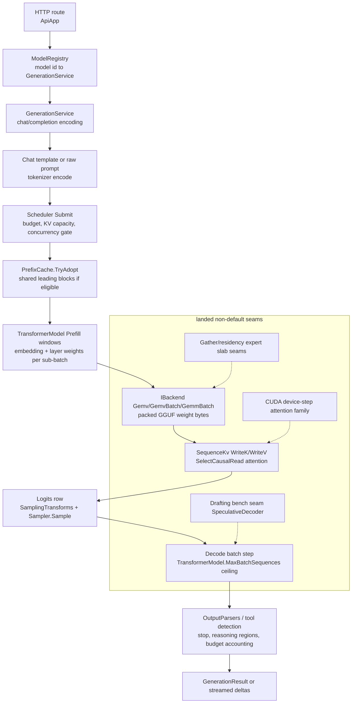

Scope: This page describes the implemented LAIR engine architecture, assembly boundaries, request-to-kernel data flow, backend and storage seams, default posture, landed internal seams, and refusal semantics. As of 2026-11-27 this reflects code under `src/` only; planned behavior is not described as current.

# Engine architecture overview

LAIR's engine separates API admission from continuous-batch generation, model-specific forward math, paged KV storage, backend kernels, and GGUF weight retrieval. A request enters through the HTTP surface, becomes a scheduled pipeline with its own token budget and KV sequence, then advances through `TransformerModel` forwards whose dense weight passes are delegated to an execution backend while attention, normalization, RoPE, logits handling, sampling, parsing, and output accounting stay in engine-owned paths.

The architecture is deliberately split so kernel behavior can be tested independently from HTTP compatibility and scheduling policy:

- API code validates OpenAI-shaped requests and maps them into `GenerationRequest` values.
- Model loading resolves GGUF tensors, model profiles, routes, KV formats, tokenizer/template/tool facts, and sampler budgets once at load time.
- The scheduler owns admission, pipeline state transitions, prefix adoption, chunked prefill selection, decode batching, cancellation, finish reasons, and concurrency accounting.
- `TransformerModel` closes over one execution backend per resolved route position, one KV attention route, and one activation family for the model instance.
- Compute backends execute dense matrix operations against packed GGUF weight bytes without materializing full dequantized models.

## Assembly boundaries

| Assembly | Owns in this build | Representative paths |
|---|---|---|
| `src/Lair.Http` | OpenAI-compatible request surface, model routing through the registry, per-model generation facade, YAML/config records, reload mutation classes, output contracts for text/logprobs/tool calls/reasoning regions. | `ApiApp.cs`, `ModelRegistry.cs`, `GenerationService.cs`, `Config/YamlConfigLoader.cs`, `OutputParsers.cs` |
| `src/Lair.Host` | Process composition root: loads config YAML and starts the model registry/API host. CLI verbs and operator flags are documented in user docs rather than repeated here. | `Program.cs` |
| `src/Lair.Models` | Model profiles, plans, routes, route segments, dedicated prefill-lane layout, forward engine (`TransformerModel`), continuous-batching scheduler, request pipelines, concurrency gates, sampling transforms, and scheduling-side outcome types. | `Engine/TransformerModel.cs`, `Scheduling/GenerationScheduler.cs`, `Scheduling/PipelineConcurrencyGate.cs`, `PrefillLanes.cs` |
| `src/Lair.Kv` | Paged KV pool contracts, block-table sequences, prefix cache sharing, quantized storage writers/readers, and host/device mirror posture vocabulary. | `IKvPool.cs`, `IKvSequence.cs`, `PrefixCache.cs` |
| `src/Lair.Contracts` | Shared compute and weight seams: backend interface, logical tensor table, packed weight references, quant formats, gather/residency contracts, device attention seam types. | `IBackend.cs`, `IWeightSource.cs`, `LogicalTensor.cs`, `IGatherKernel.cs`, `IResidencyTier.cs` |
| `src/Lair.Loader` | GGUF file parsing without materializing all payload bytes, split-shard discovery, mmap-backed default weight source, and logical tensor table construction. | `GgufModelLoader.cs`, `GgufMmapWeightSource.cs` |
| `src/Lair.Backends.Cpu` | CPU dense kernels for GEMV/batched GEMV/GEMM/dequant helpers, persistent worker pool execution, ISA posture resolution, aligned arenas, and internal quantized-KV attention helper seams. | `CpuBackend.cs`, `CpuBackend+KvAttention.cs` |
| `src/Lair.Backends.Cuda` | CUDA compute backend assembly, device-copy weight residency as its own default opened posture, host-mapped alternate residency, KV mirror machinery, and on-device attention step family as internal capability. | `CudaWeightResidency.cs`, `CudaBackend+Attention.cs`, `CudaDeviceStep.cs` |
| `src/Lair.Tokenizer` | Vocabulary/tokenization behavior over GGUF metadata and vocab data consumed through loader contracts. | tokenizer profile files under assembly root |
| `src/Lair.Templating.Minja` | Chat-template rendering used by the generation facade before tokenization for chat requests. | Minja template implementation files |
| `src/Lair.Sampling` | Per-pipeline sampler behavior: candidate filtering, temperature softmax, top-k/top-p ordering, seeded draws, logprob reporting helpers. | `Sampler.cs` |

## Core seams and data types

### Weight retrieval seam

Weight bytes are reached through logical tensor names rather than a monolithic model object:

```csharp
public interface IWeightSource
{
    ReadOnlySpan<byte> Resolve(LogicalTensor tensor);
}
```

Path: `src/Lair.Contracts/IWeightSource.cs`.

`LogicalTensorTable.Find(string name)` resolves tensors by ordinal name, and each resolved tensor carries shape, quant format, offset, and size metadata. The default engine path opens GGUF files through a memory-mapped source (`GgufMmapWeightSource`). For single-file models the file is mapped once; for split GGUF sets discovered from sibling shards in the same directory, each shard is mapped separately rather than assembled into one whole-model buffer.

The important architectural consequence is that kernels receive packed weight bytes directly through `WeightRef`. Dense GEMV paths fuse dequantization during dot products instead of first creating a full FP32 copy of all weights. The blocked matmul path stages dequantized tiles for batch reuse, but it does not replace the whole model with materialized tensors at load time.

### Compute backend seam

`IBackend` owns aligned allocation plus dense matrix kernels:

```csharp
void Gemv(ReadOnlySpan<float> x, WeightRef w, Span<float> output);
void GemvBatch(ReadOnlySpan<float> inputs, int count, WeightRef w, Span<float> outputs);
bool SupportsGemv(QuantFormat format);
void GemmBatch(ReadOnlySpan<float> inputs, int count, WeightRef w, Span<float> outputs);
bool SupportsGemm(QuantFormat format);
void DequantRow(WeightRef w, int row, Span<float> output);
```

Path: `src/Lair.Contracts/IBackend.cs`.

The backend interface also exposes aligned arenas and device KV mirror opening. Its weight-tier contract makes residency explicit: a route segment naming the device-resident tier is answered only by a backend reporting that tier; a host-memory backend answers host-resident segments on whatever device it runs.

CPU kernels are deterministic across thread counts because each row or batch-vector chain computes independently and results are bit-identical to single-row reference paths regardless of worker partitioning. The CPU backend selects an ISA posture at open (`scalar`, AVX2, or AVX-VNNI integer-dot variants when available) and keeps that resolved path fixed for the backend lifetime.

### KV storage seam

KV storage is block-addressed through `IKvSequence`:

```csharp
public interface IKvSequence : IDisposable
{
    int BlockTokens { get; }
    int Length { get; }
    IReadOnlyList<int> Blocks { get; }
    SlotRef Append();
    void MarkAdopted(int physicalBlockId, int startLogicalPos);
    bool IsAdopted(int logicalPos);
    int BlockFor(int logicalPos);
    void WriteK(int logicalPos, int layer, ReadOnlySpan<float> values);
    void WriteV(int logicalPos, int layer, ReadOnlySpan<float> values);
    BlockSelection SelectCausalRead(int queryPosition, int layerWindow);
}
```

Path: `src/Lair.Kv/IKvSequence.cs`.

The sequence table is append-only. A new private block is allocated when appended length crosses the pool's logical block size. Prefix-adoption places shared physical blocks into the same table and marks them read-only; copy-on-write replaces only a shared block when that pipeline needs to write it. Quantized storage writes float values through format-specific writers so attention code can remain generic over `IKvSequence` while quantization happens at the storage seam.

The prefix cache is reference-counted sharing keyed by token prefixes at pool-block granularity. The scheduler adopts eligible prompt blocks before forwarding prefill chunks, and adopted blocks cover leading positions; remaining prompt tokens start after them. Cache eviction never frees blocks still shared by active sequences.

Path: `src/Lair.Kv/PrefixCache.cs`.

### Scheduling seam

The scheduling unit is a pipeline, not an HTTP request or OS thread:

```csharp
internal sealed class RequestPipeline
{
    public ScheduledRequest Request { get; }
    public Sampler Sampler { get; }
    public IKvSequence Kv { get; }
    public PipelineStage Stage { get; private set; } = PipelineStage.Admitted;
}
```

Path: `src/Lair.Models/Scheduling/RequestPipeline.cs`.

Pipelines advance through a one-way control-plane state machine:

| Stage | Meaning in this build |
|---|---|
| `Admitted` | Admission slot and capacity reservation are held, but no engine advancement work has been issued yet. |
| `Prefilling` | The pipeline owns an advancement slot while remaining prompt chunks are forwarded through the step executor. A fully prefix-adopted sequence can skip this stage because it has no remaining prefill chunk to forward. |
| `Transforming` | Prefill logits are transformed and sampled into the first generated token on that pipeline's own logits row. |
| `Decoding` | The pipeline advances one token per shared engine step, sampling from its own logits row. |
| `Finished` | Outcome has been published, KV blocks have been released, and the scheduler drops it from its working set. |

The concurrency gate controls admission slots separately from batch composition:

- A submission while every slot is held is refused naming the model quota when queueing is disabled (`max_queued_requests` absent or `0`).
- A positive `max_queued_requests` value lets submissions wait for a slot, bounded by `queue_timeout_ms`; each woken waiter re-enters admission and can still be rejected after capacity/budget checks.
- Composition deferrals are decided elsewhere: a pipeline kept out of one merged step because of segment batch caps or quota headroom continues holding its admission slot and rides a later boundary.

Paths: `src/Lair.Models/Scheduling/PipelineConcurrencyGate.cs`, `src/Lair.Http/Config/YamlConfigLoader.cs`.

## Request-to-kernel flow

The default served path is CPU-routed today through the public placement vocabulary, while CUDA assemblies and device-step seams exist as internal capability paths. The core request shape remains: HTTP body → model facade encoding → scheduler admission/pipeline state → `TransformerModel` forward windows → backend dense kernels over packed weights → KV sequence writes/attention reads → sampler logits row → output parsing/result accounting.



### Prefill shape

`TransformerModel.Prefill(IReadOnlyList<int> tokens, IKvSequence kv)` forwards prompt windows in sub-batches. The resolved row width comes from the model plan and may be narrowed by declared prefill-buffer ceilings. Each row:

1. seeds its residual stream from that token's embedding row;
2. receives layer-specific norms, RoPE at its absolute position, and causal attention covering only positions up to itself;
3. writes K/V through `IKvSequence` before rows in the same sub-batch attend;
4. leaves final logits for the last row of the window in model-owned storage so sampling after prefill does not need a second forward.

Dense weight matrices across attention and feed-forward layers are traversed once per sub-batch through batched GEMV when `engine.prefill_kernel` resolves to GEMV, or through blocked matmul where selected and supported by the resolved backend. Sub-batch boundaries do not change KV bytes or final logits: the sequence state is what forwarding tokens one at a time would produce.

Path: `src/Lair.Models/Engine/TransformerModel.cs`.

### Decode shape

Decode advances pipelines in shared engine steps up to `TransformerModel.MaxBatchSequences` (16). Each pipeline transforms and samples its own logits row after the batched forward, so merging decode sequences does not alter token-level behavior. Sampling follows candidate filtering first: non-finite or banned tokens are removed, then temperature softmax runs unless greedy mode is selected; top-k cuts survivors before top-p nucleus selection, followed by a seeded draw. Presence/frequency penalties and per-token logit biases mutate only the pipeline's own logits row immediately before sampling.

Paths: `src/Lair.Models/Scheduling/GenerationScheduler.cs`, `src/Lair.Sampling/Sampler.cs`.

## Default posture versus landed internal seams

| Area | Current default served behavior | Landed but non-default or internal seam | Refusal/gate semantics today |
|---|---|---|---|
| Device placement | Served model YAML accepts only `placement.device: auto` or `cpu`, and `auto` resolves to CPU. | CUDA backend assembly exists with device-copy weight residency as its own default opened posture; host-mapped residency is an alternate internal posture. | Config vocabulary rejects non-`cpu` accelerator values for served placement keys in this build. Accelerator routes are not selected through current public YAML keys. |
| KV attention route | Engine closes over one resolved KV attention family per model open: float, Q8/Q8, or Q8/Q4 paths as represented by `_floatAttention`, `_q8q8Attention`, and `_q8q4Attention`. | Quantized device mirror machinery exists in backend/KV code. | Row-tiled prefill is refused for a quantized KV pair because that route carries FP32 attention kernels; the selection path throws rather than silently switching routes. |
| Prefill lane | Shared posture: prompt forwards ride the model's execution backend unless placement declares otherwise. | Dedicated CPU prefill lanes resolve from `placement.prefill_lane: dedicated`; default split gives floor(1/4) of effective worker claim to prefill and leaves remainder for decode, with pinned core partitions when declared. | A half-lane posture fails naming the model, key, and what must change; lane layout is resolved once at load and never re-split live. |
| Weight residency | CPU served models read host-resident weight regions through mmap-backed sources. | CUDA backend can use device-copy or host-mapped residency internally; `DeviceCopy` is documented as every default-opened CudaBackend instance's posture. | Route segments naming the device-resident tier require a backend reporting that tier; otherwise architecture opens refuse rather than run against an unaddressable residency. |
| MoE slab handling | Sparse models have engine-side expert-slab and gather seams available through `IExpertSlabSource`/`IGatherKernel`. | CPU gather kernel exists as internal seam for union active-expert gathering/prefetching; bench paths exercise gathered chains explicitly. | Residency-tier behavior is only active when the opened weight source answers residency queries; default host sources do not expose that posture through public placement keys. |
| Drafting/speculative decoding | Default HTTP generation path samples one token per step and does not advertise speculative drafting as a served request mode in this build. | `SpeculativeDecoder` and draft-head measurement paths exist under bench/host command surfaces. | These are measurement/internal seams, not default OpenAI-facing generation behavior; public config vocabulary does not select them here. |

## Why the engine is shaped this way

### Packed weights stay packed

The loader produces a logical tensor table rather than dequantized tensors. Kernels consume `WeightRef` bytes and fuse quantization into dot products for GEMV paths, or stage tiles once per batched matmul pass when blocked matmul runs. This avoids materializing full FP32 model copies at load time and keeps memory behavior tied to the GGUF file layout actually present on disk.

### Bit-identical batching is a correctness boundary

`Gemv`, `GemvBatch`, and persistent worker partitioning are specified so batched results equal single-vector reference results bit-for-bit regardless of thread count or internal row partitioning. That property matters because scheduler merging, prefill sub-batches, decode windows, lane splits, and hot config changes must not alter token output merely by changing execution shape.

### Scheduling decisions stay separate from kernel composition

Admission answers whether a pipeline exists with capacity reserved. Step composition answers which merged batch that pipeline's math rides in later. A deferred candidate is still admitted; it simply waits for another boundary where segment caps and quota headroom allow its forward to join the step executor. This separation lets HTTP-facing admission refusals remain stable while internal batching choices evolve independently.

## Current refusal semantics

| Situation | Behavior this build enforces |
|---|---|
| Model concurrency is full with `max_queued_requests` absent or `0` | Submission is refused naming the model's quota rather than queued behind work already running. |
| Positive queue posture and timeout expires | Waiting submissions are rejected after their bounded wait; queueing does not reserve capacity for callers that have not acquired an admission slot. |
| Request exceeds resolved token budget window or context limits | Admission-side validation refuses before engine advancement consumes KV blocks or token budgets. |
| Quantized KV pair selected with row-tiled prefill shape | The forward route throws rather than falling back to a different attention family; quantized storage and FP32 tiled kernels are not interchangeable in this build. |
| Route segment names formats its resolved backend cannot execute through GEMV/GEMM capability gates | Model open refuses naming model, format, segment/backend, or missing span capability; no CPU fallback is used for a device-named segment. |
| Dedicated prefill lane posture cannot give both lanes at least one worker | Load-time layout resolution fails naming the served model, `placement.prefill_lane`, and what must change: widen claim, pin enough cores, or run shared. |

## Related engine pages

This page intentionally stays high-level; detailed subsystem behavior lives in sibling engine notes when present:

- scheduling.md
- kv-cache.md
- cpu-kernels.md
- sampling-and-drafting.md
- tokenizer-templating-tools.md
- monitoring-and-metrics.md
