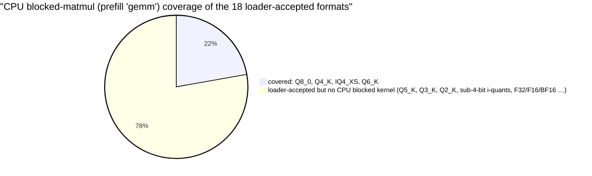
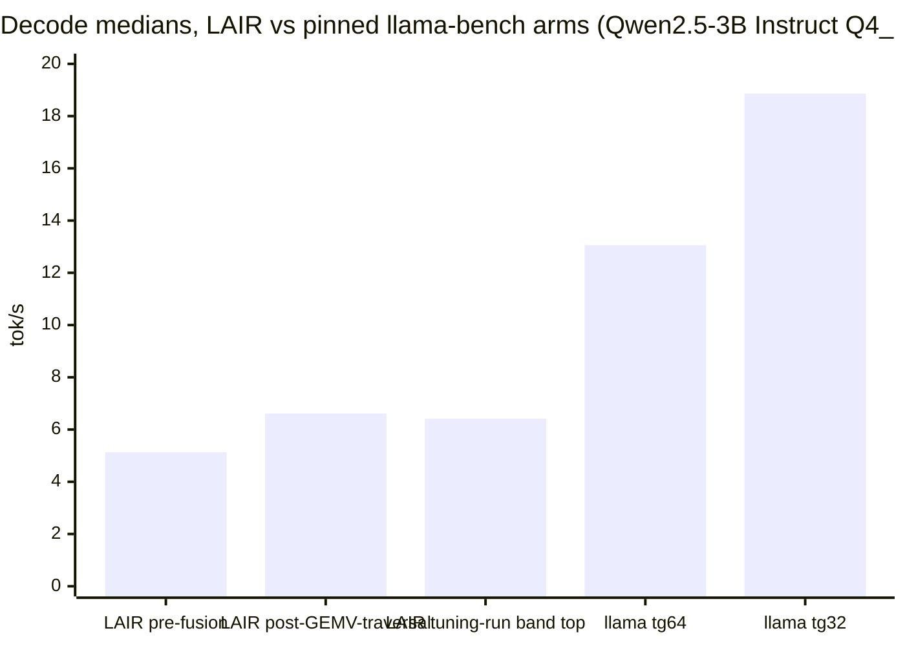
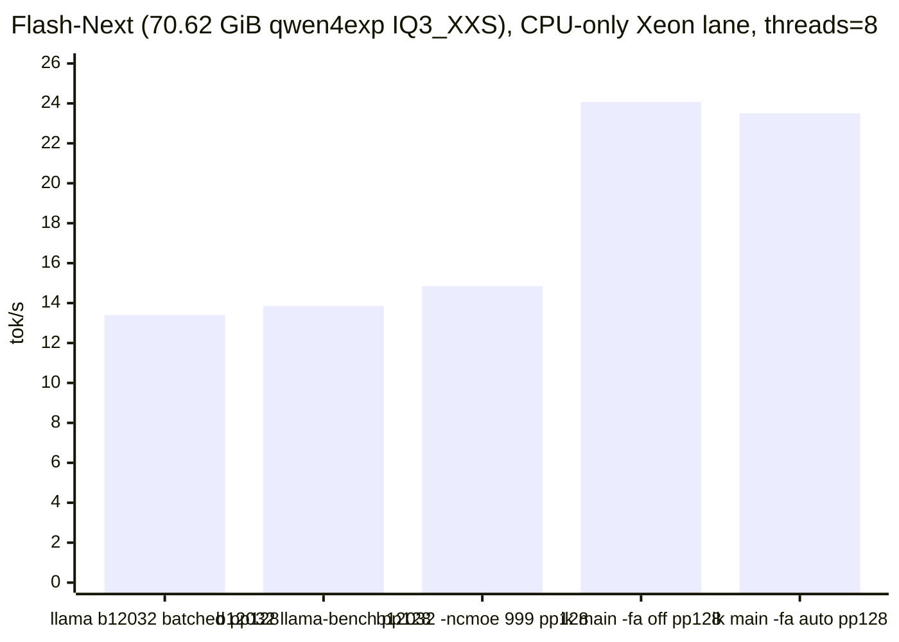
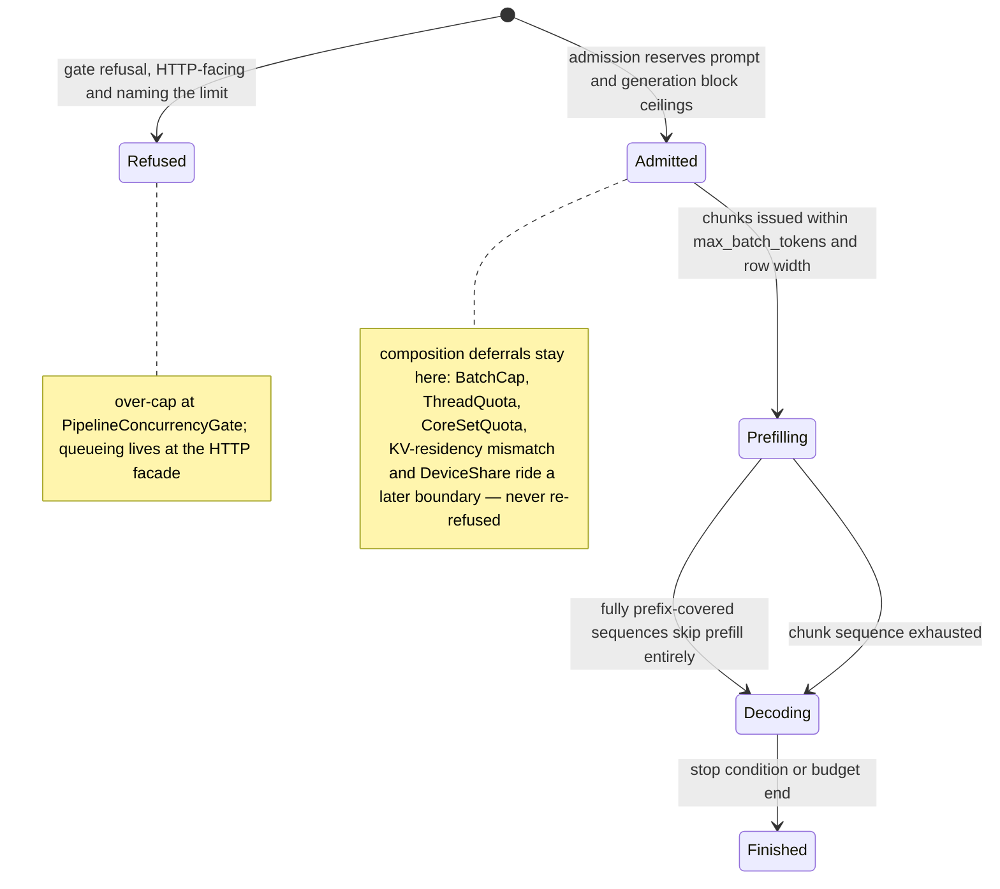
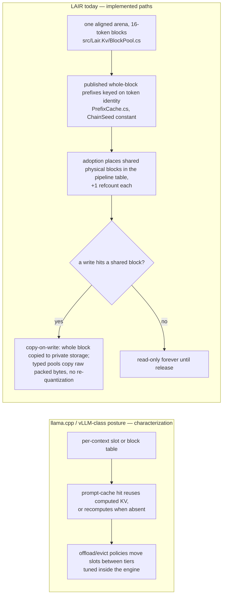
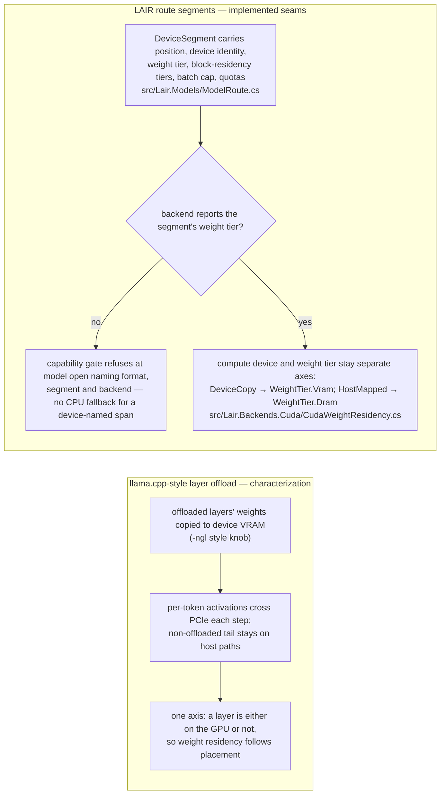

# Engine comparisons: where LAIR's design diverges, and why

Scope: subsystem-by-subsystem comparison of LAIR against llama.cpp / ik_llama.cpp, dotLLM, vLLM, colibri-style local multi-conversation runtimes, and Strata-style hybrid serving — what each does, what LAIR does instead, the measured or architectural reason recorded in this repo, and what those engines still do better today. As of 2026-11-27 (v0.7.x line). Code is authoritative over this page; `AGENTS.md` lists which page each kind of change must update.

**Evidence contract for this page.** Every description of an external engine here is a **design-level characterization** — the well-established public shape of that engine, not a version-specific claim and not a measurement LAIR made of it. The only external-engine numbers quoted anywhere on this page are llama.cpp (and one official `ik_llama.cpp` main) arms recorded in committed artifacts under `bench/reports/` and `reports/`. Everything else numeric is a LAIR-side number from the same artifact class, with its posture stated next to it. Where a statement about another engine is interpretation rather than a documented fact of this repo, it is labeled *characterization* inline or in the adjacent table legend.

Cross-links (this page does not re-explain what those pages own): [architecture.md](architecture.md) for seams, [cpu-kernels.md](cpu-kernels.md) and [quantization.md](quantization.md) for kernel/format facts, [cuda-backend.md](cuda-backend.md) for the device seam, [kv-cache.md](kv-cache.md) for pools and prefix sharing, [scheduling.md](scheduling.md) and [residency-and-budgets.md](residency-and-budgets.md) for step composition and capacity accounting, [model-profiles.md](model-profiles.md) and [tokenizer-templating-tools.md](tokenizer-templating-tools.md) for coverage, [tricks-and-tweaks.md](tricks-and-tweaks.md) for individual techniques with their evidence, [measurement-harnesses.md](measurement-harnesses.md) for how every number here was produced (including the pinned-reference posture).

### Reading conventions used on this page

Each subsystem section follows the same shape: what the other approach does → what LAIR does instead, with code paths → why, using a reason recorded in this repo → what that engine still does better today. Comparison tables are the primary carrier wherever numbers are thin; charts never stand alone (every chart here has an adjacent table carrying posture plus artifact path).

| Pinned external build | Where it appears in committed artifacts | What it is used for |
|---|---|---|
| llama.cpp **b12032** (`tools/llama.cpp/b12032/`, asset `llama-b12032-bin-win-cpu-x64.zip`) | golden fixtures and most throughput arms: `bench/reports/kv-cache-type-parity-2026-11-18.md`, `bench/reports/q4-k-viability-2026-11-17.md`, `bench/reports/flash-next-reality-check-2026-11-21.md`, `reports/2026-11-26T08-46-39Z-optimize-prefill-vs-llama-xeon-t8/` | cross-tool quality bands (server mode, because server and CLI greedy runs disagree on identical prompts) and the CPU throughput ladder |
| llama.cpp **b12359** (`llama-b12359-bin-win-cpu-x64`) | `reports/2026-11-24T21-45-49Z-optimize-small-model-cpu-thread-sweep/summary.md` only | thread-scaling arms on the local host — a *different* build from b12032, flagged wherever its numbers are quoted |
| official **ik_llama.cpp** main `7c00f87…` (built from source) | `bench/reports/flash-next-reality-check-2026-11-21.md`, machine data in `reports/2026-11-21T07-04-13Z/` | the MoE CPU bar LAIR's gather/residency work must clear; a pinned older ik commit and two unofficial prebuilts were rejected on crash/symbol grounds recorded in that report |

Two committed measurement caveats apply to every number below: the documented inter-process noise band on this repo's standard hosts is ±10–35%, so single samples inside it are not claims, and cross-host-session deltas are labeled directional reference only — never results ([measurement-harnesses.md](measurement-harnesses.md)).

---

## 1. Weight handling: ggml containers + fused dequant vs a read-side weight seam

| | llama.cpp / ik_llama.cpp (*characterization*) | dotLLM-class native C# engines (*characterization*) | LAIR today |
|---|---|---|---|
| Container view | `ggml` tensor containers materialized as graph operands; ggml owns type metadata, block geometry, and per-device copy decisions. | Model weights loaded/converted into engine-owned tensors (often FP16 or a native quant form). | GGUF parsed **without materializing payload bytes**: a logical tensor table only (`src/Lair.Loader/GgufModelLoader.cs`, `src/Lair.Contracts/LogicalTensor.cs`). |
| How kernels see weights | Fused dequant inside ggml's own dot kernels; some ops stage dequantized rows when the graph demands it. | Native kernels over their own representation. | Kernels receive **packed bytes through `WeightRef`** (`src/Lair.Contracts/IBackend.cs`, `src/Lair.Contracts/WeightRef.cs`) resolved from a mmap span (`src/Lair.Loader/GgufMmapWeightSource.cs`). No whole-model copy, no load-time dequantization. |
| Whole-model transformation step | None for the fused paths; quant→device conversions happen per tensor when offloading layers. | Usually yes (conversion/normalization at load). | **None.** Blocked matmul stages tiles once per batch pass (`src/Lair.Backends.Cpu/CpuBackend+Gemm.cs`); nothing else rewrites bytes. |
| Split/sharded files | Shard-aware loading with its own assembly rules (*characterization*). | n/a generally | Each physical shard mapped separately, disjoint tensor subsets assembled into one table; a missing shard refuses naming it (`src/Lair.Loader/GgufModelLoader.cs`). |

**Why LAIR keeps weights packed.** The read-side seam is what makes the memory posture honest: DRAM occupancy follows pages actually touched rather than file size claimed up front ([tricks-and-tweaks.md](tricks-and-tweaks.md) entry 1), and peak-working-set numbers in committed reports are per-process facts, not estimates — `1430.9 MB` (Q4_K_M), `1344.2 MB` (IQ4_XS), `1222.0 MB` (mixed-tier UD file) under a declared 4 GB ceiling (`bench/reports/sub4bit-cost-repin-2026-11-17.md`, posture: serving with `models[].placement.thread_quota: 8`, engine `threads: 0`, one server at a time).

The seam is small and literal, which is the point — nothing in it can be asked to transform bytes:

```csharp
public interface IWeightSource
{
    ReadOnlySpan<byte> Resolve(LogicalTensor tensor);   // src/Lair.Contracts/IWeightSource.cs
}

void Gemv(ReadOnlySpan<float> x, WeightRef w, Span<float> output);
bool SupportsGemv(QuantFormat format);                  // src/Lair.Contracts/IBackend.cs
```

Two consequences of that shape show up in comparisons. Row dequantization stays host-side even on the device seam (`DequantRow` and its per-format twins are plain host code used for embedding rows and norm vectors — `src/Lair.Backends.Cuda/CudaBackend.cs`), so a "dequantize then compute" design is not expressible here at all. And weight residency is expressed as *copying or mapping whole tensors*, never as conversion: the CUDA posture caches one upload per tensor (`DeviceCopy`) or registers the live host region and launches against it (`HostMapped`, zero persistent device bytes) — see §6 and [cuda-backend.md](cuda-backend.md).

**Consequence for byte-reduction experiments.** Because nothing is transformed on the way in, a smaller file buys residency only — kernel cost has to be paid again per token, and that cost is measured rather than inferred. The same artifact records resident single-thread GEMV costs against the pinned `Q4_K_M` baseline (`0.164 ns/elt`, `335.8 ns/GEMV`):

| Format inside `models/Llama-3.2-1B-Instruct-UD-IQ3_XXS.gguf` | Settled per-element cost | vs Q4_K baseline |
|---|---:|---:|
| `IQ2_S` | ≈0.247–0.270 ns/elt (settled / summary) | ≈1.50–1.65× |
| `IQ2_XS` | 0.320 ns/elt (`655.3 ns/GEMV`) | ≈1.95× |
| `IQ3_S` | 0.338 ns/elt (`692.1 ns/GEMV`) | ≈2.06–2.07× |
| `IQ3_XXS` | 0.383 ns/elt (`783.9 ns/GEMV`) | ≈2.32–2.35× — recorded as **exceeding** the intended ≤≈2× band rather than smoothed into it |

That is LAIR's own integer-dot path recovering most of a penalty an earlier staging implementation measured at roughly 6.5× dense cost; the re-pin report explicitly retires the old figure instead of carrying it forward (`bench/reports/sub4bit-cost-repin-2026-11-17.md`, [tricks-and-tweaks.md](tricks-and-tweaks.md) entry 3). ggml-family engines get the same class of benefit from their fused dequant kernels (*characterization*); LAIR's difference is that the fusion sits behind a storage seam (`IWeightSource` → `WeightRef`) rather than inside a graph library, which is what lets an alternate weight provider — arena-copied or residency-tiered — be swapped in without touching kernel bodies (seam contract documented in [architecture.md](architecture.md)).

**What the other side does better today.** ggml's container-plus-graph model gives those engines per-device tensor placement and a much wider set of graph-level fusions LAIR does not express at all. LAIR's seam is narrower by design: it answers "where do these bytes live" and nothing about how an op graph gets built.

---

## 2. CPU kernels: engine maturity vs managed-first intrinsics

| Axis | llama.cpp / ik_llama.cpp (*characterization*) | LAIR today (code gate) |
|---|---|---|
| Kernel breadth per format | A mature family per quant type across ISA generations, including formats with no LAIR kernel (`Q4_0`, `IQ1_*`, `TQ*`, `MXFP4`/`NVFP4` are refused at load — `src/Lair.Loader/GgmlTypeRegistry.cs`). | 18 accepted formats all answer GEMV: `SupportsGemv(QuantFormat) => true` (`src/Lair.Backends.Cpu/CpuBackend.cs`). |
| Blocked matmul (prefill `gemm`) coverage | Broad blocked/tiled kernels for most quant families (*characterization*). | **Only four formats.** `SupportsGemm` answers true solely for `Q8_0`, `Q4_K`, `IQ4_XS`, `Q6_K` (`src/Lair.Backends.Cpu/CpuBackend+Gemm.cs`). A prompt-window span whose dense matrices include anything else refuses at model open naming segment, backend and missing formats — no fallback ([cpu-kernels.md](cpu-kernels.md)). |
| Sub-4-bit i-quants | Integer-dot against `Q8_K` activation in the ik lineage (*characterization*); mainline runs float-ish dequant paths. | Five formats (`IQ2_XXS`, `IQ2_XS`, `IQ2_S`, `IQ3_XXS`, `IQ3_S`) quantize the activation once per call into Q8_K blocks and dot in integer lanes (`src/Lair.Backends.Cpu/CpuBackend+Q8K.cs`). |
| Integer-dot ISA choice | Runtime dispatch across a wide ISA ladder, including AVX-512-family variants on hosts that have them (*characterization*). | Two encodings plus an oracle: `pmaddubsw`/`pmaddwd` (AVX2) or `vpdpbusd` accumulating straight into int32 lanes (AVX-VNNI), selected once per backend open by capability probe; a forced value that the host cannot run fails naming the missing feature (`src/Lair.Backends.Cpu/CpuIsa.cs`). |
| Determinism contract | Reassociation across kernels is tolerated within accuracy expectations (*characterization*). | Every executor variant keeps the format's own ascending chunk walk, operand association and scalar tail: batched equals solo equals 1-thread equals N-thread **bit-for-bit** ([tricks-and-tweaks.md](tricks-and-tweaks.md) entry 8). This is what makes golden parity against pinned llama.cpp b12032 a usable gate. |
| Register-pressure strategy | Hand-written kernels sized per ISA, often with inline assembly/`__builtin_ia32_*`. | Managed intrinsics plus explicit tuning derived from worker count: `RowBlock = clamp(512 / workers, 8, 64)`, chain group width 8 under a vector posture ("eight `Vector256` chains plus one weight chunk fit AVX2's sixteen YMM registers"), scratch ceiling 16384 floats (`src/Lair.Backends.Cpu/CpuKernelTuning.cs`). |

**What the blocked-matmul gate costs in prefill.** The committed proof is a refusal, not an estimate: `models/Llama-3.2-1B-Instruct-IQ4_XS.gguf` runs `gemv` and `tiled`, but refuses `gemm` because architecture `'llama'` carries dense weight matrices of format(s) `Q5_K` (`bench/reports/kernel-comparison-2026-11-14.md`, raw evidence `prefill-kernel-llama-iq4x-mixed.txt`). On formats the gate *does* cover, blocked matmul measurably lowers weight traversal cost — Llama Q8_0: `gemv 439.52 ms/traversal` (implied `2.35 GB/s`) → `gemm 348.67 ms/traversal` (`2.97 GB/s`); Qwen3-0.6B Q8_0: `gemv 243.46` (`1.92 GB/s`) → `gemm 38.33` (`12.21 GB/s`) — while its attention coefficient barely moves, so the win is shape-dependent rather than universal (same artifact). For MoE-shaped and mixed-tier files LAIR's default prefill posture therefore stays on batched-row GEMV traversal: `Q5_K`, all K-quants except Q4/Q6-K coverage, and every sub-4-bit format have no CPU blocked-matmul kernel at all.



Adjacent authoritative table — counts read off `src/Lair.Backends.Cpu/CpuBackend+Gemm.cs` and the coverage matrix in [quantization.md](quantization.md) (a capability inventory, not a measurement):

| Backend | Blocked-matmul formats | Formats refused for that posture |
|---|---:|---|
| CPU (`CpuBackend+Gemm.cs`) | 4 of 18 accepted (`Q8_0`, `Q4_K`, `IQ4_XS`, `Q6_K`) | every other accepted format, including `Q5_K` and the five Q8_K i-quants |
| CUDA windowed (`src/Lair.Backends.Cuda/CudaBackend+Gemm.cs`) | 13 of 18 — everything except the five Q8_K i-quants | `IQ2_XXS`, `IQ2_XS`, `IQ2_S`, `IQ3_XXS`, `IQ3_S` only |

**Coverage is not the same as payoff, and one committed run says so.** On the Xeon serving lane, selecting blocked matmul for a Q4_K_M file made prefill *slower*: total_ms medians `gemv 10242.9` / `tiled 10328.7` / **`gemm 18699.1`** at length 128, and `gemv 23876.5` / **`tiled 23050.8`** / **`gemm 38520.4`** at length 256; the regression lives in the dense stages themselves — gate/up moves from 4187.5 (gemv) to 10936.2 ms under gemm at length 128, and from 9739.0 to **22347.2** ms at length 256 (`reports/2026-11-26T09-21-47Z-optimize-prefill-stage-profile-xeon-t8/summary.md`, posture: Xeon lane `lair-lab` root@192.168.33.53, threads=8, rowWidth=64, parsed from three completed raw `--reps 1 --stage-profile` logs). That is why the promoted CPU default stays batched-row traversal (`engine.prefill_kernel` defaults to `gemv`) even where a blocked kernel exists.

Where a blocked route *did* separate, it was recorded as substage evidence rather than a headline: Q6_K hybrid tile width 8 beat the off arm at every shape in alternating same-session rounds — `feed_forward_down_ms` medians **373.1 → 334.9** (gemv@128), **734.0 → 672.7** (gemv@256), **387.6 → 344.2** (tiled@128), **774.6 → 681.1** (tiled@256) — while window totals moved only −2.4…−3.2% and window throughput was noise-indeterminate at medians (`reports/2026-11-25T16-11-55Z-optimize-prefill-q6k-gemm/summary.md`; posture: `qwen2.5-3b-instruct-q4_k_m.gguf`, 2,104,932,768 bytes, local CPU lane threads=32 rowWidth=64; documented inter-process band ±10–35%, calibrated ~±5% between behaviorally identical arms).

| Step-shape axis | llama.cpp / ik_llama.cpp (*characterization*) | LAIR today (with committed evidence) |
|---|---|---|
| Shared-operand dot batching | Graph fusion plus per-kernel vector widths chosen inside each kernel. | `SharedInputDotChainGroup` = 8 under a vector posture; width-8 arms beat individual dots at every measured shape (`attention_kernel_ms` gemv@128 **107.27** auto vs **120.78** off, pinned 4 at 108.35, pinned 8 at 106.97 — `reports/2026-11-26T03-12-26Z-optimize-prefill-chain-group-widths/summary.md`, threads=32 rowWidth=64). The sweep exists precisely because narrower pins are *not* uniformly better |
| QKV / gate-up fusion | Fused graph nodes built by the op-graph builder. | Optional contracts resolved per call: triple for attention Q/K/V, pair for dense gate/up (`src/Lair.Contracts/IDenseWeightTripleFusion.cs`, `IDenseWeightPairFusion.cs`, `IDenseWeightSharedInputFusion.cs`), each byte-identical to independent calls; handing fused pairs to the tile executor resolves to 0 — unpromoted ([tricks-and-tweaks.md](tricks-and-tweaks.md) entry 6) |
| Prefill weight-pass selection | Chosen by graph construction plus device kernels. | Three selectable shapes (`gemv`, `tiled`, `gemm`) behind per-span capability gates, with fitted cost models recorded in `bench/reports/kernel-comparison-2026-11-14.md`: Llama Q8_0 attention coefficient falls from 32.491 to 24.202 µs/position pair under `tiled`, and that lower quadratic term is what makes it fastest at length 2048 (512 / 1024 / 2048 tok/s = 45.43 / 34.34 / **24.25**, versus gemv's 44.93 / 32.99 / 21.26); fitted crossovers `gemm ≥ length 669`, `gemv ≥ 855`, `tiled ≥ 1368` on that fixture |
| Worker participation model | Threads per op inside the engine's own threading (*characterization*). | Physical-core detection with SMT siblings excluded by default, row-block partitioning `clamp(512 / workers, 8, 64)`, dispatch threshold `max(rowBlock × workers / 2, 2 × rowBlock)` (`src/Lair.Backends.Cpu/CpuBackend.cs`, `ThreadAffinity.cs`, `CpuKernelTuning.cs`) |

### Pinned-tag mechanism ledger (llama.cpp b12032, as measured)

The comparison binary on the Xeon lane is prebuilt **b12032**, so mechanism claims read from `git show b12032:ggml/src/ggml-cpu/...` — never from a newer llama working tree. As of 2026-11-28, verified against the pinned tag and this repo's committed seam runs:

| Mechanism | llama.cpp at b12032 (tag source) | LAIR today (code + measured posture) |
|---|---|---|
| AVX2 Q4_K×Q8_K dot inner loop | Integer MACs throughout: AND/SRL nibble unpack, `_mm256_maddubs_epi16` × 2 then `_mm256_madd_epi16(scale_l/h, p16)` per 32-byte pair accumulating int32 `sumi`, with exactly one float FMA per 64 elements at block end; the min/dmin term rides precomputed `bsums` through `_mm_madd_epi16` (`arch/x86/quants.c:2173-2195`, `:2163-2166`) | Converts the chunk to float and FMAs per 8 lanes, storing chain accumulators (`src/Lair.Backends.Cpu/CpuBackend+Q4_K.cs:101`, `:232`), while batched passes reload activation vectors from memory inside the weight-row loop (`CpuBackend.cs:169`). Seam measurement posture (same kernels, threads=8, counts 8–64): local lane **weight_gbs 9.067 / gflops 257.9** vs ≤1.3 implied GB/s on `lair-lab` — a target-host uop/clock deficit, not generic kernel quality (`reports/2026-11-27T13-52-31Z-optimize-q4k-widebatch-local`, `reports/2026-11-27T14-14-58Z-optimize-q4k-widebatch-xeon-pinning`) |
| Integer-dot ISA machinery | dpbusd only under AVX512VNNI/AVX-VNNI guards (`arch/x86/quants.c:106-113`, `repack.cpp:151-155`); Broadwell-class hosts fall back to maddubs/madd paths | **Already exists for the Q8_K i-quants**: `pmaddubsw`/`pmaddwd` (AVX2) or vpdpbusd (AVX-VNNI), chosen once per backend open by capability probe (`src/Lair.Backends.Cpu/CpuIsa.cs`, `CpuBackend+Q8K.cs`). The Q4_K dense dot is the format where that integer lane machinery is *not* yet used — candidate work extends an existing seam rather than inventing a kernel family |
| Weight repacking / tiled kernels | Ships `ggml/src/ggml-cpu/repack.cpp` and `tiled/tiled-kernel.cpp`, but x86 variants lean AVX512F/VNNI, so this host does not take them; the memory cost is unconditional where used | No repacked copies today; LAIR's ledgers and tier budgets (`residency-and-budgets.md`) can gate a repacked int8/int16 copy by cap with explicit refusal semantics — speed bought only where budget allows (open candidate, unmeasured) |
| Activation amortization across batched rows | `vec_dot` consumes one row against one quantized activation per call; batching rides graph construction | Shared-input chain groups (auto 8) and a tile executor exist (`CpuKernelTuning.cs`), but measured effective rows-per-traversal plateaus ~5–6 at threads=8 despite rowWidth 64 (`reports/2026-11-27T10-05-02Z-optimize-prefill-rowwidth-xeon`) — the amortization LAIR is built for is not yet realized on this host |

**Worker-placement accuracy amendment.** The participation-model row above predates `1dcb354 feat(cpu)`: physical-core detection and core-set application now exist on Linux too (sysfs sibling groups, allowed-mask confinement, node-local selection — [residency-and-budgets.md](residency-and-budgets.md)). Its first host validation separated nothing (`gemv +3.07%` / `tiled −2.07%` inside ±12–29% bands, `reports/2026-11-27T23-07-15Z-optimize-affinity-selfplacement-xeon-t8`, alternating-build harness `scripts/run-xeon-alternating-build-ab.py`, threads=8 length 256): worker-thread-only affinity does not reproduce the whole-process `taskset -c 0-15` posture measured earlier, so placement is documented as landed behavior without a throughput claim.

**What remains better on the other side today.** Kernel maturity, not architecture: llama.cpp/ik_llama.cpp have tuned kernels for formats LAIR cannot execute with blocked matmul (and mainline has formats LAIR refuses to load at all), broader ISA ladders including AVX-512-family variants, and years of per-host tuning in each kernel. LAIR's managed-first posture pays a real cost there — see §3 for the size of it on this repo's own fixtures.

---

## 3. Measured performance posture (committed arms only)

These are the committed llama.cpp arms against LAIR on the same host and model, with each artifact's own posture quoted. Read them as a ladder being closed stage by stage: **LAIR is behind on every CPU fixture recorded in this repo.**

### 3a. Decode (single-token generation), Qwen2.5-3B Instruct `Q4_K_M`

| Artifact | LAIR arm (median tok/s) | llama.cpp arm, same host/session | Posture as stated by the artifact |
|---|---|---|---|
| `reports/2026-11-25T01-23-00Z-optimize-dense-cpu-traversal/summary.md` (`rerun-llama-bench-t32.txt`) | production decode medians **5.299** (spread 1.50%) and **5.668** (13.07%); batched prefill `gemv 66.00 / 47.15` tok/s at lengths 128/256 | **pp128 265.35 ± 6.62**, pp256 164.06 ± 112.40, **tg32 13.79 ± 1.14**, tg64 11.22 ± 4.15 | local CPU lane `threads=32`, model file `qwen2.5-3b-instruct-q4_k_m.gguf`; the first llama run was noisy so a rerun is the paired reference; "production decode parity is not solved by this commit" |
| `reports/2026-11-25T04-40-00Z-optimize-dense-decode-gemv-traversal/summary.md` (`lair-decode-before/after-*.txt`, `llama-bench-tg32.txt`, `llama-bench-tg64.txt`) | before **5.127 / 5.052**; after single-vector shared-input fusion + row-block 16: **6.608 / 6.384 / 6.820** (≈+27%) | `llama-bench -t 32` → **tg32 18.86 ± 2.48**, tg64 **13.06 ± 3.79** | same host, threads 32; no CUDA category run; the report attributes the remaining gap to the attention stage (~24 ms/token), engine overhead, and Q6_K traversal (`~15 GB/s` vs `~22 GB/s` for Q4_K) — not dispatch structure |
| `reports/2026-11-25T06-56-44Z-optimize-cpu-tuning-decode-gemm/summary.md` | worker reps **5.929 / 6.075 / 5.863**; main validation **5.870 / 5.908 / 6.163**; extra single runs **6.419 / 5.726**; threads-16 posture **5.553** | carried forward unchanged: tg32 **18.86 ± 2.48**, tg64 **13.06 ± 3.79** ("not re-run in this session") | same host/model, ISA resolved `vnni`; the artifact's own honesty note says the lower medians are load/noise, not a posture regression — resolved tuning is byte-identical to the staged candidate at that worker count |
| `reports/2026-11-24T21-45-49Z-optimize-small-model-cpu-thread-sweep/summary.md` (`lair-kv-quant-baseline-t*.txt`) | decode medians **5.947** (t8) → **6.796** (t16) → **7.029** (t32) | `llama-bench` from **b12359** (`llama-b12359-bin-win-cpu-x64`): pp128 185.31 ± 6.84 / 252.71 ± 9.36 / 279.94 ± 2.69; tg32 **21.08 ± 0.31** / 22.72 ± 0.15 / **19.27 ± 0.10** | local i9-13900K-class Windows host, threads swept 8/16/32. Note the tool pin: this arm is a *different* llama.cpp build (b12359) than the b12032 reference used by parity fixtures and most other arms |



Chart is a supplement; the tables above are authoritative for these numbers (posture: `qwen2.5-3b-instruct-q4_k_m.gguf`, local CPU lane, threads 32 except where noted, tool `bench/Lair.Bench kv-quant --threads 32 --context 256 --decode 64 --windows 4` vs pinned `llama-bench -t 32`). The honest reading: on this fixture LAIR decodes at roughly **one third** of the recorded llama.cpp tg rate, and the committed reports say so rather than hedging.

### 3b. Prefill (prompt processing)

| Artifact | LAIR arm | llama.cpp arm | Posture as stated |
|---|---|---|---|
| `reports/2026-11-26T08-46-39Z-optimize-prefill-vs-llama-xeon-t8/summary.md` (+ `data.json`) | gemv@128 median **12.820** (samples 12.820 / 11.870 / 13.380); tiled@128 **12.440**; gemv@256 **10.560**; tiled@256 **12.000** | b12032 `pp128` median **70.890**, `pp256` median **72.730** — LAIR's share of the reference is **18.08% / 17.55%** (length 128) and **14.52% / 16.50%** (length 256) | Xeon CPU-only lane `lair-lab` (`root@192.168.33.53`, E5-2683 v4 class, AVX2 only), threads=8, rowWidth=64, model bytes `2104932768`, alternating same-session rounds with `reps=1` per command; the report's own verdict: "LAIR's current optimized CPU prefill posture is still below the same-host llama.cpp pp band" |
| `reports/2026-11-24T21-45-49Z-optimize-small-model-cpu-thread-sweep/summary.md` (`prefill-best-config.txt`) | stable confirmation at best-looking posture: gemv w64 **25.31 / 22.76** tok/s (lengths 128/256), weight fit ≈2244 ms/traversal ≈0.74 GB/s; sweep peaks `23–29` | pp128 **185.31 → 279.94** across threads 8→32 (b12359) | same local i9-class host, LAIR at ~6× fewer tok/s than the reference on this fixture; "thread tuning alone is not parity" |
| `reports/2026-11-25T01-23-00Z-optimize-dense-cpu-traversal/summary.md` (`lair-prefill-unprofiled.txt`) | gemv **66.00 / 47.15** tok/s, weight fit `579.08 ms/traversal` = **2.88 GB/s** (from a committed baseline of ≈0.74 GB/s) | pp128 **265.35 ± 6.62**, pp256 164.06 ± 112.40 | same local host, threads=32; the artifact records "roughly 2.5–3× versus the committed baseline … not yet llama.cpp parity" |
| `bench/reports/prefill-profile-2026-11-12.md` (via [measurement-harnesses.md](measurement-harnesses.md)) | batched route **15.40 / 10.89** tok/s on a 1751-token greedy prompt (`models/Llama-3.2-1B-Instruct-IQ4_XS.gguf`, `--threads 8`) | pinned b12032 `llama-server` on the same file/prompt: **464.05** and **412.76 tok/s** prompt eval | that artifact is where this repo records *why* prefill was behind: fitted weight term vs attention term, with attention co-dominant at long prompts |

### 3c. Distance summary, per fixture

| Fixture / posture | LAIR median | Reference arm | Gap as recorded in the artifact | Artifact |
|---|---:|---:|---|---|
| Qwen2.5-3B `Q4_K_M` decode, local host threads=32 | 6.16–6.82 (best committed postures) | tg32 **18.86 ± 2.48** | ≈⅓ of the reference; gap attributed to attention stage + Q6_K traversal, not dispatch structure | `reports/2026-11-25T04-40-00Z-optimize-dense-decode-gemv-traversal/`, `reports/2026-11-25T06-56-44Z-optimize-cpu-tuning-decode-gemm/` |
| Qwen2.5-3B `Q4_K_M` decode, local host threads=8→32 sweep | 5.947 → **7.029** | tg32 **21.08 ± 0.31** (b12359) | ≈⅓ again; "not parity yet" stated in the artifact itself | `reports/2026-11-24T21-45-49Z-optimize-small-model-cpu-thread-sweep/` |
| Qwen2.5-3B prefill, Xeon lane threads=8 rowWidth=64 | gemv **12.820** @128 / tiled **12.000** @256 | pp128 **70.890**, pp256 **72.730** | LAIR holds **14.5–18.1%** of the reference band | `reports/2026-11-26T08-46-39Z-optimize-prefill-vs-llama-xeon-t8/` |
| Qwen2.5-3B prefill, local host threads=32 rowWidth=64 | gemv **66.00** @128 / 47.15 @256 (weight pass ≈2.88 GB/s) | pp128 **265.35 ± 6.62** | ≈¼ of the reference after a 2.5–3× local improvement; parity explicitly not claimed | `reports/2026-11-25T01-23-00Z-optimize-dense-cpu-traversal/` |
| Llama-3.2-1B `IQ4_XS`, 1751-token prompt, threads=8 | batched route **15.40 / 10.89** | pinned b12032 server prompt-eval **464.05 / 412.76** | recorded as the artifact that identified attention (not weight reads) as co-dominant cost | `bench/reports/prefill-profile-2026-11-12.md` |
| Flash-Next `IQ3_XXS`, Xeon lane threads=8 | **no LAIR arm recorded** | mainline pp128 13.40–14.85 / tg256 3.18–3.33; ik main pp128 23.50–24.07 / tg256 4.31–4.33 | target only — no comparison may be drawn from this artifact | `bench/reports/flash-next-reality-check-2026-11-21.md` |

Optimizations tried and **not promoted**, recorded as decisions rather than left implicit:
- `MatmulRouteBatchWidthQ4K` — a Q4_K single-matrix tile route exists as an internal pin only and resolves to 0. The recorded decision ([tricks-and-tweaks.md](tricks-and-tweaks.md) entry 7) is that **no candidate arm separates on total_ms at any shape**: the committed interleaved repair run `reports/2026-11-27T03-09-24Z-optimize-prefill-q4k-route-repair-xeon-t8/summary.md` (Xeon lane, threads=8, row width 64, 2 warmup rounds then 5 interleaved measured rounds) records pooled intra-arm `total_ms` spreads of 25.53% / 34.20% / 26.04% and fails to separate on all eight readings — gemv@256 width 16 −7.06% against its own ±8.54% band, tiled@128 width 8 +13.60% against ±18.54%. Stage-level medians do move in the expected direction (gemv@256 `attention_weight` 3,659.7 → 3,168.7 → 3,015.5 ms across arms off/on/16), but that run computes noise bands over `total_ms` only, so stage movement is not evidence of a win.
- Fused-pair handoff to the tile executor (`PairMatmulRouteBatchWidth`) resolves to 0: "no posture promotes it" until a target-host measurement separates the two routes for pairs (same page, entry 6).
- Thread/row-width tuning as a parity strategy — explicitly rejected by `reports/2026-11-24T21-45-49Z-optimize-small-model-cpu-thread-sweep/summary.md` in favor of kernel-level traversal work.

### 3d. MoE reality check (the bar LAIR's gather/residency work has to clear)



| Harness | Config | pp128 tok/s | tg256 tok/s |
|---|---|---:|---:|
| llama.cpp b12032 `llama-batched-bench` | `-fa off` | 13.40 | 3.18 |
| llama.cpp b12032 `llama-bench` | default | 13.86 | 3.33 |
| llama.cpp b12032 `llama-bench` | `-ncmoe 999` | 14.85 | 3.27 |
| official ik_llama.cpp main (`7c00f87`) `llama-bench` | `-fa off` | 24.07 | 4.31 |
| official ik_llama.cpp main `llama-bench` | `-fa auto` | 23.50 | 4.33 |

Posture (`bench/reports/flash-next-reality-check-2026-11-21.md`, machine data in `reports/2026-11-21T07-04-13Z/`): Xeon E5-2683 v4, 64 logical cores, ~252 GiB RAM, AVX2 only; pinned model assembled from two shards (`Qwen3.8-Flash-Next-GSQ-RCO-IQ3_XXS`, qwen4exp, `3.0625 bpw`, `70.62 GiB`, `176.94 B` params); geometry recorded as 48 layers / 512 experts / 10 active → ≈**993 MB/token** of active MoE FFN weight traffic, i.e. derived decode bandwidth ≈3.16–3.31 GB/s (mainline) vs ≈4.28–4.30 GB/s (ik main). The report's verdict: the ik advantage over mainline (~1.7× prefill, ~1.3× decode) is attributable to its MoE-specific CPU optimizations — only-active-expert scheduling and fused MoE — "This sets the bar LAIR's gather/residency work must meet or beat on this Xeon." **No LAIR arm was measured on that model in this artifact**, so no comparison of LAIR against those numbers may be drawn from it; what it establishes is a target, not a standing. The report also records harness failures honestly (official pinned ik commit SIGSEGV/SIGFPE; unofficial prebuilts with an undefined symbol; official main `llama-cli` emitting EOS after one token).

---

## 4. Scheduling and batching: slot-based continuous batching vs pipeline + arbiter

| Axis | llama.cpp / ik_llama.cpp (*characterization*) | vLLM-class packed continuous batching (*characterization*) | LAIR today |
|---|---|---|---|
| Unit of scheduling | Slots in a `llama_slot`-style pool; batch composed per decode step over occupied slots. | Packed token batches across requests, with chunked prefill and priority/queue policies. | **Pipeline** (`src/Lair.Models/Scheduling/RequestPipeline.cs`) advancing through a one-way control plane: `Admitted → Prefilling → Transforming → Decoding → Finished` ([scheduling.md](scheduling.md)). Admission answers "does this pipeline exist"; step composition answers which merged batch its math rides. |
| Merge identity | Slot occupancy plus model/context equality. | Request residency in a block table; per-request sampling state kept separate. | Strict: same resolved `ModelPlan` **instance** over its whole ordered route, KV addressable by the stepping segment, inside that segment's batch cap, with quota headroom for what already joined (`src/Lair.Models/Scheduling/StepCompositionArbiter.cs`). Two field-for-field identical plans remain separate steps. |
| Deferral vs refusal | Slot exhaustion shows up as slot allocation failure or queueing in front-end tooling (*characterization*). | Preemption/recompute policies inside the scheduler. | Composition deferrals are **not** refusals: a candidate kept out by `BatchCap`, `ThreadQuota`, `CoreSetQuota`, KV-residency mismatch, route shape, or device fair-share keeps its admission slot and capacity reservation and rides a later boundary; each deferral names which limit blocked it. |
| Batch ceiling | Configurable batch/ubatch knobs (`-b`/`-ub`) visible in the committed arms (§3d). | Token-budget driven packing. | `MaxBatchSequences = 16` for decode, `MaxPrefillRowWidth = 64` as an engine ceiling with no public knob; at most one prefill chunk interleaves per boundary (`src/Lair.Models/Engine/TransformerModel.cs`). |
| Cross-model device contention | Single-process serving (*characterization*). | One scheduler per instance. | Host-side `DeviceCoScheduler` window, `WindowStepSlots = 8`, with `models[].compute_share` (1–100) capping a model's future launches and deferral taken **before** launch, never preemption (`src/Lair.Models/Scheduling/DeviceCoScheduler.cs`). |
| Prefix reuse in scheduling | Prompt-cache posture per slot (*characterization*). | Block-hash prefix caching feeding the scheduler directly. | Scheduler adopts eligible published prompt blocks before forwarding chunks; a fully covered sequence skips `Prefilling` and becomes decode-eligible ([kv-cache.md](kv-cache.md)). |

**Why LAIR splits admission from composition.** The recorded reason is behavioral stability: HTTP-facing refusals must not move when internal batching changes, so over-cap submissions are refused at the gate (`src/Lair.Models/Scheduling/PipelineConcurrencyGate.cs`) while queueing lives at the HTTP facade under a bounded wait. Merged steps give each pipeline its own logits row and sampler stream — "merging changes when math runs, not what tokens the sequence produces" ([architecture.md](architecture.md), [sampling-and-drafting.md](sampling-and-drafting.md)). The arbiter reads only load-resolved facts plus one live re-resolution of the stepped segment's quota; it claims nothing new against any ledger and never reorders a route.



Control-plane states and their one-way advance are owned by [scheduling.md](scheduling.md); this diagram exists to show the comparison point — where an external engine's "batch full" becomes either refusal or queueing, LAIR splits those into gate-level refusals (HTTP-visible) versus step-composition deferrals (invisible to clients).

The deferral vocabulary is enumerable, which is what makes "route cost model" concrete rather than rhetorical (`CompositionBlock`, `src/Lair.Models/Scheduling/StepCompositionArbiter.cs`; each recorded refusal names the limit that produced it):

| Block kind | What ran out |
|---|---|
| `BatchCap` | every sequence slot of the stepping segment's batch cap is held by pipelines already in the step |
| `ThreadQuota` | every worker thread of that segment's declared thread quota is claimed |
| `CoreSetQuota` | the pinned core set is fully claimed |
| KV-residency mismatch | this candidate's KV residency is not addressable by the segment being stepped |
| Route shape with no segment at that position | nothing exists to step at that position on this route |
| `DeviceShare` | the model's granted device step slots in the co-scheduling window are all held by sequences already launched |

**What remains better on the other side.** vLLM-class engines pack far more tokens per step with token-level budgets, preemption/recompute policies, and prefix caching that is scheduler-native rather than an adoption step at admission (all *characterization*). llama.cpp's slot batching has decades of tuning behind its chunking and ubatch behavior. LAIR's merged-step ceiling (16 sequences) plus one-interleaved-prefill-chunk rule is a deliberately conservative composition, and no committed artifact in this repo measures multi-request serving throughput against any external engine — so LAIR's scheduling advantage today is *architectural* (quota/route-aware composition with named deferrals), not measured.

---

## 5. KV cache and prefix reuse: per-sequence slots vs refcounted copy-on-write blocks



| Axis | llama.cpp / vLLM-class (*characterization*) | LAIR today (with gate) |
|---|---|---|
| Storage shape | Slot buffers sized per context, or paged block tables with a free/prefix allocator. | Fixed **16-token** blocks in one arena covering layers × blocks × K+V; `engine.block_size` is fixed to 16 and the loader refuses any other value (`src/Lair.Http/Config/YamlConfigLoader.cs`). Block paging arithmetic stays branch-free through `_blockShift`. |
| Prefix reuse | Paged-attention lineage: block-hash prefix caching with cross-request block sharing (LAIR's own paged-block shape sits in that published lineage — *characterization* of the similarity, not a version claim). | Rolling token-prefix hash at whole-block granularity; adoption stops at the last complete 16-token match so a shared prefix can never be extended in place. Eviction is LRU over **publishments** and never frees a block an active sequence names (`src/Lair.Kv/PrefixCache.cs`). No cross-instance reuse: a new pool opens with an empty cache. |
| Capacity accounting against scheduling | Scheduler-side eviction/preemption to fit new requests (*characterization*). | Admission reserves prompt + generation ceiling blocks up front; capacity pressure lands at admission, and `_cache.EvictBlocks(...)` runs before a refusal — never admitted-then-tripped mid-run ([scheduling.md](scheduling.md)). Hot KV caps trim free capacity and force prefix eviction first. |
| Sliding-window models | Windowed families typically narrow attention *and* bound retained state (*characterization*). | A declared `<arch>.attention.sliding_window` masks out-of-window scores **and** narrows block selection via `BlockSelection.SkippedBlocks` (`src/Lair.Kv/BlockSelection.cs`, [model-profiles.md](model-profiles.md)) while every position's K/V stays resident for layers that need it — narrowing is cost, not memory reclamation. |
| Quantized KV pairs | Broader cache-type vocabulary and combinations (*characterization*). | Public vocabulary accepts `f32/fp16/q8_0/q4_0` spellings, but execution is gated: model open accepts only **k=`q8_0` with v∈{`q8_0`,`q4_0`**}; the dropped `q4_0/q4_0` pair resolves to *no pool* (`KvFormatPair.IsDroppedQ4Pair`, `src/Lair.Kv/KvFormatPair.cs`; refusal wording quoted in [quantization.md](quantization.md)); pairs containing `f16` are refused before pool construction; head dim must be a whole multiple of 32. Quantized attention runs host-side over the batched-row window only — split routes, dedicated lanes and non-GemV prefill all refuse. |

**Knobs that select this posture, with their reload class** (from `docs/user/reference/CONFIG.md`; no other key selects KV behavior in this build):

| Key | Value accepted today | Reload class | What it actually changes |
|---|---|---|---|
| `engine.block_size` | integer fixed to `16` — any other value refuses (`block size is fixed to 16 in this build`) | restart-only | block geometry, for the engine's whole lifetime |
| `models[].kv.quant.k`, `models[].kv.quant.v` | `f32/fp32/f16/fp16/q8_0/q8/int8/q4_0` spellings; execution accepts only K=`q8_0` with V ∈ {`q8_0`,`q4_0`} | restart-only | pool bytes and the attention route that reads them |
| `models[].kv_blocks` (equivalently `budgets.kv.caps.dram_blocks`) | integer ≥ 8, default `256` | live | soft cap inside the physical reservation; lowering it drains least-recently-used cached prefix blocks, active sequences untouched |
| `models[].placement.kv_residency` | `auto \| dram \| vram \| split`, default resolves to `dram` | restart-only | where copies of block bytes are kept (`HostArenaRead` remains the read path for attention); device-backed spellings need an opened mirror seam or route resolution refuses |
| `models[].max_context_tokens` | integer ≥ 128, default `4096` | live per-request window semantics | the admission window that prompt + generation block reservations are computed from |

**Measured LAIR cost on its own quantized KV posture.** `bench/reports/kv-quant-recommendation-2026-11-18.md` (posture: `models/SmolLM-135M-Instruct-F16.gguf`, threads 8, ISA `vnni`, ctx 1024, decode 32, tool `kv-quant`) records footprint savings alongside a throughput penalty LAIR does not hide — median decode tok/s **23.659** (`f32/f32`), **8.200** (`q8_0/q8_0`), **8.205** (`k8v4`), with prefill setup `14,410.1 ms` → `51,903.1` / `49,744.1 ms`. The committed recommendation keeps `f32/f32` as the default for that reason; quantized modes are memory-pressure options only. Quality posture against pinned llama.cpp with matching cache types is recorded in `bench/reports/kv-cache-type-parity-2026-11-18.md`: max delta **0.1347 nats** at band 0.25 for `q8_0/q8_0`, and **0.3856 nats** at band 0.50 for `k8v4`. The `q4_0/q4_0` combination was measured against b12032 with matching `-ctk/-ctv` and dropped rather than tolerated: primary-fixture drift reached **4.0019 nats** with one missing relevant token (`bench/reports/q4-k-viability-2026-11-17.md`).

**What remains better on the other side.** Those engines execute quantized KV attention without a 3× decode penalty (*characterization*, and this repo has no measurement of their cache-type throughput to compare against), they support more cache-type combinations, they can bound or evict windowed state instead of keeping it resident, and vLLM-class prefix caching is integrated with preemption so long-lived multi-turn workloads keep hot blocks under memory pressure (all *characterization*). LAIR's honest position: refcounted whole-block sharing plus copy-on-write on packed bytes is cheap and deterministic, but its quantized attention path is measurably slow today.

---

## 6. Hybrid GPU execution: layer offload vs route segments with a separate weight tier



| Axis | llama.cpp-style offload (*characterization*) | LAIR today |
|---|---|---|
| Public knob shape | A layer count / device split knob plus per-tensor copy decisions. | `models[].placement.gpu_layers` (non-negative integer; absent means zero) opens a leading span on device `'cuda'`, with everything past the boundary — including the output head — back on CPU (`src/Lair.Http/GenerationService.cs`). Whole-model accelerator placement is **not expressible**: `placement.device` / `placement.prefill` accept only `auto` or `cpu`. |
| Weight residency vs compute placement | Coupled: an offloaded layer's weights live in VRAM. | Decoupled by contract: a segment names device *and* weight tier, and the opened backend answers that tier (`DeviceCopy` reports `Vram`, one-time per-tensor upload; `HostMapped` registers host regions and reports `Dram` with zero persistent device bytes). A storage-only mapped instance exists to hold device-backed KV blocks while every forward stays on CPU. |
| Per-token crossing cost | Activations cross the bus each step for offloaded layers (*characterization*). | Two crossings per weight pass on the device span (activations in, results out) tallied by `AccountRuntimeCopy`; between spans only residual rows move through an arena allocated by the receiving span's own backend. Attention reads host-resident KV: every served device-backed pool opens in `HostArenaRead`, so no block crossing rides a decode step at all ([cuda-backend.md](cuda-backend.md)). |
| Capability refusal semantics | Format/device mismatches are resolved by falling back to CPU (*characterization*). | Per-span gates refuse before any weight view is spent — `ValidateSpanWeightCapability` / `ValidateSpanMatmulCapability` name model, format(s), segment and backend; a quantized KV pair cannot ride a split route at all. Nothing falls back for a device-named segment. |
| Kernels used | cuBLAS/cuBLASLt plus its own kernel families (*characterization*). | Driver-API binding with embedded PTX JIT-compiled from strings in this repo (`src/Lair.Backends.Cuda/CudaNative.cs`, `CudaBackend+Ptx.cs`); **no native math library is linked** on this seam; no tensor-core form used (the module carries `.target sm_50`). Escalation to cuBLAS was considered against the comparable-route shortfall and *not* adopted (`bench/reports/cuda-gemm-parity-2026-11-18.md`). |
| Multi-model device compute | Not modeled in single-process serving (*characterization*). | Per-instance non-blocking streams plus a shared co-scheduling window; measured justification is `bench/reports/multi-model-device-concurrency-2026-11-19.md` (RTX 4090, driverApiVersion 13030): paired medians **1.57–2.17** for same-family GEMV/GEMM pairs and inconclusive **1.28** once for the mixed pair, while a two-stream control measured only **0.99–1.14** — i.e. the payoff comes from submitting both lanes before awaiting either, not from lane machinery alone. |

**Landed-but-not-default on LAIR's side.** `placement.gpu_layers` GEMV/GEMM spans are public but non-default (absent means zero, and no automatic CUDA default is promoted from any recorded gate). On-device dense prefill composition — `TransformerModel._devicePrefill`, `OpenDeviceStep`/`OpenAttentionStep`, KV resident in the pool's device store — is assembly-internal: only bench/test opens install it, and every default posture answers false. So do on-device quantized-KV attention kernels (`attnCausalQ8Q8`, `attnCausalK8V4`) and the grouped-query padded staging lane (`src/Lair.Backends.Cuda/CudaGroupedAttentionStep.cs`).

**Measured mixed payoff, quoted exactly.** `bench/reports/cuda-prefill-2026-11-19.md` (posture: pinned `models/SmolLM-135M-Instruct-F16.gguf`, 270,885,792 bytes, arch llama 30 layers / hidden 576 / heads 9 / kvHeads 3 / headDim 64 / vocab 49152, resolved prefill row width 32, `cuda-prefill --lengths 32,64,128 --reps 3`, CPU arm auto-threaded):

| Length | CPU median ms (min/max) | CUDA median ms (min/max) | Ratio CPU/CUDA | GPU wins | Max abs logit drift | Argmax match |
|---:|---:|---:|---:|:--:|---:|:--:|
| 32 | 143.51 (137.97/157.05) | 120.11 (118.19/124.19) | **1.195** | yes | 1.512E-003 | cpu=29 cuda=29 |
| 64 | 232.43 (230.99/239.21) | 240.61 (239.45/247.63) | **0.966** | no | 2.019E-003 | cpu=65 cuda=65 |
| 128 | 554.38 (544.61/595.84) | 492.37 (490.48/498.83) | **1.126** | yes | 1.945E-003 | cpu=8547 cuda=8547 |

That artifact's own wording is the honest verdict: "the honest gate is 'length-dependent payoff', not a blanket fast-prefill claim", and GPU prefill stays internal/non-default because a default flip would need a stable posture across serving shapes. Kernel-level CUDA standing from `bench/reports/cuda-gemv-parity-2026-11-18.md` (rows=512 cols=1024 batch=32 reps=7, device-copy residency with the one-time weight copy in untimed warm-up; host AVX2, 24 physical cores) is also mixed: auto-threaded-CPU-vs-CUDA wall ratios favor CUDA on sub-4-bit i-quants (**1.98–2.73**) and `Q6_K` (**2.16**), tie near-parity on `Q5_0` (1.09) / `Q3_K` (1.07), and lose elsewhere (`F32 0.23`, `F16 0.17`, `BF16 0.22`, `Q8_0 0.25`, IQ4 pair ~0.23–0.25). Comparable-route blocked matmul ratios stay at or below tie (`Q8_0 0.90`, `Q4_K 0.83`, `IQ4_XS 0.79`), with wins only against the route CPU would otherwise run (`Q6_K 7.84`, `Q5_0 6.50`) — `bench/reports/cuda-gemm-parity-2026-11-18.md`.

**What remains better on the other side.** Offload-style engines move whole layers with mature device kernels and a far wider set of fused device ops; LAIR's PTX seam has no tensor-core forms, refuses five formats for blocked matmul outright, and its only measured composed-prefill win is length-dependent on one small fixture. Strata-style hybrid serving (weights held in host RAM while GPU compute streams them — *characterization*) is exactly the posture LAIR's `HostMapped` residency plus slab/gather seams are shaped to make viable, but no committed artifact measures that payoff here: it remains a seam with a stated gate ("host-resident CUDA compute … must not be claimed from synthetic or CPU measurements" is enforced by refusal and lane scripts rather than asserted).

---

## 7. Model coverage: architecture breadth vs profile registry with an exact-match fallback

| Axis | llama.cpp / ik_llama.cpp (*characterization*) | LAIR today (with refusal wording) |
|---|---|---|
| Architecture discovery | A broad set of built-in graph builders plus a generic-LLaM-ish path; unknown-but-llama-shaped files often load. | Registry of ten profiles — `llama`, `qwen2`, `qwen3`, `gemma2`, `gemma3`, `phi3`, `qwen2moe`, `qwen3moe`, `olmoe`, `qwen4exp` — plus a generic llama-shaped fallback that runs `ValidateLlamaShapedTable` **before** any metadata read. A mismatch refuses naming both sides: "the llama-shaped fallback profile was attempted but the tensor table does not match it (missing tensors: …; unexpected tensors: …)". An unregistered name fails listing the supported set (`src/Lair.Models/ModelProfiles.cs`, [model-profiles.md](model-profiles.md)). |
| Family-specific behavior | Handled per graph builder. | Strategy values resolved once into `ModelPlan`: norm placement, activation variant, QK-norm mode, RoPE pairing (adjacent vs rotate-half), softcaps, window interleave patterns (`AlternatingLocalFirst`, `SixLayerGroupsLocalFirst`), fused-QKV slicing for phi3, sparse-FFN descriptors. No metadata key overrides layout choices today. |
| Positional scaling | Multiple declared variants handled with runtime extrapolation defaults (*characterization*). | Only the YaRN variant resolves; any other name fails naming it (`"declares rope scaling variant '<v>'; only the 'yarn' variant is supported"`), and operands without a variant fail identically. Math ported from pinned b12032 sources, gated by double-precision goldens plus a patched-fixture parity case. |
| Tokenizer source | GGUF metadata read for known families; sidecar/vocab workarounds exist for unusual cases (*characterization*). | GGUF-embedded only: BPE profiles (`llama-bpe`, `gpt2`, `qwen2`, `olmo`, `smollm`) and SentencePiece longest-match with byte fallback, gated id-for-id against pinned b12032 `/tokenize` (`src/Lair.Tokenizer/TokenizerProfile.cs`, [tokenizer-templating-tools.md](tokenizer-templating-tools.md)). Unknown `tokenizer.ggml.model` or `.pre` values fail at load naming the value and supported list. |
| Chat templates | minja-based rendering with its own fallbacks (*characterization*). | A managed minja-parity engine (`src/Lair.Templating.Minja`) covering minja's documented subset with hard resource limits, byte-exact against pinned b12032 `/apply-template` goldens; a model whose template fails to parse refuses at startup naming construct and offset. No fallback renderer exists. |
| MoE execution | Fused-MoE graphs, only-active-expert scheduling (*characterization*). | Dense-resident routed execution: router GEMV → top-k in ascending expert order → per-expert gate/up/down GEMVs over contiguous slabs plus optional shared expert (`src/Lair.Models/Engine/TransformerModel.cs`, [model-profiles.md](model-profiles.md)). `low_rank_shared_basis` resolves and reports but does not execute. |

**Quality posture, since coverage without correctness is worthless.** The pinned reference for this repo's gates is llama.cpp **b12032 in server mode**, because the fixture generator recorded that server-mode and CLI-mode greedy runs disagree on identical prompts (`DEVELOP.md`, [measurement-harnesses.md](measurement-harnesses.md)). Gates: LAIR argmax must appear among the reference top-5; calibrated reproduction ±0.2 nats over a top-16 window; cross-tool band ±0.05 nats on F16 and ±1.0 nats on quantized files, applied only within 6 nats of the reference top-1. Fixture coverage spans SmolLM (F16/Q4_K_M/Q8_0), Qwen3 Q8_0 plus a YaRN-declared copy, Llama-3.2 at Q3_K_S / Q2_K / IQ4_XS / mixed-tier UD-IQ3_XXS, Gemma-2 Q4_K_M and Phi-3-mini Q2_K with fused-QKV slicing. Two honest gaps are recorded rather than hidden: MoE decode logprobs drift past the band on 2-bit and 4-bit expert stacks (up to **1.46** and **2.9971 nats** near-tie candidates against b12032, still 1.02–2.54 nats on a same-file `Q4_K_M` copy while argmax agrees), and an intermittently reproduced `AccessViolationException` in the AVX2 Q4_K GEMV worker under three resident engines.

**What remains better on the other side.** Architecture breadth, plainly: llama.cpp builds graphs for far more families than LAIR's ten profiles plus exact-match fallback, tolerates more metadata variants, and ships quantizers/tokenizer paths for formats LAIR refuses at load (`Q4_0`, `IQ1_*`, `TQ*`, `MXFP4`/`NVFP4`). ik_llama.cpp adds its own experimental families on top (*characterization*). LAIR's refusal-first posture is a correctness choice — an unverified architecture never silently serves — but it is also, today, simply narrower.

---

## 8. Multi-model serving and residency budgets: the axis most engines do not model

| Capability | llama.cpp / vLLM-class single-instance serving (*characterization*) | colibri-style disk-streaming local runtime (*characterization*) | Strata-style hybrid product (*characterization*) | LAIR today (landed vs refused) |
|---|---|---|---|---|
| Concurrent models in one process with explicit per-device budgets | Not modeled; separate processes or servers instead. | Usually single-model resident. | Multi-model serving against device capacity, engine-side. | **Landed:** `ModelRegistry` hosts multiple served models; each open reports its tier positions into a shared `DeviceLedger`, and a multi-model registry adopts one co-scheduling window ("the first engine that carries one") so hot-added models join the same bounded fair-share (`src/Lair.Http/ModelRegistry.cs`). |
| Per-resource residency chains with ceilings | Absent or implicit (*characterization*). | Implicit in streaming design. | Present as engine policy for weights/KV. | **Landed:** four resources × tiers `dram → vram → disk` with per-tier caps (`src/Lair.Models/ModelBudgets.cs`, [residency-and-budgets.md](residency-and-budgets.md)). Refused vocabulary is explicit: a working-copy claim at an unopened tier names model/resource/tier/capability; write-side `disk` claims refuse because `DiskWriteSupport` is false everywhere in this build. |
| First-come-first-served device ledger that never displaces an earlier claim | n/a (*characterization*). | n/a | Engine-side residency admission. | **Landed:** seats exist only for tier/resource positions the opened posture actually backs; later admissions refuse (or defer, for fair-share candidates) when room is gone (`src/Lair.Models/DeviceLedger.cs`). Compute capacity is a separate core-quota ledger that clamps an oversubscribed claim to a partial grant rather than refusing it. |
| Hot/cold expert tiers with cost-ranked admission | Not modeled (*characterization*). | Disk-streamed expert residency with hot-tier admission — the pattern this axis names. | VRAM-resident hot tier plus host mirror, ranked by routing frequency. | **Landed-but-not-default:** `src/Lair.Models/Engine/RamHotExpertTier.cs` implements decayed-count, cost-ranked RAM hot tiers over contiguous cold slab views (`IWeightSource` + `IExpertSlabSource` + `IResidencyTier`, tier kind `ram_hot_experts`). It is reachable only where an opened weight source answers residency queries — bench and test opens today (`bench/Lair.Bench/MoeGatherBench.cs`, `tests/Lair.Tests/ResidencyTierTests.cs`); default host sources do not expose that posture through public placement keys, and **no committed artifact records a measured hot-tier speedup**. |
| Pageable n-gram (PLE) tables under byte ceilings | Absent (*characterization*). | Pageable PLE as part of the runtime pattern. | Present for its supported models. | **Measurement seams only:** `PleRowSource`, `PleHotRowProvider`, `PleResidencyGate` plus the `ple-latency` / `ple-policy` bench verbs; "no serving path installs either today" ([model-profiles.md](model-profiles.md), [tricks-and-tweaks.md](tricks-and-tweaks.md) entry 9). Committed policy evidence exists on disk-backed Xeon shards (`reports/2026-11-22T05-35-09Z/bench.json`: a 32 MiB hot-slot arena admitted **372,827** rows; backing reported as `madvise_hugepage_succeeded: true`, `explicit_hugetlb_used: false` on a host with `HugePages_Total=0`) — recorded as storage/governance evidence, not a forward-path win. |
| Speculative drafting (MTP) in the served path | Drafting/spec decode exists in some configurations (*characterization*). | MTP drafting as part of multi-conversation serving. | Draft-head assisted decode. | **Landed-but-not-default:** `IDraftHead` / `MtpDraftPolicy` refusals are the only reachable posture without bench code; native draft tensors remain unconsumed, and batched single-forward verification is not implemented — so drafted throughput currently sits *below* baseline on small fixtures (`src/Lair.Sampling/Drafting/`, [sampling-and-drafting.md](sampling-and-drafting.md)). |
| Prefill lanes / stage-side placement for mixed workloads | Not modeled per model (*characterization*). | n/a | Engine-side. | **Landed:** `placement.prefill_lane: dedicated` splits floor(1/4) of the effective worker claim to prompt windows with pinned core partitions, resolved once at load; it refuses beside a nonzero `gpu_layers`, beside quantized KV, or when either side cannot get one worker ([scheduling.md](scheduling.md)). |

**Honest framing.** This is LAIR's real differentiator in *design* and its weakest area in *evidence*: the ledgers, budget chains, FCFS claims, refusal semantics and lane splits are live behavior of this build; expert hot tiers, PLE residency, host-resident GPU compute, drafting, device-step attention and on-device prefill are landed seams that serving does not select. The bar for the MoE half is measured (§3d: ik_llama.cpp mainline-beating `pp128 24.07 / tg256 4.31` on a 70.62 GiB IQ3_XXS file, ≈993 MB/token active expert traffic) and LAIR has no committed arm against it yet.

---

## 9. Product surface: OpenAI-compatible API with config-file-only administration

| Axis | llama.cpp / ik_llama.cpp (*characterization*) | vLLM-class serving (*characterization*) | colibri/Strata-style local runtimes (*characterization*) | LAIR today |
|---|---|---|---|---|
| Wire contract | OpenAI-compatible server plus native CLI/completion endpoints. | OpenAI-compatible API as the primary surface. | OpenAI-compatible front door for agent/tool compatibility. | OpenAI-shaped chat/completions/embeddings routes with model routing through a registry (`src/Lair.Http/ApiApp.cs`, `ModelRegistry.cs`), sampled per-request knobs only — no engine config key selects temperature/top-k/top-p ([sampling-and-drafting.md](sampling-and-drafting.md)). |
| Administration of a running server | CLI flags and process restarts; `-l`-style listen/config surfaces. | Engine arguments plus programmatic APIs for some controls. | Command-line flag surface, sometimes with service wrappers. | **Config file only.** `serve` is the only verb that watches anything: edits to the file named by `-c` are coalesced (250 ms quiet window), re-validated through the normal loader and applied field-by-field per mutation class; a broken edit is dropped whole (`docs/user/reference/CLI.md`, [scheduling.md](scheduling.md) reload table). There is **no admin API** and no CLI command that mutates a running server; `monitor` is read-only. |
| Observability | Log lines plus optional endpoints (*characterization*). | Metrics endpoints / dashboards. | Varies. | SSE engine snapshot stream (`GET /monitor/stream`) carrying pipeline facts, ledger occupancy, resolved CPU posture (`metrics_cpu_isa`, `metrics_cpu_gather`) and accelerator accounting (windowed kernel busy rate, cumulative transfer totals, live persistent VRAM bytes) — [monitoring-and-metrics.md](monitoring-and-metrics.md). |

**Why refusal-first administration.** Every mutation class is declared before it is applied (`ConfigMutationClass { Live, NewRequestsOnly, RestartOnly }`, `src/Lair.Http/Config/ConfigReload.cs`), and posture that cannot be reseated live refuses with the qualified key named rather than half-applying. That is also what keeps comparisons honest: a documented default or cost claim can only change alongside a committed artifact (`AGENTS.md`).

---

## What the alternatives still do better (today, stated plainly)

1. **CPU kernel maturity and format breadth.** Blocked/tiled matmul for far more quant families, AVX-512-family paths, formats LAIR refuses at load — visible in §3 as a 4–6× prefill gap on this repo's own fixtures and roughly one third of the recorded decode rate.
2. **MoE CPU execution.** Only-active-expert scheduling and fused MoE measured at ~1.7× mainline prefill / ~1.3× decode on a flagship file, with LAIR unmeasured against it (§3d).
3. **Quantized KV attention throughput** without the ≈⅓-of-baseline penalty LAIR measures on its own `q8_0` pairs, plus wider cache-type combinations and windowed state that can actually bound memory.
4. **Scheduler-side batching depth**: token-budget packed batches, preemption/recompute policies, scheduler-native prefix caching (all *characterization*; LAIR's composition is conservative at 16 sequences with one interleaved prefill chunk).
5. **Device capability breadth.** cuBLAS/cuBLASLt-class kernels and tensor-core use versus this build's hand-written PTX on `.target sm_50` with five formats refused for blocked matmul.
6. **Architecture breadth** beyond ten profiles plus an exact-match fallback, including tokenizer/quantizer paths LAIR does not have.
7. **Whole-model GPU placement.** LAIR can place a leading span only; `placement.device` / `placement.prefill` accept nothing but `auto`/`cpu`.

## Where LAIR's advantages are measured, not assumed

LAIR's distinct designs — packed read-side weights, bit-identical route swapping, admission/composition separation, refcounted copy-on-write prefix sharing with whole-block granularity, capability-gated refusals instead of silent fallbacks, per-resource tier chains over a FCFS ledger — are defended by committed artifacts rather than asserted, and the pages above point at them: kernel cost posture in `bench/reports/sub4bit-cost-repin-2026-11-17.md` (with its raw GEMV tables retained beside it), prefill shape economics in `bench/reports/kernel-comparison-2026-11-14.md` plus the refusal evidence `prefill-kernel-llama-iq4x-mixed.txt`, row-width decisions in `bench/reports/prefill-rowwidth-2026-11-13.md`, quantized-KV footprint/throughput bands in `bench/reports/kv-quant-recommendation-2026-11-18.md` and `bench/reports/kv-cache-type-parity-2026-11-18.md` (with the dropped pair justified by `bench/reports/q4-k-viability-2026-11-17.md`), CUDA gate posture in `reports/cuda-gemv-parity-2026-11-18/`, `reports/cuda-gemm-parity-2026-11-18/`, `bench/reports/cuda-prefill-2026-11-19.md` and `bench/reports/multi-model-device-concurrency-2026-11-19.md`, tuning decisions in `reports/2026-11-25T04-40-00Z-optimize-dense-decode-gemv-traversal/`, `reports/2026-11-25T06-56-44Z-optimize-cpu-tuning-decode-gemm/`, `reports/2026-11-25T16-11-55Z-optimize-prefill-q6k-gemm/` and the committed Q4_K route A/B in `reports/2026-11-27T03-09-24Z-optimize-prefill-q4k-route-repair-xeon-t8/summary.md` (its later strict re-analysis is cited by [tricks-and-tweaks.md](tricks-and-tweaks.md) entry 7 from a run directory that is not yet committed on this branch), external-engine standing only in `bench/reports/flash-next-reality-check-2026-11-21.md` and the Xeon ladder under `reports/2026-11-26T08-46-39Z-optimize-prefill-vs-llama-xeon-t8/`. The same artifact class records where LAIR loses, which is the point of this page: a divergence justified only by design intent belongs in the plan's vocabulary, not here — and per `AGENTS.md` engine prose does not cite that vocabulary at all.

**Unverified-by-necessity items on this page.** No committed artifact measures vLLM-class packed batching, colibri-style or Strata-style runtime throughput, dotLLM kernel standing, or LAIR's hot-expert-tier / PLE-residency benefit; those axes are compared at design level and labeled as characterizations. The only external-engine numbers quoted anywhere here come from `bench/reports/flash-next-reality-check-2026-11-21.md`, the pinned-reference posture in [measurement-harnesses.md](measurement-harnesses.md), and the llama.cpp arms inside §3's report directories — including the one build-pin mismatch flagged there (b12359 for `reports/2026-11-24T21-45-49Z-optimize-small-model-cpu-thread-sweep/` versus b12032 elsewhere).
