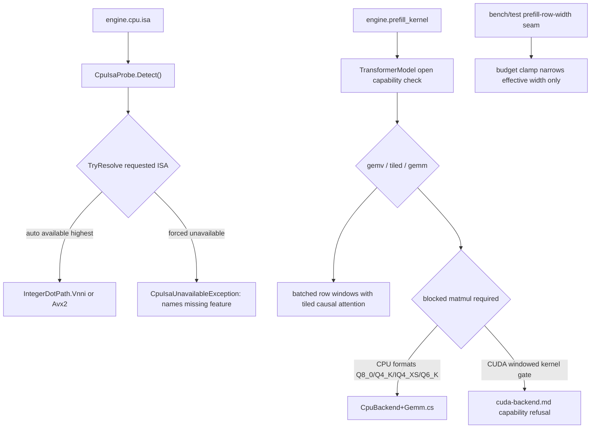
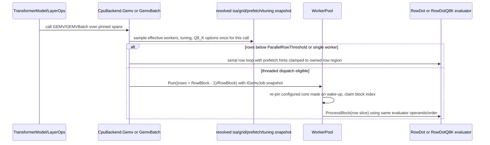
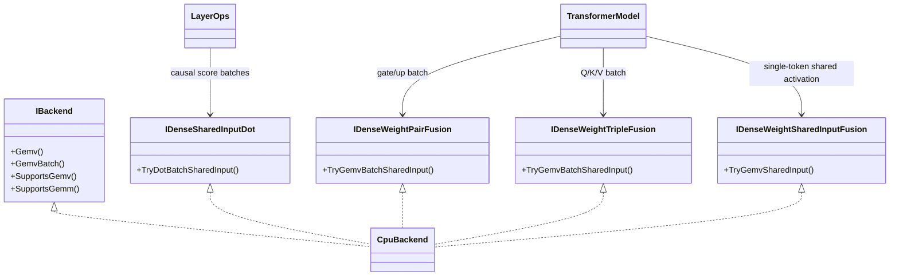

Scope: CPU ISA dispatch, GEMV/GEMM/tiled prefill shape, grid staging and prefetch for i-quants, shared-input fusion seams, gather kernels, worker-pool participation, core-set/NUMA placement behavior, kernel tuning knobs, and the refusals each posture takes. As of 2026-11-27 this reflects implemented CPU-kernel behavior under `src/` only; planned surfaces are not described as current.

# CPU kernels

The CPU backend turns weight bytes into dot products through one opened posture: a resolved integer-dot encoding, a resolved sub-4-bit grid staging mode, a tuning snapshot derived from effective worker count and vector-posture presence, and optional fusion seams that share one activation batch across several dense matrices. Every routing decision below either changes which executor walks the same operands or leaves output bytes untouched; none of them reorders an accumulator chain inside one row.

Cross-links: [architecture.md](architecture.md) for module seams, [scheduling.md](scheduling.md) for prefill lanes and step composition, [quantization.md](quantization.md) for GGUF format coverage, [cuda-backend.md](cuda-backend.md) for device-side capability gates, [kv-cache.md](kv-cache.md) for quantized attention routes, [residency-and-budgets.md](residency-and-budgets.md) for full placement and budget behavior, [measurement-harnesses.md](measurement-harnesses.md) for bench verbs that read these postures, and [tricks-and-tweaks.md](tricks-and-tweaks.md) for individual register-pressure and route-selection decisions.

## Backend posture resolved at open

`engine.cpu.isa` declares the integer-dot axis used by the five Q8_K sub-4-bit i-quants: `IQ2_XXS`, `IQ2_XS`, `IQ2_S`, `IQ3_XXS`, and `IQ3_S`. The accepted YAML vocabulary is defined in `src/Lair.Http/Config/YamlConfigLoader.cs` as `'auto'`, `'avx2'`, or `'avx-vnni'`; an invalid value fails config load naming the served model, key, and accepted set.

At backend open (`src/Lair.Backends.Cpu/CpuBackend.cs`), `CpuIsaProbe.Detect()` reports one capability posture for this process: AVX2 plus FMA plus SSSE3 is required as a vector baseline, and AVX-VNNI counts only beside that baseline because the same staging/sign-fold intrinsics feed both integer-dot encodings. `CpuIsaProbe.TryResolve` then maps declared ISA to an actual kernel path (`src/Lair.Backends.Cpu/CpuIsa.cs`):

| Declared value | Resolved encoding when available | Behavior when unavailable |
|---|---|---|
| `auto` | AVX-VNNI if runnable, else AVX2, else scalar reference dots | Auto never fails; it falls back to the scalar oracle only when no vector path is reported. |
| `avx2` | `IntegerDotPath.Avx2`: adjacent-pair products in int16 lanes (`pmaddubsw`) then quadruple sums in int32 lanes (`pmaddwd`) | Forced AVX2 fails with `CpuIsaUnavailableException`, naming the missing feature; no substitute path is chosen. |
| `avx-vnni` | `IntegerDotPath.Vnni`: unsigned magnitude times signed quant accumulated directly into int32 lanes (`vpdpbusd`) | Forced VNNI fails when either AVX-VNNI or its required AVX2 baseline is missing; if both are missing the refusal names that combined gap. |

The scalar path remains correctness oracle: vector paths differ in lane grouping, not arithmetic semantics. For Q8_K sub-block dots, magnitudes come from format tables below 128 and activation quants land in `[-127, 127]`, so AVX2 pair sums stay bounded under int16 overflow and VNNI lanes accumulate the same exact products (`src/Lair.Backends.Cpu/CpuBackend+Q8K.cs`).

The host reports resolved facts rather than re-deriving them. `CpuBackend.ResolvedSelection` returns a `CpuSelectionReport(RequestedIsa, ResolvedIsa, GatherMode)` with lowercase names from already-resolved values (`src/Lair.Backends.Cpu/CpuIsa.cs`, `src/Lair.Backends.Cpu/CpuBackend+Grid.cs`). `GenerationService` logs that posture at model open as:

```text
cpu_selection model='{Model}' isa={ResolvedIsa} gather={GatherMode}
```

and exposes it in monitor facts through `CpuIsa` and `CpuGather` (`src/Lair.Http/GenerationService.cs`). Hot reload classifies `engine.cpu.isa` as restart-only because the backend resolves ISA into kernel bodies at open; a live edit cannot move an opened engine's integer-dot path (`src/Lair.Http/Config/ConfigReload.cs`).



## Sub-4-bit grid staging and prefetch axes

The Q8_K i-quants stage magnitudes from fixed format grids before the integer dot runs. `GridLoadEncoding` chooses between two load shapes over one table (`src/Lair.Backends.Cpu/CpuBackend+Grid.cs`):

| Grid mode | Behavior | Reachability today |
|---|---|---|
| `scalar` | Baseline indexed entry load per eight-value group. | Default when no vector posture exists; fallback from auto benchmark or forced scalar seam. |
| `gather` | Hardware gathers issue whole grid entries: qword gathers for 8-byte-entry grids, dword gathers for 4-byte-entry grids. | Auto-resolved by a process-wide synthetic sub-4-bit GEMV probe when vector posture exists; forced only through internal backend constructors. Host config has no `engine.cpu.grid` key. |

The auto grid resolver (`ResolveAutoGrid`) measures once per process, caches the answer for later auto opens, and uses interleaved best-of passes over representative Q8_K formats: `IQ2_XXS`, `IQ2_XS`, `IQ2_S`, `IQ3_XXS`, and `IQ3_S`. Gather is accepted only when its overall best-of totals beat scalar by a clear margin (`gatherTotalTicks * 25 < scalarTotalTicks * 24`) and no format collapses badly (`gatherBestTicks > scalarBestTicks * 6 / 5`). A forced gather on an AVX2-less posture fails the open naming the vector-posture requirement rather than substituting scalar.

Prefetch is a separate axis with the same internal-only forcing rule: `_prefetchWeights` defaults to true when vector Q8_K kernels run and can be forced either way through bench/test constructors only (`src/Lair.Backends.Cpu/CpuBackend.cs`). `PrefetchRowWindow` issues `prefetcht0` hints ahead within a 2,048-byte window but clamps every hinted address inside the row region owned by that call. Prefetch performs no read and changes nothing in computed bytes; it only moves future weight lines toward cache before the GEMV consumes them (`src/Lair.Backends.Cpu/CpuBackend+Grid.cs`).

## Prefill kernel selection

`engine.prefill_kernel` accepts `gemv`, `tiled`, or `gemm`; default is `gemv` when omitted. The config value classifies as new-requests-only, but the forward engine validates whether the selected route can run for each served file and execution span at model open (`src/Lair.Http/Config/YamlConfigLoader.cs`, `src/Lair.Http/Config/ConfigReload.cs`).

The enum in `src/Lair.Models/ModelStrategies.cs` states the implemented semantics:

| Selection | Weight traversal | Attention shape | Capability posture today |
|---|---|---|---|
| `gemv` | Batched row window: sub-batches of up to resolved `ModelPlan.PrefillRowWidth`; each dense matrix is traversed once per sub-batch. | Single-row causal attention walk, with shared-input dot batching where available. | Runs for every loaded format through CPU GEMV or device-side equivalent; no blocked matmul required. |
| `tiled` | Same batched row windows. | Causal attention walked row-tiled over KV blocks: each selected position's K/V is read once per kv-head group and applied to rows whose causal range covers it. | Runs today for every family through batched-row weight passes; results are bit-identical with `gemv`. |
| `gemm` | Blocked matmul over dequantized weight tiles: one tile built per row/column block and consumed by activation vectors of the sub-batch. | Same batched window shape unless fused pair/triple routes are disabled for dense-matrix posture. | Refused when any prompt-window span carries a dense format whose resolved backend has no blocked matmul kernel; CPU supports only `Q8_0`, `Q4_K`, `IQ4_XS`, and `Q6_K` (`src/Lair.Backends.Cpu/CpuBackend+Gemm.cs`). CUDA windowed coverage is documented in [cuda-backend.md](cuda-backend.md). |

The capability gate is per execution span. `TransformerModel.ValidateSpanMatmulCapability` checks each resolved prompt-window segment against the backend that will run it, and a gap refuses before dispatch with wording shaped like: prefill kernel `'gemm'` needs blocked matmul kernels for weight format(s) ... on the compute backend resolved for this segment; no dense-matrix path exists in this build. It also names `gemv`/`tiled` as runnable alternatives (`src/Lair.Models/Engine/TransformerModel.cs`). A mixed-tier file is therefore not enough: every dense matrix of a span must have a kernel on the backend selected for that span.

### Prefill row width

Row width controls how many prompt rows one batched weight pass advances at once. It is separate from decode's `MaxBatchSequences` ceiling and has no public YAML key today. The default resolved value is:

```csharp
public const int DefaultPrefillRowWidth = 32; // src/Lair.Models/Engine/TransformerModel.cs
public const int MaxPrefillRowWidth = 64;     // same file, allocation ceiling
```

`ModelPlan.PrefillRowWidth` carries the resolved value (`src/Lair.Models/ModelPlan.cs`). Explicit widths arrive only through assembly-internal `TransformerModel.Open(... prefillKernel, prefillRowWidth)` seams used by tests/bench. A stated width outside `1..MaxPrefillRowWidth` fails at open naming the value and range; zero means "use the plan's resolved default."

A declared prefill-buffer budget can narrow what actually runs without rewriting the requested resolution: `ResolvedPrefillRowWidth` reports the plan/requested row count, while `EffectivePrefillRowWidth` reports the widest sub-batch allowed by budget chains. `PrefillRowClamp?.Describe()` exposes binding tier/cap/row-byte details when a clamp applies (`src/Lair.Models/Engine/TransformerModel.cs`, surfaced in monitor facts and ledger logs from `src/Lair.Http/GenerationService.cs`).

Measured posture for default selection is committed under `bench/reports/prefill-rowwidth-2026-11-13.md`; raw tables are stored beside it as `prefill-rowwidth-llama.txt` and `prefill-rowwidth-qwen3.txt`. Tool posture: `dotnet run --project bench/Lair.Bench -c Release -- prefill-profile ... --threads 8 --reps 1 --lengths 512,1024,2048 --widths 16,32,64`; each candidate width reopens a real engine.

| Fixture | Window | 16 rows tok/s | 32 rows tok/s | 64 rows tok/s |
|---|---:|---:|---:|---:|
| Llama-3.2-1B IQ4_XS | 512 | 34.90 | 39.84 | 41.91 |
| Llama-3.2-1B IQ4_XS | 1024 | 28.62 | 30.23 | 31.43 |
| Llama-3.2-1B IQ4_XS | 2048 | 19.57 | 20.31 | 20.57 |
| Qwen3-0.6B Q8_0 | 512 | 55.93 | 55.16 | 55.30 |
| Qwen3-0.6B Q8_0 | 1024 | 34.93 | 34.56 | 33.84 |
| Qwen3-0.6B Q8_0 | 2048 | 18.44 | 18.52 | 18.37 |

Estimated activation bytes for one full sub-batch:

| Fixture | 16 rows | 32 rows | 64 rows |
|---|---:|---:|---:|
| Llama-3.2-1B IQ4_XS | 1,769,472 | 3,538,944 | 7,077,888 |
| Qwen3-0.6B Q8_0 | 983,040 | 1,966,080 | 3,932,160 |

The report keeps `DefaultPrefillRowWidth = 32` because it captures most of the wider-hidden Llama gain while avoiding doubled activation bytes where Qwen shows no useful improvement. Row width changes sub-batch count and allocation; it does not materially change attention cost on these fixtures. At length 2048, fitted attention dominates both shapes: roughly `100.9 s` against `9.6 s` weight cost for Qwen3-0.6B Q8_0, and `66.2 s` against `34.7 s` for Llama IQ4_XS on that run.

### Prefill kernel comparison posture

The committed shape comparison is `bench/reports/kernel-comparison-2026-11-14.md`, with raw tables beside it as `prefill-kernel-llama-q8-gemv.txt`, `...tiled.txt`, `...gemm.txt`, and the Qwen3 equivalents. Posture: separate bench process per kernel so peak working set is per-kernel; `--threads 8 --lengths 512,1024,2048 --widths 32`; Llama reps=3, Qwen reps=2.

Llama-3.2-1B-Instruct-Q8_0:

| Kernel | Weight fit ms/traversal | Implied weight GB/s | Attention us/position pair | Fitted crossover | 512 tok/s | 1024 tok/s | 2048 tok/s | Peak working set MB |
|---|---:|---:|---:|---:|---:|---:|---:|---:|
| `gemv` | 439.52 | 2.35 | 32.491 | length >= 855 | 44.93 | 32.99 | 21.26 | 1532.0 |
| `tiled` | 527.01 | 1.96 | 24.202 | length >= 1368 | 45.43 | 34.34 | 24.25 | 1531.5 |
| `gemm` | 348.67 | 2.97 | 32.672 | length >= 669 | 51.03 | 36.34 | 22.53 | 1531.9 |

Qwen3-0.6B-Q8_0:

| Kernel | Weight fit ms/traversal | Implied weight GB/s | Attention us/position pair | Fitted crossover | 512 tok/s | 1024 tok/s | 2048 tok/s | Peak working set MB |
|---|---:|---:|---:|---:|---:|---:|---:|---:|
| `gemv` | 243.46 | 1.92 | 58.485 | length >= 274 | 39.25 | 27.39 | 14.79 | 1196.9 |
| `tiled` | 277.13 | 1.69 | 38.104 | length >= 467 | 53.87 | 35.54 | 20.96 | 1196.4 |
| `gemm` | 38.33 | 12.21 | 54.568 | length >= 53 | 57.92 | 35.23 | 17.49 | 1197.0 |

Reading: `tiled` lowers fitted attention cost enough to win the long-prompt shape on both fixtures, while GEMM's weight-traversal improvement is strongest where blocked matmul formats are actually available and its attention coefficient does not move as far. The report labels these shared-box measurements directional unless fitted terms and wall time agree; a mixed-format refusal (`IQ4_XS` file carrying `Q5_K`) proves that proven format alone is insufficient for GEMM selection across an entire span.

## GEMV traversal, worker pool, and bit identity

The CPU backend answers `SupportsGemv(QuantFormat) => true` for every current stored format (`src/Lair.Backends.Cpu/CpuBackend.cs`). Format routing splits into two evaluator families:

| Route | Formats | Kernel shape |
|---|---|---|
| FP row dot | F32, F16, Q8_0, Q4_K, Q5_0, Q5_K, Q6_K, Q2_K, Q3_K, IQ4_NL, IQ4_XS, Q2_0, BF16 | `RowDot` selects scalar or AVX2 per-format evaluator; K-quants unpack nibbles/scales/mins and advance FP accumulator chains. |
| Quantized-activation integer dot | IQ2_XXS, IQ2_XS, IQ2_S, IQ3_XXS, IQ3_S | `UsesQ8KActivation` is true only for these five formats; activation bytes are quantized once per call into Q8_K blocks (`QuantizeActivationToQ8K`) and row dots run scalar/AVX2/VNNI integer sub-block chains against staged magnitudes/sign masks. |
| Integer-domain Q4_K batched dot (landed, unpromoted) | `Q4_K` at `GemvBatch` only | Runs only when the ISA oracle resolved this backend to the AVX2 rung **and** a batch width is stated through the internal seam (`Q4KIntegerDotBatchWidth`, always 0 under every auto posture): activations are staged once into ordinary Q8_K blocks, one exact activation group-sum table per `(batch vector, super-block, group)` is built beside that staging for the whole call, and each row's nibbles are dotted against those operands in integer lanes (AND/SRL unpack shared across chains, `pmaddubsw` pair sums, per-group scale folded through `pmaddwd`, exact int32 block totals) with a fixed float fold at every super-block boundary; that block's eight group mins are unpacked once and shared by each chain's min-term fold against the staged table (`src/Lair.Backends.Cpu/CpuBackend+Q4KIntegerDot.cs`). Outputs are not bit-identical to the float kernels — activation quantization touches each dot — but the variant reproduces bit-for-bit across batch order, chain grouping, and worker count. A Vnni or Scalar resolution keeps today's float traversals untouched whatever a seam states about it; `q4k-widebatch --integer-dot` measures this arm beside the float routes with its divergence classified rather than asserted identical, and `--integer-chain-group 1..8` adds stated-width arms over the same rows. |

Single-vector GEMV participation follows one tuning snapshot: `workers > 1 && rows >= ParallelRowThreshold`. If threaded, block count is `(rows + RowBlock - 1) / RowBlock`; each worker claims whole row blocks and evaluates its own contiguous slice (`src/Lair.Backends.Cpu/CpuBackend.cs`). Batched GEMV follows the same rule after any Q8_K activation staging; each batch vector keeps its own accumulator chain, so grouping changes which vectors share one weight traversal but not per-vector arithmetic.



Worker sizing is posture-derived. `AutoWorkerCount` uses Windows topology physical-core detection (`ThreadAffinity.DetectPhysicalCoreCount`) capped by logical processor count; when detection is unavailable it falls back to `Environment.ProcessorCount`. An explicit nonzero thread request wins over auto-sizing, and model-level `thread_quota` caps the effective worker count. Dense GEMV is bandwidth-bound: two threads on one physical core share front-end/L1/L2/execution ports, so SMT siblings are not counted as useful workers by default (`src/Lair.Backends.Cpu/CpuBackend.cs`, `src/Lair.Backends.Cpu/ThreadAffinity.cs`).

Pool lifetime matters for affinity and memory placement. Pool threads outlive individual GEMV calls until backend disposal; each worker pins itself at loop start and defensively re-pins on wake-up when a core mask is configured, while the dispatcher's own blocks are deliberately neither pinned nor sampled (`src/Lair.Backends.Cpu/CpuBackend.cs`). A quota change can grow the pool once because forward consumers of one backend are serialized by scheduler gates; each kernel call samples `_effectiveThreads` and captures one tuning snapshot for its whole dispatch.

Core pinning applies on Windows (`ThreadAffinity.ApplyCoreSet` → `SetThreadAffinityMask`) and Linux (libc `sched_setaffinity`, pid 0 — the calling thread); every pool worker re-pins defensively at each wake-up through `ApplyProcessorMask`, which also carries multi-word processor sets past one group on the auto-placement seam (`src/Lair.Backends.Cpu/ThreadAffinity.cs`). Explicit core ids must fit the 64-bit processor-mask range `[0, 63]`. On other platforms a configured mask stays documented as no-op rather than faked affinity. Unpinned Linux models get physical-core-preference placement derived by `WorkerPlacement` — selection rules, measured reason, and fallback semantics are owned by residency-and-budgets.md; kernel arithmetic itself reads nothing about placement. NUMA behavior remains first-touch discipline only;
 `NumaPlacement.PagePlacementAdvisory` states that byte placement follows workers pinned to the chosen node before serving, and this build neither prefaults a model file nor moves pages where placement is advisory (`src/Lair.Models/NumaPlacement.cs`). Linux measurement lanes can use anonymous mmap arenas whose pages land on first touch plus optional `set_mempolicy` attempts through `LinuxPlacementInterop`, but host engine placement semantics stay restart-bound: an opened worker pool and its already-first-touched weight pages do not move when a live edit records a new preference (`src/Lair.Loader/LinuxPlacementInterop.cs`, `src/Lair.Http/GenerationService.cs`).

## Fusion seams and shared-input dots

Dense forward passes ask backends through optional contracts only. If the backend implements an interface but declines a posture, it returns false without touching outputs; callers fall back to independent calls (`src/Lair.Contracts/*.cs`). The CPU implementation exposes four related routes:

| Seam | Consumer today | Eligibility and behavior |
|---|---|---|
| `IDenseSharedInputDot.TryDotBatchSharedInput` | `LayerOps.CausalAttention` and `CausalAttentionTiledRows` score batches of query heads against one stored K vector (`src/Lair.Models/Engine/LayerOps.cs`) | Requires at least two dots. Uses resolved `SharedInputDotChainGroup`; zero keeps every dot individual. Each chain has its own accumulator, scalar tail, reduction order; batching only shares loads of the common operand. |
| `IDenseWeightPairFusion.TryGemvBatchSharedInput` | Dense feed-forward gate/up batch (`RunDenseFeedForwardPair`) when dense-matrix route is not selected (`src/Lair.Models/Engine/TransformerModel.cs`) | CPU pair fusion covers scratch formats `Q4_K` and `Q6_K`, equal column counts, columns within `MaxScratchCols`, at least one chain group of batch vectors, block-aligned widths: Q4_K `% 32 == 0`, Q6_K `% 16 == 0`. Unequal-row pairs return false because the fused executor walks a shared row range. |
| `IDenseWeightTripleFusion.TryGemvBatchSharedInput` | Attention Q/K/V batch projection (`RunAttentionQKVProjection`) when dense-matrix route is not selected | Requires equal column counts across all three matrices and scratch eligibility for each format; unlike pair fusion, different row counts are allowed. The executor walks the union of row spaces: a matrix with no row at an index contributes nothing, while present rows share one activation traversal. If triple staging would exceed cache-resident limits it degrades to pair/single-row scratch routes rather than changing arithmetic. |
| `IDenseWeightSharedInputFusion.TryGemvSharedInput` | Single-token Q/K/V projection and dense gate/up (`src/Lair.Models/Engine/TransformerModel.cs`) | CPU implementation shares one activation vector across two or three matrices, supports differing row counts/formats, builds one Q8_K activation when any selected format needs it, then dispatches the concatenated row space through ordinary `RowDot`/`RowDotQ8K` evaluators. Win is dispatch/cache locality, not changed math. |



All fusion routes preserve bit identity by construction: they reuse the same ascending chunk order, operand association, scalar-tail handling, and row-block partitioning as independent calls. Pair/triple batch fusion excludes Q8_K i-quants because those formats stay on integer-dot activation staging rather than float scratch batching (`src/Lair.Backends.Cpu/CpuBackend+FusedPair.cs`, `CpuBackend+FusedTriple.cs`). Single-vector shared-input GEMV does not exclude them: it shares one quantized activation only when a selected matrix needs Q8_K and otherwise uses each format's ordinary row evaluator (`src/Lair.Backends.Cpu/CpuBackend+SharedInputGemv.cs`).

## Gather kernels for sparse FFN slabs

Sparse blocks route through contiguous expert slabs resolved from the model weight source. `TransformerModel` resolves one `_gatherKernel = new CpuGatherKernel()` when a sparse-FFN descriptor exists, and selected chains run through that kernel (`src/Lair.Models/Engine/TransformerModel.cs`). The default gather walks the batch's union active-expert set in ascending expert order, resolves each selected gate/up/down slab once per step, issues `prefetcht0` hints across 64-byte cache lines before handing slabs to the consumer, and lets GEMVs consume them (`src/Lair.Models/Engine/CpuGatherKernel.cs`).

This is a locality kernel, not an arithmetic variant: prefetch performs no memory access and gathered chains use ascending expert-index accumulation order matching dense-equivalent MoE traversal. Residency tiers can fold selected experts into hot/cold sets before gathering, but the default host posture stays cold-slab gather; tier behavior belongs to [residency-and-budgets.md](residency-and-budgets.md).

## Kernel tuning knobs and mutation class

`CpuKernelTuning.Resolve` derives scheduling/scratch shapes from effective worker count plus vector-posture presence (`src/Lair.Backends.Cpu/CpuKernelTuning.cs`). Public YAML keys cover only four fields; other qualified override names exist for bench/test seams through `CpuKernelTuningOverrides`, not host configuration. Out-of-range stated values fail naming the qualified key and accepted span instead of clamping quietly.

| Knob | Public YAML path? | Accepted range | Auto default with vector posture | Notes |
|---|---:|---:|---|---|
| `RowBlock` | yes, `engine.cpu.tuning.row_block` | 1..64 public; backend constants allow same span | clamp(512 / workers, 8, 64) | Output rows per scheduling unit for threaded dense kernels. Auto floor is 8 despite lower accepted bound because blocks below that are too small against dispatch overhead. Restart-only. |
| `ParallelRowThreshold` | yes, `engine.cpu.tuning.parallel_row_threshold` | >=1 (upper unbounded public validation) | max(rowBlock * workers / 2, 2 * rowBlock) | Row count where threaded dispatch starts paying for itself. Restart-only. |
| `ChainGroup` | yes, `engine.cpu.tuning.chain_group` | 1..8 | 8 with vector posture; 1 without scratch route | Scratch batch-dot accumulator chains sharing one pass over materialized row. Pair chain group derives as half of resolved chain group capped at 4; triple caps at 3 because three matrices plus their weight chunks fit register budget differently. Restart-only. |
| `MaxScratchCols` | yes, `engine.cpu.tuning.max_scratch_cols` | 512..65536 | 16384 floats | Row-scratch column ceiling for scratch batch-dot route; wider staging stops staying cache-resident beside packed row bytes. Restart-only. |
| `MatmulRouteBatchWidth` | no public YAML key in current loader vocabulary | qualified override range 0..64 | 8 with vector posture, else 0 | Internal seam controls Q6_K hybrid dense-matrix route for eligible single-matrix batched passes; tile executor replaces scratch batch dot at/above width. |
| `MatmulRouteBatchWidthQ4K` | no public YAML key in current loader vocabulary | qualified override range 0..64 | always 0 unless stated through internal seam | Q4_K blocked matmul remains unpromoted by default. Committed Xeon t8 interleaved lane under `reports/2026-11-27T02-28-33Z-optimize-prefill-q4k-route-ab-interleaved-xeon-t8/summary.md` compares arms `[off, on, 16]`, but every measured delta falls inside its own arm noise band; the code keeps Q4_K auto width at zero. |
| `Q4KIntegerDotBatchWidth` | no public YAML key in current loader vocabulary | qualified override range 0..64 | always 0 unless stated through internal seam | Internal seam selects the integer-domain AVX2 Q4_K batched dot (`CpuBackend+Q4KIntegerDot.cs`) at/above a stated count, and only when this backend's ISA resolution landed on the AVX2 rung; Vnni or Scalar resolutions keep the float kernels. `q4k-widebatch --integer-dot` (with optional `--integer-chain-group 1..8` arms) measures it beside the float routes with divergence classified rather than asserted identical; promotion stays refused pending committed target-host validation, and no cost claim is stated here. |
| `SharedInputDotChainGroup` | no public YAML key in current loader vocabulary | qualified override range 0..8 | 8 with vector posture, else 0 | Internal seam controls how many independent shared-operand dot chains share one load of common operand; zero keeps every dot individual. |

Hot-reload classification is explicit: `engine.prefill_kernel` affects new requests only because each request's forward can re-read the resolved selection at window boundaries after validation succeeds, while ISA and tuning pins are facts of opened backend kernels/scratch layout (`src/Lair.Http/Config/ConfigReload.cs`). Model-level thread quota classifies live because kernel calls sample effective worker count per call; core-set changes and placement rebinding require restart semantics documented in [scheduling.md](scheduling.md) and [residency-and-budgets.md](residency-and-budgets.md).

## What the CPU route refuses today

- Forced `engine.cpu.isa` values that this host cannot run fail at backend open with `CpuIsaUnavailableException`, naming missing feature(s); no substitute integer-dot path is silently chosen (`src/Lair.Backends.Cpu/CpuIsa.cs`).
- An explicit prefill row width outside `1..64` through the internal seam fails model-open validation; host config cannot state it today, and zero means use plan default (`src/Lair.Models/Engine/TransformerModel.cs`).
- A `gemm` selection for a prompt-window span whose dense weight formats lack blocked matmul kernels on that span's resolved backend refuses at load naming the model, segment, device, missing format(s), and runnable alternatives; no fallback to another kernel/device occurs (`src/Lair.Models/Engine/TransformerModel.cs`).
- Out-of-range tuning pins fail with `ArgumentOutOfRangeException` naming qualified key/value/range/rationale rather than clamping silently (`src/Lair.Backends.Cpu/CpuKernelTuning.cs`).
- A forced gather grid encoding without vector posture fails the internal backend open because gathers use AVX2 staging; host config cannot force it today (`src/Lair.Backends.Cpu/CpuBackend+Grid.cs`, `CpuBackend.cs`).
- CPU-backed models refuse device-resident KV mirrors: every block handed out by `CpuBackend` stays in host memory, so a mirror request names backend/tier/resource instead of answering with a fake stand-in (`src/Lair.Backends.Cpu/CpuBackend.cs`). Quantized KV pair posture belongs to [kv-cache.md](kv-cache.md).
