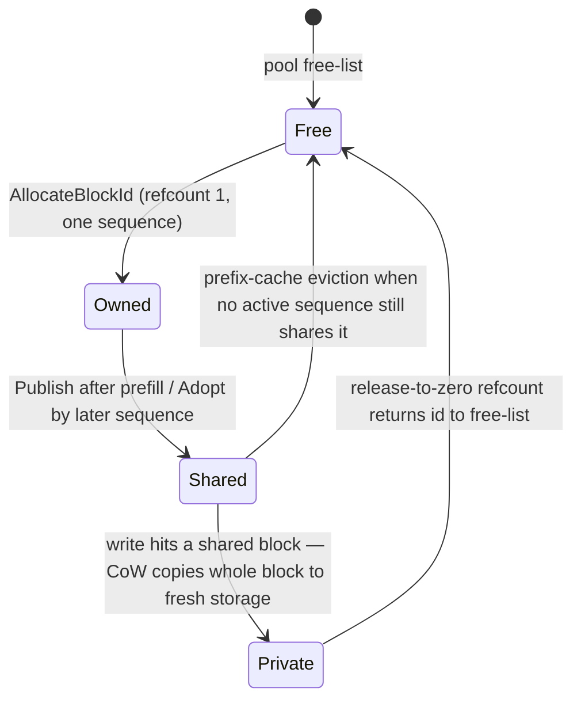
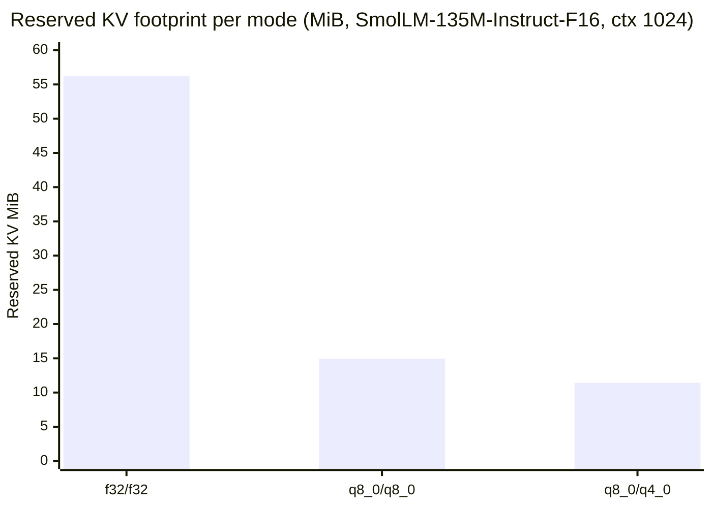

Scope: This page covers the engine's paged KV cache as implemented today — 16-token block geometry, pool and sequence ownership with refcounted copy-on-write prefix sharing, quantized KV format pairs and their attention paths, per-layer windowed block selection, residency modes at open, and the measurement posture behind each number. As of 2026-11-27 this reflects implemented behavior under `src/` only; planned cache capabilities are not described as current.

# The paged KV cache: blocks, sharing, formats, and windows

## What this subsystem is for

Attention over a growing sequence needs every past token's key and value vectors addressable per layer. LAIR stores them in fixed-size **blocks of 16 tokens** (`engine.block_size` is fixed to 16 in this build; the loader refuses any other value — `src/Lair.Http/Config/YamlConfigLoader.cs`) rather than one giant buffer per sequence, so sequences can share identical leading prefixes by reference, capacity decisions count whole blocks instead of bytes, and a decode step appends into block-local regions without ever moving older tokens.

Three assemblies own the cache:

- `IKvPool` (`src/Lair.Kv/IKvPool.cs`) — one pool per opened model instance; hands out physical block ids, tracks refcounts, answers effective free capacity.
- `SequenceKv` (`src/Lair.Kv/SequenceKv.cs`, generic typed variant `SequenceKvGeneric.cs` / `SequenceKv<TK,TV>`) — one logical-to-physical block table per sequence; every K/V write and attention read goes through it.
- `PrefixCache` (`src/Lair.Kv/PrefixCache.cs`) — the shared prefix registry attached to a pool; publishes finished prompt prefixes and adopts them for later sequences whose tokens match.

## Block geometry: one arena, fixed regions

A pool is **one aligned allocation** covering all layers × blocks × K+V. The per-block size derives from model geometry resolved at open (`src/Lair.Models/Engine/TransformerModel.cs`):

```text
kvDim        = kvHeads * headDim            (e.g. 3 kv-heads x 64 head dim = 192)
layerRegion  = 2 * blockTokens * kvDim floats   (K side + V side, per layer)
blockBytes   = layers * layerRegion             (FP32 posture)
```

For the measured fixture `models/SmolLM-135M-Instruct-F16.gguf` (`llama` architecture, 30 layers, hidden 576, heads 9, kv-heads 3, head dim 64 — posture from `bench/reports/kv-quant-recommendation-2026-11-18.md`) that is **737,280 bytes per FP32 block**. Quantized pools shrink the same region by packing groups of 32 values into smaller records (see "Quantized formats" below): `q8_0/q8_0` measures 195,840 bytes/block and `q8_0/q4_0` 149,760 on the same geometry.

Physical blocks are addressed by id; a sequence's table maps *logical* block index → physical id (`SlotRef`, `src/Lair.Kv/SlotRef.cs`). Block paging in device-facing seams rides `_blockShift`, so the fixed 16-token size is also what makes id arithmetic branch-free (a non-power-of-two block width would refuse at bind time — `ValidateExecutionCombo` posture, `src/Lair.Kv/BlockPoolGeneric.cs`).

Free capacity is a stack free-list with per-block refcounts: allocation and release are O(1), and the scheduler's admission check reads `_pool.EffectiveFreeBlocks`, which counts blocks freed *and* blocks held only by prefix-cache entries that eviction can reclaim.

## Ownership, sharing, and copy-on-write

A physical block carries a reference count shared across every sequence whose table names it plus every prefix-cache entry publishing it. A write into a shared block is never allowed to mutate the shared bytes: `SequenceKv` copies the whole block into fresh private storage first (copy-on-write), then writes privately. In the typed pools (`BlockPoolGeneric.cs`) that copy moves **raw packed bytes** — no re-quantization happens on CoW, so quantized sharing costs one memcpy of the compressed region.

Logical adoption is keyed by *index*, not id: `SequenceKv`'s `_adopted` set tracks which logical positions are shared, because a CoW swap replaces a table entry's physical mapping while leaving that position logically adopted for read purposes. A fully adopted prefix therefore reads forever as read-only until the sequence releases it.



Paths: `src/Lair.Kv/BlockPool.cs`, `src/Lair.Kv/SequenceKv.cs` (CoW destination span is the pool's `MutableBlockSpan`).

## Prefix sharing end to end

The cache keys on **token identity, not model state**: a rolling token-prefix hash at block granularity, seeded by `ChainSeed = 0x9E37_79B9_7F4A_7C15UL` (`src/Lair.Kv/PrefixCache.cs`). Two sequences share blocks exactly when their prompt tokens agree over whole 16-token runs.

```mermaid
sequenceDiagram
    participant A as Sequence 1 (pipeline)
    participant P as PrefixCache + pool refcounts
    participant B as Sequence 2 (admitted later)
    A->>A: prefill full prompt into fresh blocks
    A->>P: Publish(whole-block prefix) after final prefill row completes
    Note over P: partial tail block stays out of the registry; each entry holds one refcount on top of every publishing and adopting sequence
    B->>B: admitted — token stream matches published prefix
    B->>P: AdoptPrefix: shared leading physical blocks placed in pipeline table, one extra refcount each
    P-->>B: PromptOffset / PrefillCachedTokens set to the adopted length; Stats.CacheHitSequences++, CacheSkippedTokens += skipped
    Note over B: only tokens after the adopted prefix get prefill work; a fully covered prompt becomes decode-eligible without a Prefilling chunk (see request-lifecycle.md)
```

Two rules make this safe under capacity pressure, both enforced in `src/Lair.Kv/PrefixCache.cs` and at admission (`src/Lair.Models/Scheduling/GenerationScheduler.cs`):

1. **Eviction is LRU over *publishments*, never over live sharing.** Admission reserves blocks for the whole sequence lifetime — prompt tokens plus the generation ceiling (scheduling.md) — so capacity pressure lands at admission, not mid-run. When a new sequence needs blocks the pool cannot hand out, the scheduler calls `_cache.EvictBlocks(needed - EffectiveFreeBlocks)`; eviction walks least-recently-published first and releases only what no active pipeline pins — an entry moves at most one block out of use while blocks shared with an active pipeline stay in use, so capacity checks re-read `EffectiveFreeBlocks` rather than assuming each evicted block counts. Admission then either fits or refuses as capacity exhaustion — never admitted-then-tripped mid-run (see scheduling.md). A hot ceiling edit takes the same shape: `ApplyKvBudget` re-resolves the effective budget and drains least-recently-used cache entries until in-use usage sits at or below the cap (`SetEffectiveBudget` + `TrimToBudget`) without touching active pipelines' held blocks, and freed usage flows straight into later admissions.
2. **Whole-block granularity both ways.** A prompt's partial final block is neither published nor adopted; adoption stops at the last whole 16-token match, so a shared prefix can never be extended in place by a second sequence writing into its tail.

Once capacity fits, admission opens a per-pipeline *admission window* on the pool (`BeginAdmissionWindow(needed)`, `GenerationScheduler.cs`): it carries that submission's reserved headroom across its whole run — closed at pipeline finish — so a budget shrink landing mid-decode cannot strand an admitted sequence below what `Submit` already accounted for, and waiting submissions hold no capacity a later admission could steal.

The registry lives exactly as long as its pool: opening a new model instance means an empty cache — no cross-instance reuse exists today. There is **no config knob** for enabling or sizing it; the scheduler receives a `PrefixCache?` beside its pool (`GenerationScheduler.cs`, constructor) and shares whatever capacity policy the pool carries.

Observable effect in serving output: adopted tokens are reported as cached prompt-token counts on the result (`src/Lair.Http/GenerationResult.cs`) and tallied in `Stats.CacheHitSequences` / `Stats.CacheSkippedTokens` (`src/Lair.Models/Scheduling/SchedulerStats.cs`).

## Quantized KV formats: pairs, block records, attention routes

The format axis is declared per model as `models[].kv.quant.k` and `.v` (absent means FP32/FP32 — `ParseKvQuant`, `src/Lair.Http/Config/YamlConfigLoader.cs`). Today's accepted vocabulary for a quantized posture: **k side `q8_0`; v side `q8_0` or `q4_0`**. Any other spelling refuses at load naming both qualified paths. The dropped combo `q4_0/q4_0` resolves to *no pool* rather than silently falling back (`KvFormatPair.IsDroppedQ4Pair`, `src/Lair.Kv/KvFormatPair.cs`).

| Pair (public names) | K-side record | V-side record | Attention route opened |
|---|---|---|---|
| `f32/f32` (default; also plain dense posture) | raw float rows | raw float rows | `FloatAttentionRoute` → `LayerOps.CausalAttention` (`src/Lair.Models/Engine/TransformerModel.cs`) |
| `q8_0/q8_0` (`q8`, `int8`, `k8v8`) | 34-byte group per 32 values: ushort scale + 32 signed-byte quants; dot-side and value-side use | same record, value-side read | `QuantizedAttentionRoute<Q8Block,Q8Block>` (typed `LayerOps<TK,TV>`, `src/Lair.Kv/Q8Block.cs`) |
| `q8_0/q4_0` (`k8v4`) | as above | 18-byte group per 32 values: scale + 16 nibble-packed bytes with llama.cpp-style cross-half pairing; **value-side only** — a q4 record cannot serve as an attention dot side, which is exactly why `q4_0/q4_0` has no route (`src/Lair.Kv/Q4Block.cs`) | `QuantizedAttentionRoute<Q8Block,Q4Block>` |

Geometry gate: each group covers 32 values (`KvFormatPair.GroupValues`), so **head dim must be a whole multiple of 32** for a quantized pair to open at all — the kernel dots whole groups per head region and refuses otherwise ("{HeadDim} is not a whole number of them", `src/Lair.Models/Engine/TransformerModel.cs`) — and pool sizing rounds each token region up to whole groups (`src/Lair.Kv/KvFormatPair.cs`, `BlockPoolGeneric.cs`). The typed seams are one family end to end — `BlockPool<TK,TV>`, `SequenceKv<TK,TV>`, and the closed attention route resolve once at model open; no forward re-branches on format per position.

Quantized attention is **host-resident CPU work over the batched-row window only**. Model open refuses the pair against any posture it cannot run: a split route (`placement.gpu_layers`), a dedicated `prefill_lane`, an offloaded prefill backend, or a non-GemV prefill kernel selection ("row-tiled" refusals in `TransformerModel.cs`; refusal wording quoted for the CUDA side in cuda-backend.md). The device-facing mirror posture remains accounting-only for these pairs: persistent copies exist to keep residency claims honest while attention reads the host arena; on-device stores with quantized kernels (`attnCausalQ8Q8`, `attnCausalK8V4`) are landed-but-not-default seams installed only from bench/test opens — see cuda-backend.md.

## Windowed block selection

Model profiles may resolve a **sliding attention window per layer** (`Plan.AttentionWindowForLayer` → `pool.DeclareAttentionWindows(int[])`; profile semantics live in [model-profiles.md](model-profiles.md)). A windowed read addresses only the tail of each sequence's table:

```text
selected positions = [max(0, pos - window + 1) .. pos]   (per layer, per step — TransformerModel.cs)
BlockSelection(firstPosition, lastPosition, firstBlockIndex, selectedBlocks, totalBlocks)
    SkippedBlocks = TotalBlocks - SelectedBlocks        (src/Lair.Kv/BlockSelection.cs)
```

A `BlockSelection` is the bounded answer to "which blocks does this read walk": consecutive logical blocks from `FirstBlockIndex`, with `CoversWholeTable` true only when nothing was skipped. Skipped blocks stay resident and addressable — a layer without a window still walks them, so windows narrow attention cost without freeing memory or reordering tables.

## Residency modes at pool open

`models[].placement.kv_residency` selects how the opened pool's block ranges are claimed (`BlockResidencyMode`, `src/Lair.Kv/BlockResidencyMode.cs`; names `dram` / `vram` / `split`):

- **Dram** — every block lives in the host arena; attention reads it directly. This is the posture behind every measured number on this page and needs no declared ceiling.
- **Vram** — device-backed ranges for FP32 pools, admitted only against a finite declared ceiling (`budgets.kv.caps.vram_blocks`; refusal wording quoted from `src/Lair.Http/GenerationService.cs`). Attention still reads the host arena in the default mirror posture (cuda-backend.md). Quantized pairs refuse any non-host residency.
- **Split** — divided ranges: some blocks device-backed, all attention paths unchanged on the host side for the backed portion's accounting.

Claim arithmetic and refusal semantics belong to [residency-and-budgets.md](residency-and-budgets.md); this page documents only what each mode means for cache reads and writes.

## Measured posture (committed artifacts)

All numbers below are from `bench/reports/kv-quant-recommendation-2026-11-18.md` with raw run data in `reports/kv-quant-recommendation-2026-11-18/`, and the pinned cross-tool gate in `bench/reports/kv-cache-type-parity-2026-11-18.md`. **Posture for every row:** model `models/SmolLM-135M-Instruct-F16.gguf` (sha256 `1fc02c…84861790`, 30 layers, kv-heads 3, head dim 64), threads 8, ISA `vnni`, context 1024, decode 32 tokens, production CPU serving seams (`TransformerModel.Open` with a resolved `KvFormatPair`, typed pools, closed quantized attention route), tool `bench/Lair.Bench kv-quant`.

| Mode | Bytes per block | Reserved KV (MiB) | Median tok/s (decode) | Prefill setup ms | Pinned parity band vs llama.cpp b12032 |
|---|---:|---:|---:|---:|---|
| `f32/f32` baseline | 737,280 | 56.25 | 23.659 (min 20.949 / max 27.111) | 14,410.1 | dense-family bands unchanged |
| `q8_0/q8_0` | 195,840 | 14.94 | 8.200 (min 7.839 / max 8.503) | 51,903.1 | max delta 0.1347 nats; band 0.25 |
| `q8_0/q4_0` (`k8v4`) | 149,760 | 11.43 | 8.205 (min 7.961 / max 8.564) | 49,744.1 | max delta 0.3856 nats; band 0.50 |

Note: the per-block figures are each mode's own encoding arithmetic over the same geometry — for FP32 that is `layers × (2 × 16 tokens × kvDim=192) × 4 B = 737,280` bytes/block; reserved KV is each pool sized by its mode at this context.



The chart is a supplement; the table above (with its artifact pointers) is authoritative for these numbers. The committed recommendation stands: **`f32/f32` remains the documented default** — quantized modes save footprint but measured decode throughput sits at roughly a third of baseline on this geometry, and prefill setup runs several times longer. `q8_0/q8_0` is the conservative memory-saving option (tighter pinned band); `k8v4` is the memory-pressure-only option (smallest footprint, loosest band).

## Knobs that select cache behavior

| Key | Live class | What it decides | Bounds and refusals today |
|---|---|---|---|
| `engine.block_size` | — | block token width | fixed 16; loader refuses any other value (`YamlConfigLoader.cs`) |
| `models[].kv.quant.k`, `.v` | RestartOnly (format resolves at model open) | which pool/attention family the instance opens | whitelist above; head dim must be a whole multiple of 32 (`GroupValues` rule at open); quantized pair beside device-backed posture or non-GemV prefill refuses at open |
| `models[].kv_blocks` | Live (`ConfigReload.cs`, scheduling.md table) | legacy system-memory KV ceiling (default 256, floor 8) | interchangeable with the canonical budgets spelling — both must state the same number if declared together; hot edit applies `SetEffectiveBudget` + `TrimToBudget`; may force prefix-cache eviction before later admissions fit (`GenerationScheduler.cs`) |
| `models[].budgets.kv.caps.dram_blocks` | Live when the model's chain carries a system-memory KV tier; otherwise refused mid-run (`ConfigReload.cs`, `GenerationService.cs`) | canonical spelling of the same ceiling | floor 8 like the legacy key (it reserves physical blocks exactly as it does); deprecated-key warning points here ("budgets are canonical for what LAIR holds at system memory", `GenerationService.cs`) |
| `models[].placement.kv_residency` + `budgets.kv.caps.vram_blocks` | RestartOnly | residency modes above | non-`dram` without a finite declared ceiling refuses; quantized pair beside any non-host residency refuses (`GenerationService.cs`) |

## What this cache refuses today

- Any block size other than 16.
- A `q4_0` K side, or the dropped `q4_0/q4_0` pair as a pool — refused at config load naming both paths; no silent fallback to FP32 for an unrecognized spelling either.
- Quantized attention on any device-backed route segment, split route, dedicated prefill lane, or non-GemV prefill kernel selection (model-open refusals in `TransformerModel.cs`; the same posture refusal wording appears in cuda-backend.md).
- Prefix adoption over partial blocks: a shared prefix can never be extended in place; only whole 16-token runs publish and adopt.
- Evicting any block still named by an active sequence, regardless of LRU order — admission either fits after eviction or refuses as capacity exhaustion (scheduling.md covers the refusal surface).
- Cross-instance prefix reuse: a new pool opens with an empty cache; there is no persistence layer for published prefixes.

Cross-links: pipeline states and adoption timing in [request-lifecycle.md](request-lifecycle.md); admission arithmetic, eviction-before-refusal, and hot-edit behavior in [scheduling.md](scheduling.md); mirror postures, device attention kernels, and their refusal wording in [cuda-backend.md](cuda-backend.md); tier chains the residency claims seat against in [residency-and-budgets.md](residency-and-budgets.md); window/softcap profile semantics in [model-profiles.md](model-profiles.md); bench verbs behind every number above (`kv-quant`, `generate-kv-cache-type-parity.ps1`) in [measurement-harnesses.md](measurement-harnesses.md).
