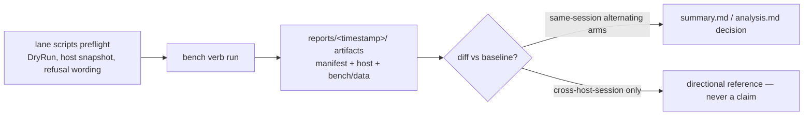
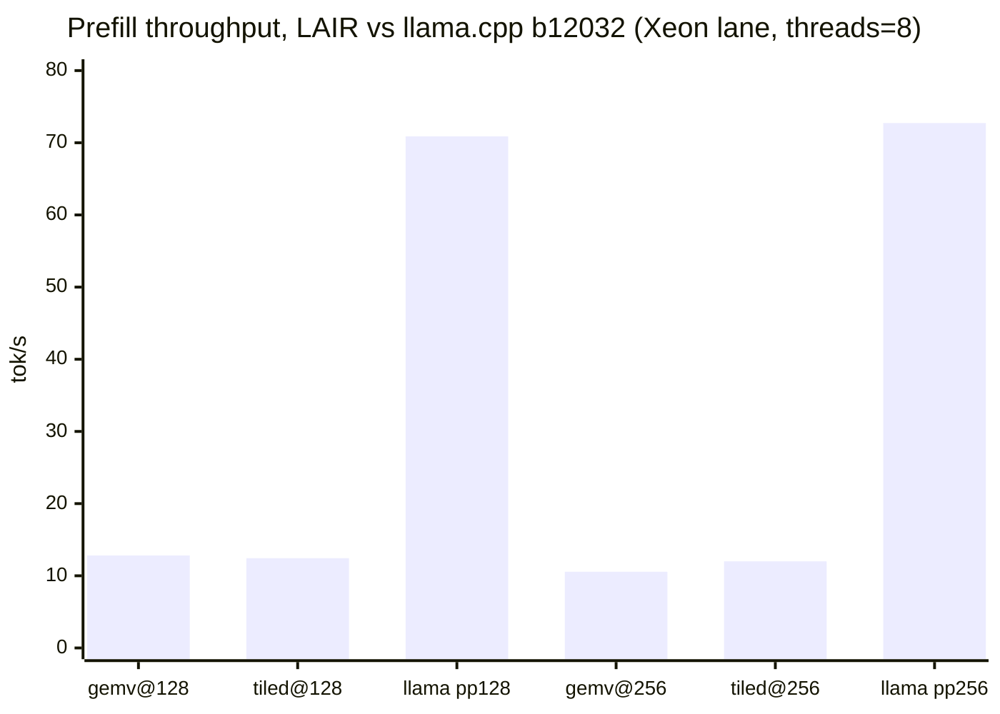

# Measurement harnesses

Scope: how LAIR's bench verbs, committed report artifacts, scripted lanes, and pinned parity fixtures turn engine behavior into numbers this build can defend. As of 2026-11-27. Command syntax for building and running lives in `DEVELOP.md`; kernel selection semantics live in [cpu-kernels](cpu-kernels.md); cross-tool standing is owned by [comparisons.md](comparisons.md).

## Two harness families, one evidence contract

LAIR measures through two separated systems:

- **Bench verbs** (`bench/Lair.Bench/Program.cs`) produce *performance* artifacts — throughput and cost numbers with posture recorded in a committed directory under `reports/<timestamp>/` or narrative Markdown under `bench/reports/`.
- **Test categories** produce *correctness gates* — parity, kernel identity, script wording. Performance-sensitive suites must run `-c Release`; the golden cross-tool gate is `dotnet test --filter Category=Parity -c Release`.

The contract both families enforce: every performance claim names a committed artifact, and every number carries its posture (model file, context length, thread quota/kernel selection, ISA/backend path, tool). A run whose artifacts were not committed is not evidence.

## Bench verbs

`dotnet bench\Lair.Bench\bin\Release\net10.0\Lair.Bench.dll <verb> [flags]`. The verb list in `bench/Lair.Bench/Program.cs`:

| Verb | Measures | Key posture facts / flags |
|---|---|---|
| `gemv` | synthetic GEMV micro-costs | — |
| `gguf-dump` | tensor table of a GGUF | read-only dump |
| `gemv-file` | per-tensor GEMV cost over real model files | defaults: thread quota 8, `--reps 150`, `--max-rows 1024`; prints peak working set at process end; warns "unusable split" when a tensor's measured cost stops rising with causal span |
| `prefill-profile` | windowed prefill throughput and stage breakdown | `--threads N --lengths <list> --widths <list> --kernel gemv,tiled,gemm --reps R (3) --per-token --stage-profile --matmul-route off\|on\|N --q4k-matmul-route off\|on\|N --pair-matmul-route off\|on\|N --attention-batch-dots off\|on\|N --out <path>` |
| `kv-spike`, `kv-micro` | KV write/quantization micro-costs | owned by [kv-cache](kv-cache.md) semantics |
| `q4-parity` | Q4-family logit comparison | — |
| `kv-quant` | quantized-KV decode throughput (`KvQuantDecodeBench.cs`) | — |
| `mtp` | multi-token drafting seam latency (`MtpDraftBench.cs`) | seam measurement, not promoted serving |
| `cuda-gemv`, `cuda-gemm`, `cuda-prefill`, `cuda-concurrency` | CUDA-side kernel and step measurements | refuse or report posture when no idle device is available; see lane gates below |
| `gather` | MoE expert gather cost (`MoeGatherBench.cs`) | hot-budget flags per bench header |
| `ple-latency`, `ple-policy` | n-gram table row-gather latency and residency policy arms (`PleLatencyBench.cs`, `PlePolicyBench.cs`) | disk-backed shard posture recorded in manifest |
| `lowrank-svd` | expert SVD spectrum probe (`LowRankSvdBench.cs`) | — |
| `qwen4exp-forward-file` | forward pass over a sharded flagship file | — |

The route pins in the table are bench-side measurement seams onto internal tuning keys; [cpu-kernels](cpu-kernels.md) owns what each resolved posture actually promotes, and this page's Q6_K example below shows how a seam graduates to default.

## Report artifacts: three committed shapes

Every `reports/` directory is self-describing — the manifest states goal, command line, working directory, model path; `host.json` records host facts (processor count, memory, huge-page posture); `bench.json` holds per-arm measurements. Three layouts are in use:

1. **Classic single-run form** — `manifest.json`, `host.json`, `bench.json`, `report.html`. Example: `reports/cuda-gemv-parity-2026-11-18/`, `reports/kernel-comparison-2026-11-14/` (the latter's committed kernel comparison: gemv 23.37 prefill tok/s at peak RSS 1,353.8 MB vs tiled 25.11 tok/s at 1,222.8 MB on the IQ4_XS fixture).
2. **Timestamped A/B form** — `commands.md`, `data.json`, `summary.md`, `report.html`, plus per-round arm logs `logs/stage-ab-rN-<arm>.txt`. Example: `reports/2026-11-27T02-28-33Z-optimize-prefill-q4k-route-ab-interleaved-xeon-t8/`.
3. **Strict re-pair form** — per-arm log subdirectories (`logs/baseline-off/`, `logs/route-on-w8/`, `logs/route-w16/`) with a paired `analysis.md` separating stage metrics from window totals and noise bands. Example: `reports/2026-11-27T01-16-57Z-optimize-prefill-q4k-route-ab-xeon-t8/`.

Narrative Markdown with raw tables beside it lives in `bench/reports/` (e.g. `bench/reports/sub4bit-cost-repin-2026-11-17.md` retains its three raw GEMV tables as `.txt` files). Directory naming convention is `reports/YYYY-MM-DDTHH-mm-ssZ-optimize-<process>/`; 15 of the 43 committed report directories follow it, so older directories keep their short names.



`reports/index.html` is generated by `scripts/generate-benchmark-overview.ps1` from `reports/benchmark-history.json`, so the overview stays derived rather than hand-maintained. The documented inter-process noise band on the standard measurement hosts is ±10–35%; a single-sample difference inside that band is not a result (posture for most committed CPU reports: i9-13900K-class host, `threads=32`, `rowWidth=64`, kernels gemv/tiled, lengths 128/256, `--reps 3`).

## A/B methodology enforced by the harness scripts

`scripts/run-xeon-prefill-stage-ab.py` encodes what committed reports actually did: arms run alternating across rounds (`--arms off,on,16 --rounds 5`, arm order reversing on odd rounds unless `--no-rotate`), with `--warmup-rounds 2` to absorb cold-start and page-cache warm-up before measurement. Medians are the reported quantity; samples stay in the directory. Two behaviorally identical arms (e.g. default vs explicit pin resolving to the same width) calibrate run noise — the Q6_K hybrid pass saw ~±5% between such arms at medians, against a documented ±10–35% inter-process band (`reports/2026-11-25T16-11-55Z-optimize-prefill-q6k-gemm/summary.md`). Cross-host-session comparisons are explicitly labeled directional reference only; same-session alternating medians are the measurement.

`scripts/tune-prefill-chain-groups.ps1` and `scripts/analyze-prefill-chain-group-tuning.ps1` add arm labels that map onto tuning pins: stage axis `default`→auto-resolved group 8, `off`→individual dots, `g2`/`g4`→pinned widths, `on`→width 8; throughput axis adds `w4`/`w16`. The resulting committed evidence — e.g. gemv length-128 attention-kernel medians 107.27 (auto) vs 120.78 (off), with pinned 4 at 108.35 and pinned 8 at 106.97 (`reports/2026-11-26T03-12-26Z-optimize-prefill-chain-group-widths/summary.md`, posture `threads=32 rowWidth=64 lengths 128,256 kernels gemv,tiled`) — is what lets a resolved default be defended rather than asserted.

The Xeon A/B driver also fixes the comparison target explicitly: one named baseline arm (`off`), terminal control sequences stripped from captured logs so each `logs/stage-ab-rN-<arm>.txt` file is plain text, and a dry-run mode that lays out the plan without executing — the same refuse-first posture as the host-gate scripts above.

## Lane gates: refusals before measurement

Scripts that run measurements on constrained hosts refuse first and measure second; the refusal wording itself is test-pinned (`tests/Lair.Tests/ResourceGateScriptTests.cs`, `Category=Scripts`), including a forbidden-operations regex list — lane scripts may not stage, commit, push, copy files, or mutate git state.

| Lane script | Guarantee it enforces | Refusal semantics |
|---|---|---|
| `scripts/run-cpu-first-lane.ps1` | `DryRun` (default) executes nothing and writes nothing; `Synthetic` mode is explicit about synthetic fixtures; `RealFile` validates pinned shards and headroom before any run, maps zero-copy spans only, never falls back to synthetic data when a real file cannot be honored, never merges shard files | refuses the run naming what was unavailable, rather than degrading to a different substrate |
| `scripts/run-idle-accelerator-lane.ps1` | requires `-IdleGpuConfirmed` *before* any probe; records `nvidia-smi` utilization, memory, and resident processes as committed evidence; rejects a device whose VRAM envelope cannot hold the target working set | refuses while the device is occupied; synthetic or CPU-side numbers may not stand in for CUDA claims. `-CapabilityOnly` opens an explicitly narrower lane for older small accelerators; `DryRun` refuses to write any report path at all |
| `scripts/lane-gates.common.ps1` | read-only helpers only: byte formatting, declaration expansion, host snapshot via Windows performance counters or Linux `/proc/meminfo` | a counter the OS will not give reports as "not readable" instead of guessing a value |

The same honesty posture appears inside bench code itself: `PlePolicyBench.cs` prints each arena's backing as "anonymous mmap + MADV_HUGEPAGE ask" versus "plain committed (non-Linux host: the THP ask is not emulated)", and committed hosts show why this matters — the Xeon lane recorded THP posture `always [madvise] never` with `HugePages_Total=0`, while its arenas reported `explicit_hugetlb_used: false` and full transparent-page coverage in `smaps` (`reports/2026-11-22T05-35-09Z/bench.json`: 32 MiB arena, `smaps_anon_hugepages_bytes_over_arena = 33554432`; host facts in the sibling directories' `xeon-host-facts.txt`).

## Cross-tool parity: regeneration and guards

The pinned reference is llama.cpp **b12032** (`tools/llama.cpp/b12032/`, asset `llama-b12032-bin-win-cpu-x64.zip`), used in *server mode* because the fixture generator records that server-mode and CLI-mode greedy runs disagree on identical prompts — a fact written into every logit fixture's `reference_mode`.

```mermaid
sequenceDiagram
    participant G as scripts/generate-parity.ps1
    participant L as pinned llama-server b12032 (threads 8, ctx 1024)
    participant C as Category=Calib probe (LAIR top-16 per prompt)
    participant F as tests/fixtures/parity-*.json
    G->>L: four fixed prompts, temperature 0.0, n_probs 5
    L-->>G: output + reference top_logprobs
    G->>C: LAIR_CALIB_MODEL / LAIR_CALIB_OUT set; run calibration lane
    C-->>G: LAIR's own top-16 logprob per prompt candidate
    G->>F: write model_sha256, llama_cpp_tag, calibrated lair_logprob beside each reference value
```

A fixture therefore carries two baselines per candidate: the pinned engine's live logprob and LAIR's distribution at generation time. Regeneration is `scripts/generate-parity.ps1` (plus `generate-template-parity.ps1`, `generate-tokenizer-parity.ps1`; `patch-gguf-rope-scaling.ps1` produces the YaRN fixture copy so both engines read identical declared keys).

At gate time, guards refuse before comparison: a model file that hashes differently fails naming both hashes — "…hashes to X but the fixture was captured against Y…" (`tests/Lair.Tests/LlamaServeTests.cs`); template parity additionally pins `chat_template_sha256` and a fixed `date_string` so renders are clock-free; tokenizer parity requires the model's declared `tokenizer.ggml.pre`; quant-layout tests reproduce b12032's own `ggml-quants.c` formulas rather than any LAIR-side writer.

### Tolerance bands (the honest gate)

From `tests/Lair.Tests/ParityTests.cs`:

| Rule | Value | Why it is shaped this way |
|---|---|---|
| Argmax membership | LAIR's argmax must appear among the reference **top-5** tokens | cross-tool exact continuations are unattainable under CLI/server divergence; membership of our pick in the reference leaders is the honest gate |
| Reproduction tolerance (calibrated values) | `±0.2` nats, window = LAIR top-**16**, including documented absences | catches a forward-math regression that shifts the whole distribution even when no single cross-tool tie flips |
| Cross-tool band vs pinned llama.cpp value | `±0.05` on F16; `±1.0` on quantized files, applied only within **6 nats** of the reference top-1 | inside 6 nats a candidate carries ≥~0.25% softmax weight — decision-relevant; deeper tail candidates are compared only on calibrated-window membership and reproduction, since sub-nat differences reorder the tail wholesale |

Fixture coverage (all against b12032): SmolLM F16 / Q4_K_M / Q8_0; Qwen3 Q8_0 plus a YaRN-declared copy; Llama-3.2 at Q3_K_S, Q2_K, IQ4_XS, and the mixed-tier UD-IQ3_XXS file (IQ3_XXS/IQ4_XS/IQ3_S/Q2-family tensors side by side); Gemma-2 Q4_K_M with its alternating local/full attention blocks applied by profile; Phi-3-mini Q2_K exercising fused-qkv slicing and a gate living inside `ffn_up` with no separate gate tensor. Quantized-KV routes have their own fixtures (`tests/fixtures/parity-kv-q8q8-smollm-f16.json`, `tests/fixtures/parity-kv-k8v4-smollm-f16.json`) gated by `KvQuantizedParityTests.cs`. F16 continuations themselves are pinned separately in `ContinuationParityTests.cs`; determinism suites (e.g. `OverlapDeterminismServeTests.cs`) state that no tolerance band appears anywhere in them because nothing there compares quantized formats.

## The measured-cost ladder: LAIR vs llama.cpp on the Xeon lane

The committed same-session A/B against pinned llama.cpp b12032 (`reports/2026-11-26T08-46-39Z-optimize-prefill-vs-llama-xeon-t8/data.json`) — three alternating rounds, `reps=1` per round:

| Shape | LAIR gemv median (samples) | LAIR tiled median | llama.cpp pp median | LAIR share of reference |
|---|---:|---:|---:|---:|
| length 128 | 12.820 tok/s (12.820 / 11.870 / 13.380) | 12.440 tok/s | 70.890 tok/s (`pp128`) | gemv 18.08% · tiled 17.55% |
| length 256 | 10.560 tok/s (10.320 / 10.560 / 11.560) | 12.000 tok/s | 72.730 tok/s (`pp256`) | gemv 14.52% · tiled 16.50% |



Posture for every number above: `qwen2.5-3b-instruct-q4_k_m.gguf` (2,104,932,768 bytes), lane host lair-lab Xeon (`root@192.168.33.53`, E5-2683 v4 class — AVX2 only, no AVX-512/VNNI), `threads=8`, `rowWidth=64`, rounds alternating LAIR/llama in the same session with `reps=1` per round; medians reported. The report's own host-noise note is ±10–35%, so single samples (e.g. gemv@256 at 10.320) sit inside band and are not separate claims. This ladder exists to keep the gap honest while kernel work closes it stage by stage; comparisons with other engines' standing belongs to [comparisons](comparisons.md).

## CUDA-side posture in this harness family

- `CudaPrefillBench.cs` runs an untimed paired pass that *reports* maximum absolute logit drift and argmax agreement between CPU and CUDA step composition — it asserts no band, because the point is to record observed divergence, not certify a threshold. Default fixture: `models/SmolLM-135M-Instruct-F16.gguf`; output is stdout only (no `--out`).
- Near-tie behavior is guarded in tests rather than tuned on device (`tests/Lair.Tests/CudaNearTieArgMaxTests.cs`): two-candidate fixtures separated by a single fp16 mantissa step (~9.7e-4 relative) must resolve to the same argmax, with separation 5×–2000× the recorded per-format CUDA bands (2e-6 for IQ4_NL/IQ4_XS; 1e-6 for Q8_0/Q5_0 and finer formats, copied from `CudaIQuantGemvTests`/`CudaBlockQuantGemvTests`); a deliberately true-tie lane allows divergence bounded at 4× the band. The CPU oracle is the scalar chain (`threads:1`, `allowAvx2:false`). Semantics detail belongs to [cuda-backend](cuda-backend.md).
- Capability refusals are re-pinnable per format pair: when Q6_K gained a blocked matmul, both refusal-lane suites were moved to **Q5_K**, the format this build genuinely has no CPU-side blocked matmul for (`reports/2026-11-25T16-11-55Z-optimize-prefill-q6k-gemm/summary.md` validation section). A harness refuses only what is actually missing.

## What the harness layer refuses today

- Perf gates outside `-c Release`; a Debug-build timing number is not accepted as gate evidence.
- Any claim from synthetic data when a real-file lane was requested (`RealFile` mode has no fallback; `gemv-file` names unusable splits explicitly).
- CUDA measurement while the practical device is occupied — the idle-GPU scripts refuse, and CPU-side numbers never substitute for a claimed GPU result.
- Cross-host-session throughput deltas as results (they are plotted only as history in committed reports' HTML).
- A single sample inside the documented noise band as evidence; committed decisions cite medians with sample lists beside them.

## See also

[cpu-kernels](cpu-kernels.md) · [quantization](quantization.md) · [cuda-backend](cuda-backend.md) · [kv-cache](kv-cache.md) · [scheduling](scheduling.md) · [residency-and-budgets](residency-and-budgets.md) · [tricks-and-tweaks](tricks-and-tweaks.md) · `DEVELOP.md`
