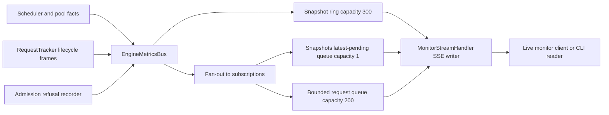
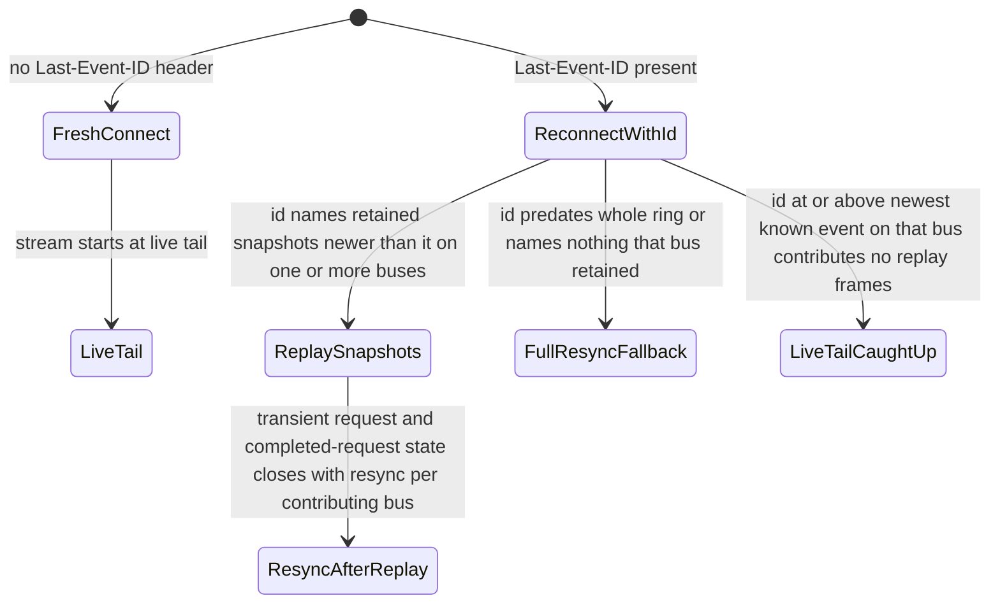
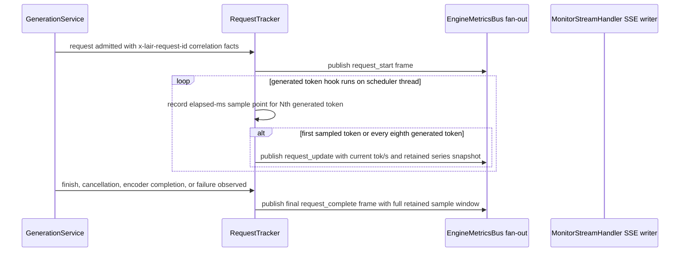
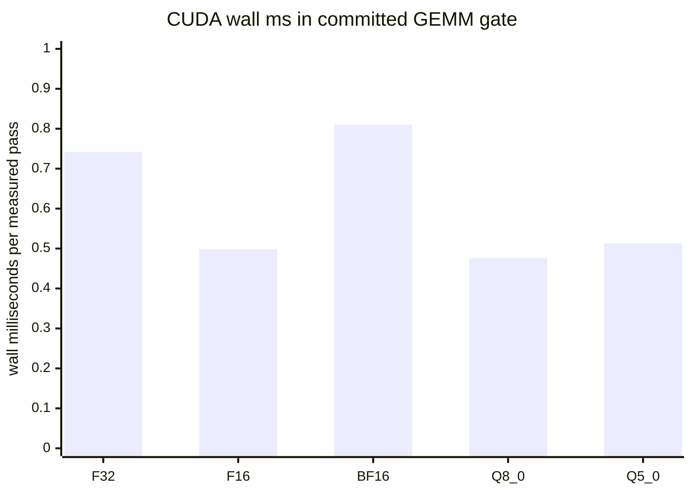

Scope: Metrics bus, engine snapshot fields, request lifecycle events, ledger occupancy, accelerator accounting (GPU busy / PCIe bytes / VRAM), what the monitor refuses to mutate. As of 2026-11-27 this reflects implemented behavior under `src/` only; planned surfaces are not described as current.

# Monitoring and metrics internals

LAIR exposes engine state through a per-model metrics bus, versioned Server-Sent Events on `/monitor/stream`, request lifecycle frames keyed to the same correlation id used by HTTP responses, ledger occupancy views, accelerator accounting where an opened backend reports device facts, and a console reader that follows those SSE snapshots. The monitor surface is observational: it publishes what engines already answer and does not decide admission or move tokens.

Related pages for control-plane context: [architecture.md](architecture.md), [request-lifecycle.md](request-lifecycle.md), and [scheduling.md](scheduling.md).

## Metrics bus shape

`EngineMetricsBus` (`src/Lair.Http/Monitoring/EngineMetricsBus.cs`) samples one engine model's live counters, request tallies, cache facts, pool facts, ledger occupancy, queue posture, CPU selection facts, accelerator accounting where present, and recent admission refusals. The host attaches buses to the monitor stream handler; `/monitor/stream` deliberately lives outside `/v1/*` because it is operator surface rather than OpenAI-compatible API contract (`src/Lair.Http/Monitoring/MonitorStreamHandler.cs`).



Implemented fan-out behavior (`src/Lair.Http/Monitoring/EngineMetricsBus.cs`, `src/Lair.Http/Monitoring/MonitorSubscription.cs`):

- Snapshot ring capacity: `RingCapacity = 300`. Older snapshots are dropped as newer ones arrive.
- Recent-request ring maximum accepted by configuration/loader: `MaxRecentRequestsCapacity = 1_000`; live resize clamps to `[1, 1000]`. The configured key is `ui.recent_requests` (`src/Lair.Http/Config/YamlConfigLoader.cs`).
- Admission refusal ring retains newest refusals only: capacity `AdmissionRefusalRingCapacity = 10`, while cumulative total counts every refusal since open.
- Each subscriber has two independent channels: snapshots arrive through a capacity-one drop-oldest queue, so slow readers see latest pending snapshot and intermediate coalesced frames are intentionally dropped; request lifecycle frames ride bounded drop-oldest queue capacity `EngineMetricsBus.RequestQueueCapacity = 200`.
- Completed writers make publish writes inert no-ops. Fullness probes count drops for the bus's dropped-events tally under fan-out lock.

Sampling publishes only when an engine sample is active (`IsActive(current)`). Window baselines roll forward on every tick, including quiet ticks, so windowed rates describe the interval since previous check rather than a diluted idle average (`src/Lair.Http/Monitoring/EngineMetricsBus.cs`).

## `/monitor/stream` frame vocabulary and reconnect semantics

Every normal SSE frame carries server-scoped incrementing `id:`, an event name from `MonitorEventNames`, schema version marker, and one JSON payload. Comment frames such as `: connected` keep proxies from dropping quiet streams; a client hang-up ends cleanly through request cancellation (`src/Lair.Http/Monitoring/MonitorStreamHandler.cs`).



Exact implemented reconnect semantics (`src/Lair.Http/Monitoring/MonitorStreamHandler.cs`):

- Frame ids come from one host-scoped `MonitorEventLineage`; every bus publishes through the same monotonic sequence, so ids do not repeat across engines.
- Only snapshots persist for replay. Request frames and coalesced snapshot deliveries are transient; each bus keeps a 300-snapshot ring (`EngineMetricsBus.RingCapacity`).
- A `Last-Event-ID` header is judged per sampled bus: retained snapshots newer than the id re-deliver oldest-first across all buses, then one fresh `resync` closes in-flight and completed-request state that replay cannot carry.
- An id older than a bus's whole ring, or naming nothing that bus retained (a request/resync frame id, or an evicted snapshot), gets that bus's `resync` instead of partial replay. No error is produced for stale reconnects.
- A resync payload carries no SSE `id:` line because it is transient state rather than a durable replay point; the client's last durable snapshot remains its next reconnect anchor (`src/Lair.Http/Monitoring/MonitorStreamHandler.cs`).

## Engine snapshot fields

`MetricsSnapshot` uses one consistent wire vocabulary under `metrics_` prefixes. Core mandatory facts include:

| JSON field | Meaning implemented today |
|---|---|
| `metrics_ts`, `metrics_window_ms` | Snapshot timestamp and measurement window in milliseconds (`src/Lair.Http/Monitoring/MetricsSnapshot.cs`). |
| `metrics_model` | Served model id this bus reports. |
| `metrics_tok_s`, `metrics_step_time_avg_ms`, `metrics_batch_occupancy_seqs_per_step` | Windowed decode throughput, average step time, and windowed batch occupancy in sequences per step. |
| `metrics_decode_steps_total`, `metrics_prefill_chunks_total`, `metrics_prefill_tokens_forwarded_total` | Cumulative totals since bus open for steps, prompt chunks forwarded, and tokens carried through prefill forwards. |
| `metrics_cache_hit_sequences_total`, `metrics_cache_skipped_tokens_total` | Prefix-cache hit sequences and skipped recomputed token counts since open. |
| `metrics_kv_used_blocks`, `metrics_kv_capacity_blocks`, `metrics_kv_cached_blocks`, `metrics_active_sequences` | Live KV pool usage, capacity posture, cached prefix blocks retained by the same cache scheduler uses, and live admitted pipeline count. |
| `metrics_requests_total`, `metrics_requests_eos_total`, `metrics_requests_length_total`, `metrics_requests_stop_total`, `metrics_requests_cancelled_total`, `metrics_requests_failed_total` | Request finish tallies since bus open; stop literal completions are recorded by the facade so HTTP outcomes match engine tallies. |
| `metrics_process_working_set_mb`, `metrics_process_cpu_percent` | Serving-process facts, not OS/hardware telemetry (`src/Lair.Http/Monitoring/MetricsSnapshot.cs`). |
| `metrics_events_version`, `metrics_event_seq`, `metrics_dropped_events_total` | Stream schema version marker, server-scoped event id for this snapshot, and total frames dropped from subscriber queues since bus open. |

Additive model-fact fields serialize null or zero until the owning service attaches them (`src/Lair.Http/GenerationService.cs`). Key families:

| Field family | Example JSON keys | Meaning implemented today |
|---|---|---|
| Model and KV geometry | `metrics_model_type`, `metrics_kv_block_tokens`, `metrics_kv_budget_blocks`, `metrics_kv_pool_mb` | Configured model kind, fixed block token size, soft usage cap admission spends from, physical pool bytes rounded to MB. |
| CPU placement facts | `metrics_worker_threads`, `metrics_core_set`, `metrics_thread_quota`, `metrics_decode_device`, `metrics_prefill_device`, `metrics_cpu_isa`, `metrics_cpu_gather` | Effective worker participation after quota, pinned core ranges or null when unpinned, configured hard cap, resolved decode/prefill devices, integer-dot encoding (`scalar`, `avx2`, `vnni`), and grid staging for sub-4-bit i-quant dots. CPU selection is resolved at open rather than echoed from config text. |
| Prefill posture facts | `metrics_prefill_kernel`, `metrics_weight_formats`, `metrics_kv_windowed_layers`, `metrics_kv_read_footprint_blocks`, `metrics_kv_skipped_read_blocks` | Prompt-window kernel route, dense weight formats that prefill selection needs kernels for, windowed layer count and logical block read footprint/skips at current soft budget. |
| Admission diagnostics | `metrics_max_concurrent_requests`, `metrics_admission_refusals_total`, `metrics_admission_refusals` | Configured concurrency cap or null when uncapped; cumulative refusal total since open; newest-first bounded list of recent refusals naming limit kind, model, and concise reason. Refusal kinds are diagnostic copies of request-layer refusals: `kv_capacity`, `context_length`, `concurrency_quota`, `queue_full`, `queue_timeout`, `budget_exhaustion`, `model_retiring` (`src/Lair.Http/Monitoring/MonitorEvents.cs`). |
| Route/lane facts | `metrics_route_segments`, `metrics_prefill_lane`, `metrics_prefill_claim_threads`, `metrics_prefill_decode_share_threads`, `metrics_prefill_lane_share_threads`, `metrics_prefill_decode_core_set`, `metrics_prefill_lane_core_set` | Ordered resolved route segments naming device identity, weight tier, batch cap posture, and quota facts; dedicated/shared lane posture with worker claims and pinned core ranges when present. Shared postures report zero lane split fields (`src/Lair.Http/Monitoring/MetricsSnapshot.cs`). |
| Prefill buffer clamp facts | `metrics_prefill_row_width`, `metrics_effective_prefill_row_width`, `metrics_prefill_working_set_bytes`, `metrics_prefill_activation_bytes`, `metrics_prefill_row_clamp` | Resolved row width before declared ceiling, effective narrowed width when a prefill-buffer chain binds it, activation bytes held by opened prompt-window working set or dedicated lane family, and the binding ceiling's own words (`src/Lair.Http/Monitoring/MetricsSnapshot.cs`). |
| Ledger occupancy facts | `metrics_ledger_occupancy` | One entry per tier position with seated claims: resource name, tier name, unit, capacity posture where null means explicit unbounded, occupied amount in native unit, contested flag when multiple claimants share the tier, and holder list in registration order when contested (`src/Lair.Http/Monitoring/LedgerOccupancy.cs`). An engine whose ledger has seated no claims reports no entries rather than zeros. |
| Compute grant/placement facts | `metrics_compute_requested_threads`, `metrics_compute_granted_threads`, `metrics_core_overcommit`, `metrics_shared_cores_models`, `metrics_placement_node`, `metrics_placement_nodes`, `metrics_placement_spread`, `metrics_placement_spread_requested`, `metrics_compute_node_allocations`, `metrics_placement_advisory` | Requested against granted worker share, overcommit posture and shared-holder models when present, node(s) selected at open, requested vs resolved NUMA spread posture, per-node allocations as `node:cores` pairs, and advisory text explaining why opened placement could not be honored whole (`src/Lair.Http/Monitoring/MetricsSnapshot.cs`). |
| Queue posture facts | `metrics_queued_requests`, `metrics_max_queued_requests`, `metrics_queue_timeout_ms` | Live queue depth waiting for admission slots (none admitted yet), configured cap or null while nothing queues, and bounded wait applied when enabled (`src/Lair.Http/ApiContracts.cs`). |
| Encoder-lane facts | `metrics_active_encoder_requests`, `metrics_encoder_requests_total`, `metrics_encoder_tokens_forwarded_total`, `metrics_encoder_tok_s` | Live encoder forwards through the forward stage, completed encode-only calls since bus open, cumulative token positions carried through encoder forwards that reached pooling, and windowed encoder throughput. Decode-side engines report zero because nothing runs an encoder pass (`src/Lair.Http/Monitoring/MetricsSnapshot.cs`). |
| Expert residency facts | `metrics_residency_tier`, `metrics_residency_hot_units`, `metrics_residency_budget_bytes`, `metrics_residency_resident_bytes`, `metrics_residency_hits_total`, `metrics_residency_misses_total`, `metrics_residency_saved_bytes_estimate_total` | Residency tier posture, hot expert units admitted now, admission budget bytes (RAM quota less working-set reserve stated at open), resident bytes across admitted chains, cumulative residency hits/misses since open, and estimated slab bytes kept out of the cold gather path. A serve with no residency-backed model reports null rather than zeros (`src/Lair.Http/Monitoring/MetricsSnapshot.cs`). |
| Update candidate fact | `metrics_update_candidate` | Report-only hub update candidate for a pinned model pack when present; absent/null means no published source, no candidate found, or check unavailable (`src/Lair.Http/Monitoring/MetricsSnapshot.cs`, `src/Lair.Http/GenerationService.cs`). |

## Request lifecycle frames and tok/s samples

Request lifecycle frames correlate with HTTP responses through the existing `x-lair-request-id` value. Event names are:

| Event name | Implemented meaning |
|---|---|
| `snapshot` | Per-model engine snapshot payload (`MetricsSnapshot.ToJson()`). |
| `request_start` | Admitted request began work on this engine, or encoder call entered its forward stage; id/model/endpoint kind/prompt size known from here. |
| `request_update` | In-flight generation advanced: generated-so-far count, elapsed time, current tok/s rate, and sampled tok/s series. Encoder-only calls produce no update frames because nothing advances token by token between start and completion (`src/Lair.Http/Monitoring/MonitorEvents.cs`). |
| `request_complete` | Request finished with status such as eos, length, stop literal, cancellation, or failure; encoder-only calls report `encoded`. Payload carries final accounting plus retained tok/s sample series. |
| `resync` | Connect-time state dump used when replay cannot fully converge: current in-flight request set and recent completed-request ring (`src/Lair.Http/Monitoring/MonitorEvents.cs`). |



Path cadence facts (`src/Lair.Http/Monitoring/RequestTracker.cs`): `SampleCapacity = 64`, first token always publishes an update, then every eighth generated token publishes. Completion frames carry the latest retained series; older points drop so long generations report recent speed rather than full history. Encoder-only calls share lifecycle start/completion but build no per-token sample series and keep generated count zero because nothing was sampled (`src/Lair.Http/Monitoring/RequestTracker.cs`, `src/Lair.Http/Monitoring/MonitorEvents.cs`).

Payload shape for request frames is one record with null fields omitted until known:

```csharp
public sealed record RequestPayload(
    [property: JsonPropertyName("events_version")] int EventsVersion,
    [property: JsonPropertyName("request_id")] string RequestId,
    [property: JsonPropertyName("model")] string Model,
    [property: JsonPropertyName("endpoint")] string Endpoint,
    [property: JsonPropertyName("prompt_tokens")] int PromptTokens,
    [property: JsonPropertyName("status")] string Status,
    [property: JsonPropertyName("generated_tokens")] int? GeneratedTokens = null,
    [property: JsonPropertyName("elapsed_ms")] long? ElapsedMs = null,
    [property: JsonPropertyName("tok_s")] double? TokensPerSec = null,
    [property: JsonPropertyName("cached_tokens")] int? CachedTokens = null,
    [property: JsonPropertyName("finish_reason")] string? FinishReason = null,
    [property: JsonPropertyName("samples")] IReadOnlyList<TokenSample>? Samples = null,
    [property: JsonPropertyName("budget_exhausted")] string? BudgetExhausted = null)
```

Path: `src/Lair.Http/Monitoring/MonitorEvents.cs`. Each sample pair is `at_token` plus elapsed milliseconds since generation began (`TokenSample`). Resync payloads use the same request shape for in-flight and recent completed views (`ResyncPayload`).

## Accelerator accounting semantics

Accelerator facts appear only when an opened serve holds accelerator backend instances. CPU-only snapshots keep these fields absent rather than zero-filled, because there is no device-side fact to report (`src/Lair.Http/GenerationService.cs`, `src/Lair.Http/Monitoring/MetricsSnapshot.cs`).

| JSON field | Implemented meaning and caveats |
|---|---|
| `metrics_gpu_utilization_percent` | Windowed share of the snapshot window where opened accelerator backends' kernels were busy on device: delta device-measured kernel microseconds over elapsed wall milliseconds, summed across every backend instance this serve holds open (`src/Lair.Http/Monitoring/MetricsSnapshot.cs`). This is LAIR's own kernel-busy accounting; it does not claim full-device utilization from a driver telemetry source. |
| `metrics_pcie_transfer_bytes_total` | Cumulative bytes crossed by runtime copies: activation inputs going to device and kernel outputs coming back. One-time persistent weight uploads, host-region registrations, and KV mirror residency crossings stay outside this tally (`src/Lair.Http/Monitoring/MetricsSnapshot.cs`). |
| `metrics_pcie_transfers_total` | Count of those runtime copy operations, one per activation input and one per kernel output whatever their sizes; same exclusions as bytes total. |
| `metrics_persistent_vram_bytes` | Device bytes opened default-copy postures hold open for resident weights right now. Host-mapped weight residency and transient activation buffers stay outside this reading (`src/Lair.Http/Monitoring/MetricsSnapshot.cs`). A host-mapped instance contributes zero rather than a fabricated device-residency value in aggregate accounting (`src/Lair.Http/GenerationService.cs`). |

Measured accelerator gate artifact: `bench/reports/cuda-gemm-parity-2026-11-18.md`. The committed table below is representative, not the full 13-format gate; that file holds all measured medians and drift values.



Adjacent authoritative table:

| Format | CPU route in gate | CPU auto wall ms | CUDA wall ms | Kernel busy us/rep | Auto vs CUDA ratio | Measurement posture |
|---|---|---:|---:|---:|---:|---|
| F32 | `gemv` fallback batched-row alternative | 0.555 | 0.742 | 432.6 | 0.75 | rows=512 cols=1024 batch=32 reps=7, deviceCopy CUDA posture, auto CPU workers on host with AVX2=yes physical cores=24 logical processors=32 (`bench/reports/cuda-gemm-parity-2026-11-18.md`) |
| F16 | `gemv` fallback batched-row alternative | 0.376 | 0.498 | 444.3 | 0.75 | same committed gate posture |
| BF16 | `gemv` fallback batched-row alternative | 0.463 | 0.810 | 455.4 | 0.57 | same committed gate posture |
| Q8_0 | `gemm` comparable blocked matmul path on both sides | 0.426 | 0.476 | 421.3 | 0.90 | same committed gate posture |
| Q5_0 | CPU fallback because no comparable blocked-matmul kernel for that format in this build | 3.334 | 0.513 | 474.1 | 6.50 | same committed gate posture; large win is not whole-prefill parity claim (`bench/reports/cuda-gemm-parity-2026-11-18.md`) |

Kernel-busy microseconds exclude PCIe/runtime transfer overhead and are not directly comparable to wall milliseconds without that caveat (`bench/reports/cuda-gemm-parity-2026-11-18.md`). The gate's own interpretation also warns that fallback-route wins do not prove whole transformer prefill speed because attention and device-resident KV still cross the seam per layer in this posture.

## Console monitor behavior

`MonitorCommand` follows `/monitor/stream`, parses `data:` snapshot payloads, and re-renders one compact table row per readable snapshot (`src/Lair.Host/MonitorCommand.cs`). Base columns are:

```text
model                 tok/s   step ms  seqs/step  cache hit    KV used/cap  active
```

The renderer adds accelerator tail fields only when the served engine reports them: GPU utilization percent, PCIe transfer MiB over runtime copy count, and persistent VRAM bytes. It adds CPU selection labels (`isa=...`, `gather=...`) when present; a CPU-only serve shows no device columns it cannot support (`src/Lair.Host/MonitorCommand.cs`).

Implemented refusal/exit semantics:

- A server that cannot be reached produces one actionable error line and non-zero exit code.
- Non-success HTTP status from `/monitor/stream` answers `is this a lair serve host?` style error rather than pretending to render engine state (`src/Lair.Host/MonitorCommand.cs`).
- Cancellation exits cleanly with 0 after the stream ends.
- Rows arriving faster than requested minimum render interval are folded so chatty servers cannot flood console output.

## What the monitor refuses or omits today

The monitor path is observational and has no mutation seam: `MonitorCommand` reads SSE frames and prints them; it carries no config apply, scheduler action, admission decision, ledger mutation, or engine-control code (`src/Lair.Host/Monitoring/...`, `src/Lair.Host/MonitorCommand.cs`). Engine-side composition diagnostics are observer-only too: the last step-composition report says which candidates merged on which segment and what kept any out for tests/internal accounting only; no admission decision, response shape, or forward path consults it (`src/Lair.Models/Scheduling/GenerationScheduler.cs`, `src/Lair.Http/GenerationService.cs`).

Specific omissions/refusals:

- CPU-only serves do not fabricate accelerator readings. GPU busy, PCIe tallies, and persistent VRAM stay null when no accelerator backend stands open (`src/Lair.Http/Monitoring/MetricsSnapshot.cs`, `src/Lair.Http/GenerationService.cs`).
- Host-mapped weight residency does not report device-resident bytes as if weights were copied into persistent VRAM; aggregate accounting keeps that posture's contribution zero for resident-weight readings rather than inventing a value (`src/Lair.Http/GenerationService.cs`, `src/Lair.Http/Monitoring/MetricsSnapshot.cs`).
- One-time persistent weight uploads, host-region registrations, and KV mirror residency crossings are excluded from runtime PCIe transfer tallies; those fields count only activation-input and kernel-output copy operations during measured passes (`src/Lair.Http/Monitoring/MetricsSnapshot.cs`).
- Request frames do not replay after reconnect. Only snapshots persist in the bus ring; transient request state converges through `resync` instead of pretending a partial event-id replay is complete (`src/Lair.Http/Monitoring/MonitorStreamHandler.cs`, `src/Lair.Http/Monitoring/EngineMetricsBus.cs`).
- Slow subscribers do not block publishers. Snapshot queues coalesce to latest pending; request queues drop oldest frames beyond bounded capacity and count drops in the bus's dropped-events tally (`src/Lair.Http/Monitoring/MonitorSubscription.cs`, `src/Lair.Http/Monitoring/EngineMetricsBus.cs`).
