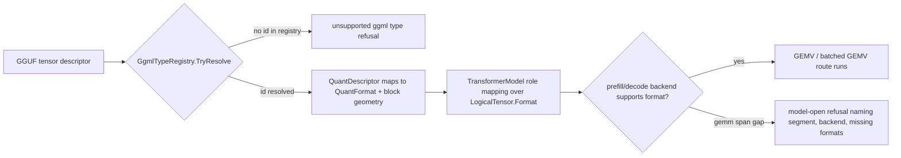
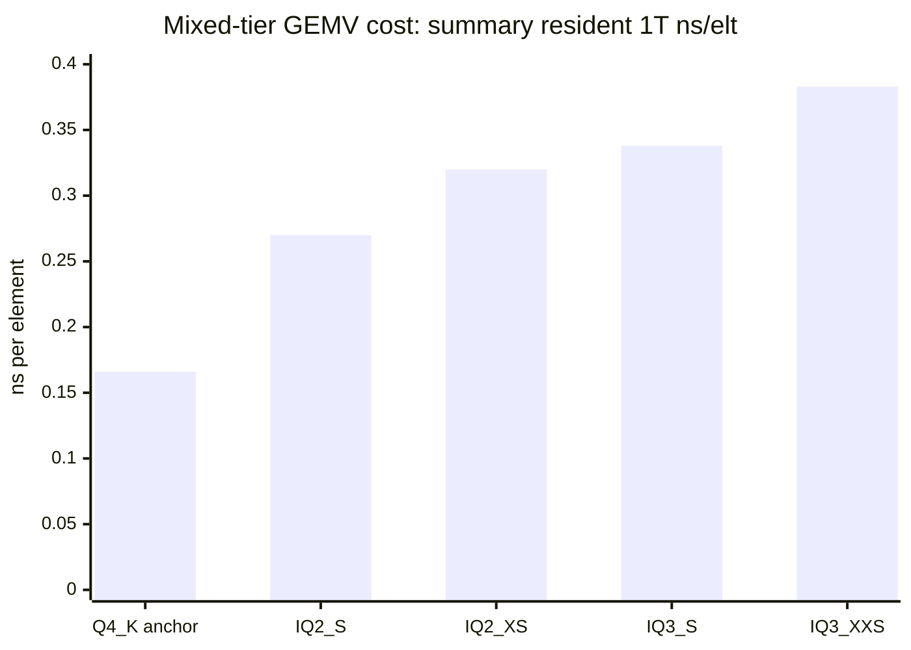
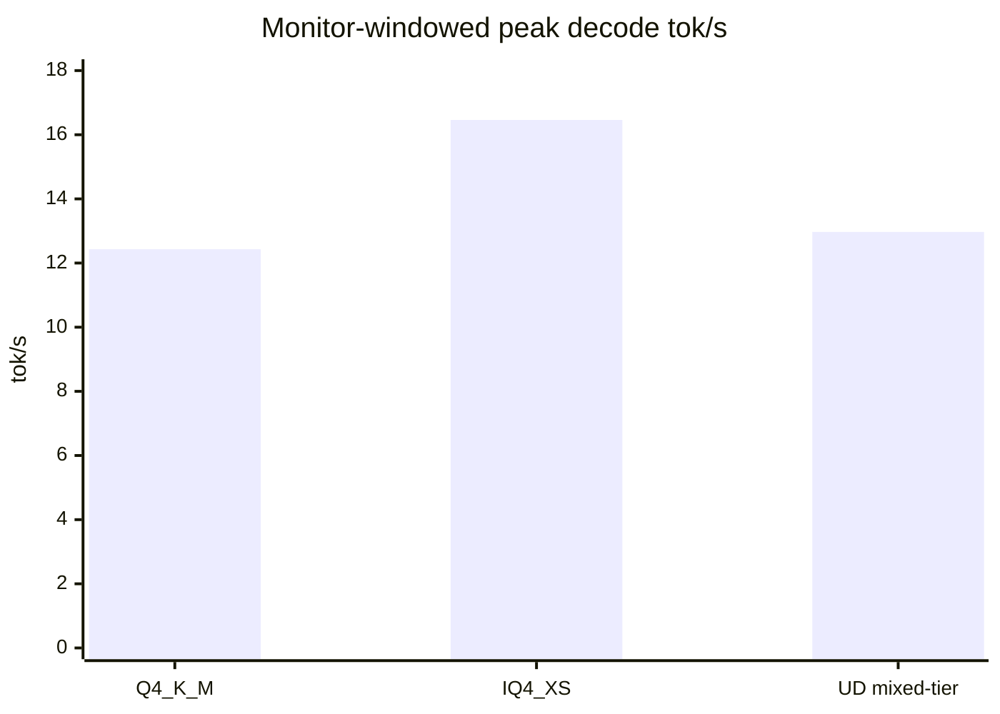

Scope: GGUF block-quant layout as LAIR reads it, per-family decode strategy (K-quants, i-quants, sub-4-bit), integer-dot selection, scale/block handling, mixed-tier files, format coverage per backend and what refuses. As of 2026-11-27 this reflects implemented loader/kernel behavior under `src/` only; planned surfaces are not described as current.

# Quantization handling

LAIR separates three facts that are easy to conflate: which GGUF tensor types the container reader accepts, which kernel a selected backend can execute for those formats, and whether a served model's route (prefill shape or KV format pair) is allowed at open. A file may load because its tensors have accepted block geometry while still refusing `gemm` selection because one dense matrix lacks blocked matmul coverage; a quantized KV posture may be expressible in config but refused before pool construction if the attention route cannot run it.

Cross-links: [architecture.md](architecture.md) for module seams, [cpu-kernels.md](cpu-kernels.md) for CPU traversal and tuning knobs, [cuda-backend.md](cuda-backend.md) for device kernels/PTX binding, [kv-cache.md](kv-cache.md) for paged KV pools and quantized attention routes, [model-profiles.md](model-profiles.md) for role mapping, and [measurement-harnesses.md](measurement-harnesses.md) for bench verbs that measure these formats.

## Loader acceptance rule

`GgmlTypeRegistry.Supported` membership is the loader's acceptance rule (`src/Lair.Loader/GgmlTypeRegistry.cs`). Each accepted ggml id maps to a `QuantDescriptor` carrying block size and type-size bytes; `TensorShape.RowStrideBytes(QuantFormat)` applies matching row padding when needed (`src/Lair.Contracts/TensorShape.cs`). The registry currently accepts 18 formats, each mapped to one member of `QuantFormat`.

| Format | Values per GGML unit/block | Bytes per unit/block | Row-stride behavior |
|---|---:|---:|---|
| F32 | 1 element | 4 bytes/element | exact stored floats; no quant padding. |
| F16 | 1 element | 2 bytes/element | exact half-precision storage; no quant padding. |
| BF16 | 1 element | 2 bytes/element | two-byte truncated float storage; registry treats it as unblocked geometry (`src/Lair.Loader/GgmlTypeRegistry.cs`). |
| Q8_0 | 32 values | 34 bytes | whole blocks: half scale + 32 signed-byte quants. |
| Q5_0 | 32 values | 22 bytes | half scale, 4 bytes of fifth-quant bits, 16 nibble bytes. |
| IQ4_NL | 32 values | 18 bytes | half scale + 16 four-bit quant bytes; row stride rounds up to whole 32-value blocks. |
| Q2_0 | 64 values | 18 bytes | half scale plus 16 bytes carrying 64 two-bit quant slots (`half d` plus `qs[QK2_0/4]` in the pinned reference); row stride rounds up to whole 64-value blocks. |
| Q4_K | 256 values | 144 bytes | half `d`, half `dmin`, 12 packed group scale/min bytes, 128 nibble bytes. |
| Q5_K | 256 values | 176 bytes | K-quant scales plus 32 fifth-bit bytes and 128 nibbles. |
| Q6_K | 256 values | 210 bytes | 128 low-nibble bytes, 64 high-two-bit bytes, 16 signed group scales, half `d`. |
| Q2_K | 256 values | 84 bytes | scale/min pairs, two-bit quants, and two halves. |
| Q3_K | 256 values | 110 bytes | quant high bits, low bits, packed group scales, half `d`. |
| IQ2_XXS | 256 values | 66 bytes | grid-index words plus half scale; final block zero-padded to cover partial run. |
| IQ2_XS | 256 values | 74 bytes | index words + group scales + half scale. |
| IQ2_S | 256 values | 82 bytes | two-bit quants, high bits, group scales, half scale. |
| IQ3_XXS | 256 values | 98 bytes | three-bit quant payload plus half scale. |
| IQ3_S | 256 values | 110 bytes | three-bit quants, high bits, signs, five-bit group scales, half scale. |
| IQ4_XS | 256 values | 136 bytes | four-bit quants plus split low/high scales and half scale. |

Unsupported ggml tensor types fail at container load before any model view is built (`src/Lair.Loader/GgufFile.cs`):

```text
tensor '{name}' has unsupported ggml type {ggmlType} ({GgmlType.Name(ggmlType)})
```

A supported descriptor can still reject a shape if the fastest dimension does not divide into whole blocks:

```text
tensor '{name}' with ggml type {ggmlType} ({descriptor.Name}) fastest dimension {stored[0]} is not a multiple of the {descriptor.Name} block size {descriptor.BlockSize}
```

Known rejected ids include `Q4_0`, `Q4_1`, removed `Q4_2`/`Q4_3`, `Q5_1`, `Q8_1`, `IQ1_S`, `IQ1_M`, `TQ1_0`, `TQ2_0`, `MXFP4`, `NVFP4`, `Q1_0`, and wider integer/float types such as `I8` through `F64`; the name table in `src/Lair.Loader/GgmlType.cs` exists so refusals can identify these ids even though registry membership excludes them.

## Backend capability matrix

Loader acceptance is not backend execution support. The CPU GEMV seam answers true for every current stored format (`CpuBackend.SupportsGemv`, `src/Lair.Backends.Cpu/CpuBackend.cs`). CUDA GEMV coverage in this build resolves a function handle for every member of the enum today (`HasGemvKernel(QuantFormat) => true`, `src/Lair.Backends.Cuda/CudaBackend.cs`); blocked matmul coverage is narrower.

| Format | Loader accepts | CPU GEMV | CPU blocked matmul | CUDA GEMV | CUDA windowed matmul |
|---|---:|---:|---:|---:|---:|
| F32 | yes | yes | no | yes | yes |
| F16 | yes | yes | no | yes | yes |
| BF16 | yes | yes | no | yes | yes |
| Q8_0 | yes | yes | yes | yes | yes |
| Q4_K | yes | yes | yes | yes | yes |
| Q5_0 | yes | yes | no | yes | yes |
| Q5_K | yes | yes | no | yes | yes |
| Q6_K | yes | yes | yes | yes | yes |
| Q2_K | yes | yes | no | yes | yes |
| Q3_K | yes | yes | no | yes | yes |
| IQ2_XXS | yes | yes | no | yes | no |
| IQ2_XS | yes | yes | no | yes | no |
| IQ2_S | yes | yes | no | yes | no |
| IQ3_XXS | yes | yes | no | yes | no |
| IQ3_S | yes | yes | no | yes | no |
| IQ4_NL | yes | yes | no | yes | yes |
| IQ4_XS | yes | yes | yes | yes | yes |
| Q2_0 | yes | yes | no | yes | yes |

CPU blocked matmul support is exact: `SupportsGemm(QuantFormat)` returns true only for `Q8_0`, `Q4_K`, `IQ4_XS`, and `Q6_K` (`src/Lair.Backends.Cpu/CpuBackend+Gemm.cs`). CUDA windowed matmul covers every packed block quant, the IQ4 pair, unquantized F32/F16/BF16, and refuses only the five Q8_K i-quants: `IQ2_XXS`, `IQ2_XS`, `IQ2_S`, `IQ3_XXS`, `IQ3_S` (`src/Lair.Backends.Cuda/CudaBackend+Gemm.cs`). A route naming a missing kernel refuses at load rather than falling back to another backend or running through CPU kernels.



## Decode strategy by family

The CPU row evaluator selects a scalar or AVX2 variant for each non-Q8_K format (`RowDot`, `src/Lair.Backends.Cpu/CpuBackend.cs`). K-quants and unquantized shapes advance FP accumulator chains after unpacking stored values, scales, mins, high bits, or widening half/bf16 payloads. The five sub-4-bit formats that use a quantized activation are routed away from this evaluator on purpose: `UsesQ8KActivation` returns true only for `IQ2_XXS`, `IQ2_XS`, `IQ2_S`, `IQ3_XXS`, and `IQ3_S` (`src/Lair.Backends.Cpu/CpuBackend+Q8K.cs`).

| Family | CPU dot shape | Why this family behaves differently |
|---|---|---|
| F32/F16/BF16/Q8_0/Q5_0/K-quants/IQ4_NL/IQ4_XS/Q2_0 | FP row dots against activation values; scalar and AVX2 per-format kernels unpack or widen stored payloads. These formats are eligible for float scratch batch-dot/fusion only where CPU fusion eligibility permits it (notably Q4_K/Q6_K pair/triple scratch routes). | Stored precision is already numeric enough to feed ordinary FMA chains after block/scale handling; no activation quantization needed in the row dot itself. |
| IQ2_XXS/IQ2_XS/IQ2_S/IQ3_XXS/IQ3_S | Activation bytes are quantized once per GEMV call into Q8_K blocks, then sub-block integer dots run against staged magnitudes and sign masks (`QuantizeActivationToQ8K`, `RowDotQ8K`). | The format tables store small unsigned magnitudes plus signs; keeping the dot in integer lanes avoids reconstructing full FP weight values while preserving exact totals. Grid staging (scalar/gather) changes load shape only, not numerics. |

`IQ4_NL` and `IQ4_XS` are i-quants but do not use Q8_K activation quantization on CPU: they remain in the ordinary row-dot family (`RowDotIQ4N*`, `RowDotIQ4X*`). CUDA blocked matmul still covers both because their unpacking path has a windowed kernel; the five Q8_K formats do not.

### Integer-dot selection for sub-4-bit dots

`engine.cpu.isa` resolves once per backend into one integer encoding used by every row, worker, and batch vector of that engine (`src/Lair.Backends.Cpu/CpuIsa.cs`). The resolved paths are:

| Encoding | Instruction shape | Exactness property |
|---|---|---|
| `scalar` | reference dot over 32-value sub-blocks. | Oracle for parity; every vector path is gated against it bit-for-bit. |
| `avx2` | adjacent-pair products summed in int16 lanes (`pmaddubsw`), then quadruple sums widened to int32 with `pmaddwd`. | Pair bounds stay under int16 overflow: two 127-magnitude products sum below 32,768; lane totals are exact int32 values. |
| `vnni` | unsigned magnitude times signed quant accumulated straight into int32 lanes (`vpdpbusd`). | Same four-product groups as AVX2 but one widening step earlier; magnitudes stay below 128 and activation quants land in `[-127, 127]`, so no lane saturates. |

The Q8_K quantizer mirrors the reference shape: scale comes from largest magnitude, stored quants land in signed range, padding past real columns quantizes as zero contributions under block scales (`src/Lair.Backends.Cpu/CpuBackend+Q8K.cs`). Sign folding happens on activation lanes before dotting; scalar and vector paths therefore differ only in grouping/lane shape.

## Mixed-tier files

GGUF tensors are resolved per tensor, not by a file-wide quant label: `LogicalTensor` records each tensor's own `QuantFormat`, and `TransformerModel` consumes those logical formats through role mapping (`src/Lair.Contracts/LogicalTensor.cs`). A converted mixed-tier file can legitimately carry different tiers in the same model family.

For dense-matrix selection, however, every matrix of a prompt-window span must be covered by its resolved backend's blocked matmul kernels. `TransformerModel.MatmulWeightFormats` collects this engine's own dense weight formats deduplicated in role order (`src/Lair.Models/Engine/TransformerModel.cs`). The committed proof is the pinned mixed-tier refusal recorded beside `bench/reports/kernel-comparison-2026-11-14.md`: an IQ4_XS fixture runs `gemv` and `tiled`, but refuses `gemm` because architecture `'llama'` carries dense weight matrices of format(s) `Q5_K`. The refusal names the selection, missing formats, and runnable row-route alternatives rather than silently falling back.

Sparse expert slabs can also carry different quant tiers per layer/role (`src/Lair.Models/Engine/TransformerModel.cs` describes per-expert gate/up/down shapes and byte blocks built once at open). Gather kernels resolve slab bytes before GEMV consumption; format coverage still answers through the same backend capability facts.

## Measured sub-4-bit cost posture

The committed re-pin report `bench/reports/sub4bit-cost-repin-2026-11-17.md` measures three pinned fixtures with Release bench GEMV commands recorded as `--threads 8 --reps 200 --max-rows 256`, retained raw tables beside the narrative, and a primary kernel comparison labeled "resident single-threaded GEMV (`threads=1`)". All three reported process posture:

```text
sub4bit axis: forcedGrid=auto forcedPrefetch=auto resolvedGrid=gather prefetchHints=on
```

The chart below plots only the mixed-tier file's summary resident 1T per-element costs, with adjacent table carrying exact values and caveats. Baseline fixture summaries are listed separately because they come from pinned single-format files rather than the same mixed rows.



| Format group in `models/Llama-3.2-1B-Instruct-UD-IQ3_XXS.gguf` | Summary resident 1T ns/GEMV | Settled tensor samples | Cost vs pinned Q4_K_M baseline summary (`0.164 ns/elt`) |
|---|---:|---:|---|
| `IQ2_S` | 553.0 / 0.270 | settled `504.7-507.0`; one first-measured sample at `693.4 ns/GEMV` inflates summary | settled ≈1.50-1.51×; summary ≈1.65× |
| `IQ2_XS` | 655.3 / 0.320 | `654.7-655.5` | ≈1.95× |
| `IQ3_S` | 692.1 / 0.338 | `691.0-693.4` | ≈2.06-2.07× |
| `IQ3_XXS` | 783.9 / 0.383 | `778.9-788.7` | ≈2.32-2.35×; recorded as exceeding the intended ≤≈2× band on this posture rather than smoothed away |
| `Q4_K` anchor in same mixed file | 340.9 / 0.166 | `335.9-350.4` | ≈1.01-1.02× vs pinned Q4_K_M summary |

Baseline fixture summaries from the same report:

| Fixture | Resident 1T ns/GEMV | ns/elt |
|---|---:|---:|
| `models/Llama-3.2-1B-Instruct-Q4_K_M.gguf` | 335.8 | 0.164 |
| `models/Llama-3.2-1B-Instruct-IQ4_XS.gguf` | 334.6 | 0.163 |

The report records that the old severe sub-4-bit penalty is not present on this build: stable per-element costs are roughly `0.25-0.39 ns/elt`, about 1.5-2.3× depending format and skew handling, with mixed-wide-row IQ4_XS comparable to dense baselines (`0.169 ns/elt`) despite higher raw GEMV time on wide contraction rows.

Live decode posture from the same report uses temporary configs outside repo: `max_context_tokens: 4096`, `kv_blocks: 256`, engine `threads: 0`, model-level `placement.thread_quota: 8`; one server at a time with startup logs confirming granted quota 8. Monitor-windowed decode tok/s is primary because completion token counts differ across models/quantizations (`337`, `239`, and `204` tokens for Q4_K_M, IQ4_XS, and UD respectively).



| Fixture | Startup CPU selection | Monitor peak decode tok/s | Peak working set MB | Client aggregate runs (secondary) |
|---|---|---:|---:|---|
| `Q4_K_M` | `isa=vnni gather=gather` | 12.43 | 1430.9 | run1 `337 tokens / 41.33 s = 8.153 tok/s`; run2 `337 / 38.22 = 8.818` |
| `IQ4_XS` | `isa=vnni gather=scalar` | 16.46 | 1344.2 | run1 `239 tokens / 16.49 s = 14.491 tok/s`; run2 `239 / 15.54 = 15.377` |
| UD mixed-tier file | `isa=vnni gather=gather` | 12.97 | 1222.0 | run1 `204 tokens / 18.90 s = 10.794 tok/s`; run2 `204 / 17.27 = 11.811` |

The mixed-tier live number should not be read as a per-format measurement for every sub-4-bit quant; it mixes formats and produces different output lengths. Selection variance is also recorded: GEMV bench processes all resolved `gather`, while separate server starts can resolve scalar (`IQ4_XS`) or gather (`Q4_K_M`/UD) depending on the process-wide auto probe.

## KV cache side formats: storage vocabulary vs execution route

Weight quantization and KV-side quantization are different vocabularies. Weight tensors use `QuantFormat`; served KV pairs use `KvSideFormat`, with config spelling handled by `src/Lair.Kv/KvSideFormat.cs` (`f32`, `fp32`, `f16`, `fp16`, `q8_0`, `q8`, `int8`, and `q4_0`). Default pair is `KvFormatPair(F32, F32)`; group geometry for block-quant sides is 32 values per group (`src/Lair.Kv/KvFormatPair.cs`).

| KV side format | Storage shape | Group bytes when used as a quantized side |
|---|---|---:|
| `f32` / `fp32` | plain FP32 values, no stored scale. | 0 group overhead; float regions use value bytes directly. |
| `f16` / `fp16` | half-precision values with same addressing shape as F32 but half bytes. | 0 groups/scales in KV vocabulary today. |
| `q8_0` / `q8` / `int8` | GGML q8_0: one half scale + 32 signed-byte quants per whole group. | 34 (`src/Lair.Kv/Q8Block.cs`) |
| `q4_0` | GGML q4_0: 16 nibble-packed bytes covering 32 values plus one half scale. | 18 (`src/Lair.Kv/KvFormatPair.cs`, pool side uses `Q4Block.cs`) |

Execution support is narrower than vocabulary acceptance. Config load rejects the dropped pair outright:

```text
q4_0/q4_0 is the dropped KV pair, and LAIR has no quantized KV storage or attention execution path for it.
```

At model open (`src/Lair.Http/GenerationService.cs`), any non-float-storage pair enters a quantized branch that accepts only `k='q8_0'` with `v='q8_0'` or `v='q4_0'`. Therefore pairs containing `f16`, such as `f16/f16`, are refused before pool construction rather than silently served as float storage: the current quantized attention route instantiates over q8_0 on the k side and q8_0/q4_0 on the v side. The opened engine logs its chosen CPU integer-dot path (`backend.ResolvedIntegerDotPath`) into model open so the quantized kernel uses that resolved encoding per scored position without re-resolving it (`src/Lair.Http/GenerationService.cs`).

Quantized KV posture also refuses route shapes incompatible with today's kernels: split `placement.gpu_layers`, dedicated prefill lane/offload posture, non-host residency, and any prompt-window selection other than the batched-row window. Those refusals name the key that declared the conflicting posture; full scheduling/residency semantics live in [scheduling.md](scheduling.md) and [residency-and-budgets.md](residency-and-budgets.md), while attention kernel mechanics are documented under [kv-cache.md](kv-cache.md).

## What refuses today, by layer

- Loader: unknown ggml ids outside `GgmlTypeRegistry`, or supported descriptors whose fastest dimension is not a whole-block multiple (`src/Lair.Loader/GgufFile.cs`).
- Prefill selection: `gemm` on any execution span where the resolved backend lacks blocked matmul kernels for that span's dense formats; CPU gaps are exact to four formats, CUDA gaps exclude only five Q8_K i-quants from windowed coverage. No silent fallback occurs (`src/Lair.Models/Engine/TransformerModel.cs`, `src/Lair.Backends.Cpu/CpuBackend+Gemm.cs`, `src/Lair.Backends.Cuda/CudaBackend+Gemm.cs`).
- KV pair posture: dropped q4/q4 at config load; all other non-float pairs outside k=q8_0/v∈{q8_0,q4_0} at model open, before pool construction (`src/Lair.Http/Config/YamlConfigLoader.cs`, `src/Lair.Http/GenerationService.cs`).
- Device residency for quantized KV: CPU-backed models refuse device-resident mirrors outright because every block they hand out remains host memory; quantized pairs additionally reject non-host residency posture in the serving route (`src/Lair.Backends.Cpu/CpuBackend.cs`, `src/Lair.Http/GenerationService.cs`).
