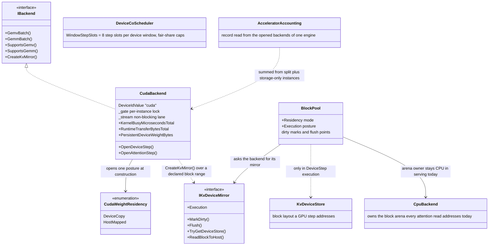
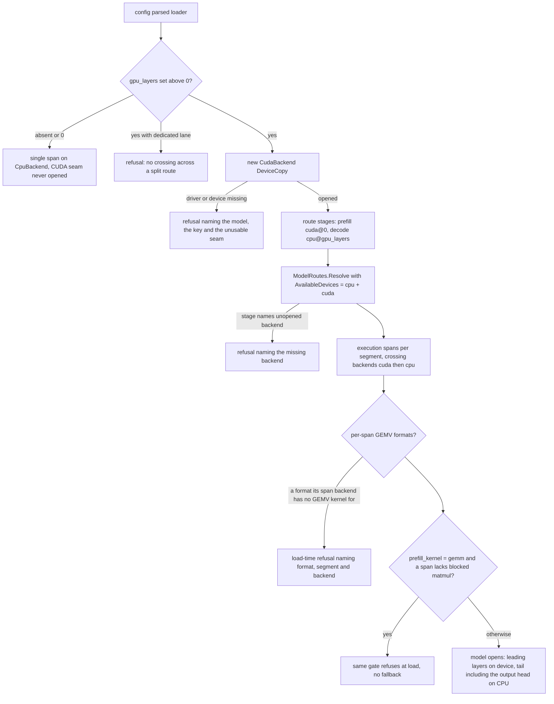
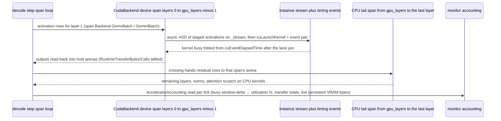

# CUDA backend

How LAIR's accelerator seam works today: the Driver-API binding and embedded-PTX posture, weight GEMV/GEMM kernels per quant format, attention kernels, KV mirroring, device-step composition, streams and multi-model device compute, capability gates with their refusal semantics, and transfer accounting.

As of 2026-11-27 (v0.7.x line). Where this page and the code disagree, the code is authoritative. Operator-facing keys live in [`docs/user/reference/CONFIG.md`](../../user/reference/CONFIG.md); the module map and seams are in [architecture.md](architecture.md), one request's path through them in [request-lifecycle.md](request-lifecycle.md).

## What this seam is for

`CudaBackend` (`src/Lair.Backends.Cuda/CudaBackend.cs`) implements `IBackend` on device id `"cuda"` (`DeviceIdValue`). It exists to run a *declared span* of a model's transformer layers — and, behind an assembly-internal seam only bench/test opens reach, whole dense prompt windows — against hand-written kernels the driver JIT-compiles from PTX text embedded in this project. No CUDA toolkit is invoked at build time and no native math library (cuBLAS/cuBLASLt) is linked anywhere on this seam: every kernel here lives in `CudaBackend+Ptx.cs`, `CudaBackend+GemmPtx.cs`, `CudaBackend+DenseGemmPtx.cs`, `CudaBackend+AttentionPtx.cs`. A model that never declares accelerator placement (`placement.gpu_layers` absent or 0) never touches this seam at all — see [scheduling.md](scheduling.md) for the CPU default posture it stays in.

## Driver-API binding and embedded PTX

The whole driver surface is `[LibraryImport("nvcuda", EntryPoint = "…")]` source-generated P/Invoke in `src/Lair.Backends.Cuda/CudaNative.cs`: context seams (`cuInit`, `cuDeviceGetCount`, `cuDeviceGet`, `cuDevicePrimaryCtxRetain`, `cuCtxSetCurrent`, `cuDevicePrimaryCtxRelease`), module/kernel seams (`cuModuleLoadData`, `cuModuleGetFunction`, `cuLaunchKernel`), memory and copy seams (`cuMemAlloc_v2`, `cuMemcpyHtoD_v2`, `cuMemcpyDtoH_v2`, the async twins, `cuMemAllocAsync`/`cuMemFreeAsync` plus `cuDeviceGetDefaultMemPool`/`cuMemPoolSetAttribute`), pinned-host registration for mapped weights (`cuMemHostRegister_v2`, `cuMemHostGetDevicePointer_v2`, `cuMemHostUnregister`), per-instance stream seams (`cuStreamCreate`, `cuStreamDestroy_v2`, `cuStreamSynchronize`, `cuStreamQuery`) and device-side timing events (`cuEventCreate`, `cuEventRecord`, `cuEventQuery`, `cuEventElapsedTime`).

PTX is emitted as C# string constants with the header `.version 7.0` / `.target sm_50` / `.address_size 64` (`PtxHeader`, `CudaBackend+Ptx.cs`) and JIT-compiled by the driver at module load. Two consequences of that target are stated in the source rather than discovered mid-run:

- Address arithmetic stays in computed-register form everywhere, because this seam rejects `[base+reg]` load forms; half/bf16 weights widen through integer bit math into a per-thread local slot reloaded as `f32`, since `cvt.f16` forms answer `CUDA_ERROR_INVALID_PTX` here. Accumulation is written as plain `mul` then `add` in ascending column order — the chain shape the scalar CPU reference walks — which is what lets one windowed launch reproduce repeated solo dots; last-bit agreement lives between two device launches, not across devices (the per-format bands every CUDA parity gate measures are recorded test-side).
- No tensor-core form is used: `mma.sync` needs a target declaration this module does not carry. The attention softmax (`CudaBackend+AttentionPtx.cs`) is a reduction over positions with `ex2.approx` over log2-e scaled arguments and `div.rn` for the reciprocal — including the softcap path, which evaluates `cap * tanh(score / cap)` through those same forms.

Driver failures carry the driver's own vocabulary unchanged: `CudaException` (`src/Lair.Backends.Cuda/CudaException.cs`) reports `"CUDA driver seam failure in {function}: {Describe(result)} ({(int)result}). nvcuda.dll was loaded but the call failed; ensure a CUDA-capable device and a driver exposing the CUDA Driver API are present."` A host that opened this backend for a declared split converts any `CudaException`, `DllNotFoundException`, `EntryPointNotFoundException`, or `TypeInitializationException` into its own model-named refusal (below). The binding itself is exercised by a tiny standalone probe: `src/Lair.Backends.Cuda/CudaGemmSmoke.cs` runs one 3×4×5 FP32 GEMM through the same JIT path, and `tests/Lair.Tests/CudaBindingSpikeTests.cs` compares it against a CPU reference (Windows-guarded).

## Device, context, stream lifecycle

Construction order in `CudaBackend(CudaWeightResidency)` is fixed: `cuInit(0)`, `cuDeviceGetCount` (a host with no device answers `CudaResult.NoDevice`), `cuDeviceGet(out _device, 0)` — **ordinal 0 only**, this build opens exactly one device and there is no device-selection knob — primary-context retain, `cuCtxSetCurrent`, module load from the single PTX image, then resolution of every kernel function handle (18 GEMV, 13 blocked matmul, six attention plus two quantized-attention entry points; see the field list in `CudaBackend.cs`). The instance stream is created beside the module load (`CreateInstanceStream`, `CudaBackend+Streams.cs`) with `CU_STREAM_NON_BLOCKING` (0x1), and the device's default allocation pool has its release threshold raised once to 256 MiB (`PoolReleaseThresholdBytes`) so a lane join returns freed chunks to the pool instead of the OS.

Two locks organize this seam:

- `_gate` is a per-instance `object` lock; `EnterDeviceWork()`/`ExitDeviceWork()` take it and re-bind the retained primary context for the calling thread (`CudaBackend+KvMirror.cs`). It serializes single-flight ordering **within one model**; since the stream lanes landed it no longer gates anything across instances.
- `_stream` is this instance's dedicated non-blocking compute/copy lane: every steady-state launch, staging copy, and timing event carries that handle and never `IntPtr.Zero`, so an instance never implicitly rendezvous with the legacy NULL/default stream. Steady-state activation traffic stages through private pinned arenas (`_pinnedIn`/`_pinnedOut`) grown to the largest shape seen; transient device buffers ride the lane through the default mempool; residency moves that must be complete before a later launch reads them (a weight tensor's one-time upload, an IQ table fill) enqueue on the instance stream and then join it (`SyncInstanceStream`, `EnsureDeviceWeights` in `CudaBackend+DeviceCopy.cs`).

Teardown drains before destroying: `DestroyInstanceStream()` synchronizes then destroys so a failure names `cuStreamSynchronize`; open device steps are released by backend dispose even if their caller never disposed them (`_deviceSteps`, `CudaBackend+Attention.cs`); timing events and the pending probe are destroyed with the instance.

### How a weight pass crosses the seam

`RunGemv(WeightRef, activations, count, output)` (`CudaBackend.cs`) is one enqueue-and-join cycle per call. It resolves that format's function handle first — *refuses formats with no kernel before any device work starts* — routes the five sub-4-bit formats to `RunGemvQ8K` (host Q8_K quantization of each activation vector, see below), then takes `_gate`, re-binds this instance's retained primary context for the calling thread (`SetCurrentContext`; the driver API keeps the current context per thread), and answers weight placement from the residency posture: `EnsureHostMappedWeights` or `EnsureDeviceWeights`, both keyed on `(pointer, length)` so a tensor crosses once per instance. Transients are stream-ordered on this lane — `cuMemAllocAsync(…, _stream)` for the activation buffer and the result buffer, consumed by the copies and launch enqueued after them, released with `cuMemFreeAsync` behind the download that last touches the result — so no classic allocation or free lands in a compute call and *"a second model's stream is never held behind this instance's allocator bookkeeping"*.

The activation bytes are copied into the pinned `_pinnedIn` arena and uploaded with `cuMemcpyHtoDAsync_v2` on the instance stream; that crossing is what `AccountRuntimeCopy` tallies. The launch itself is `(rows + KernelThreads - 1) / KernelThreads` blocks of `KernelThreads = 128` threads, one block per slice of weight rows with an in-kernel batch loop over activation vectors (`CudaBackend+Ptx.cs`: *"a row guard, a batch loop, and one walk of `blockBytes`-wide blocks covering `blockElements` columns each"*), six kernel parameters for every format except the IQ4 pair, which rides a seventh cursor into the shared scratch table. The result download is enqueued on the same lane before `SyncInstanceStream()` joins it — this instance's stream only — and elapsed time from the event pair folds in after that join returns.

Not everything this backend does runs on the device: `Dot`, `Axpy`, row dequantization (`DequantQ4KRow` … `DequantIQ3SRow`) are plain host code used for embedding lookups, norm vectors and single-vector scratch — consistent with "row dequantization stays host-side" in the type docs. Disposal ordering is explicit about what belongs to which context: mirrors flush while the context is current, then device steps, IQ scratch, weight allocations or mapped regions, the instance stream (which joins its own pending work), pinned staging arenas, timing events — and only then `cuModuleUnload` and `cuDevicePrimaryCtxRelease`.

## Weight residency postures, KV mirroring, streams and accounting behind one seam

`CudaWeightResidency` (`src/Lair.Backends.Cuda/CudaWeightResidency.cs`) selects one of two postures per instance, and the posture is fixed at construction:

- **`DeviceCopy` (default)** — each weight tensor's `(Pointer, Length)` gets exactly one `cuMemAlloc_v2`, filled by a host-to-device copy enqueued on the instance stream and joined before answering (`EnsureDeviceWeights`). Copies are cached for the instance lifetime and freed as a set at dispose. Counters read straight off that tracking: `DeviceWeightCopies`, `PersistentDeviceWeightAllocations`, `PersistentDeviceWeightBytes`. This posture reports `WeightTier.Vram` (its kernels read device copies), which is what makes an opened split's span resolve its weight tier at the accelerator tier in route resolution.
- **`HostMapped`** — each tensor's live host region is registered once (`cuMemHostRegister_v2`) and launched against the device pointer `cuMemHostGetDevicePointer_v2` answers, so no weight byte enters persistent device memory; `PersistentDeviceWeightBytes` stays 0 and the instance reports `WeightTier.Dram`. A mapped region must stay valid and page-aligned for the backend's whole lifetime with no overlapping registration (`CudaBackend` ctor docs). GenerationService uses this posture for a storage-only seam opened when KV blocks are device-backed but every forward stays on CPU: `new CudaBackend(CudaWeightResidency.HostMapped)` — it maps no weight tensor, runs no kernel, and answers no scheduler or monitor fact beyond residency.

## Weight kernels per format

`SupportsGemv(QuantFormat) => HasGemvKernel(format)` with `HasGemvKernel(format) => true`: every `QuantFormat` member resolves a GEMV function handle today (`CudaBackend.cs`). Row dequantization stays host-side (embedding lookups and norm vectors), so the device carries dot kernels only. The blocked-matmul gate is narrower:

| Format | GEMV on device | Blocked matmul (`GemmBatch`) | How the kernel consumes activations |
|---|---|---|---|
| `F32`, `F16`, `BF16` | yes | yes (hand-tiled dense PTX, that format's own widening) | FP values direct |
| `Q8_0`, `Q5_0`, `Q2_0` | yes | yes | packed block unpacking per window lane |
| `Q4_K`, `Q5_K`, `Q6_K`, `Q2_K`, `Q3_K` | yes | yes | K-quant header/scale unpacking in-kernel |
| `IQ4_NL`, `IQ4_XS` | yes | yes | fused nibble-table lookups against pinned scratch, FP activations |
| `IQ2_XXS`, `IQ2_XS`, `IQ2_S`, `IQ3_XXS`, `IQ3_S` | yes | **no kernel today** | host-side Q8_K quantization crossed over PCIe beside pinned grid tables |

Handles resolved at construction (`CudaBackend.cs` field list) make the gate count concrete: 18 GEMV handles (`_gemvF32`, `_gemvF16`, `_gemvBf16`, `_gemvQ4K`, `_gemvQ6K`, `_gemvQ8_0`, `_gemvQ5_0`, `_gemvQ2_0`, `_gemvQ5K`, `_gemvQ2K`, `_gemvQ3K`, `_gemvIQ4Nl`, `_gemvIQ4Xs`, `_gemvIQ2XXS`, `_gemvIQ2XS`, `_gemvIQ2S`, `_gemvIQ3X`, `_gemvIQ3S`), 13 blocked-matmul handles (exactly the thirteen formats the table's middle column marks yes), and eight attention-family handles (`_ropePairs`, `_ropeHalf`, `_kvStore`, `_kvStorePaged`, `_attnCausal`, `_attnCausalPaged`, `_attnCausalQ8Q8`, `_attnCausalK8V4`). A format with no GEMV handle is impossible today; a `GemmKernelFor` miss throws the refusal quoted below rather than picking another kernel.

### How the kernel text is assembled

Every packed-quant GEMV comes out of one generator, `BuildQuantGemvPtx(entryName, blockElements, blockBytes, extraU32Regs, headerLines, groupArms, tabLoad)` (`CudaBackend+Ptx.cs`), which emits a `.visible .entry` with six parameters — weight pointer, activation pointer, output pointer, rows, cols, batch count (plus the scratch-table cursor when `tabLoad`) — and reuses one register set across the family: *"a row guard, a batch loop, and one walk of `blockBytes`-wide blocks covering `blockElements` columns each"*, with unpack scratch (`bits/payload/exp/mant/sign/fbits/sub_/hw` plus the per-thread local slot) shared because every block header is a half-float widened through integer bit math, and the scale pair (fused `scl_`/`sft_`) present for every grouped format. Per-format files (`CudaBackend+Q8_0.cs` … `CudaBackend+IQ3_S.cs`, `+Q4K.cs`, `+Q6K.cs`) supply that format's header lines and group arms rather than separate PTX bodies, which is also what makes the GEMM derivation possible: same unpacking text, windowed frame.

The windowed family amortizes one unpack of a weight row's quant bytes across an activation-row window: `GemmWindow = 8` (`CudaBackend+Gemm.cs`). Each lane keeps its own accumulator chain advanced in ascending column order exactly as that format's GEMV walk advances it, so a windowed dot and a solo dot over the same bytes produce the same sum — the per-format bands inherited from the GEMV kernels carry over unchanged; a lane past the batch end reads its clamped row into an accumulator that is never stored. The PTX for each blocked matmul is *derived* from that format's own GEMV text by rewriting three frame anchors (batch opening, accumulator init per lane, store epilogue) in `CudaBackend+GemmPtx.cs`, with the unquantized variants built from scratch in `CudaBackend+DenseGemmPtx.cs`.

The Q8_K i-quant family answers false to `HasGemmKernel` "until its windowed kernel lands", and a route naming any of them keeps refusing at load rather than running through some other device's kernel. The backend's own mid-call refusal names the seam: `"CudaBackend ('cuda') has no blocked matmul kernel for format {format}: … while the Q8_K i-quants (IQ2_XXS, IQ2_XS, IQ2_S, IQ3_XXS, and IQ3_S) carry none, so this weight pass is refused naming that backend rather than run through a CPU fallback."`

### Sub-4-bit i-quants: why they dot against Q8_K activations

The five sub-4-bit formats mirror the CPU oracle's `RowDotQ8K` path exactly (`QuantizeActivationToQ8K`, `CudaBackend+IQ.cs`): one float block scale per 256-value super-block followed by 256 signed quants, with `iscale = -127 / max` (first strict improvement carries the maximum's sign, so no quant reaches −128), ties-to-even rounding through `NearestInt`, and whole super-blocks covered with zero quants past the real width under a scale built from real values only. The device kernel then consumes whole sub-blocks without per-column bounds: padding products against zero quants contribute nothing on either side of the seam. Pinned lookup tables (`CudaBackend+IqTables.cs`) are byte-for-byte copies of `CpuBackend`'s internal tables, and a gate asserts element equality at open — "a copy that drifts fails naming the table instead of serving silent mis-decode". Scratch is allocated once per instance with one sub-pointer per grid so each launch passes its own format's device address (`EnsureIqScratch()`, `GridDeviceBase(w.Format)`); fills ride the instance stream and join before answering.

## Attention kernels and KV mirroring

`HasDeviceStepKernel => true` documents the fact it names: this seam resolves `rope_pairs`, `rope_half`, `kv_store`, `kv_store_paged`, `attn_causal`, `attn_causal_paged`, plus quantized-attention handles for the two supported KV combos (`CudaBackend+Attention.cs`). Rotation pairing is selected by `RopePairing` (`src/Lair.Backends.Cuda/CudaDeviceStepRequest.cs`): `AdjacentPairs` rotates `(2i, 2i + 1)` — the llama-family layout — and `SplitHalfPairs` rotates `(i, i + headDim / 2)`, the qwen3/gemma layout; both read the same position-major pair tables.

The KV mirror seam is residency accounting in its default posture and *storage* only under an internal one (`KvMirrorExecution`, `src/Lair.Contracts/KvResidency.cs`; default `HostArenaRead`):

- **`HostArenaRead`** — a device-backed block range carries a persistent copy allocated once over the declared ids, sized to whole blocks in the pool's own layout (`CudaKvMirror.cs`). Attention still reads the host arena. Dirty marks come from write paths only: a freshly handed-out block (`AllocateBlockId`), a copy-on-write destination span (`MutableBlockSpan`), and `SequenceKv`'s K/V writes; release-to-zero also marks before flushing. Flush points are admission-window end, release-to-zero, an explicit `FlushDeviceMirror()`, and dispose (`src/Lair.Kv/BlockPool.cs`). Reads never mark: only what changed since the last crossing is owed a copy.
- **`DeviceStep`** — the same persistent copy starts byte-identical to the pool's zeroed arena over the declared range (one residency crossing at open, staged from the region the mirror pins), and it is handed out as a `KvDeviceStore` a GPU step reads and writes through the pool's block paging. Host attention of these blocks stops being the served path; reading one back explicitly goes through `ReadBlockToHost`. Asking this posture for anything it cannot serve refuses: a host-only residency, a non-FP32 pair on the float pool (`"… declares k='q8_0' v='q4_0' at tier Vram … that pair has no device attention kernel here"`), or a CPU backend asked to mirror its own arena. The only quantized combos with device kernels are `q8_0/q8_0` and `q8_0/q4_0`, selected in exactly one place (`ValidateExecutionCombo`, `src/Lair.Kv/BlockPoolGeneric.cs`).

| Posture | Attention reads | Who writes block bytes | What a flush means | Persistent copy |
|---|---|---|---|---|
| `HostArenaRead` (every served device-backed pool today) | host arena | pool's host writers (`SequenceKv`, in-pool copies) | bring the residency copy current for dirty blocks | one whole block per declared id, never read by a kernel |
| `DeviceStep` (bench/test opens only) | the store itself, through pool block paging | GPU kernels write float KV; quantized bytes still written host-side then flushed | keeps host-written blocks current; device writes are recorded without crossing (`AccountDeviceWrite`) | same allocation, but it *is* the storage a step addresses |

Serving today never selects the store posture: GenerationService opens its pool as `new BlockPool(blockTokens, …, backend, kvResidency, deviceBackedBlocks, mirrorOwner)` with no execution argument — i.e. `HostArenaRead` — and a quantized pair beside any non-host residency is refused earlier (`"quantized blocks are host-resident in this build — resolve the residency to 'dram' or omit 'kv.quant'"`).

### What the mirror request carries, and how a store is addressed

`KvMirrorRequest` (`src/Lair.Contracts/KvResidency.cs`) names the caller's host arena base and length (the range must lie inside it), `BytesPerBlock`, the physical id range `[FirstBlockId, FirstBlockId + BlockCount)`, plus tier and resource name used only to phrase a refusal from a backend that holds no storage at that tier. The persistent copy is exactly `DeviceRangeBytes = BytesPerBlock * BlockCount` — one whole block per device-backed id, allocated once for the mirror's lifetime (`IKvDeviceMirror.DeviceBytes`). In the store posture the pool geometry travels with it: `BlockTokens`, `LayerCount`, `KvDim`, and for a quantized combo the group geometry a kernel addresses through (`KGroupBytes` 34 for q8_0, `VGroupBytes` 18 for q4_0, groups per token, layer-K-side bytes, layer-region bytes), because *"the store a step consumes is addressed through the pool's block layout"*.

A bound step re-derives that geometry and refuses any disagreement rather than walking the wrong block mid-step: quantized attention resolves a value to its group by shift, so `KvDim` must be a whole number of 32-value groups (*"only a multiple of 32 addresses it"*), declared groups-per-token must match, and byte arithmetic across layers has to come out identical — e.g. *"the KV store declares layer-K-side=… block=… bytes, but its geometry is {layers} layers x ({groups} groups x {tokens} tokens x 34 K) + … = {bytes} bytes."* Block paging itself rides `_blockShift`, so a pool with a non-power-of-two `BlockTokens` (a ragged 3-token block) refuses at bind time. The attention handle is then resolved **once** from the combo (`AttentionPagedKernel`, `AttentionQ8Q8Kernel`, or `AttentionK8V4Kernel`) — *"the attention walk never branches on format per position"* — and what that route computes is fixed: it dots a q8_0 K side against a prepared query and decodes a q8_0 or q4_0 V side (`ValidateExecutionCombo` comment, `src/Lair.Kv/BlockPoolGeneric.cs`).

## Layer split: how `placement.gpu_layers` routes a model

The public surface for accelerator placement is one key. The loader parses it as "how many transformer layers execution opens on device `'cuda'`, counted from layer 0" and refuses a negative value (`YamlConfigLoader.cs`: *"'gpu_layers' must be a non-negative integer — the count of this model's transformer layers execution opens on device 'cuda', counted from layer 0."*). The two placement keys that name whole-model devices stay CPU-only:

- `models[].placement.device` / `models[].placement.prefill` accept only `'auto'` or `'cpu'`, each refusal ending with *"An accelerator device becomes placeable when a compute backend reports it in 'Lair.Backends.Cuda'"* — so an all-on-GPU model is not expressible today, only a leading span.
- `models[].placement.gpu_layers > 0` beside `placement.prefill_lane: dedicated` refuses outright: *"a dedicated prefill lane carries one stage-side execution backend, and this build has no crossing across a split route — resolve placement onto one segment or open no lane."*

Route construction is in `src/Lair.Http/GenerationService.cs` (`OpenEngineAsync`): the split backend is opened beside the decode-side CPU backend, and if no usable driver or device stands behind it the open fails naming everything — *"model 'X' declares 'placement.gpu_layers' N: the split opens a compute backend on device 'cuda', accelerator-backed segments run in 'Lair.Backends.Cuda', and this host opened no usable CUDA driver or device behind that seam — refusing rather than running this model's layers somewhere else."* Stages become `[PrefillStage → cuda @ SplitPosition 0, DecodeStage → cpu @ SplitPosition gpu_layers]`, resolved by `ModelRoutes.Resolve` with the CPU id plus `"cuda"` in `AvailableDevices`. A stage naming a device no opened backend reports refuses there: *"no compute backend reports device '…' — accelerator-backed segments run in 'Lair.Backends.Cuda', which this build does not carry … a route naming another device is refused rather than run on CPU."*

The engine then bounds the boundaries against the file it opens over (`ResolveExecutionSpans`, `src/Lair.Models/Engine/TransformerModel.cs`): the first span must start at 0, each later boundary must ascend past the previous one (*"a split route hands every layer to exactly one span"*), and a boundary past this file's last layer refuses — *"only the final span may start exactly at the layer count"*, which is how an output-head tail can sit on its own segment. Each resolved position runs on the backend supplied for it: GenerationService passes `[splitExecution, backend]` in order ('cuda' first, decode-side CPU after), and each span beyond the first owns a staging arena allocated through *its own* backend (`ResidualCarrier`, `ExecutionCrossing`) sized once at open. A single-token or merged decode step walks spans in order — every weight pass runs on its own span's backend, and a crossing hands only residual rows onward; logits are dotted by `_mainSpans[^1].Backend`, i.e. the CPU tail for a split route.

Capability gates run per resolved span before any weight view is spent: `ValidateSpanWeightCapability` refuses *"weight format(s) … have no GEMV kernel in the compute backend 'cuda' resolved for this segment … resolve placement onto 'cpu' or re-quantize this file to a format 'cuda' executes"*, and `ValidateSpanMatmulCapability` applies the same per-span shape when `engine.prefill_kernel: gemm` is selected (`gemv`, `tiled`, `gemm` are all accepted by the loader; whether one can run for the served file is decided at model open). Nothing falls back to CPU for a device-named segment, and a quantized KV pair cannot ride a split route at all: *"quantized attention runs CPU kernels over host-resident KV through the batched-row window only — resolve placement onto a CPU-only, host-resident posture with 'gemv' prefill."*

### What crosses during a split decode step, and what does not

Per weight pass on the device span, exactly two crossings are tallied: that call's activation rows in, its result out (`AccountRuntimeCopy` once per direction). Attention for those layers runs against host-resident KV bytes — the pool opens `HostArenaRead`, so no block crossing rides a decode step at all — and mirror flushes, when they happen (window end, release-to-zero), stay outside the runtime tallies as residency moves. Between spans only residual rows move, through the arena the receiving span's own backend allocated; norms, projections, attention scratch and expert buffers are recomputed inside whichever span runs that layer (`ResolveExecutionSpans` comments). The tail — everything past `gpu_layers`, including the output head dotted by `_mainSpans[^1].Backend` — answers on CPU kernels exactly as an unsplit model would.

### What the split's device span pays, and where its residency is claimed

Choosing `gemv` or `tiled` for prompt windows does not keep a split's first span off the GPU: prefill spans take their stage-side backend from the same ordered set (`prefillSide[index].Backend`, `ResolveExecutionSpans`), so with `[splitExecution, backend]` in force those rows run as CUDA GEMVs per row — only `gemm` engages the blocked-matmul gate, and only then does a span whose formats lack it refuse. Weight residency is claimed once at open: when the split backend reports device copies (`WeightTier.Vram`) the ledger records an accelerator position for weights bounded by the operator's `host.vram_mb`, or no public total when that key is absent ("what a host backs without stating a size keeps the posture that states no public total", `YamlConfigLoader.cs`). KV residency divides its own way: `vram` declares every id in the pool, `split` defaults to half of them in allocation order — *"A declared finite ceiling narrows that default; nothing widens past the midpoint or past what the pool reserves"* (`GenerationService.OpenEngineAsync`) — and whichever accelerator backend this open owns becomes the storage owner of those persistent copies: the split's compute instance when one exists, otherwise the mapped seam opened only to hold blocks. That storage-only instance contributes its residency bytes but no kernel busy (it runs none), which is why the monitor totals add nothing for it.

In order, what an open with a declared split does (`YamlConfigLoader.cs` → `GenerationService.OpenEngineAsync` → `TransformerModel.Open`):

1. Loader validates vocabulary and ranges for `gpu_layers`, `device`, `prefill`, `kv_residency`, `compute_share`, budgets — no backend is consulted at this stage.
2. The decode-side CPU backend opens first (thread quota, core set, ISA resolution); a dedicated lane posture would open two CPU backends instead, and cannot coexist with a split.
3. `new CudaBackend()` (`DeviceCopy`) attempts the seam; driver-shaped failures become the model-named refusal quoted above, and success logs `gpu_layers model=… cuda_layers=… device=cuda`.
4. KV residency resolves to a mode plus its ceiling check before any seam opens for storage; a divided range computes its leading block count there.
5. Route stages are built (`cuda` at boundary 0, `cpu` at `gpu_layers`) and resolved with both ids available; segment weight tiers come from what each opened backend reports.
6. Budget chains resolve against the pools this service will open — an accelerator-backed KV residency opens the Vram position for blocks specifically while compute stays host-side.
7. The model opens over `[splitExecution, backend]`; boundaries are bounded against the file's layer count and per-span format gates run before any weight view is spent.
8. Ledgers record opened tier positions (`host.vram_mb` ceiling for device weights when stated), claims seat at open, then the pool opens with its mirror owner over the declared block range in host-read posture.
9. The engine takes its seat in that device's co-scheduling window (adopted by a multi-model registry) and attaches accelerator accounting to its monitor bus.

## Device-step composition — an internal seam

`OpenDeviceStep(CudaDeviceStepRequest[, IKvDeviceMirror])`, `OpenAttentionStep(...)` and the step class itself (`src/Lair.Backends.Cuda/CudaDeviceStep.cs`) are public members of the backend, but no host configuration path reaches them. What a composed open does: persistent device buffers for positions/layers/staged window plus angle tables; either a private KV arena (unwritten at open — *"a step may only read positions its own KV write has covered"*) or a bound pool store in the `DeviceStep` posture, with block paging through `_blockShift = Log2(BlockTokens)` and byte geometry validated against both sides (`"the KV store declares combo … with group sizes k=… v=…, but … stores a q8_0 K side (34 bytes per group) beside a q4_0 V side (18 bytes)"`, ragged block counts that are not powers of two refuse, `MaxPositions` wider than the store's declared range refuses naming *"covers 4 blocks of 8 tokens = 32 positions"*). Method surface: `LoadRopeTables`, `StageWindow`, `ApplyRope(positionBase)`, `WriteKv(layer, positionBase)`, `Attend(...)`, whole-step `RunStep`, composed-window `RunAttentionWindow`, query-only staging for the decode footing (`StageQueries`), and read-backs of staged rows.

Geometry ceilings validated before any device work starts (`CudaDeviceStepRequest.Validate()`): `HeadDim` must be even and at most `MaxHeadDim = 128`, the width of one attention lane; `KvHeadCount` must divide `HeadCount` and the resulting group size must be a power of two because *"the attention kernel maps each query head to its kv-head by a bit shift"*; the staged window is capped by `MaxWindowRows` (default 64) so a wider sub-batch refuses naming the field rather than faulting mid-step.

Launch geometry differs by kernel on purpose (`CudaDeviceStep.cs`): rotation and KV-write blocks stride at `StagedKernelThreads = 128`, while the attention block is *"one lane per head dimension, so its block width is the request's head dimension and every lane covers exactly one accumulator"* — grid X is the staged row count, grid Y the query-head count, with the grouped-query mapping passed as a shift (`Log2(HeadsPerKvHead)`) and `attnScale`/`softcap` passed by their bit patterns. Every step launch goes through `LaunchStepKernel`, which brackets exactly that launch with the backend's timing pair, enqueues on `_backend.ComputeStream` (*"a step never queues onto the legacy default stream"*), joins the lane and folds elapsed time into the same kernel-busy tally every other call site uses — so a composed window reports busy time like any GEMV does. A device-side KV write records each covered block through `AccountDeviceWrite`: *"accounting for what the store now contains, not a crossing: no byte moved."*

Two posture rules make this seam honest rather than clever:

- A quantized store is **read-only** to a step: it has no device-side quantizer, so `WriteKv` refuses *"for a quantized combo rather than staging FP32 key/value rows as quantized groups"* — the pool's host writers and mirror flush own those bytes.
- `RunAttentionWindow` performs **no rotation**: rows arrive with the composing engine's own rotary pass already applied, which is what keeps rope bytes byte-identical to the host reference while only the KV write and causal walk move device-side (`CudaDeviceStep.cs`; used by `TransformerModel.RunPrefillSubBatch`, `deviceStep.RunAttentionWindow(...)`).

A grouped-query group the committed shift mapping cannot express — nine query heads over three kv-heads is that shape today — runs through padded head staging in `src/Lair.Backends.Cuda/CudaGroupedAttentionStep.cs` (internal): every real head keeps its kv-group slot, one dummy region absorbs each partial group with zeros on stage and is dropped on read-back; the kernels stay exactly as committed.

Where composition actually installs: `TransformerModel._devicePrefill` (`src/Lair.Models/Engine/TransformerModel.cs`) is documented *"Assembly-internal: only a bench or test open installs one, and every default posture answers false"* (`DevicePrefillActive`). A composition requires the dense-matrix selection — anything else raises *"'… composes prompt windows under prefill kernel 'gemm' … opens with 'gemm' or not at all; a re-point away from it is refused rather than run behind an opened composition"*, refuses against a dedicated lane/offloaded stage backend, and validates step geometry against the engine's own plan (`DevicePrefillGeometryRefusal`, staging width vs `_effectivePrefillRowWidth`). The only opens in-tree are `bench/Lair.Bench/CudaPrefillBench.cs` (device-store pool + `OpenAttentionStep`) and `tests/Lair.Tests/{CudaDeviceStepTests,CudaDeviceKvTests,CudaQuantizedKvTests,CudaDevicePrefillTests}.cs`. Treat on-device attention over quantized KV, and any device-side prefill in serving, as landed-but-not-default.

## Streams and multi-model device compute

Every open `CudaBackend` carries exactly one non-blocking stream (`_liveInstanceStreams`, static counter — test/measurement visibility only; no production path consults it), so two models resident on the same physical GPU queue their launches and staging copies independently on the shared primary context, and each call site awaits its own lane rather than `cuCtxSynchronize` (*"a second backend's kernels keep running while this one drains"*). Cross-model launch admission is a host-side decision: `DeviceCoScheduler` (`src/Lair.Models/Scheduling/DeviceCoScheduler.cs`) bounds how much device work each resident model may launch inside one shared window of `WindowStepSlots = 8` step slots; a declared `models[].compute_share` (1–100) caps a model at its share, floor one slot, and *"deferral is a launch decision taken before a step starts, never a preemption of one in flight"*. GenerationService hands each device-resident engine the host's seam when it names that device, else opens its own; `src/Lair.Http/ModelRegistry.cs` adopts the window from *"the first engine that carries one"*, so every later model resident on that device — including a hot-added one — advances the same bounded fair-share instead of opening a window of its own. A declared share against a route with no device segment bounds nothing and is reported warn-and-accept (`GenerationService.OpenEngineAsync`, log line `compute_share … window_mismatch`).

What overlap pays off was measured with hand-rolled launches against already-loaded modules — deliberately *not* through `CudaBackend`'s production streams (`bench/reports/multi-model-device-concurrency-2026-11-19.md`; shape rows=2048 cols=2048 batch=32, repsPerArm=15, sweeps=3, pairs=3; device ordinal 0 "NVIDIA GeForce RTX 4090", driverApiVersion=13030): serialized/overlapped paired medians ran **1.57–2.00** for `two_gemv_q8_0__q6_k`, **1.89–2.17** for `two_gemm_q8_0__bf16`, and 1.28–1.66 for the mixed GEMV/GEMM pair (positive twice, inconclusive once at 1.28). The two-stream control shows serialized/two-stream medians of only **0.99–1.14** — essentially all measured payoff comes from submitting both lanes before awaiting either, not from lane machinery itself. Absolute millisecond medians there are contention-contaminated (other GPU compute processes active; raw JSONs live outside the repo), so those verdicts ride on rep-by-rep paired ratios. Bit-for-bit serialized-vs-overlapped output equivalence held for every pair in every run. The production posture this measurement justified is per-model streams plus the co-scheduling window — not any device-side priority or SM-share enforcement (`AcceleratorStreamPriority`/share fields land on segments but bound nothing yet, `src/Lair.Models/ModelRoutes.cs`).

Two seams worth knowing when reading overlap behavior: `cuDeviceGet(out _device, 0)` means every open instance retains the **same** primary context — device ordinal 0 — so two models on one GPU is today's only multi-model posture and a second physical card is not addressable (which is also why `DeviceCoScheduler` keys its window by the single `"cuda"` id). And the pending check used to prove lanes run together rides `_pendingProbe`, an event recorded behind everything already queued on the lane and read with `cuEventQuery`, because *"a bare cuStreamQuery proved unreliable here — it answered Success while a just-submitted millisecond launch was still running."* Both facts are stated in-source rather than inferred.

## Transfer accounting and what the monitor publishes

Cumulative tallies live in `CudaBackend+Accounting.cs`. Kernel busy is measured by the device: a lazily-opened event pair brackets each launch *on this instance's stream*, recorded in stream order after earlier staging copies have crossed, folded only after that lane joins — so it answers how long the kernel was busy, not wall time around the call site. A driver that refuses to open the pair degrades accounting (zero busy) instead of refusing compute behind it; a sub-microsecond kernel contributes nothing rather than an invented floor. Transfer tallies count **only copies made by compute calls** — activation inputs crossing in and kernel outputs coming back, now staged through pinned arenas on the instance stream. Excluded deliberately: the one-time weight upload a `DeviceCopy` posture caches per tensor, host-region registrations, and KV mirror residency crossings ("they are residency moves, not a compute call's traffic").

GenerationService sums these across whichever accelerator instances this open owns — the split backend and/or a storage-only mirror instance (`AcceleratorAccountingOf`, feeding `new AcceleratorAccounting(kernelBusyMicroseconds, runtimeTransferBytes, runtimeTransferCalls, persistentDeviceWeightBytes)`; a mapped posture adds no weight bytes) — and publishes them through `EngineMetricsBus`: kernel busy becomes a **windowed rate** (device-measured microseconds advanced in the interval ÷ that interval's wall time → `gpuUtilizationPercent`), transfer totals publish cumulative-since-open, persistent VRAM as what each backend holds *right now*. A serve with no accelerator backend answers null so CPU-only snapshots keep their pre-existing shape rather than zero-filling. Separately, the *capacity* ledger is told which positions an open can back: `ReportOpenedTier(Vram, Weights, config.Host?.VramMb)` when a split backend reports device-resident weight copies (so device weight claims seat against the operator-declared `host.vram_mb` ceiling rather than anything read off the device), plus tier positions for prompt buffers and a storage-only KV mirror. See [monitoring-and-metrics.md](monitoring-and-metrics.md) for the rest of that surface, [residency-and-budgets.md](residency-and-budgets.md) for chains and claims; note this utilization reading is engine-side kernel busy on one device, not OS or NVML telemetry — hardware views stay out of scope there.

## Measured posture (committed artifacts only)

```mermaid
xychart-beta
    title "Composed dense prefill: CPU vs CUDA median wall ms (SmolLM-135M-Instruct-F16)"
    x-axis ["length 32", "length 64", "length 128"]
    y-axis "median ms" 0 --> 600
    bar [143.51, 232.43, 554.38]
    bar [120.11, 240.61, 492.37]
```

| Measurement | Posture and geometry | Numbers as recorded | Artifact |
|---|---|---|---|
| GEMV parity/speed gate | `cuda-gemv` bench; rows=512 cols=1024 batch=32 reps=7, all 18 CUDA-supported formats, device-copy residency with the one-time weight copy in untimed warm-up; host AVX2, 24 physical cores / 32 logical, CPU auto workers 24 | Auto-threaded-CPU-vs-CUDA-wall ratios: sub-4-bit i-quants **1.98–2.73** and `Q6_K` **2.16**; near-tie `Q5_0` 1.09, `Q3_K` 1.07; losses elsewhere (F32 0.23, F16 0.17, BF16 0.22, Q8_0 0.25, IQ4 pair ~0.23–0.25). Kernel-busy vs wall examples: `IQ2_S` 351.1 µs busy / 0.529 ms wall; `F32` 1904.4 µs busy / 2.270 ms wall — compute-only ratios are not serving claims | [`bench/reports/cuda-gemv-parity-2026-11-18.md`](../../../bench/reports/cuda-gemv-parity-2026-11-18.md), `reports/cuda-gemv-parity-2026-11-18/` |
| Blocked-matmul gate | `cuda-gemm`; rows=512 cols=1024 batch=32 reps=7, 13 formats, device-copy; CPU arms take that format's own dense weight pass (`cpuRoute=gemm\|gemv`) so each ratio states the chain it compares | Comparable-route (CPU blocked matmul exists) ratios stay at or below tie: `Q8_0` 0.90, `Q4_K` 0.83, `IQ4_XS` 0.79; fallback-route wins up to `Q6_K` 7.84 / `Q5_0` 6.50 against the batched-row route CPU would run today | [`bench/reports/cuda-gemm-parity-2026-11-18.md`](../../../bench/reports/cuda-gemm-parity-2026-11-18.md), `reports/cuda-gemm-parity-2026-11-18/` |
| Composed device prefill payoff | `cuda-prefill --lengths 32,64,128 --reps 3`; pinned `models/SmolLM-135M-Instruct-F16.gguf` (270,885,792 bytes), arch llama layers=30 hidden=576 heads=9 kvHeads=3 headDim=64 vocab=49152, resolved prefill row width 32; CUDA arm composes the device step per layer with KV resident in the pool's device store | CPU/CUDA medians **1.195 / 0.966 / 1.126** (win at 32 and 128, loss at 64) → "length-dependent payoff", not a blanket fast-prefill claim; argmax matched the CPU arm at all three lengths; max abs logit drift 1.5e-3–2.0e-3 is bench basis only (the composition test band stays `4e-3`); tallies e.g. length 128: kernel busy 1,903,216 µs, 10,810 runtime transfer calls / 929,967,360 bytes, resident device KV 11,796,480 bytes | [`bench/reports/cuda-prefill-2026-11-19.md`](../../../bench/reports/cuda-prefill-2026-11-19.md), `reports/cuda-prefill-2026-11-19/` |
| Two-model device overlap gate | `cuda-concurrency --reps 15 --sweeps 3`; shape rows=cols=2048 batch=32, three pairs; RTX 4090 driverApiVersion=13030; arms serialized-legacy / two-stream control / overlapped non-blocking lanes | Same-family pairs positive in all three runs (paired medians **1.57–2.17**); mixed GEMV/GEMM inconclusive once (**1.28**); lane machinery alone ≈ today's serialized pipeline (**0.99–1.14**) → per-model stream lanes justified for same-family concurrency, not blanket | [`bench/reports/multi-model-device-concurrency-2026-11-19.md`](../../../bench/reports/multi-model-device-concurrency-2026-11-19.md) (raw JSONs outside the repo; contention caveat stated in that report) |

### Correctness gates recorded test-side

Speed posture is only half of what those runs pinned. The authoritative CUDA-vs-CPU quality bands are the parity tests', and the same report records them (measured worst inside each band, from [`bench/reports/cuda-gemv-parity-2026-11-18.md`](../../../bench/reports/cuda-gemv-parity-2026-11-18.md)): `Q8_0` 1e-6 relative (worst 7.96e-7), `Q5_0` 1e-6 (8.16e-7), `Q2_0` 1e-6 (7.41e-7), `Q5_K` 4e-6 (2.72e-6), `Q2_K` 1e-6 (4.22e-7), `Q3_K` 2e-5 (1.01e-5 batched), `IQ4_NL` 2e-6 (1.03e-6 host-mapped, ~8.97e-8 exact-block), `IQ4_XS` 2e-6 (1.07e-6 batched), and the five sub-4-bit formats at 5e-7 — bit-exact zero in the gate for IQ2_XXS/IQ2_XS/IQ3_XXS, 8.27e-8 / 1.47e-7 partial-final-block for IQ2_S / IQ3_S. `F32`, `F16`, `BF16`, `Q4_K` and `Q6_K` keep their pre-existing posture; the gate neither re-bands nor widens them. Bench "equivalence" drift columns in those reports are sanity signals on different fixture magnitudes, never band assertions — which is why a composed-prefill composition test band of 4e-3 stands beside the bench's own drift numbers instead of being derived from them.

The verbs behind these tables (documented per-harness in [measurement-harnesses.md](measurement-harnesses.md)) are recorded verbatim in each report: `dotnet run --project bench/Lair.Bench -c Release --no-build -- cuda-gemv`, `… cuda-gemm`, `… cuda-prefill --lengths 32,64,128 --reps 3`. Real-model arms skip gracefully when their fixture is absent from `models/` — see [DEVELOP.md](../../../DEVELOP.md).

### Reading those numbers straight

Each report states its own caveats, and they are load-bearing for how the tables above may be quoted: kernel-busy microseconds exclude PCIe/runtime transfer overhead entirely, so compute-only ratios (up to 64.07 on `IQ3_S`) describe kernels, never serving speed; CUDA wall time includes activation upload, launch, sync and output download but not weight residency. The GEMV/GEMM shapes (`512 x 1024`, batch 32) are repeatable kernel gates, explicitly *not* whole-model decode or prefill throughput. Absolute medians on this host are contention-contaminated (other GPU compute processes active; CPU auto-threaded timings vary run-to-run where cache residency and boost behavior matter), which is why the overlap verdicts ride rep-by-rep paired ratios instead of wall numbers. And bench "equivalence" drift columns measure different fixture magnitudes than the parity bands, so they corroborate rather than gate correctness.

No automatic CUDA default is promoted from any of these gates: weight passes stay CPU unless a model declares `placement.gpu_layers`, and GPU prefill stays internal/non-default pending a stable payoff posture across serving shapes. Escalation to cuBLAS/cuBLASLt was considered on the comparable-route shortfall and *not* adopted — the dependency would break this managed-first embedded-PTX posture, and fast dense prefill is gated by device-side attention/KV composition rather than a library swap (`cuda-gemm-parity` report).

## Which suites hold these postures up

`dotnet test tests/Lair.Tests -c Release --filter "Category=Cuda"` is the CUDA suite; the overlap gate recorded exactly that run (248 passed, 0 skipped) beside its verdicts. The files that pin this page's claims: `CudaBindingSpikeTests.cs` (the JIT smoke GEMM against a CPU reference), `CudaBlockQuantGemvTests.cs` / `CudaIQuantGemvTests.cs` / `CudaQuantizedGemvTests.cs` / `CudaBackendParityTests.cs` (per-format quality bands), `CudaDenseGemmTests.cs` and `CudaPrefillGemmCapabilityGateTests.cs` plus `CudaWeightCapabilityGateTests.cs` (the blocked-matmul and per-span GEMV gates refusing at load rather than mid-decode), `CudaLayerSplitTests.cs` (route construction for a declared split), `CudaDeviceKvTests.cs` (mirror postures: host-read mirrors hand out no store, device-step execution needs a device-backed range and FP32 storage, geometry refusals naming both sides), `CudaQuantizedKvTests.cs` (the read-only quantized store refusal on `WriteKv`, quantized attention over flushed bytes), `CudaDeviceStepTests.cs` / `CudaDevicePrefillTests.cs` (step lifetimes and composed windows), and `CudaStreamConcurrencyTests.cs` (the per-instance lanes; the pending probe those tests read is documented as test/measurement visibility only — *"no production path consults it"*).

## Why this shape, and what was rejected

- **One JIT'd PTX module at `sm_50`, no toolchain step.** The seam's own constraints drove the kernel text: `[base+reg]` load forms are rejected by this driver path, as are `cvt.f16` conversion forms (`CUDA_ERROR_INVALID_PTX`), so every address is mad'd from its index and half/bf16 weights widen through integer bit math. Writing accumulation as plain `mul` then `add` in ascending column order — the CPU reference's chain shape — buys a stronger property than a faster kernel: one windowed launch answers what repeated solo dots answer, which is why blocked matmul inherits its format's GEMV parity band instead of needing new gates. The cost is stated plainly: no tensor-core path exists at this target (`mma.sync` needs a declaration this module does not carry), so attention softmax and the quantized-attention walks are lane reductions rather than tiles (see [tricks-and-tweaks.md](tricks-and-tweaks.md) for the register-pressure decisions these trade against).
- **cuBLAS/cuBLASLt considered, not adopted.** The comparable-route shortfall — CUDA hand-written blocked matmul at 0.79–0.90 of auto-threaded CPU on `Q8_0`/`Q4_K`/`IQ4_XS` in the committed gate — was measured as insufficient to justify a native-library dependency that would break this managed-first posture, and fast dense GPU prefill is gated by device-side attention/KV composition rather than a library swap. The escalation trigger stays recorded for post-device-step measurement (`bench/reports/cuda-gemm-parity-2026-11-18.md`), which is also the honest comparison against llama.cpp-style backends in [comparisons.md](comparisons.md).
- **Host-side Q8_K quantization for sub-4-bit i-quants, not a device quantizer.** Mirroring `QuantizeActivationToQ8K` step-for-step (sign-carrying maximum, ties-to-even `NearestInt`, zero padding under a real scale) is what keeps the 5e-7 band intact across the seam, and the measurement says it pays: total-pass wins of 1.98–2.73 against auto-threaded CPU *including* that extra crossing plus launch/sync — while every dense or block format with more activation traffic lost on the same shape (0.17–0.41). The windowed variant of these five formats is what a future kernel must add; until then their `GemmBatch` selection refuses rather than borrowing another device's numerics.
- **Per-model streams plus a host-side launch window, not context-wide synchronization or device priorities.** Before the lanes existed every call rendezvoused through `_gate` and whole-context syncs; the gate measurement showed lane machinery alone costs about today's serialized pipeline (paired medians 0.99–1.14) while submitting both lanes before awaiting either pays 1.57–2.17 for same-kernel-family pairs, with a mixed GEMV/GEMM pair inconclusive once under host contention. Hence the implemented posture: independent non-blocking instance streams, per-instance `_gate` only for single-flight ordering inside one model, and fair-share deferral decided at launch boundaries (`DeviceCoScheduler`) — never preemption of running device work. Declared stream-priority/SM-share fields land on route segments but bound nothing yet.
- **A leading-span split rather than whole-model residency.** `placement.device`/'cpu'-only vocabulary plus a crossing set `[cuda, cpu]` means the output head and everything past `gpu_layers` stay CPU-side today; combinations this build cannot cross (dedicated lane over a split route, quantized KV on any device-backed posture, encoder forwards across crossings) refuse at load naming what they lack instead of half-serving them. [residency-and-budgets.md](residency-and-budgets.md) covers the tier chains these refusals seat against; [kv-cache.md](kv-cache.md) covers why quantized attention stays host-resident.

## Knobs this seam answers to

| Key | Mutation class (`src/Lair.Http/Config/ConfigReload.cs`) | What it selects | Refusal/limit today |
|---|---|---|---|
| `models[].placement.gpu_layers` | RestartOnly (the reload table's default for placement postures that decide which backends and route segments an open builds) | count of leading layers run on device `'cuda'`; opens the split backend with `DeviceCopy` residency | negative → loader refusal; no usable driver/device behind the seam → model-named open refusal; combined with a dedicated prefill lane → refused; boundary bounds re-checked against the file at engine open |
| `models[].placement.device`, `.prefill` | RestartOnly (default class, same reason) | whole-model stage devices — `'auto'`/`'cpu'` only today | any other value refuses naming the key and stating that an accelerator becomes placeable when a compute backend reports it in `Lair.Backends.Cuda` |
| `models[].placement.kv_residency`, `models[].budgets.kv.caps.vram_blocks`, `host.vram_mb` | RestartOnly (explicit for both) | host-resident / device-backed / divided block ranges and their finite ceilings | non-`dram` without a declared ceiling refuses; quantized KV beside any non-host residency refuses; no usable CUDA behind the storage seam refuses |
| `models[].compute_share` | Live — *"the device fair-share re-resolves headroom for future compositions only — in-flight sequences keep their window slots until their forwards return"* | percent of one co-scheduling window this model may hold launched device work in | 1–100 enforced at load; bounds nothing until a placement opens a device-backed segment (warn-and-accept against the resolved route otherwise) |
| `engine.prefill_kernel` (`gemv`\|`tiled`\|`gemm`) | NewRequestsOnly | weight-pass selection for prompt windows | per-span capability gate refuses at load when a span's own backend lacks blocked matmul for its formats; an opened device composition requires `gemm`, and a hot re-point away from it is refused rather than run behind the composition |

## What this seam refuses today, stated plainly

- Whole-model accelerator execution: only a leading layer span is placeable.
- A split route with no usable driver or device behind the seam (never silently CPU).
- Blocked matmul for the five Q8_K i-quants on `'cuda'`, per-span at load and mid-call from the backend itself.
- Quantized KV beside any non-host block residency, and quantized KV beside a multi-segment route; `q4_0` K side or `q4_0/q4_0` pair as a device store (no kernel stands for them).
- A dedicated prefill lane across a split route; encoder forwards over a crossing route.
- Device-side writes into quantized KV from a step (`WriteKv` refuses); a step reading positions it never wrote in its own arena or outside a bound store's declared range; head geometries the committed shift mapping cannot express except through padded staging.
- Any cuBLAS/cuBLASLt dependency, and any tensor-core (`mma.sync`) kernel at this module's `sm_50` target.

Cross-links: block layout, prefix sharing and quantized KV attention paths in [kv-cache.md](kv-cache.md); tier chains, ceilings and host posture detection in [residency-and-budgets.md](residency-and-budgets.md); the bench verbs behind every number above (`cuda-gemv`, `cuda-gemm`, `cuda-prefill`) in [measurement-harnesses.md](measurement-harnesses.md); CPU kernel design this seam mirrors in [cpu-kernels.md](cpu-kernels.md) and format decode strategy in [quantization.md](quantization.md).
