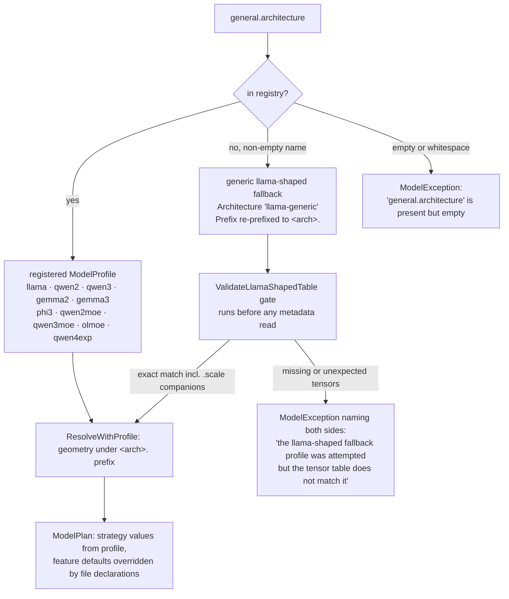
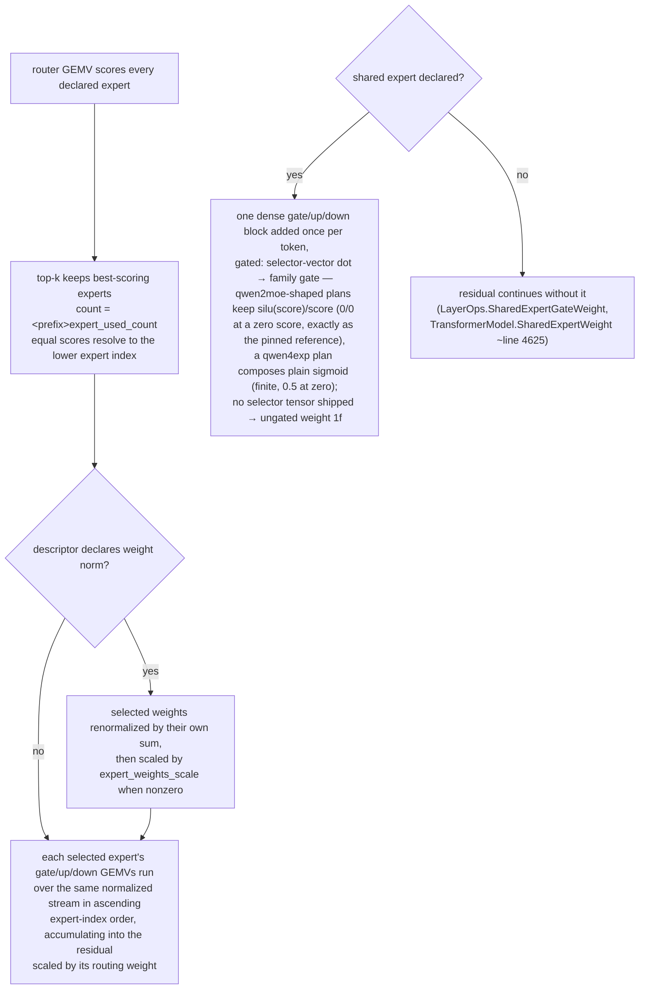
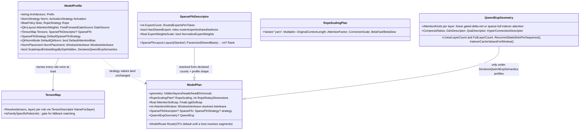

# Model Profiles and Plans

Scope: how a GGUF file's `general.architecture` resolves to a profile, what the resolved plan carries, where each strategy value lands in the forward, and which postures refuse at load or engine open. As of 2026-11-27.

A **profile** is the load-time fact sheet for one architecture: its metadata prefix, the strategy values the forward switches on, the tensor map naming every logical role, and (for MoE-shaped families) a sparse-FFN shape carrying zero counts — the real counts come from the file's declared metadata, never the profile. A **plan** (`ModelPlan`) is what one resolved against one file: geometry read under the prefix plus strategy values landed once so the hot forward path stays concrete and never dispatches per token ([`src/Lair.Models/ModelProfile.cs`](../../../src/Lair.Models/ModelProfile.cs), [`src/Lair.Models/ModelPlans.cs`](../../../src/Lair.Models/ModelPlans.cs)).

Strategy values are profile facts, not file facts — which tensors a family ships is decided by the registry entry and no metadata key overrides placement, interleave, or layout today ([`src/Lair.Models/ModelProfile.cs`](../../../src/Lair.Models/ModelProfile.cs) line 108). That asymmetry is deliberate: the plan resolves once at load so the forward switches on concrete values and never dispatches through a per-token interface (the same reason `NormStrategy`, `ActivationStrategy` and friends carry no runtime probe). Adding a family means adding one registry entry plus its tensor map and strategy values ([`src/Lair.Models/ModelProfiles.cs`](../../../src/Lair.Models/ModelProfiles.cs) header lines 3–9); nothing else in the engine changes.

## Resolution flow



`ModelProfiles.ResolveOrFallback` returns a registered profile or the generic one; `ModelPlans.Resolve` then verifies the fallback's tensor-table match before reading any metadata, deriving block extent from the table itself ([`src/Lair.Models/ModelProfiles.cs`](../../../src/Lair.Models/ModelProfiles.cs), [`src/Lair.Models/ModelPlans.cs`](../../../src/Lair.Models/ModelPlans.cs) lines 63–87). An unregistered name never reaches `Resolve`: it fails with

```
model architecture '<x>' is not supported (supported architectures: llama, qwen2, qwen3, gemma2, gemma3, phi3, qwen2moe, qwen3moe, olmoe, qwen4exp)
```

The generic profile lives outside the registry array — never selectable by name and never listed as supported. It is deliberately a llama-shaped disguise: `Bias = ByTensorPresence` (the only profile using that policy), `RmsNorm`, `SwiGLU`, `StandardFullHead`, the canonical tensor map, no sparse-FFN slot at all — so a tensor under an expert name counts as unexpected material. Family-specific roles (sparse-FFN, gated-delta-net, indexer, hyper-connection, PLE) stay out of the fallback's nameable set even though some maps declare them; quantization companion entries (`<tensor>.scale`, `<tensor>.input_scale`) are known-optional and never count as a mismatch. The rejection names both sides:

```
model architecture '<x>' is not supported (supported architectures: ...): the llama-shaped fallback profile was attempted but the tensor table does not match it (missing tensors: ...; unexpected tensors: ...)
```

## What each registered profile says

| Architecture | Norm / activation | RoPE pairing | Distinctive strategy values |
|---|---|---|---|
| `llama` | RmsNorm · SwiGLU | adjacent `(2i, 2i+1)` | baseline: PreOnly placement, declared-only features |
| `qwen2` | RmsNorm · SwiGLU | adjacent | same map as llama; attention biases may be present (optional in map) |
| `qwen3` | RmsNorm · SwiGLU | rotate-half `(i, i+headDim/2)` | `DefaultQkNorm = PerHeadWeighted` — the block always ships per-head q/k norm vectors; a declared `attention.use_qk_norm=false` still wins |
| `gemma2` | RmsNorm · GeGluExact (exact GELU, not tanh) | rotate-half | `DefaultQkNorm = Off`; post-sublayer norms required (`PostSublayerOutputs`); embedding gain √hidden; window masks even-indexed layers only (`AlternatingLocalFirst`) |
| `gemma3` | RmsNorm · GeGluExact | rotate-half | `DefaultQkNorm = PerHeadWeighted`; post-sublayer norms; embedding gain; window leaves the last layer of each group of six unbounded (`SixLayerGroupsLocalFirst`) — the family declares no per-layer stride, so the profile carries it |
| `phi3` | RmsNorm · SwiGLU | rotate-half, full head | fused layouts: `QkvLayout.FusedBufferSlices` (one `blk.{layer}.attn_qkv.weight`, q region then k region then v) and `FeedForwardGateSource.UpTensorHalves` (`ffn_up.weight` first half gate); the split roles and a separate gate matrix stay declared-but-optional — a file shipping them is reported as material this block does not read |
| `qwen2moe` | RmsNorm · SwiGLU | adjacent | sparse shape with shared expert **and** its hidden-sized selector vector (`ffn_gate_inp_shexp.weight`) |
| `qwen3moe` | RmsNorm · SwiGLU | rotate-half | no shared expert at all; `DefaultQkNorm = PerHeadWeighted` like dense qwen3 |
| `olmoe` | RmsNorm · SwiGLU | adjacent (reference asserts full-head coverage) | `DefaultQkNorm = StreamWeighted`: one RMS norm over each side's whole projected stream before head splitting, scaled by a hidden-sized vector the file ships whether or not it declares the feature; no shared expert, no routing-weight gain declared by reference |
| `qwen4exp` | RmsNorm · SwiGLU | rotate-half (qwen3 lineage) | see §qwen4exp below — geometry flag + sparse shape reused from qwen2moe |

Strategy enums live in [`src/Lair.Models/ModelStrategies.cs`](../../../src/Lair.Models/ModelStrategies.cs): `NormStrategy {RmsNorm, LayerNorm}`, `ActivationStrategy {SwiGLU, GeGlu, GeGluExact}`, `BiasPolicy {ByTensorPresence, Declared}`, `QkNormMode {Off, PerHeadWeighted, PerHeadUnweighted, StreamWeighted}` (per-head over each head's own slice weighted or with epsilon alone; stream-weighted jointly normalizes every head of one side under a single mean), `RopeStrategy {StandardFullHead, RotateHalfFullHead}`, `NormPlacement {PreOnly, PostSublayerOutputs}` — the post placement adds a second norm on each sublayer output and makes those tensors required at load while pre-only treats their presence as a layout failure.

## Plan metadata keys

Geometry reads under the resolved prefix (`llama.`, `qwen3.`, …; generic fallback files read `<architecture>.`):

| Key | Meaning when absent |
|---|---|
| `<prefix>embedding_length`, `<prefix>block_count`, `<prefix>attention.head_count`, `<prefix>attention.head_count_kv`, `<prefix>feed_forward_length` | required integers (a routed-only file may name only `expert_feed_forward_length`; the plan substitutes it once, with a log line) |
| head length (`<prefix>attention.head_length` + key/value equivalents) | derived from widths where declared |
| `<prefix>vocab_size` | falls back to tokenizer vocabulary length |
| `<prefix>rope.freq_base` / `<prefix>rope.freq_base_swa` | the base windowed layers rotate at resolves to the same value an undeclared global frequency takes when absent |
| `<prefix>attention.layer_norm_rms_epsilon` | feeds RMS norms and QK-norm; `attention.layer_norm_epsilon` (0f when absent) feeds LayerNorm block norms only |
| `<prefix>attn_logit_softcapping`, `<prefix>final_logit_softcapping` | 0f = disabled; a declared value must be positive finite or the load fails: "softcap values must be positive finite numbers" |
| `<prefix>attention.sliding_window` | 0 = unbounded; otherwise a positive integer, which masks scores in every attention path and bounds no KV — narrowing is a block selection resolved by lair.kv (see [kv-cache.md](./kv-cache.md)) so masked positions are never addressed while their K/V still exists for other layers' selections |
| `<prefix>rope.scaling.type` | absent = unscaled rotation; `none` same; only the YaRN variant resolves — any other name fails: "declares rope scaling variant '<v>'; only the 'yarn' variant is supported". Operands declared without a type fail with the same wording naming the stray key (the reference's linear default posture) |
| `<prefix>rope.scaling.factor` · `.original_context_length` · `.attn_factor` · `.yarn_ext_factor` · `.yarn_beta_fast` / `.yarn_beta_slow` · `.yarn_log_multiplier` | YaRN plan: multiplier 1f, original context required positive, attention factor/correction scale/beta pair defaults (1f, 1f, 32f, 1f), log-multiplier 0f selecting the reference's all-dimensions magnitude divisor inside the attention factor → `RopeScalingPlan` |
| `<prefix>rope.dimension_count` | absent = full head dimension; a declared even count ≤ head dim narrows rotation to that leading slice; anything else fails naming key and value |

Feature defaults resolve against declarations exactly as the profile table above describes: `<prefix>attention.use_qk_norm`, `<prefix>attention.use_bias` (a resolved-on bias makes every layer's q/k/v vectors required at load; a resolved-off one ignores present tensors with one structured log line), and `<prefix>attention.norm_bias` (absent means false). Norm placement, window interleave, embedding gain, QKV/gate layout come from the profile alone — no metadata key selects them today.

## Tensor maps: what is required, optional, or unread material

`CanonicalTensors()` names the llama.cpp GGUF layout every supported profile ships ([`src/Lair.Models/ModelProfiles.cs`](../../../src/Lair.Models/ModelProfiles.cs) lines 372–408). The required core is embedding, per-layer q/k/v/output projections, gate/up/down triplet, and the pre-sublayer + output norm vectors; everything family-specific rides as optional so a load can **report** a file rather than reject its material:

- Attention bias quartets (`attn_q/k/v.bias`, `attn_output.bias`) are optional in every map — llama files carry none while qwen2/qwen3 may — and the resolved bias policy decides whether they're consumed, required, or logged-as-ignored.
- Per-head QK-norm vectors (`attn_q_norm/attn_k_norm.weight`) ride optional because the resolved mode decides at load: a profile defaulting them on makes a file without them fail naming them; an off mode ignores present ones. Norm-bias vectors follow the same rule against `attention.norm_bias`.
- Post-sublayer norm vectors are declared in every canonical map but consumed only under `PostSublayerOutputs`; presence of one under a pre-only placement is a **layout failure**, not ignorable material — that asymmetry is deliberate so misplacement surfaces at load.
- The output head (`output.weight`) and its bias are optional: a model without an untied head produces logits through tied token-embedding rows instead, which the final-logit softcap also saturates ([`src/Lair.Models/Engine/TransformerModel.cs`](../../../src/Lair.Models/Engine/TransformerModel.cs) header lines 15–20).
- `PhiTensors()` swaps in the fused roles: required `blk.{layer}.attn_qkv.weight`, with split q/k/v and a separate gate matrix demoted to optional — shipping them for phi3 is "material this block does not read", reported rather than loaded.
- `MoeTensors()` relaxes the dense gate/up/down triplet (an expert-routed block ships per-expert stacks instead) and adds every sparse role as optional: router (`ffn_gate_inp.weight`), stacked triplets (`ffn_gate_exps/ffn_up_exps/ffn_down_exps.weight`), shared triplet (`*_shexp.weight`), the hidden-sized selector `ffn_gate_inp_shexp.weight`, plus factorized basis/coefficient/output-basis names with plural aliases. Dense profiles carry no sparse roles at all, and the generic fallback treats a tensor under any of those names as unexpected material.
- `Qwen4ExpTensors()` relaxes dense FFN roles, the split q/k/v/output quartet **and** plain per-sublayer norms too: which layers need them is decided by each layer's resolved attention kind (only sparse-full layers project through separate tensors; only linear-layer blocks run without hyper-connection stream norms), so a flat required flag would reject one half of this family's own blocks. The plan gate over the resolved interleave — not the map flags — makes material required where its kind needs it and reports missing names concretely (see §qwen4exp).

## Where plan values land in the forward

From `TransformerModel.cs` header docs and [`src/Lair.Models/Engine/LayerOps.cs`](../../../src/Lair.Models/Engine/LayerOps.cs):

- Each layer normalizes its input stream (norm × weight under the resolved norm strategy) before QKV GEMVs; RoPE rotates q/k pairs at absolute position with `theta_i = base^(-2i/headDim)` using adjacent or rotate-half pairing per profile. Rotation tables precompute cos/sin per position up to the context ceiling so decode reads bit-identical rotations, and windowed layers get their own theta tables from `rope.freq_base_swa` when any layer carries a window (lines ~2073–2103).
- Attention scores scale by `(RopeScaling?.AttentionFactor ?? 1f) / sqrt(headDim)` then pass through the attention-score softcap — `LayerOps.Softcap(x, cap) = cap · tanh(x / cap)` evaluated in double and rounded once to float — before any online softmax sees it; identical scaled-then-capped order across the float kernel, quantized dot route, row-tiled batched pass, and device-composed window.
- A resolved final-logit softcap saturates every logit vector (untied head or tied embeddings) after the full vector is computed and before any softmax, sampling, or copy-out — so it lands ahead of everything [sampling-and-drafting.md](./sampling-and-drafting.md) describes.
- The window narrows each masked layer's causal range to `[max(0, pos - window + 1), pos]` at block-selection level; the interleave decides which layers carry it (all / alternating local-first on even indices / six-layer groups with index ≡ 5 unbounded). A declared window of 0 leaves every layer unbounded whatever the pattern.
- `ScaleInputEmbeddingsBySqrtHidden` resolves a √hidden gain multiplied into every freshly dequantized embedding row before the first layer, because the conversion leaves that reference gain out of the weights.

## Sparse FFN: descriptor, layout, strategy

A file declaring `<prefix>expert_count` replaces its dense gate/up/down triplet with an expert-routed block; a file declaring no count keeps the dense block ([`src/Lair.Models/SparseFfnDescriptor.cs`](../../../src/Lair.Models/SparseFfnDescriptor.cs), `ModelPlans.ResolveSparseFfn`).

| Key | Resolution |
|---|---|
| `<prefix>expert_count` | positive integer required when present; absent = dense |
| `<prefix>expert_used_count` | defaults to expert count; must be positive and ≤ it — exceeding fails: "a sparse-FFN block cannot route more experts than its `expert_count`" |
| `<prefix>expert_shared_count` | absent or 0 means none |
| `<prefix>expert_weights_scale` | non-negative finite number, zero (the reference's disabled default) otherwise |
| `<prefix>expert_weights_norm` | false when absent |
| `<prefix>expert_layout` | `stacked` when absent; only `stacked` / `shared_basis` recognized — anything else fails naming key and value |
| `<prefix>expert_rank` | required positive integer for a `shared_basis` declaration; declaring one on a stacked block fails: "only a block whose expert_layout is 'shared_basis' can declare expert_rank" |
| `<prefix>sparse_ffn_strategy` | absent keeps the profile default — every registered family today defaults to `dense_resident`; only `dense_resident` / `low_rank_shared_basis` are recognized, and an inconsistent pair refuses rather than downgrades: "declares sparse-FFN strategy 'low_rank_shared_basis' on a block whose expert_layout stores its experts as stacked dense matrices with no rank: … declare expert_layout 'shared_basis' with an expert_rank, or select 'dense_resident'" |

Selecting `low_rank_shared_basis` therefore stays visible in the plan and reports at engine open — nothing resident computes coefficient-space sums yet. The factorized tensor roles (`ffn_exps_basis_in.weight`, `ffn_exps_coefficient.weight`, `ffn_exps_basis_out.weight`, each with a plural alias) exist only as optional map entries an alternate weight provider could reach; no published conversion ships them ([`src/Lair.Models/ModelProfiles.cs`](../../../src/Lair.Models/ModelProfiles.cs) lines 458–485). The analytical side lives in the `lowrank-svd` bench verb.

Dense-resident execution per token, from `TransformerModel.cs` header docs (lines 41–46):



The selected experts run through the gather kernel in `CpuGatherKernel.cs`: one pass over the batch's union of active-expert slabs in ascending order, each expert resolved once per step with prefetch hints — arithmetic stays bit-identical to single-sequence routing. A tiered variant exists as an internal seam: `RamHotExpertTier` (an `IWeightSource`/`IExpertSlabSource` hot-copy layer over cold slab views) is constructed only from bench and test code today; the `gather` bench verb measures capacity/cost hot expert copies against a prefetch-only baseline, with artifacts under committed `reports/<timestamp>/` directories (`2026-11-21T15-55-44Z`, `2026-11-21T15-56-53Z`, `2026-11-21T23-15-09Z`) — no host configuration path installs a residency tier today (see [residency-and-budgets.md](./residency-and-budgets.md)).

## qwen4exp: resolved geometry, bounded seam

The only profile carrying `DeclaresQwen4ExpSemantics` resolves family geometry from the file's own declarations (`ModelPlans.ResolveQwen4Exp`, lines 1125–1247) and then validates the tensor table against that interleave rather than a flat required-role sweep: `<prefix>ssm.group_count/state_size/inner_size/time_step_rank/conv_kernel` (value-head count = inner ÷ state, remainder fails naming both keys; `time_step_rank` must equal it exactly — decay weights, dt biases and gate rows each carry one entry per value head), `<prefix>attention.indexer.head_count/key_length/top_k`, `<prefix>hyper_connection.count/low_rank` (required positives), and the authority for which layers run what: a positive ratio means full sparse attention with that pooling ratio, zero means gated-delta-net linear attention. A declared `full_attention_interval` must agree group-for-group with the array; either side failing names both sides with the layer index. Per-layer material lands where its kind needs it — every linear layer carries fused qkv (row count = conv channels), z-gate matrix and recurrent-state tensors; each full sparse layer instead carries split projections plus the indexer quartet; hyper-connection trios wrap both sublayer sides on all layers, with shape checks against the declared stream count and low rank.

Execution is a bounded synthetic seam, not serving. `TransformerModel.Open` opens `Qwen4ExpEngine` (assembly-internal) instead of standard dense loading — this family's linear layers ship no dense q/k/v triplet or plain norms, so the standard loader would refuse material the family legitimately omits — and refuses any posture that composes against the machinery rather than the seam:

```
model '<name>' architecture 'qwen4exp' opens its forward on the bounded synthetic qwen4exp engine seam, which runs CPU-only GEMV and slab kernels over the file's own packed weight views with per-sequence state sized at the opened context ceiling: <posture> has no composition over that seam — omit it to run the fixture through the assembly-internal qwen4exp chunk forwards, or resolve placement onto a standard family
```

Refused postures at open (lines 1408–1433): non-CPU backend; multi-segment route; quantized KV storage; dedicated prefill lane / offloaded prefill backend / crossing backends / device prefill step; any prefill kernel other than `gemv` — including a hot re-point via `ApplyPrefillKernel`. Inside the engine, `ValidateForwardPosture` refuses rope scaling variants (a declared rotary slice composes across q/k heads and indexer components instead), attention windows under an interleave, the attention-score softcap, projection/norm bias vectors or tensors, weighted QK-norm modes (the seam carries only unweighted head norms), non-stacked layouts, strategies other than dense-resident, and any PLE tensor per layer — each naming the posture. The final-logit softcap does run inside the seam. Serving routes refuse against it:

```
model '<name>' opened the bounded synthetic qwen4exp forward seam: Prefill/DecodeNext/LastLogits/DecodeBatch runs against persistent production caches this family does not have yet — forward the fixture through the assembly-internal qwen4exp chunk seam instead
```

`GdnOps` and `QsaOps` compose gated-delta-net chunks and indexer-selected restricted attention for the seam (`Qwen4ExpEngine.cs`, `Qwen4ExpForwardSpike.cs`) only: no served dense model reaches them. The seam is exercised by the `qwen4exp-forward-file` bench verb; chunk-split runs land bit-for-bit on unsplit ones because recurrent slots, convolution history and synthetic caches advance across splits. When a load log line is supplied, the open reports its composition as structured fields — `qwen4exp_engine model=… architecture=… linear_layers=N sparse_full_layers=N hyper_streams=N hyper_rank=N context_ceiling=N` (`TransformerModel.Open`, lines 1449–1458) — the same identity style every other load line uses.

PLE (per-layer token embedding) tensors appear in this map as optional names (`blk.{layer}.ple_conv1d.weight`, `ple_key/ple_value.weight`, `ple_norm_conv/key/query.weight`) — only layers the file's PLE layer selection ships them, and today's gather seam resolves the table by name rather than through the map. The n-gram geometry reads `<arch>.ple.ngram_size/heads_per_ngram/layer_multipliers/head_offsets/head_vocab_sizes/eos_token_id` plus `embedding_length_per_layer_input`, heads ordered so order-n starts at `(n − 2) · heads_per_ngram`; the row hash mirrors llama.cpp's qwen4exp gather (multiplier XOR mix in wrapping unsigned 64-bit, EOS cutting history). Row sources and hot-row providers (`src/Lair.Loader/PleRowSource.cs`, `PleHotRowProvider.cs`) plus the residency clamp (`src/Lair.Models/PleResidencyGate.cs`) exist as measured seams only — the `ple-latency` / `ple-policy` bench verbs exercise them; no serving path installs either today.

## The seam contracts on one screen



`ModelDesc.cs` is the narrow read-only view a host may query without the plan (`SupportedArchitectures` straight from the registry, plus geometry and both softcaps); `ModelRoute.CpuDefault()` lands on every plan that no host placement resolved ([`src/Lair.Models/ModelPlan.cs`](../../../src/Lair.Models/ModelPlan.cs), [`src/Lair.Models/Qwen4ExpGeometry.cs`](../../../src/Lair.Models/Qwen4ExpGeometry.cs)).

## Knobs and refusals summary

- The only engine knob a profile page touches is `engine.prefill_kernel` → `PrefillKernel {GemV, Tiled, Gemm}` (`gemv`/`tiled`/`gemm`, [`src/Lair.Models/ModelStrategies.cs`](../../../src/Lair.Models/ModelStrategies.cs) lines 255–303): re-read at every window boundary; a selection the backend has no dense weight path for refuses at open naming formats and device — never a silent fallback. Kernel internals live in [cpu-kernels.md](./cpu-kernels.md).
- `/v1/models` reports each model's resolved `sparse_ffn_strategy` when its plan routes experts (omitted otherwise) alongside architecture and quant facts ([`src/Lair.Http/ApiContracts.cs`](../../../src/Lair.Http/ApiContracts.cs)).
- Load-time refusals: unsupported architecture name; empty architecture key; generic fallback table mismatch; non-positive/non-finite softcap or window declarations; unrecognized rope variant or stray scaling operands; bad rotary slice; sparse count/layout/rank/strategy inconsistencies. Engine-open refusals: unrunnable prefill kernel selection, quantized-KV postures the opened route cannot serve (see [architecture.md](./architecture.md)), and every qwen4exp posture above — each names what was declared and what to change instead of falling back to whatever happens to work.

Related pages: [kv-cache.md](./kv-cache.md) (windowed block selection), [cpu-kernels.md](./cpu-kernels.md) (gather kernels, prefill routes), [residency-and-budgets.md](./residency-and-budgets.md) (tier chains), [sampling-and-drafting.md](./sampling-and-drafting.md) (what sees the capped logit vector), [measurement-harnesses.md](./measurement-harnesses.md).
