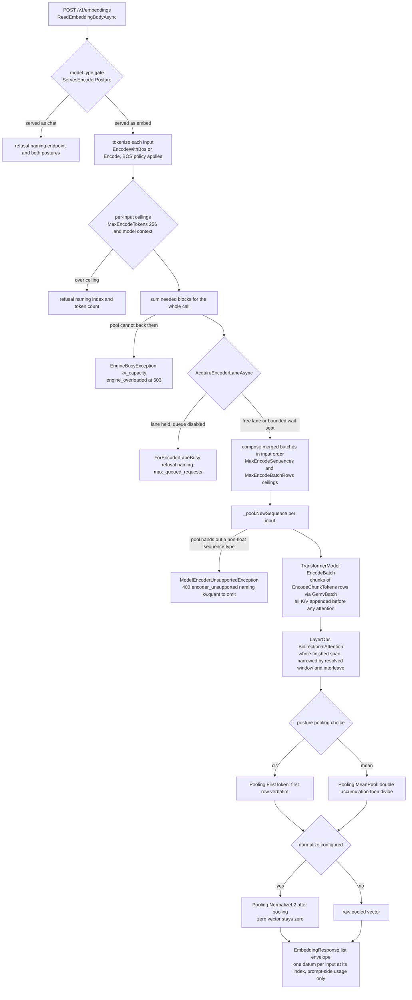

Scope: This page follows one OpenAI-compatible generation request through HTTP routing, model facade encoding, scheduler admission, prefix adoption, prefill/decode forwards, sampling, output parsing, and result publication, plus the encoder-only (`type 'embed'`) serving posture that answers pooled vectors instead of sampled tokens. As of 2026-11-27 this reflects implemented behavior under `src/` only; planned lifecycle stages are not described as current.

# Request lifecycle: chat completion through generation internals

A served request starts as an HTTP body on `/v1/chat/completions` or `/v1/completions`. The API surface routes that body to the model instance named in the request, converts it into a `GenerationRequest`, resolves encoding and budget facts against the loaded model, submits work to one per-model continuous-batching scheduler, then turns engine logits rows back into streamed deltas or a final `GenerationResult` with token accounting and finish reason.

The lifecycle is intentionally split across layers:

- HTTP routing decides which served instance receives work before any engine validation touches that instance.
- Model facade encoding resolves prompt text, tokenizer behavior, chat template output, tool schemas, reasoning policy context, sampling knobs, and budget ceilings into a scheduled request.
- Scheduler admission owns concurrency slots, queue posture, KV capacity checks, prefix adoption eligibility, pipeline state transitions, cancellation observation, and finish outcomes.
- `TransformerModel` forwards own prompt windows, decode batches, logits rows, execution spans, activation families, and the exact batched-forward guarantee that merged work does not alter token behavior.
- Output parsing turns decoded text into visible content, tool calls, reasoning-region accounting, logprob reports when requested, budget exhaustion reporting, and wire finish reasons.

## Main lifecycle objects

| Object | Role in one request | Key fields or contracts |
|---|---|---|
| `ApiApp` | Maps OpenAI-compatible routes to handlers, attaches correlation id, converts engine refusals to `{error:{message,type,code}}`, and emits JSON/SSE payloads. Path: `src/Lair.Http/ApiApp.cs`. | `/v1/chat/completions`, `/v1/completions`, `/v1/models`, `/healthz`, `/monitor/stream`; every response carries `x-lair-request-id`. Registry mode routes by request model id before per-model validation and holds a lease until the stream completes. |
| `GenerationRequest` | Internal generation call shape after HTTP body parsing. Path: `src/Lair.Http/GenerationRequest.cs`. | `Model`, `IsChat`, raw `Prompt`, `Messages`, sampling knobs, stop strings, tool definitions/choice, logprob fields, streaming callback, optional request id for monitor correlation. |
| `OutputParserPlan` | Load-resolved parser and reasoning policy context used by the generation facade; request-side tools do not swap a per-step decode loop into some other parser family. Path: `src/Lair.Http/OutputParsers.cs`. | Tool parser choice, optional tool-output parser, `ReasoningPolicy`, resolved reasoning region markers when budgets can bind them. |
| `RequestPipeline` | Scheduler-owned state machine for one admitted request; owns its sampler and KV sequence independent from other pipelines. Path: `src/Lair.Models/Scheduling/RequestPipeline.cs`. | Stage transitions (`Admitted` → `Prefilling` or directly decode-eligible when fully prefix-adopted → `Transforming` → `Decoding` → `Finished`), own `Sampler`, own `IKvSequence`, outcome task. |
| `TransformerModel` | Forward engine for one opened model instance; runs prompt windows and batched decode steps, closes over KV attention route and execution spans. Path: `src/Lair.Models/Engine/TransformerModel.cs`. | Prefill sub-batches, final logits buffer ownership per activation family, quantized or float attention routes, backend dispatch for dense weight passes. |
| `GenerationResult` | Public outcome returned to API handlers after generation ends or is canceled/failed at the engine boundary. Path: `src/Lair.Http/GenerationResult.cs`. | Text, prompt/completion token counts, finish reason string, cached prompt-token count, logprobs when requested, tool calls, reasoning regions, admitted reasoning policy, optional budget-exhausted marker. |

## Lifecycle diagram

```mermaid
sequenceDiagram
  participant HTTP as ApiApp route handler
  participant Registry as ModelRegistry lease
  participant Facade as GenerationService
  participant Scheduler as GenerationScheduler pipeline
  participant Engine as TransformerModel forward windows
  participant Backend as execution backend kernels
  participant KV as IKvSequence and prefix cache
  participant Sampler as RequestPipeline sampler

  HTTP->>HTTP: parse /v1/chat/completions or /v1/completions body
  HTTP->>Registry: route by request model id before per-model validation
  Registry-->>HTTP: lease selected GenerationService for whole response lifetime
  HTTP->>Facade: convert to GenerationRequest with sampling, tools, budgets, streaming flags

  alt chat request
    Facade->>Facade: render Messages through loaded chat template and inject declared tool schemas when applicable
  else completion request
    Facade->>Facade: keep Prompt as raw prompt text
  end

  Facade->>Facade: tokenize rendered/raw prompt with model BOS policy, resolve budgets and parser/reasoning context
  Facade->>Scheduler: submit ScheduledRequest to per-model continuous-batch scheduler

  alt concurrency slots full and queue posture disabled
    Scheduler-->>HTTP: refusal naming quota; no engine advancement starts for this request
  else positive max_queued_requests posture
    Scheduler->>Scheduler: wait bounded by queue_timeout_ms, then revalidate capacity/budgets on wake
  end

  Scheduler->>KV: adopt eligible prefix blocks when prompt length reaches pool block size
  KV-->>Scheduler: shared leading physical blocks placed in pipeline sequence table

  loop prefill sub-batches while prompt remains
    Engine->>Engine: forward window rows with embedding, RoPE position, causal attention ordering per row
    Engine->>Backend: dense weight passes over packed WeightRef bytes via Gemv/GemvBatch/GemmBatch as resolved
    Backend-->>Engine: logits for final prefill row held in model-owned buffer
  end

  Scheduler->>Scheduler: transform pipeline logits row with configured penalties/biases if present
  Scheduler->>Sampler: draw first generated token from that pipeline's own logits row and RNG stream

  loop decode steps while budget not exhausted or stop/eos/cancel/failure not observed
    Engine->>Engine: advance one shared engine step up to MaxBatchSequences ceiling
    Sampler-->>Scheduler: sampled token for each pipeline's own logits row
    Scheduler-->>HTTP: streamed deltas when request asks for streaming output
  end

  HTTP->>Facade: collect final GenerationResult, tool calls, reasoning regions, logprobs, usage/budget reports
```

## Stage-by-stage behavior

### 1. HTTP routing and model lease

The registry-backed API surface routes as soon as the body is parsed. A request naming an unserved model or a retiring/draining instance receives its refusal before touching that named engine instance. The response lease remains open for the whole handler lifetime, including stream completion; this is what drain-completion waits on because releasing the lease signals when the retiring instance's last admitted generation finishes.

Every HTTP response carries `x-lair-request-id`, and monitor lifecycle frames are keyed to the same value used by the correlation middleware. This means a request can be followed from API handler through scheduler events using one id even if the engine mints its own internal id for non-HTTP paths.

Path: `src/Lair.Http/ApiApp.cs`.

### 2. Model type gate before sampling work

A model opened as encoder-only refuses sampled endpoints before tokenization or generation admission. For `/v1/chat/completions` and `/v1/completions`, the refusal names the served model id, states it is `type 'embed'`, directs callers to `/v1/embeddings`, and explains that sampling requires a model declared with `type 'chat'`.

This gate belongs before scheduler admission because embedding-only models do not have sampled generation budgets or sampler pipelines in this build. Path: `src/Lair.Http/ApiApp.cs`.

### 3. Request conversion into internal generation fields

`GenerationRequest` carries the OpenAI-facing knobs plus LAIR-specific budget and reasoning fields relevant to lifecycle accounting. Defaults observed on the record include:

- `MaxTokens = 128`, with a separate boolean indicating whether that ceiling was explicitly supplied by the caller or left for model-declared budgets.
- Sampling defaults: temperature `1.0f`, top-p `0.9f`, top-k `40`, seed null, penalties zero, logit bias disabled unless provided.
- Chat requests render messages through the loaded chat template; completion requests send raw prompt text as-is.
- Tool definitions and tool choice affect rendered prompt injection and accepted call detection only for chat requests.

Path: `src/Lair.Http/GenerationRequest.cs`.

### 4. Prompt encoding, BOS policy, parser/reasoning context

For chat requests, the model facade builds a prompt through the loaded template before tokenization. Tokenizer BOS behavior is suppressed only when the rendered prompt already begins with that model's BOS token; otherwise tokenizer BOS handling applies normally. This prevents double-prefixing while preserving models whose templates do not carry their own BOS marker.

Output parsing and reasoning visibility are resolved once per model, then carried into request execution:

- `ReasoningPolicy` is either `Keep` (regions stream through as visible content byte-for-byte) or `Strip` (recognized regions are withheld from visible text while boundary spans remain recorded for the result).
- A strip policy follows the policy admitted for that sequence; a later reload does not retroactively change streaming behavior of an already running request.

Paths: `src/Lair.Http/GenerationService.cs`, `src/Lair.Http/OutputParsers.cs`.

### 5. Scheduler admission, concurrency slots, and queue posture

Admission is decided before engine advancement starts for that pipeline. The per-model scheduler maintains a concurrency gate distinct from batch composition:

| Config posture | Admission behavior this build implements |
|---|---|
| `max_concurrent_requests` absent or not reached by held slots | Submission proceeds as far as capacity allows; no artificial admission cap is imposed. |
| Concurrency full and `max_queued_requests` absent or `0` | New submission is refused immediately naming the model quota rather than queued behind work already running. |
| Positive `max_queued_requests` | Submissions may block waiting for a slot, bounded by `queue_timeout_ms`; each woken waiter re-enters admission under scheduler rules and can still be rejected after capacity/budget checks. |

Queueing reserves no KV blocks or token budget for callers that have not acquired an admission slot. Hot edits to concurrency/queue keys affect later submissions; already admitted pipelines keep their slots through the edit.

Paths: `src/Lair.Models/Scheduling/PipelineConcurrencyGate.cs`, `src/Lair.Http/Config/YamlConfigLoader.cs`.

### 6. Prefix adoption before prompt forwarding

When a pipeline is admitted, scheduler-side prefix-cache adoption runs before prefill or decode advancement work for that request. If the prompt length reaches at least one pool block and the engine has a usable cache, eligible leading blocks are adopted into the sequence's logical-to-physical block table as shared read-only entries. The remaining prompt tokens start after those positions.

A fully prefix-adopted pipeline does not need to occupy `Prefilling` stage work for already-covered positions; it becomes decode-eligible when its advancement slot is taken because no chunk remains for adopted blocks.

Paths: `src/Lair.Kv/PrefixCache.cs`, `src/Lair.Models/Scheduling/GenerationScheduler.cs`, `src/Lair.Kv/IKvSequence.cs`.

### 7. Prefill windows and kernel dispatch

Prompt tokens are forwarded in sub-batches rather than token-by-token when the resolved prefill shape allows it. Each row keeps its own residual stream, layer norms, RoPE position, causal attention coverage, and KV append behavior; dense weight matrices for attention and feed-forward layers traverse once per sub-batch through backend kernels over packed GGUF bytes.

The forward contract is strict: a window longer than the resolved row width splits into consecutive sub-batches that see previous sub-batches' KV state, but resulting KV bytes and final logits remain identical to forwarding tokens one at a time. Sampling after prefill uses the final row's logits from model-owned storage rather than rerunning an extra forward solely for logits.

Paths: `src/Lair.Models/Engine/TransformerModel.cs`, `src/Lair.Contracts/IBackend.cs`.

### 8. First-token transformation and sampling transition

After prompt forwarding completes, pipeline state enters `Transforming`: prefill logits are transformed on that pipeline's own row before its sampler draws the first generated token. If configured, presence/frequency penalties and constant per-token logit biases mutate only this sequence's logits row immediately before sampling.

The sampler order is fixed:

1. Remove non-finite or banned candidate tokens if any filter applies.
2. Apply temperature softmax unless greedy mode selects argmax directly; greedy tie-breaking favors the lowest token id for deterministic decoding.
3. Cut candidates to top-k survivors when enabled (`0` disables).
4. Shrink those survivors to the nucleus mass selected by top-p.
5. Draw from remaining candidates using this pipeline's own seeded RNG stream or unseeded generator if no seed was supplied.

Paths: `src/Lair.Models/Scheduling/RequestPipeline.cs`, `src/Lair.Sampling/Sampler.cs`.

### 9. Decode batching and continuous advancement

Once decoding starts, pipelines advance one token per shared engine step up to the model's batch ceiling (`MaxBatchSequences = 16`). Each pipeline samples from its own logits row after the batched forward; merged decode steps do not expose different token behavior than unmerged stepping would produce. This is why stage transitions are control-plane facts rather than kernel-behavior facts: a pipeline may ride a later merged step without changing what tokens it sees or emits.

Streaming requests receive decoded pieces as they settle while the final result still carries aggregate accounting and finish reason. A strip reasoning policy withholds recognized regions from streamed content exactly when boundaries become settled, so split markers do not leak partial hidden text onto the wire.

Paths: `src/Lair.Models/Scheduling/GenerationScheduler.cs`, `src/Lair.Http/ApiApp.cs`.

### 10. Stop detection, tool parsing, and reasoning accounting

The public result distinguishes several completion shapes beyond simple token-budget exhaustion:

| Result condition | Public behavior in this build |
|---|---|
| End-of-sequence sampled | Generation stops with finish reason `"eos"`; the end token is not forwarded into generated sequence content. |
| Token budget exhausted | Generation stops with finish reason `"length"`. |
| Literal stop string appears in decoded output | Output truncates before that substring and result reports `"stop"`. |
| Fenced tool calls are recognized under resolved parser policy | Recognized calls appear as structured `ToolCall` entries, fences are removed from visible text, and the finish reason becomes `"tool_calls"` for accepted call completion. |
| Reasoning regions exist under a model's marker pair | Regions remain recorded in result accounting; strip policies remove their spans from visible content while preserving region boundaries on the request record. |

Internal scheduler outcomes also include `Canceled` (cancellation observed between steps, blocks released) and `Failed` (forwarding failure affecting only that sequence). These engine-level outcomes are distinct from public text finish strings such as `"stop"` or `"tool_calls"`.

Paths: `src/Lair.Http/GenerationResult.cs`, `src/Lair.Models/Scheduling/FinishReason.cs`, `src/Lair.Http/OutputParsers.cs`.

### 11. Result publication and usage accounting

The final result carries prompt token count, completion token count, cached prompt tokens adopted from prefix sharing when any were shared, optional per-token logprob reports, tool-call records, reasoning regions, admitted reasoning policy, and budget-exhausted reporting fields when applicable. API handlers translate these into OpenAI-shaped JSON or SSE payloads while preserving the correlation id already carried on the response.

Path: `src/Lair.Http/GenerationResult.cs`.

## Encoder-only serving: the `/v1/embeddings` route

A model declared `type 'embed'` (`src/Lair.Http/Config/LairConfig.cs`, `ModelTypeValues`) serves encoder forwards only. Its requests arrive on `/v1/embeddings`, run a bidirectional encode pass over each input, and answer one pooled vector per input — no sampler, no decode step, no pipeline stage machine advances on such an engine. The route shares the API surface's named-model routing, response lease, correlation id, and error taxonomy with its sampling siblings (`src/Lair.Http/ApiApp.cs`).

### What accepts a request here

| Step | Behavior this build implements | Path |
|---|---|---|
| Route and lease | `/v1/embeddings` is mapped in both single-model and registry modes. Registry mode resolves the named instance from the body before any per-model validation and holds the lease across the whole encoder call, so a retiring instance drains what it admitted before releasing. `x-lair-request-id` rides every response like its siblings do. | `src/Lair.Http/ApiApp.cs` |
| Input spellings | The body is read from its raw JSON document rather than bound to one shape: `"input": "text"` answers one vector and `"input": ["a","b"]` answers one vector per entry at the index that entry arrived at. A non-string array element refuses naming `input[i]`; any other JSON kind refuses naming what it got; an absent key reaches the request-shape message "an embeddings request requires a non-empty 'input': one text or a list of texts." | `src/Lair.Http/ApiApp.cs`, `src/Lair.Http/ApiContracts.cs` (`EmbeddingBody`) |
| Model-type mirror gate | A model served as `type 'chat'` is refused on this endpoint before any tokenization or admission, naming the endpoint and both postures: sample from it through chat/completions, or declare it with `type 'embed'`. It answers where every other request-shape refusal lands (`400 invalid_request_error`). | `src/Lair.Http/ApiApp.cs` |
| Encoder posture facts on `/v1/models` | An encoder entry advertises its sentence-vector posture — `pooling` and `normalize` — beside the queue facts; a chat entry leaves both fields out entirely. Asserted in `tests/Lair.Tests/EmbeddingApiTests.cs` (`Models_CarriesPoolingPostureOnlyForEncoderModels`). | `src/Lair.Http/ApiApp.cs`, `src/Lair.Http/Config/YamlConfigLoader.cs` |

### What an encoder-only model does instead of the sampled pipeline

`GenerationService.EmbedAsync` runs one call to completion and returns an `EmbeddingOutcome` (`src/Lair.Http/EmbeddingContracts.cs`: the vectors, total input tokens, pooling mode, and whether normalization followed). The order below is what the code does:

1. **Posture snapshot for this call.** The response-shape posture — `models[0].pooling` (`mean` or `cls`) and `models[0].normalize` — comes from configuration only; nothing in a GGUF file selects pooling, and an unrecognized value fails load naming the qualified path, model, value, and accepted set. Both keys are read once from the config in force when the request is admitted, exactly like a generation run captures its output-parser plan. A live edit to either retitles later requests only; vectors already answered keep the posture their request started with (`tests/Lair.Tests/EmbeddingApiTests.cs`, `PoolingAndNormalizeHotEdit_AppliesForLaterRequests_AndReadvertisesWithoutRestart`). A model's `type` itself stays restart-only.
2. **Tokenization, prompt-side rules.** Every input is tokenized like an ordinary prompt through the loaded tokenizer with its BOS policy — `_tokenizer.AddBosToken ? EncodeWithBos(text) : Encode(text)` — so a model whose profile adds BOS gets it here too. No chat template renders, no tool schemas are injected, and reasoning policy plays no part: those belong to sampled serving. An input that tokenizes to zero tokens refuses naming its index.
3. **Prompt-side ceilings.** Each input must clear two counts before any work runs: `TransformerModel.MaxEncodeTokens` (256) — the ceiling one encoder forward carries, with a message telling the caller to shorten it — and this model's resolved context window. Both refusals name the token count they measured against.
4. **Whole-call KV arithmetic up front.** An encoder forward writes every input position's K/V before pooling anything, so the call's total block need (`ceil(tokens / pool.BlockTokens)` per fresh sequence) is checked against `IKvPool.EffectiveFreeBlocks` before admission: short inputs answer `EngineBusyException.ForEncoderKvCapacity`, naming needed blocks and free blocks with what to change (`kv_blocks`). A mid-forward overflow maps to the same refusal carrying the honest counts.
5. **One encoder lane, same queue posture.** The engine holds a single forward-lane semaphore for this serving mode: a free lane is taken outright with no seat spent; a held lane with `max_queued_requests` absent or `0` answers `EngineBusyException.ForEncoderLaneBusy` (`engine_overloaded`, recorded as a concurrency-quota admission refusal); a positive posture takes one queue seat and waits within the `queue_timeout_ms` ceiling in force at entry, releasing that seat whether it admits, refuses, or is cancelled. Waiting reserves no pool block and no token budget, and the retirement gate participates in the wait so draining instances keep their semantics.
6. **Monitor frames without a tok/s series.** An admitted call mints request-lifecycle rows keyed to the caller's correlation id (`kind "embeddings"`), drives `BeginEncoderRequest` / `RecordEncoderPositions` per composed batch / `EndEncoderRequest(allInputsPooled:)`, and closes with status `"encoded"`, `cachedTokens: 0`, and no finish reason — nothing sampled, and this path consults no prefix cache. Its frames carry prompt size and elapsed time only, which is what keeps an `embed` model visible on `/monitor/stream` at all (`src/Lair.Http/Monitoring/EngineMetricsBus.cs`; detail in [monitoring-and-metrics.md](monitoring-and-metrics.md)).
7. **Merged encoder batches preserve input order.** Inputs compose into calls of at most `MaxEncodeSequences` sequences (equal to the decode ceiling, 16) whose flattened rows stay within `MaxEncodeBatchRows` (`4 × MaxEncodeTokens` = 1024); a wider set composes as several calls in order. Each vector lands where its input was read — asserted by `tests/Lair.Tests/EmbeddingsTests.cs` (`EncodeBatch_PreservesMemberOrder_RepeatInputsMatch_AndRejectsBadArguments`) and the API-level batching parity test (`Embeddings_BatchedRequestMatchesTheSameInputsSentSeparately`).
8. **Forward internals.** `TransformerModel.EncodeBatch` maps one fresh sequence per input from `_pool.NewSequence()`, seeds each position from its dequantized `token_embd` row, then runs the pre-attention norm, QKV projections plus biases with RoPE at absolute positions, the K/V writes, and finally gate/up/down as three batched weight passes — all in windows of `EncodeChunkTokens = 8` rows through `IBackend.GemvBatch`. Encoder dense passes request the batched-GEMV form (`denseMatmul: false`), so `engine.prefill_kernel` selection plays no part on this route. Every position's KV slot is reserved before any attention runs, so each query scores against its own sequence's finished span via `LayerOps.BidirectionalAttention` over `[0, last position]`, narrowed per layer to that layer's resolved window on the layers its declared interleave masks (`src/Lair.Models/ModelStrategies.cs`, `WindowInterleave`). Results are independent of chunking and equal what an independent single-sequence `Encode` call produces; the output is final hidden states after the model's output norm — no lm_head logits, so nothing to sample.
9. **Pooling then optional normalization.** Pooling reads only what that input's forward produced: `cls` copies the first position's row verbatim through `Pooling.FirstToken`, and `mean` averages every position per column in `Pooling.MeanPool`, accumulating in double before the final division — the same discipline as the engine's norms (`src/Lair.Models/Pooling.cs`). Normalization, when configured, runs strictly after pooling: a mean over normalized rows is not the same vector as a normalized mean. Every helper writes an exact hidden-size result and reads only inputs, so repeat calls are bit-for-bit identical; `normalize` on a zero vector leaves it untouched rather than dividing by zero.
10. **Answer envelope.** The handler completes synchronously — the facade's bounded queue wait resolves before any forward composes — and answers OpenAI's list shape: `object "list"`, the served model id, one datum per input (`index` plus its embedding floats), and prompt-side usage where `total_tokens` carries `prompt_tokens` because nothing was generated. Pooling mode and normalization are facts of the served model, not request knobs; a body asking for them changes nothing.

Paths: `src/Lair.Http/GenerationService.cs`, `src/Lair.Models/Engine/TransformerModel.cs`, `src/Lair.Models/Pooling.cs`, `src/Lair.Http/ApiContracts.cs`.

### Where tokenization and KV work differ from the sampled route

| Aspect | Generation request | Encoder-only request |
|---|---|---|
| Prompt construction | Chat bodies render through the loaded Minja template with declared tool schemas injected; completion bodies pass raw prompt text. | Each `input` string is tokenized directly, BOS policy included; no template or tool rendering exists on this path. |
| Sequence ownership | One pipeline-owned `IKvSequence` lives across prefill chunks and decode steps, seeded from prefix-adoption where eligible. | One fresh sequence per input for the duration of its batch: nothing carries over between calls and no block is shared. |
| Prefix cache | Scheduler-side adoption places shared read-only blocks into the table before forwarding; results report cached prompt tokens when any were shared. | Consulted never — completion reports `cachedTokens: 0`, so an encoder answer can claim no reuse. |
| Capacity arithmetic | Admission reserves for the whole sequence lifetime (prompt plus generation ceiling) with eviction-before-refusal and admission windows. | The call's own positions are summed up front against free blocks, because every K/V must exist before pooling; shortfall answers `EngineBusyException`, which reaches the wire as 503 `engine_overloaded_error` code `engine_overloaded` naming both block counts (`src/Lair.Http/ApiExceptions.cs`). |
| Attention reads | Causal: each decode step appends one position and attends only positions at or before it. | Bidirectional over the finished span after all writes, narrowed by resolved windows; sequential one-position-at-a-time encodes agree with incremental decode steps bit-for-bit — `tests/Lair.Tests/EmbeddingsTests.cs` (`Encode_SequentialPositions_MatchIncrementalDecode_BitForBit`) pins that agreement and a sibling test pins that full-window rows genuinely differ from causal-prefix rows. |
| Concurrency control | Per-model admission slots through the pipeline concurrency gate plus batch composition ceilings. | One forward-lane semaphore with the same `max_queued_requests` / `queue_timeout_ms` posture keys; no scheduler step ever advances. |



### What refuses on this route today

| Boundary | Refusal and what it names | Path |
|---|---|---|
| Chat-served model on `/v1/embeddings` | `400 invalid_request_error`, naming the endpoint, both postures, and the two ways to fix it. | `src/Lair.Http/ApiApp.cs` |
| Missing, empty, or wrongly-typed `input` | Request-shape refusal; a bad array element names its own index. | `src/Lair.Http/ApiApp.cs` |
| Input tokenizing to nothing, past 256 tokens, or past model context | Per-input refusal naming the measured count and what to shorten or raise. | `src/Lair.Http/GenerationService.cs` |
| Encoder lane held with queueing disabled | `engine_overloaded` naming the blocked resource and the key that would let submissions wait. | `src/Lair.Http/ApiExceptions.cs`, `src/Lair.Http/GenerationService.cs` |
| Pool cannot back the call's positions | Up-front `kv_capacity` refusal naming needed versus free blocks; a mid-forward overflow carries the same shape with honest counts. | `src/Lair.Http/GenerationService.cs` |
| Quantized KV pair opened on an encoder model | `400 invalid_request_error` code `encoder_unsupported`, naming both sides' formats and stating that omitting `kv.quant` serves the FP32 posture — raised either where the pool hands out a non-float sequence type or where the forward checks its storage posture. No quantized encoder route exists in this build. Asserted at HTTP level in `tests/Lair.Tests/EmbeddingApiTests.cs` (`Embeddings_QuantizedKvModel_RefusesWithEncoderUnsupported_NamingWhatToOmit`). | `src/Lair.Http/GenerationService.cs`, `src/Lair.Models/Engine/TransformerModel.cs` (`EnsureEncoderForwardPosture`) |
| Route crossing backends (a declared layer split) | Same `encoder_unsupported` family: an encoder forward rents streams past what those crossings stage, so the refusal tells the operator to open this model as one span. Engine-side refusal in `src/Lair.Models/Engine/TransformerModel.cs`; it reaches the wire wrapped by `EncodeBatchMapped`. | `src/Lair.Models/Engine/TransformerModel.cs` |
| Sparse-FFN architecture | Refused naming expert count and per-token routing: "the encoder forward runs dense gate/up/down blocks only" — serve a dense checkpoint on this endpoint instead. Engine-side refusal; no HTTP-level fixture covers it in this build. | `src/Lair.Models/Engine/TransformerModel.cs` (`EnsureDenseEncoderBlocks`) |

## Lifecycle refusal boundaries worth knowing when reading source

| Boundary | What refuses before what runs next |
|---|---|
| Unserved/draining model route | API lease routing refuses without touching that named engine instance's scheduler or forward path. |
| Encoder-only model on sampled endpoint | Model type gate refuses chat/completions before prompt encoding, budget validation, and scheduler submission. |
| Chat-served model on the embeddings endpoint | The mirror posture gate: refused naming both postures before any tokenization or forward; the encoder route's own posture refusals (quantized KV pair, backend-crossing route, sparse-FFN block) are tabulated in the encoder section above. |
| Concurrency full with queue disabled | Scheduler concurrency gate refuses admission naming quota; no pipeline advancement starts for the rejected request. |
| Queue wait timeout or capacity revalidation failure | Waiting submissions can still be refused after wake because waiting reserves nothing: KV blocks and budgets are not consumed by unadmitted requests. |
| Context/token-budget over-limit | Admission-side validation rejects before engine advancement consumes shared prefix adoption slots, prefill windows, decode steps, or token budget counters for that request. |

## Related lifecycle notes

For deeper subsystem behavior, these sibling engine pages carry the detail:

- [scheduling.md](scheduling.md) — admission slots, merged steps, arbiter cost model, prefill lanes, budgets.
- [kv-cache.md](kv-cache.md) — block pools and sequences both routes address, prefix sharing and copy-on-write, quantized KV pairs.
- [tokenizer-templating-tools.md](tokenizer-templating-tools.md) — tokenizer profiles and BOS policy, chat templates, tool parsing, reasoning regions.
- [sampling-and-drafting.md](sampling-and-drafting.md) — sampler stage order, penalties, logprobs, drafting seams (the sampled route only).
- [monitoring-and-metrics.md](monitoring-and-metrics.md) — lifecycle frames, encode-side counters, and what each serving posture publishes.
