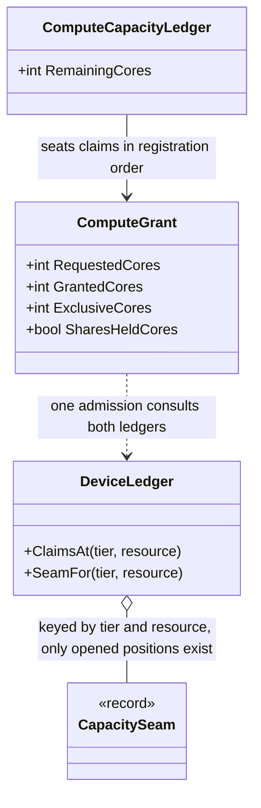
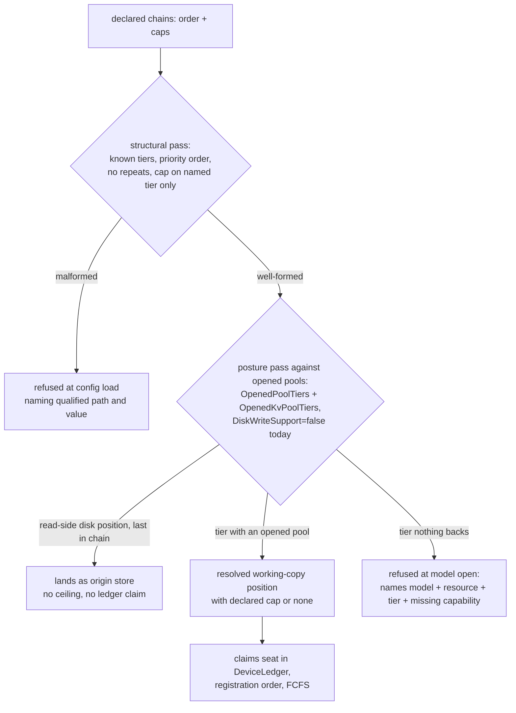

Scope: This page covers how LAIR accounts capacity today — the compute-capacity ledger and the device (tier/resource) ledger, budget chains per model resource and what each tier actually backs in this build, weight arenas and mmap placement of model files, host posture detection with declared-override semantics, NUMA spread preferences, prefill-buffer row-width clamps, PLE row residency gating, and `budget_exhausted` refusal semantics. As of 2026-11-27 this reflects implemented behavior under `src/` only; planned placement capabilities are stated as refused vocabulary, never as working posture.

# Capacity accounting: ledgers, budget chains, weight arenas, host posture

## What this subsystem is for

Two questions have to answer before a model serves and while it runs: *can this admission fit what the machine actually holds* (ledgers), and *what may move where when its declared ceilings bind* (budget chains). LAIR splits these deliberately: ledgers count real capacity claims against real pools; budget chains are per-resource declarations of residency priority with optional ceilings. Neither relocates anything silently — every unresolvable posture refuses, naming the model, resource, tier, and what this host lacks.

## The two ledgers



Paths: `src/Lair.Models/ComputeCapacityLedger.cs`, `src/Lair.Models/DeviceLedger.cs`. Semantics the diagram sketches (full detail below): a grant records what was asked against what runs; ledger seats exist only for tier/resource positions an open actually backs.

- **Compute capacity** is core quota, not bytes. A model's grant states requested cores (`RequestedCores` — its engine thread choice capped by `thread_quota` where declared), granted cores (`GrantedCores`, never zero: "a claim that finds nothing left runs beside standing grants rather than being refused"), and exclusive cores (`ExclusiveCores`, clamped so the total across claims never exceeds the reported host logical-processor count). A later oversubscribed claim is *clamped to what remains* — a partial grant naming requested against granted (`GrantVersusRequest()`, e.g. `8/3`) rather than an admission failure; fairness degradation stays visible through `SharesHeldCores` and the grant's diagnostic text ("requested 8 cores / granted 5 (2 exclusive, shared with earlier grants)" shape). Overlap beyond exclusivity happens only where `models[].placement.core_overcommit` opts in, keeping the whole requested share while recording the overlap — "records the overlap instead of hiding it". Claims seat on the nodes their placement chose: capacity is tracked per reported node, a claim fills its chosen nodes in node order clamping to each node's unclaimed remainder, and a pinned posture's node is authoritative (the seam never moves a pinned claim elsewhere). A claim registered without an explicit node choice spreads across every reported node in node order. `RemainingCores` answers what no seated grant has taken as its own; shared overlap never consumes it.
- **Device capacity** claims seat at a `[tier, resource]` position through a `CapacitySeam` record (`src/Lair.Models/DeviceLedger.cs`) — the ledger is built from exactly the seam set the opened posture reports, so an unopened tier has no seatable position rather than an unlimited one. Claims arrive in registration order; first-come-first-served is load-bearing: an earlier claim is never revoked, preempted, or displaced by a later one — when room is gone, *later* admissions answer refusal (or deferral for device fair-share candidates, which hold their slot and ride a later boundary — scheduling.md owns that split). `ClaimsAt(tier, resource)` gives the operator view of contested holders at a tier; `SeamFor(tier, resource)` resolves one position's seam. Read-side origin-store positions (a model file on disk) deliberately hold no ledger capacity: nothing is claimed against storage that already holds the complete set.

Which tier positions exist to seat against comes from the opened posture itself (`CapacitySeam` / `ReportOpenedTier`, feeding `GenerationService.AcceleratorAccountingOf` and weight-tier reporting as cuda-backend.md describes): a CPU-only open opens DRAM positions only; an accelerator-backed open adds device positions for whatever its backend actually backs.

## Budget chains: resources, tiers, units

Each model may declare per-resource budget chains (`src/Lair.Models/ModelBudgets.cs`). The vocabulary is fixed and small:

| Resource key | What it bounds | Ceiling unit | Read/write side |
|---|---|---|---|
| `weights` | weight bytes a forward reads | `_mb` | read-side — complete set already exists in the model file (origin store) |
| `kv` | paged KV blocks sequences write | `_blocks` | write-side — resident where its pool opened |
| `prefill_buffers` | transient activation working sets of a prompt window | `_mb` | write-side, "never disk material today" by design comment |
| `ple` | PLE n-gram table rows admitted into residency | `_mb` | read-side origin store; only resident rows are bounded |

Tiers run in one fixed priority order — **`dram`, then `vram`, then `disk`** — any tier skippable, none repeated (`BudgetTierNames.DeclaredNames`). Cap keys are tier name joined to the resource's unit: `budgets.kv.caps.dram_blocks`, `budgets.weights.caps.vram_mb`, and so on; a key built from one resource's unit never parses as another's (megabytes are not how KV counts anything, blocks are not how weights count theirs — refusal wording names the accepted vocabulary).

Config shape (`src/Lair.Http/Config/YamlConfigLoader.cs`): `models[].budgets.<resource>.order` is a list of tier names highest-priority first; `.caps` maps qualified ceiling keys. A cap binds only a tier its own chain's order names — declaring `vram_mb` beside an order that skips `vram` refuses at load. Structural edits (`order`, the whole block) are restart-only by design: they carry no single canonical scalar to hot-compare, and semantic changes surface through full-config diff instead (ConfigReload skip rule). Individual cap scalars hot-edit per key — see "Knobs" below for which ones apply live today.

Resolution lands each declared position against what the host opened (`ModelBudgets.Resolve`): a working-copy claim at a tier no opened pool backs refuses naming model, resource, tier, and the missing capability — weights-in-VRAM names the compute backend seam that would need device-resident weight copies; KV-in-VRAM names the device-backed block pool; write-side disk claims name the writing machinery this build does not carry (`DiskWriteSupport` is false everywhere here). A read-side resource's `disk` position resolves as its **origin store** — legal only as the chain's final position, and never under a ceiling of ours because that storage already holds the complete set.



**What each tier actually backs today:** `dram` backs everything this engine opens — weight arenas, KV pools, activation buffers. `vram` seats claims only where an open reports positions: device-resident weight copies behind a CUDA split posture, and *KV* specifically through device-backed block ranges (mirror accounting; `budgets.kv.caps.vram_blocks` must state a finite ceiling or the residency refuses — refusal wording quoted in "Refusals"). Quantized KV pairs refuse any non-host residency outright (kv-cache.md). `disk` is real only as the read-side origin store of model files; no write-side bytes reach storage anywhere in this build, and declaring that posture answers with what is missing rather than pretending.

## `budget_exhausted` semantics

Two distinct refusal families ride on top of admission, both named end to end:

- **Declared-ceiling breach.** When a claim cannot fit its chain's declared cap at the tier it resolved to, resolution/admission raises the budget exception naming *model, resource, exhausted tier*, and the ledger breakdown behind it (`BudgetExhaustedException`, `src/Lair.Models/`). Serving reports it as the budget-exhausted marker on the result path (request-lifecycle.md).
- **Pool capacity exhaustion.** KV admission that eviction cannot free refuses as capacity exhaustion — *before* advancement consumes anything, never admitted-then-tripped mid-run (`GenerationScheduler.cs`; scheduling.md owns the refusal surface).

FCFS is what makes these deterministic: because earlier claims are never displaced, a refused admission describes exactly the room already held. Nothing in this build preempts a running sequence to reclaim bytes; hot KV ceiling edits trim *free* capacity and force prefix eviction first (active pipelines keep their blocks — kv-cache.md).

```mermaid
sequenceDiagram
    participant S as Scheduler admission
    participant C as ComputeCapacityLedger
    participant D as DeviceLedger
    participant P as Pool + PrefixCache
    S->>C: seat worker claim on chosen nodes
    Note over C: oversubscribed remainder clamps to a partial grant,<br/>never refuses, never displaces an earlier seat
    S->>D: seat tier/resource claims in registration order
    alt room exists at the position
        D-->>S: claim seated — FCFS holds it for this sequence's lifetime
    else declared chain cap cannot fit
        D-->>S: BudgetExhaustedException naming model, resource,<br/>exhausted tier, and the ledger breakdown behind it
    else device fair-share room is short but standing grants hold slots
        D-->>S: deferral — candidate keeps its slot and rides a later boundary<br/>(DeviceCoScheduler posture, not an admission refusal)
    end
    S->>P: KV reservation sized for prompt + generation ceiling
    P-->>S: evict cached prefixes first; if still short,<br/>capacity-exhaustion refusal before advancement consumes anything
```

## Weight arenas and mmap placement

Default weight residency is **the model file itself, memory-mapped read-only**: `GgufMmapWeightSource` (`src/Lair.Loader/GgufMmapWeightSource.cs`) opens one whole-file mapping for a single-file GGUF (or index-aligned per-shard mappings for split models) and resolves every logical tensor as a span over the mapped bytes — no arena copy of weights happens in this posture, so DRAM occupancy follows pages actually touched rather than file size claimed upfront.

Views layered on that backing stay copies-free: `ExpertSlabWeightSource` exposes MoE tensors as per-expert slabs at their contiguous byte ranges for router-pointer gathers while "the backing store stays exactly what it was — the mmap arena today, an arena-copied source, or a residency tier later" (its own documentation; no expert tensor is ever copied there). The CUDA `DeviceCopy` posture caches a one-time weight upload per tensor instead of mapping, and its accounting deliberately excludes those uploads from compute-call transfer tallies while a mapped posture adds no persistent device bytes at all (cuda-backend.md owns the kernel side).

PLE rows map exactly the shard that owns them (`PleRowSource`, `src/Lair.Loader/PleRowSource.cs`): one whole-physical-shard mapping, touched row pages only, with prefetch hints naming ranges inside the view's own extent. Hot-row residency (`PleHotRowProvider`) admits copies parity-checked against their source spans before counting as resident; on Linux the hot arena is an anonymous `mmap(MAP_PRIVATE|MAP_ANONYMOUS)` range madvise'd `MADV_HUGEPAGE`, and on every other host it is plain committed aligned memory — **the requested backing reports as not applied rather than emulated**. Hits/misses are tallied so measured hit rates describe what actually ran.

PLE residency ceilings gate whole rows, never guessed bytes: `PleResidencyGate` (`src/Lair.Models/PleResidencyGate.cs`) divides declared `ple.caps.dram_mb` against each table's own row stride (same ceiling division the provider applies at admission — "admission and budget gating can never disagree about how many rows fit"), and a selection the clamp cuts is reported as refused rather than silently narrowed.

## Prefill-buffer clamps: ceilings that narrow work, not refuse it

A declared `prefill_buffers` chain sizes prompt windows instead of claiming standing bytes (`src/Lair.Models/PrefillBufferClamp.cs`). At engine open one sub-batch row's activation cost is measured against every copy-holding position in the chain; **the binding tier allowing the fewest rows wins**, producing a `PrefillRowWidthClamp` (tier, cap, requested width beside allowed width) resolved once like every other forward-shape value. No arithmetic in any forward reads it — prompt routes split at the clamped effective width (`_effectivePrefillRowWidth`, `TransformerModel.cs`). A clamp that allows zero rows still reports with `AllowsPositiveWidth` false: "the posture reads off diagnostics rather than vanishing into a silently narrowed window", and the scheduler exposes it as internal diagnostic ("reports why rows narrowed and never moves a token" — `GenerationScheduler.ResolvedPrefillRowClamp`). With no declared cap nothing binds, which is today's default behavior.

## Host posture detection and declared overrides

`HostTopology.cs` (`src/Lair.Models/`) probes what the machine reports — nodes with per-node byte/core totals (Windows path `ProbeWindowsNodes`; Linux interop via `src/Lair.Loader/LinuxPlacementInterop.cs`). The honesty rule is explicit: **a capacity a host does not report reads as absent/null, never zero**, so absence and emptiness stay distinguishable.

Operators may declare over it (`host.dram_mb`, `host.vram_mb`, `host.cpu_cores`, `host.disk_path`, plus `host.numa.nodes` per-node overrides — the loader's `HostPostureKeys`). Each must state a positive number where it states anything; `disk_path` declares only *that this host reads from disk* ("no ceiling belongs at that position, so nothing here reads a number beside it"). A declared total disagreeing with probed topology is **accepted with a warning naming both**: `host_capacity model='…' … — accepted against reported topology` (`GenerationService.ReportDeclaredCapacity`). Ledger seats follow the *effective* posture after acceptance. The monitor publishes the resolved reading as `compute_topology model=…` rows (monitoring-and-metrics.md owns the stream).

NUMA placement is a preference, never a promise: `models[].placement.numa_spread` accepts `auto`, `local`, or `interleave`; what lands on this host's node layout is decided at open per OS path (`NumaSpreadPreference` in the loader/placement seams), and no refusal claims cross-node movement that the OS declines to give.

## Knobs this page owns

| Key | Live class today | What it decides | Bounds/refusals |
|---|---|---|---|
| `models[].budgets.<resource>.order` (+ whole budgets block) | RestartOnly (structural list — hot-compare has no canonical scalar; semantic edits surface via full diff, `ConfigReload.cs`) | chain tiers and priority for that resource | config-load structural refusals above; posture refusal at open |
| `models[].budgets.kv.caps.dram_blocks` | **Live** when the model's resolved chain carries a system-memory KV tier (maps to canonical block count — `GenerationService.cs`) | standing KV reservation/cap in blocks | floor 8 like legacy `kv_blocks`; hot edit trims free side and can force prefix eviction; refused live if no such tier resolves |
| `models[].budgets.kv.caps.vram_blocks` | RestartOnly (explicit, with residency keys) | finite device-resident KV ceiling | required by any non-`dram` `kv_residency`; refusal wording quoted below |
| `models[].budgets.weights.caps.*`, `.ple…`, `.prefill_buffers…` caps | **Refused mid-run** — RestartOnly (`GenerationService.cs`) | declared ceilings for weight claims, PLE rows, prefill clamps | positive-only at load; enforcement as described per section above |
| `models[].placement.kv_residency` + `budgets.kv.caps.vram_blocks` + `host.vram_mb` | RestartOnly | which block ranges seat device-side | non-`dram` without finite ceiling refuses; quantized KV beside non-host residency refuses; no usable CUDA behind the storage seam refuses (also cuda-backend.md) |
| `models[].placement.core_set`, `.thread_quota`, `.core_overcommit` | per reload table (scheduling.md owns live classes) | core-grant shape in the compute ledger | oversubscription clamps to remainder, not refusal; overlap only where opted in and recorded |
| `host.*` posture keys + `host.numa.nodes` | RestartOnly | effective capacity totals ledgers seat against | positive-number validation at load; declared-vs-probed disagreement accepted with warning line |

## Refusals today (concrete wording families)

- Chain shape: unknown tier, repeated tier, out-of-priority order (`dram → vram → disk` is the only legal direction), a cap on a tier its chain's `order` does not name, non-positive caps ("ceilings must be 1 or greater — omit the cap to declare no ceiling there"), and any ceiling on a read-side origin position ("that storage already holds the complete set").
- Working-copy claim at an unopened residency: weights/PLE in VRAM name the compute-backend capability; KV in VRAM names the device-backed pool posture; write-side disk claims state "write-side bytes reach storage only where something writes them" — declared vocabulary, never a silent drop to DRAM.
- Device-backed KV residency without a finite ceiling: `device-backed KV blocks are admitted only against a finite ceiling… Declare 'models[].budgets.kv.caps.vram_blocks' … or resolve the residency to 'dram', which needs no ceiling because it opens no device pool` (`src/Lair.Http/GenerationService.cs`).
- Legacy-vs-canonical disagreement: `kv_blocks` and `budgets.kv.caps.dram_blocks` "spell the same system-memory KV ceiling, so they must state the same number" (loader refusal); a legacy key alone still works but logs the deprecated-key notice pointing at budgets.
- Mid-run edits to weight/PLE/prefill-buffer caps: refused rather than half-applied; only the canonical KV DRAM ceiling hot-edits when its tier resolves.

Cross-links: block pools, residency modes as they affect cache reads, and quantized-pair refusals in [kv-cache.md](kv-cache.md); admission ordering, deferral vs refusal, and reload classes in [scheduling.md](scheduling.md); result-side budget reporting in [request-lifecycle.md](request-lifecycle.md); opened-tier accounting and monitor publishing of device posture in [cuda-backend.md](cuda-backend.md) and [monitoring-and-metrics.md](monitoring-and-metrics.md); row-width machinery these clamps bind against in [cpu-kernels.md](cpu-kernels.md); profile-driven window values feeding KV windows in [model-profiles.md](model-profiles.md).
