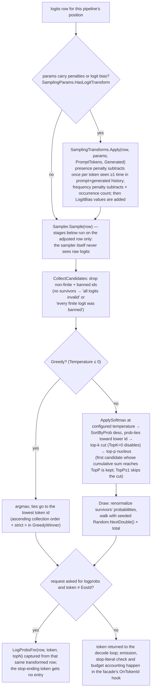

# Sampling, Logprobs, and the Drafting Seam

Scope: how one pipeline samples its next token — transform order, sampler stages, knob ranges and where each refusal lands on the wire; stop handling and finish-reason mapping; logprob accounting; and what the speculative-draft seam does today. As of 2026-11-27.

## One pipeline owns one sampler

`RequestPipeline` (internal to `Lair.Models.Scheduling`, [`src/Lair.Models/Scheduling/RequestPipeline.cs`](../../../src/Lair.Models/Scheduling/RequestPipeline.cs)) builds its own `Sampler` once from the request's `SamplingParams` and never shares it, so a pipeline's RNG stream never interleaves with another pipeline's. Its per-step authority is `SampleFrom(row)`: transform if needed, sample, capture logprobs when asked — and because "which batch produced this row changes nothing", a merged step hands the pipeline exactly the logits row an unmerged one would have, making batching invisible to its tokens and its random stream (see [request-lifecycle.md](./request-lifecycle.md)).



### Stage by stage, in method order

| # | Method (`src/Lair.Sampling/Sampler.cs`) | Exact behavior and edge cases |
|---|---|---|
| 1 | `CollectCandidates` (lines 177–189) | Keeps ids with finite logits that are not banned; the sampler exposes a banned-token draw entry point (`Sample(logits, bannedTokens)`), though served pipelines pass none. An empty survivor list throws naming which filter emptied it: "all logits invalid" vs "no candidate tokens: every finite logit was banned". |
| 2 | `GreedyWinner` (lines 208–222) | Used whenever `SamplingParams.Greedy` holds (Temperature ≤ 0). Strict `>` over ascending-id collection order, so the first — lowest-id — holder of the maximum wins ties. No softmax, no cuts: greedy is a plain argmax on the transformed row. |
| 3 | `ApplySoftmax(candidates, temperature)` (lines 224–246) | `exp((logit − maxLogit) / temperature)` per candidate; probabilities summed and divided in double precision. Temperature scaling happens before any cut — this is also the distribution logprobs report (§Logprob accounting). |
| 4 | `SortByProb` (lines 248–255) | Probability descending; probability ties resolve toward the lower token id, which keeps candidate order deterministic for identical rows. |
| 5 | `ApplyTopK` (lines 257–263) | Drops everything past position `TopK`; `TopK = 0` disables the cut entirely rather than meaning "keep zero". |
| 6 | `ApplyTopP` (lines 265–288) | Nucleus walk over the survivors of the k-cut: cumulative sum until it reaches `TopP`, keeping that crossing candidate; `TopP ≥ 1f` skips the pass. Because this runs after top-k, nucleus mass is measured over the truncated set — llama.cpp's order, not a re-normalized full-vocabulary one. |
| 7 | `Draw(candidates)` (lines 290–310) | Recomputes the survivors' total and walks cumulative sums against `Random.NextDouble() × total`; floating-point drift falls back to the last survivor (line 309). The generator is seeded only when `Seed` carries a value (`MixSeed`, line 60); otherwise it is a fresh unseeded `Random`. |

The wire body carries no min-p, repeat-penalty or freshness knobs today — `ChatCompletionBody` names exactly temperature, top_p/top_k, seed, stop, both penalties, logit_bias and the two logprob fields ([`src/Lair.Http/ApiContracts.cs`](../../../src/Lair.Http/ApiContracts.cs) lines 10–27), and `Sampler` implements exactly the seven stages above.

## Knob ranges and where refusals land

Defaults on both chat and completion bodies (`src/Lair.Http/ApiApp.cs` lines 375–445): `temperature` 1.0, `top_p` 0.9, `top_k` 40, penalties 0, `seed` null (a fresh unseeded generator), `max_tokens` 128.

| Knob | Range enforced | Enforcement site | Wire outcome for a violation |
|---|---|---|---|
| `presence_penalty`, `frequency_penalty` | [-2, 2] | `ApiApp.SamplingRangeError` before the engine; again in `GenerationService` (lines 2411–2419) so programmatic callers meet the same rules | 400 `invalid_request_error` / `invalid_request`, message names field and value |
| `top_logprobs` | [0, 20] | same two sites (line 2421; ApiApp line 532) | 400 invalid request |
| `temperature` | ≥ 0 (0 = greedy) | `Sampler` constructor (`src/Lair.Sampling/Sampler.cs` lines 18–21): "Temperature must be >= 0, got X." — no wire-side pre-check exists for it today | ArgumentOutOfRangeException → mapped as ArgumentException to 400 invalid request in `ApiApp.WriteErrorAsync` (lines 813–827) |
| `top_k` | ≥ 0; 0 disables the cut | Sampler constructor lines 23–26 | same 400 mapping |
| `top_p` | (0, 1] | Sampler constructor lines 28–31 ("TopP must be in (0, 1], got X.") — TopP = 1 skips the nucleus cut entirely | same 400 mapping |
| logit-bias values | [-100, 100] per token id; ids outside the vocabulary are ignored at application time (`SamplingTransforms`) | Sampler constructor lines 43–52 | same 400 mapping |

A long `seed` is folded to a 32-bit generator seed by XOR-ing its halves (`Sampler.MixSeed`, line 60) so distinct 64-bit inputs stay distinguishable down to a 2⁻³² collision rate. There are no engine config keys that change sampling posture: every knob above arrives per request, and nothing in `lair.yaml` selects temperature, top-k, or top-p defaults for served models — the wire defaults listed here are what applies when a body omits them (see [tokenizer-templating-tools.md](./tokenizer-templating-tools.md) for how output parsing can then override the finish reason).

## Logprob accounting

When `logprobs: true`, the facade sets `LogProbTopN = max(top_logprobs, 0)` on the scheduled request and each pipeline appends one `TokenLogprob(token, logProb, top)` per generated token in generation order ([`src/Lair.Models/Scheduling/RequestPipeline.cs`](../../../src/Lair.Models/Scheduling/RequestPipeline.cs) lines 91–92, 144–148). The reported distribution comes from `Sampler.LogProbsFor` (lines 118–175): the softmax of the given logits at the configured temperature — after any temperature scaling but before the top-k and top-p cuts — so entries describe the sampling distribution, not the truncated one; greedy mode reports at temperature 1 because its argmax equals that distribution's argmax. The `topN` highest-probability candidates sort descending with ties toward the lower token id, and a chosen token ranked below the window is appended to it, so every entry carries the sampled token itself. Non-finite logits are excluded; asking for a non-finite token fails naming it ("token X is not in the reported distribution (its logit is non-finite)").

On the wire this rides `logprobs.content` as `LogProbEntry(token_id?, token, logprob, top_logprobs)` under snake-case serialization (`src/Lair.Http/ApiContracts.cs` lines 110–114, naming policy at ApiApp line 736). The entries reach the wire through the pipeline's own capture list: `RequestPipeline.LogProbEntries` folds into `SequenceOutcome`, which the facade hands to `GenerationResult.LogProbs` for non-streaming choices and per-fragment deltas in streamed chunks (`GenerationService.cs` lines 2685–2692). Streaming itself keeps the same authority ordering: a chunk delta pairs its content fragment with that token's logprob entry, budget reports ride only on the closing frame, and `finish_reason` appears solely on the final content chunk (ApiContracts lines 116–134). The stop-ending token is never reported or visible in text at all — besides skipping capture, the facade decodes generated tokens with `includeSpecial: false`, so special ids do not surface in the response body either (`GenerationService.cs` line 2576).

## Stop handling and finish reasons

Two distinct stop mechanisms run on different layers, which matters for what a client sees:

- **Stop literals** (`stop` strings) are matched against accumulated decoded text inside the facade's per-token hook via `StopIndex(streamed, request.Stop)`; a hit records the cut position, signals cancellation into the scheduler through a linked token source (so it lands at the next step boundary — even when the literal appears in the very first streamed token before the handle came back), and truncates final text before the literal. The scheduler only ever reports such a run as `FinishReason.Canceled`; only the facade knows it was really the stop string, so its tally feeds the metrics bus's finish-reason counts (`GenerationService.cs` lines 2483–2594).
- **Stop token id**: scheduled requests carry `EosId = StopId`, which is the model's declared EOT id when present (`tokenizer.ggml.eot_token_id`) and today's EOS behavior otherwise. The scheduler ends the sequence at that sample without emitting or logprob-recording it, reporting `FinishReason.Eos`.

**Budget ceilings ride next to sampling.** Per-request overrides of the model's reasoning/response token ceilings arrive through `max_reasoning_tokens` / `max_response_tokens`, each validated as ≥ 1 by both wire and facade (ApiApp; `GenerationService.cs` lines 2429–2437), then clamped to what the loaded model declares — a clamp is reported back as a `TokenBudgetReport(field, requested, applied, clamped)` entry rather than swallowed silently. During decode a `BudgetStreamState` fed by the token hook marks whichever ceiling was hit and cancels through the same linked stop signal (lines 2522–2528), so budget exhaustion ends as `"length"` with its own attribution in `budget_exhausted`: `"response"`, or `"reasoning"` when only the reasoning ceiling bounds the run — including the case where the token that exhausts the combined ceiling never reaches the hook, which is re-derived from the resolved pair (lines 2604–2624).

```mermaid
stateDiagram-v2
    direction LR
    state "scheduler FinishReason.Eos" as seos
    state "finish_reason eos" as weos
    state "scheduler FinishReason.Length: token budget exhausted" as slen
    state "finish_reason length" as wlen
    state "scheduler FinishReason.Canceled" as scan
    state "facade saw a stop literal?" as chk
    state "finish_reason stop: text truncated before the literal" as wstop
    state "budget ceiling hit, caller not cancelled: finish_reason length plus budget_exhausted response or reasoning" as wblen
    state "real cancellation: 499 client_disconnected_error or OperationCanceledException" as wcancel
    state "scheduler FinishReason.Failed: forwarding fault" as sfail
    state "finish_reason failed then 503 engine_overloaded_error" as wfail

    seos --> weos
    slen --> wlen
    scan --> chk
    chk --> wstop : stop literal seen in streamed text
    chk --> wblen : budgetCeilingReached and caller not cancelled
    chk --> wcancel : otherwise
    sfail --> wfail
    note right of wstop : GenerationService.cs lines 2576-2644 map the enum to wire strings; budget_exhausted attribution at 2604-2624
```

A request whose resolved ceiling leaves no room after prompt fitting (`maxTokens ≤ 0`, `GenerationService` lines 2467–2472) never schedules a forward: it answers with empty text and `"length"` immediately. Tool-call detection can take over last — when recognized calls appear in the decoded text, their markup is stripped, calls ride as data, and the finish reason becomes `tool_calls` "no matter how decoding ended" (lines 2646–2678).

## Drafting seam: contracts and refusal semantics

Speculative drafting exists today only behind assembly-internal seams with explicit eligibility rules — no config key enables it for served models. The contract types live in `src/Lair.Sampling/Drafting/`: `IDraftHead` (a head proposes up to `MaxDraftTokens` tokens from a `DraftProposalContext(vocabSize, history, lastSampledLogits)`, may propose nothing — an unsure step then proceeds exactly as an ordinary decode would — and must be deterministic for identical contexts so accept-rate measurements repeat), and `MtpDraftPolicy.Resolve(modelName, hasNativeDraftTensors, configuredHead)` returning a `DraftHeadDecision`:

- explicit head supplied → enabled: "drafting enabled through a host-supplied draft head of cap N."
- native tensors declared but no head supplied → refused: "the artifact declares draft-head tensors but no head was supplied through the drafting seam" — an engine-side provider that binds native multi-token-prediction tensors to this seam is not wired for any family yet, so declaring tensors alone does nothing.
- neither → refused: "MTP drafting is refused — this model carries no draft-head tensors and none was configured; supply an IDraftHead (a side artifact or a stand-in head) to enable speculative decoding."

Refusal never silently replaces drafting with unverified free-running proposals (`src/Lair.Sampling/Drafting/MtpDraftPolicy.cs` lines 22–46).

```mermaid
sequenceDiagram
    participant H as IDraftHead (host-supplied or scripted stand-in)
    participant SD as SpeculativeDecoder (own Sampler, one RNG stream for the run)
    participant T as target verifyForward (one ordinary decode step of this sequence)
    Note over SD: StartFromLogits mirrors a served pipeline's first token — transforms over prompt, no forward; eos there ends the run before any drafting
    SD->>H: Propose(history + last transformed logits row)
    H-->>SD: proposals (window clamped to remaining generation budget)
    loop until acceptance ends or window consumed
        SD->>T: forward pending/accepted authoritative token — same feeds, append order and logits rows an undrafted step would produce
        T-->>SD: logits row → SampleAuthority(transforms over prompt+generated history, then Sampler.Sample)
        alt sample equals eos id
            SD-->>SD: FinishReason.Eos; stop token never emitted or forwarded on
        else proposal matches target's own sample at this position
            SD->>SD: accepted++; authoritative token emitted into EmittedTokens and Generated
        else first mismatch
            SD->>SD: FirstMismatchIndex recorded; the target's own token is still emitted as ordinary output; every later proposal was never fed — a rejected draft cannot write KV bytes, advance positions, or disturb the sampler
        end
    end
    SD-->>SD: DraftStepOutcome(EmittedTokens, ProposedCount, AcceptedCount, FirstMismatchIndex?) folded into MtpTallies (StepsAdvanced, DraftsProposed/DraftTokensAccepted/Rejected, FullyAcceptedSteps, NoProposalSteps, AcceptRate) — single-writer counters on the control-plane thread
```

`SpeculativeDecoder` (`src/Lair.Models/Engine/SpeculativeDecoder.cs`) keeps its own seeded `Sampler` plus penalty/bias transforms over this run's history at every sample, "exactly as a served pipeline samples", so drafted runs reproduce the non-drafted sampler posture token for token including RNG-stream continuity. Length finishes mirror the served loop's emit-then-check order (lines 189–200). Because each verify forward feeds only authoritative tokens, the emitted stream is identical to an undrafted run of the same model and sampling posture — boundary grouping included: a drafted run's per-token decisions are one-for-one the baseline step sequence. Boundary results arrive as `DraftedAdvance(EmittedTokens, DraftStepOutcome, Finished?)` until the run ends in `DraftedRunResult(FinishReason, Tokens, Tallies)`; `MtpTallies.Absorb` folds several drafted streams into host-level counters for reporting (`src/Lair.Sampling/Drafting/MtpTallies.cs` lines 89–99). `ScriptedDraftHead` is a deterministic selector-driven stand-in for tests and benches; nothing public reaches it.

Today the only consumers of these types are bench and test code: the `mtp` bench verb runs scripted heads over `SpeculativeDecoder` against an undrafted greedy baseline on the pinned SmolLM-135M fixture, reporting median/min/max tok/s per draft window, accept-rate tallies, and drafted-vs-baseline stream equality (`bench/Lair.Bench/Program.cs` line 29; `bench/Lair.Bench/MtpDraftBench.cs`). Its own documentation posture states the measured multipliers "document drafting overhead until single-forward batched verification exists in the engine" — verify forwards remain one-per-authoritative-token, so drafted throughput is currently below baseline on small fixtures. No committed draft-cost artifacts exist under `reports/` yet; treat that claim as qualitative for now (see [measurement-harnesses.md](./measurement-harnesses.md)).

## Refusals and gaps stated plainly

- Out-of-range sampling values reach the engine only through their enforcement sites above: penalties/top_logprobs pre-checked at two layers, temperature/top-k/top-p/logit-bias ranges enforced by `Sampler` construction — an invalid pair fails with a named-field message mapped to 400 rather than clamped silently.
- A sampler call where every candidate is filtered throws naming which filter emptied the set; a drafted run refuses to advance before its first token exists or beyond its remaining budget (lines 123–132).
- No served pipeline drafts today: `MtpDraftPolicy` refusals are the only drafting posture reachable without bench code, and native MTP tensors remain unconsumed until an engine-side provider binds them. Batched single-forward verification is not implemented — accept-prefix verify forwards stay one-per-token.

Related pages: [request-lifecycle.md](./request-lifecycle.md) (pipeline stages, admission), [model-profiles.md](./model-profiles.md) (softcaps ahead of sampling), [monitoring-and-metrics.md](./monitoring-and-metrics.md) (finish-reason tallies on the metrics bus), [tokenizer-templating-tools.md](./tokenizer-templating-tools.md) (tool-call and reasoning-region post-processing that can rewrite a finish reason).
