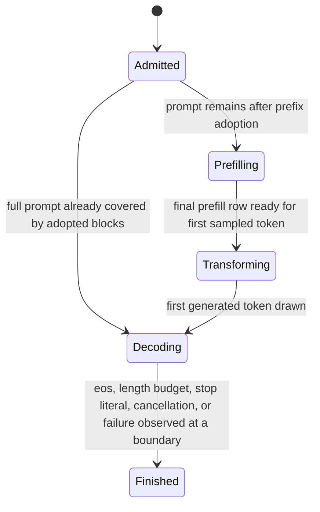
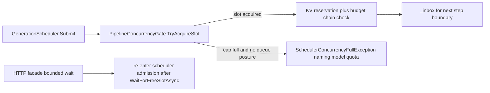
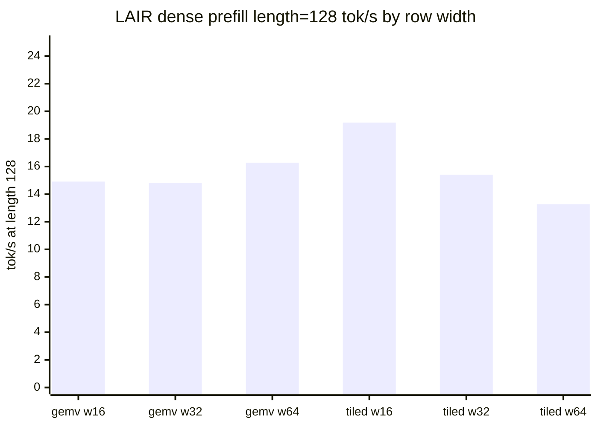

Scope: Pipelines vs merged steps, routes and segments, arbiter cost model, concurrency caps and queueing, fairness, prefill lanes, token budgets, hot-reload of scheduling knobs. As of 2026-11-27 this reflects implemented behavior under `src/` only; planned surfaces are not described as current.

# Scheduling internals

LAIR schedules one model instance with a continuous-batching control plane rather than one request thread per caller. The scheduler owns admission, pipeline state, merged-step composition, cancellation observation, and finish accounting. Forward execution lives in the engine/backend layers described by [architecture.md](architecture.md) and follows one admitted sequence end to end through HTTP encoding and output parsing as documented in [request-lifecycle.md](request-lifecycle.md).

The scheduler class is `GenerationScheduler` (`src/Lair.Models/Scheduling/GenerationScheduler.cs`). Its live shape:

- `_inbox` carries admitted submissions waiting for the next step boundary.
- `_active` is the pipeline working set, sorted ascending by pipeline id at each boundary; ids are handed out in admission submission order, so the oldest admitted sequence advances first.
- cancellation is observed before forward work for that boundary.
- every decoding pipeline participates in shared decode steps, with at most one prefill chunk interleaved into a boundary. A merged step gives each pipeline its own logits row and sampler stream; merging changes when math runs, not what tokens the sequence produces.

## Pipeline states



Path: `src/Lair.Models/Scheduling/RequestPipeline.cs`. The enum values are `Admitted`, `Prefilling`, `Transforming`, `Decoding`, and `Finished`. A fully prefix-adopted sequence can skip forward work for already-covered prompt positions; the state machine still advances through decode eligibility when its boundary slot is taken.

## Admission, concurrency caps, and queue posture

Concurrency admission happens before KV capacity checks in scheduler submission:



Paths: `src/Lair.Models/Scheduling/GenerationScheduler.cs`, `src/Lair.Models/Scheduling/PipelineConcurrencyGate.cs`.

Key implemented behavior:

- One gate slot is held from submission until the pipeline finishes. Lowering a cap later stops future admissions but does not preempt admitted pipelines; raising it admits more submissions from that point on.
- Over-cap scheduler submissions are refused rather than queued inside the scheduler. The queue posture lives at the HTTP facade, because waiting for an admission slot spans multiple submit attempts under one bounded wait (`src/Lair.Http/GenerationService.cs`).
- Queue postures are `immediate` and `bounded` (`src/Lair.Http/ApiContracts.cs`). An enabled bounded queue defaults to a 30-second wait when `models[].queue_timeout_ms` is absent. A waiting submission reserves no KV blocks or token budget; after waking it re-enters scheduler admission and can still be refused by capacity, context, quota, budget-chain, or queue-state checks.
- Composition deferrals are not admission refusals. A candidate kept out of a merged step by batch cap, quota headroom, or device fair-share keeps its admission slot and rides a later boundary (`src/Lair.Models/Scheduling/GenerationScheduler.cs`).

## Routes and segments

A model's resolved execution route is assembled at engine open and does not change while the model stays open. Route resolution lives in `ModelRoutes.Resolve` (`src/Lair.Models/ModelRoutes.cs`) with segment vocabulary in `src/Lair.Models/ModelRoute.cs`.

Each resolved `DeviceSegment` carries its position on the ordered path, device identity, weight tier, block residency tiers, batch cap posture, and quota facts. Consecutive stages that land on one device at one residency collapse into a single span; distinct split boundaries remain separate positions even when their device/residency values agree (`src/Lair.Models/ModelRoute.cs`).

Public placement vocabulary today:

| Key | Accepted public value set in this build | Implemented route effect |
|---|---|---|
| `models[].placement.device` | `auto`, `cpu` | Resolves decode-side stage to CPU; accelerator device names are refused and point at the named seam constant `ModelRoute.CudaBackendSeam`. Path: `src/Lair.Http/Config/YamlConfigLoader.cs`. |
| `models[].placement.prefill` | `auto`, `cpu` | Resolves prefill-side stage to CPU unless a declared layer split overrides route stages. Path: `src/Lair.Http/Config/YamlConfigLoader.cs`. |
| `models[].placement.gpu_layers` | non-negative integer; absent means zero | Opens accelerator compute backend on device `cuda` for the first span from layer 0, with later layers through the output head returning to CPU at boundary `gpu_layers`. Path: `src/Lair.Http/GenerationService.cs`, `src/Lair.Backends.Cuda/CudaBackend.cs`. |
| `models[].placement.kv_residency` | `auto`, `dram`, `vram`, `split` | Declares block-copy residency posture. Attention still reads the pool's host arena; device-backed modes open a mirror range where persistent copies live (`src/Lair.Kv/BlockResidencyMode.cs`). |

The accelerator seam constant is:

```csharp
public const string CudaBackendSeam = "lair.backends.cuda";
```

Path: `src/Lair.Models/ModelRoute.cs`. Naming that seam says where an accelerator-backed segment would run; it does not by itself open a usable CUDA driver or device. A declared layer split with no usable backend behind the seam refuses rather than falling back to some other posture (`src/Lair.Http/GenerationService.cs`).

## Step composition and arbiter identity

Step candidates are built from admitted pipelines at each boundary in `src/Lair.Models/Scheduling/StepCompositionArbiter.cs`. A candidate carries:

- pipeline id,
- the resolved `ModelPlan` instance it advances,
- KV residency tier read from the pool rather than a declared label alone. Default CPU pools report DRAM; device-backed mirror postures can report VRAM (`src/Lair.Backends.Cuda/CudaBackend.cs`, `src/Lair.Models/Scheduling/StepCompositionArbiter.cs`).

Merged-step identity is strict: pipelines share one logical forward pass only when they advance the same resolved model plan instance over its whole ordered route, hold KV that the stepping segment can address, fit that segment's batch cap posture, and leave quota headroom for what already joined. Two field-for-field identical plans are still separate steps if they are distinct instances or routes (`src/Lair.Models/Scheduling/GenerationScheduler.cs`, `src/Lair.Models/Scheduling/StepCompositionArbiter.cs`).

Decode batches obey the engine ceiling:

```csharp
public const int MaxBatchSequences = 16;
public const int MaxPrefillRowWidth = 64;
```

Path: `src/Lair.Models/Engine/TransformerModel.cs`. Prefill row width is independent of decode batch cap and must land within the engine ceiling or be narrowed by a declared prefill-buffer posture. Out-of-range resolved widths refuse at engine open.

## Arbiter cost model for prompt chunks

Prompt chunk sizing has two postures:

- If `engine.prefill_step_budget_ms` is unset, future chunks size toward the configured width ceiling (`src/Lair.Http/GenerationService.cs`).
- If a step-time budget is set, future prefill chunks are sized from measured engine cost toward that millisecond target within the configured ceiling. A forward already running finishes at whatever width was chosen before a live edit lands.

Internal scheduler facts:

```csharp
internal const int InitialPrefillProbeTokens = 8;
public const int UncappedConcurrencyCap = PipelineConcurrencyGate.Uncapped;
```

Path: `src/Lair.Models/Scheduling/GenerationScheduler.cs`, `src/Lair.Models/Scheduling/PipelineConcurrencyGate.cs`. The first budgeted chunks start narrow because a fresh engine has no measured step cost yet. Internal diagnostics expose the last chosen prompt-token count and sub-batch row width (`LastPrefillChosenTokens`, `LastPrefillSubBatchRows`), but these are not public knobs.

Measured prefill row-width posture from committed artifact:
`reports/2026-11-24T21-28-48Z-optimize-dense-prefill-rowwidth/summary.md`.



Adjacent authoritative table:

| Kernel | Row width | length=128 tok/s | length=256 tok/s | Posture |
|---|---:|---:|---:|---|
| `gemv` | 16 | 14.91 | 14.25 | local CPU lane, Qwen2.5-3B Instruct Q4_K_M fixture, threads=8 |
| `gemv` | 32 | 14.79 | 13.83 | same artifact posture |
| `gemv` | 64 | 16.28 | 15.73 | same artifact posture |
| `tiled` | 16 | 19.18 | 17.80 | best stable row-width configuration in this sweep at threads=8 |
| `tiled` | 32 | 15.41 | 14.16 | same artifact posture |
| `tiled` | 64 | 13.27 | 12.16 | same artifact posture |

The same run refused row width 128 before measurement because the engine's resolved prefill ceiling is 64: `prefill-profile: row width 128 exceeds the engine's resolved prefill row ceiling of 64`. A separate committed thread sweep (`reports/2026-11-24T21-45-49Z-optimize-small-model-cpu-thread-sweep/summary.md`) shows short-window LAIR prefill improving from roughly `15-17 tok/s` at threads=8 to peak values near `23-29 tok/s` in the sweep, with stable confirmation around `25 tok/s` at threads=32 / row width 64. That report also states llama.cpp remains far ahead on this fixture; thread tuning alone is not parity.

## Fairness and device co-scheduling

Pipeline fairness inside one model scheduler is deterministic: ascending pipeline id, with ids assigned in admission submission order (`src/Lair.Models/Scheduling/GenerationScheduler.cs`). There is no weighted priority queue for pipelines today.

Device fair-share exists only when the resolved route names an accelerator-backed segment. The seam is `DeviceCoScheduler` (`src/Lair.Models/Scheduling/DeviceCoScheduler.cs`): one window per device shared by models resident on it, with eight concurrent step slots:

```csharp
public const int WindowStepSlots = 8;
return Math.Max(1, WindowStepSlots * computeSharePercent / 100);
```

Path: `src/Lair.Models/Scheduling/DeviceCoScheduler.cs`. A model without a declared share is resident but unbounded by fair-share. A declared share caps future launches to its percent of the window, floored at one slot so no resident model with a declared share can be rounded out entirely. Grants/releases are exact: one slot per launched sequence, released after forward completion. Deferral happens before launch; in-flight device work is not preempted (`src/Lair.Models/Scheduling/GenerationScheduler.cs`).

Public key `models[].compute_share` accepts integers 1 through 100 or absent (`src/Lair.Http/Config/YamlConfigLoader.cs`, `src/Lair.Http/Config/ConfigReload.cs`). On a CPU-only route the declaration is warn-and-accept: it bounds nothing because no device window exists. On an accelerator-backed route, live edits retarget future compositions only; sequences already launched keep their window slots until their forwards return (`src/Lair.Http/GenerationService.cs`).

## Prefill lanes

`models[].placement.prefill_lane` accepts `shared` or `dedicated`; absent means `shared` (`src/Lair.Http/Config/YamlConfigLoader.cs`, `src/Lair.Http/Config/LairConfig.cs`). A dedicated posture creates a second CPU execution backend for prompt windows and derives its worker share from the model's effective claim. The default split takes floor one-quarter of that claim for prefill (`src/Lair.Models/PrefillLanes.cs`).

Dedicated lanes have hard boundaries today:

- `placement.prefill_lane dedicated` beside a nonzero `placement.gpu_layers` refuses because a dedicated lane carries one stage-side execution backend and this build has no crossing across a split route (`src/Lair.Http/GenerationService.cs`).
- Dedicated prefill posture beside quantized attention KV refuses; the quantized attention route does not carry that lane/offload posture in this build (`src/Lair.Http/GenerationService.cs`).

Live `placement.thread_quota` edits under dedicated lanes map onto the decode side only. The load-resolved prefill share keeps its worker pool, mask, activation buffers, and collision posture for the model's lifetime; an edit that cannot leave at least one worker on each side is refused as a lane-layout change requiring restart (`src/Lair.Http/GenerationService.cs`).

## Token budgets

Admission reserves blocks for the whole sequence lifetime: prompt tokens plus the generation ceiling. The scheduler therefore does not expect admitted pipelines to trip KV capacity mid-run; it first evicts cached prefix entries enough to satisfy effective free capacity, then refuses if still short (`src/Lair.Models/Scheduling/GenerationScheduler.cs`).

The generation ceiling is explicit `MaxTokens` when no reasoning/response budget pair was resolved. Otherwise it is the smaller of `MaxTokens` and the sum of resolved reasoning-plus-response ceilings:

```csharp
public int GenerationTokenCeiling => ReasoningTokenBudget is null && ResponseTokenBudget is null
    ? MaxTokens
    : Math.Min(MaxTokens, (ReasoningTokenBudget ?? 0) + (ResponseTokenBudget ?? 0));
```

Path: `src/Lair.Models/Scheduling/ScheduledRequest.cs`. Model-declared ceilings come from public keys such as `models[].max_context_tokens`, `models[].max_reasoning_tokens`, and `models[].max_response_tokens` (`src/Lair.Http/Config/YamlConfigLoader.cs`). Request-side overrides are clamped to those model ceilings before the scheduler reserves against them.

Context refusal semantics: a prompt that does not fit the resolved context window with at least one token free for generation is refused as `context_length`. KV capacity, concurrency quota, queue fullness, bounded-wait timeout, budget exhaustion, and retiring-model posture are separate recorded admission limit kinds (`src/Lair.Http/Monitoring/MonitorEvents.cs`).

## Hot-reload of scheduling knobs

Mutation classes come from `ConfigReload.Classify` and the apply path in `GenerationService.ApplyConfiguration`. Wire names are:

```csharp
public enum ConfigMutationClass { Live, NewRequestsOnly, RestartOnly }
// wire strings: live / new-requests / restart-only
```

Path: `src/Lair.Http/Config/ConfigReload.cs`, `src/Lair.Http/ApiContracts.cs`.

| Field | Class | Implemented effect today |
|---|---|---|
| `engine.max_batch_tokens` | Live | Prefill chunk width takes effect at the next step boundary; sequences mid-chunk finish that chunk at old width (`src/Lair.Http/GenerationService.cs`). |
| `engine.prefill_step_budget_ms` | Live | Future prefill chunks size toward new millisecond budget from next issue; running forward finishes with its chosen width. Unset returns to configured ceiling behavior (`src/Lair.Http/GenerationService.cs`). |
| `models[].kv_blocks` | Live | Soft KV usage cap changes admission's effective free side and can require cached-prefix eviction before later admissions fit (`src/Lair.Models/Scheduling/GenerationScheduler.cs`, `src/Lair.Http/Config/ConfigReload.cs`). Legacy key reports only when both configs still spell the ceiling that way; canonical block count remains enforced. |
| `models[].max_concurrent_requests` | NewRequestsOnly | Later submissions answer new cap; already admitted pipelines keep their slots (`src/Lair.Models/Scheduling/PipelineConcurrencyGate.cs`, `src/Lair.Http/Config/ConfigReload.cs`). |
| `models[].max_queued_requests` | NewRequestsOnly | Later queue seats follow the new posture; submissions already waiting keep the ceiling they entered with (`src/Lair.Http/GenerationService.cs`). |
| `models[].queue_timeout_ms` | NewRequestsOnly | Submissions from now on answer timeout after their bounded wait expires; existing waits are not rewritten mid-flight (`src/Lair.Http/GenerationService.cs`). |
| `models[].compute_share` | Live | Future device compositions re-derive cap; in-flight sequences keep window slots until forwards return. CPU-only route records warn-and-accept posture with no window (`src/Lair.Http/GenerationService.cs`, `src/Lair.Models/Scheduling/DeviceCoScheduler.cs`). |
| `models[].placement.thread_quota` | Live | Shared posture adjusts effective worker participation from next kernel call and merged-step quota headroom. Dedicated lane maps new quota onto decode side only; unmappable layout changes refuse with effective quota untouched (`src/Lair.Http/GenerationService.cs`). |
| `models[].max_context_tokens`, reasoning/response ceilings | NewRequestsOnly | Later request validation sees the new posture; already admitted sequences follow budgets they started on (`src/Lair.Http/Config/ConfigReload.cs`). |
| `engine.prefill_kernel` | NewRequestsOnly | Kernel selection is resolved into opened backend kernels and retitles later requests rather than mutating running forward code paths (`src/Lair.Http/Config/ConfigReload.cs`). |
| `models[].placement.device`, `prefill_lane`, `gpu_layers`, core set, overcommit, KV residency mode, source pins | Restart-only for live edits that cannot safely reseat opened posture; exact mutation class follows the reload table and loader classification (`src/Lair.Http/Config/ConfigReload.cs`). Device/lane/split/core-set/residency/source establish opened engine state rather than retargeting a running scheduler. Budget ceilings classify by tier/resource: system-memory KV caps follow live soft-cap behavior, accelerator-tier KV residency reseat requires restart posture, weight ceilings require reopened read paths, and prefill-buffer ceilings affect later requests only where clamping is in force (`src/Lair.Http/Config/ConfigReload.cs`). |

## What this scheduler refuses today

- Over-cap submissions when no queue posture is enabled: refused at `PipelineConcurrencyGate` before KV reservation or pipeline advancement starts.
- Queue waits that expire without a slot freeing, and submissions arriving while every bounded queue seat is taken: named as queue timeout/full admission refusals (`src/Lair.Http/Monitoring/MonitorEvents.cs`).
- Context prompts with no token free for generation: refused as `context_length` before engine advancement consumes shared prefix slots or forward work.
- KV reservations the pool cannot back after cached-prefix eviction: refused as capacity exhaustion rather than admitted then tripped mid-run (`src/Lair.Models/Scheduling/GenerationScheduler.cs`).
- Device fair-share candidates beyond current grant room: deferred, not admission-refused; they hold their slot and ride a later boundary (`src/Lair.Models/Scheduling/DeviceCoScheduler.cs`, `src/Lair.Models/Scheduling/GenerationScheduler.cs`).
- Dedicated prefill lanes crossing split routes or quantized attention postures: refused at model open because the opened execution posture cannot carry that combination today (`src/Lair.Http/GenerationService.cs`).
