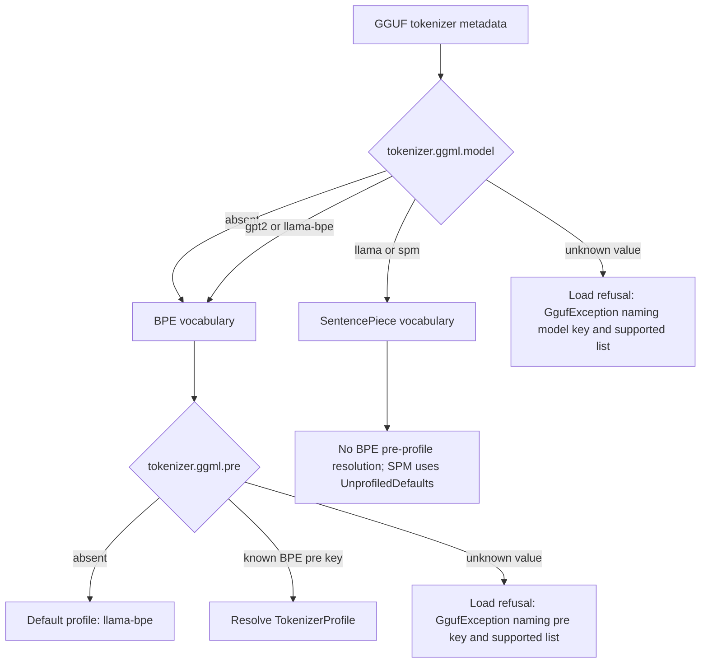
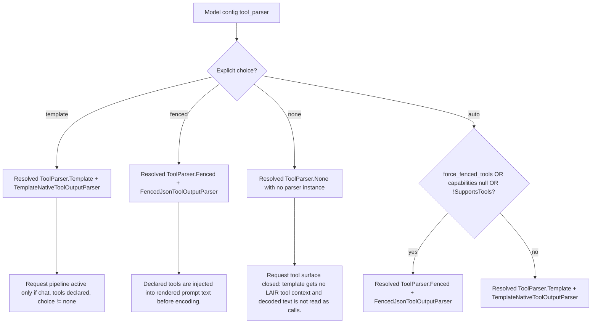
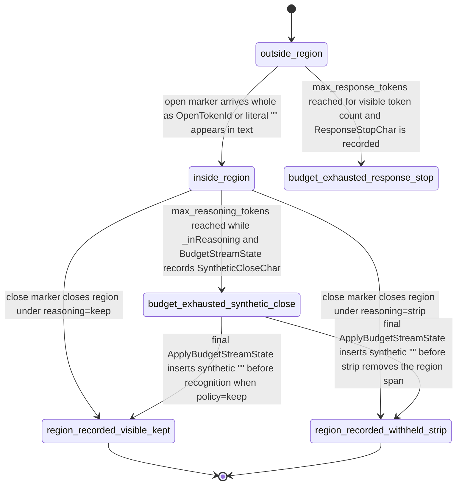

Tokenizer profile selection, minja chat-template rendering, tool parsing, reasoning regions, and token budgets.
As of 2026-11-27

## Scope

This page describes the implemented request-facing surface: GGUF tokenizer assembly in `src/Lair.Tokenizer`, chat-template rendering in `src/Lair.Templating.Minja`, resolved output plans in `src/Lair.Http/OutputParsers.cs`, and prompt/tool/budget behavior in `src/Lair.Http/GenerationService.cs` and `src/Lair.Http/ApiApp.cs`. It documents only behavior present in this build. Planned-but-unaccepted knobs are not described as available.

## Tokenizer selection from GGUF metadata

`GgufTokenizer.FromGguf` resolves tokenizer behavior once at load, then the hot encode path uses concrete state rather than dispatching per token (`src/Lair.Tokenizer/GgufTokenizer.cs:214`). Two independent metadata axes select implementation shape.

| Metadata key | Accepted values | Behavior in this build |
|---|---|---|
| `tokenizer.ggml.model` | absent, `llama`, `spm`, `gpt2`, `llama-bpe` | Absent keeps BPE. `llama` and `spm` select SentencePiece (`VocabularyModel.Spm`). `gpt2` and `llama-bpe` select BPE. Unknown values throw a load-time `GgufException` naming the value and supported list (`src/Lair.Tokenizer/VocabularyModel.cs:18`). |
| `tokenizer.ggml.pre` | absent, `llama-bpe`, `gpt2`, `qwen2`, `olmo`, `smollm`; BPE vocabularies only | Absent resolves to `llama-bpe`. Unknown values throw a load-time `GgufException` naming the value and supported list (`src/Lair.Tokenizer/TokenizerProfile.cs:121`). SentencePiece vocabularies ignore this profile axis because SPM has no pre-split stage; they use internal neutral defaults (`src/Lair.Tokenizer/GgufTokenizer.cs:44`, `src/Lair.Tokenizer/GgufTokenizer.cs:232`). |



Supported vocabulary-model keys, in registry order, are `llama`, `spm`, `gpt2`, and `llama-bpe`. Supported BPE profile keys, in registry order, are `llama-bpe`, `gpt2`, `qwen2`, `olmo`, and `smollm` (`src/Lair.Tokenizer/TokenizerProfile.cs:51`).

### Load-time GGUF fields resolved by the tokenizer assembly

| Field | Default posture when absent or unset | Implemented effect / refusal posture |
|---|---|---|
| `tokenizer.ggml.tokens`, `tokenizer.ggml.token_type` | Required vocabulary arrays. | Constructor rejects mismatched lengths (`src/Lair.Tokenizer/GgufTokenizer.cs:107`). Token types select inline special handling and decode suppression behavior (`src/Lair.Tokenizer/GgufTokenizer.cs:21`). |
| `tokenizer.ggml.merges`, `tokenizer.ggml.scores` | Merges are read only for BPE vocabularies; scores are required by SPM construction. | BPE uses merge ranks from stored order; SPM requires one score per piece and rejects mismatched lengths (`src/Lair.Tokenizer/GgufTokenizer.cs:240`). |
| `tokenizer.ggml.byte_to_utf8` | Default GPT-2 visual byte map is used when absent. | Declared maps override the default, but invalid surrogate entries fail at load naming key and byte index in tests (`src/Lair.Tokenizer/GgufTokenizer.cs:254`, `tests/Lair.Tests/GgufTokenizerTests.cs`). |
| `tokenizer.ggml.byte_to_token` | Byte tokens are resolved from vocabulary scanning when no declared map exists. | Declared maps override vocab scan; out-of-vocabulary entries and non-byte-type entries fail at load naming key/index (`src/Lair.Tokenizer/GgufTokenizer.cs:258`, tests above). |
| `tokenizer.ggml.byte_fallback` | Default true. | Disabled fallback routes uncovered SPM runs to unknown id or drops them when no unknown token is declared (`src/Lair.Tokenizer/GgufTokenizer.cs:684`). |
| `tokenizer.ggml.add_space_prefix` | Default true, exposed by tokenizer state. | It affects SPM start-of-run marker prepending and decode leading-space strip posture; it does not alter BPE pre-split behavior because the pinned reference still folds leading spaces into pre-tokens (`src/Lair.Tokenizer/GgufTokenizer.cs:729`). |
| `tokenizer.ggml.utf8_flush_between_controls` | Default true. | When false on BPE decode, a partial UTF-8 window is flushed at Unknown/Control/UserDefined boundaries instead of stitching across them (`src/Lair.Tokenizer/GgufTokenizer.cs:311`). SPM controls always flush the byte window during decode (`src/Lair.Tokenizer/GgufTokenizer.cs:360`). |
| `tokenizer.ggml.eot_token_id` | Absent becomes sentinel `-1`. | Exposed for callers/tests, but not used as a normal vocabulary piece by default. Tests assert declared ids are exposed and absent ids stay sentinel (`src/Lair.Tokenizer/GgufTokenizer.cs:247`, tests above). |

## BPE profiles and load-time defaults

BPE tokenization is a three-stage path: profile-specific pre-split, byte-level encoding through `tokenizer.ggml.byte_to_utf8` or the GPT-2 visual map default, then merge-rank application (`src/Lair.Tokenizer/GgufTokenizer.cs:539`, `src/Lair.Tokenizer/GgufTokenizer.cs:747`). Profile selection sets concrete strategy fields once.

| `tokenizer.ggml.pre` | Pre-split shape | Merge shortcut | Decode clean-spaces | Default BOS when GGUF omits key | Fallback special ids when declared keys are absent |
|---|---|---|---|---|---|
| `llama-bpe` | Llama-family split: surrogate pairs stay whole, case-insensitive contractions (`'s`, `'t`, `'re`, `'ve`, `'m`, `'ll`, `'d`), digit runs grouped in threes, symbol and newline handling follows the llama-3 regex shape (`src/Lair.Tokenizer/TokenizerProfile.cs:307`). | `ignore_merges=true`: whole pre-tokens hit vocabulary before merges. | true | true | BOS/EOS fallback id 11 (`src/Lair.Tokenizer/TokenizerProfile.cs:54`). |
| `gpt2` | Byte-level GPT-2 split: case-sensitive contractions, no merge shortcut, whole digit runs, symbols excluded from undefined Unicode categories unless math symbols are allowed by family (`src/Lair.Tokenizer/TokenizerProfile.cs:169`, `src/Lair.Tokenizer/TokenizerProfile.cs:502`). | false | true | false | BOS fallback 1, EOS fallback 2. |
| `qwen2` | Same byte-level GPT-2 split as `gpt2`. | false | true | false | BOS fallback 1, EOS fallback 2 (`src/Lair.Tokenizer/TokenizerProfile.cs:76`). |
| `olmo` | Byte-level BPE with family-specific math-symbol allowance; ChatML/math delimiters stay in the symbol alternative instead of falling through undefined-character splits. | true | true | false | BOS fallback 1, EOS fallback 2 (`src/Lair.Tokenizer/TokenizerProfile.cs:88`). |
| `smollm` | GPT-2 split followed by digit-run splitting; decode space cleaning is disabled because round-trip must keep spaces such as `"hello !"`. | false | false | false | BOS fallback 1, EOS fallback 2 (`src/Lair.Tokenizer/TokenizerProfile.cs:102`). |

Special ids are not a public config knob. They come from GGUF keys plus profile-scoped fallbacks for BOS/EOS only when those keys are absent; the loader logs each applied default through `logLine` and emits no log line when declared special ids carry the state (`src/Lair.Tokenizer/GgufTokenizer.cs:243`, tests in `tests/Lair.Tests/GgufTokenizerTests.cs`).

Declared token types drive inline special handling. `TokenTypeUnknown = 2`, `TokenTypeControl = 3`, and `TokenTypeUserDefined = 8` become single-id fragments during encoding, sorted descending by UTF-8 byte count so longer markers are partitioned first (`src/Lair.Tokenizer/GgufTokenizer.cs:21`). During decode, those same types are suppressed unless the caller passes `includeSpecial: true` (`src/Lair.Tokenizer/GgufTokenizer.cs:916`).

### Special-id resolution

| GGUF key | Fallback when absent in this build | Notes |
|---|---|---|
| `tokenizer.ggml.bos_token_id` | BPE profiles have family-convention fallbacks (`llama-bpe`: 11; GPT-2-family keys: 1); SPM unprofiled defaults use sentinel `-1`. | The loader logs when a profile default is applied and does not log when the GGUF declares the id (`src/Lair.Tokenizer/GgufTokenizer.cs:243`). |
| `tokenizer.ggml.eos_token_id` | Same fallback shape as BOS for BPE profiles; SPM unprofiled defaults use sentinel `-1`. | Fallbacks are load-time only and do not invent public config knobs (`src/Lair.Tokenizer/TokenizerProfile.cs:54`, `src/Lair.Tokenizer/GgufTokenizer.cs:47`). |
| `tokenizer.ggml.padding_token_id` | Sentinel `-1`. | Exposed as tokenizer state when declared; no family fallback is applied. |
| `tokenizer.ggml.unknown_token_id` | Sentinel `-1`. | Used by byte-fallback-disabled posture and unmergeable SPM runs when present (`src/Lair.Tokenizer/GgufTokenizer.cs:246`, tests above). |
| `tokenizer.ggml.eot_token_id` | Sentinel `-1`. | Exposed for callers/tests, but absent ids stay sentinel rather than becoming vocabulary pieces. |

## Encode and decode guarantees

| Behavior | Implemented guarantee |
|---|---|
| BOS policy | `EncodeWithBos` prefixes only when `_addBos` is true and the resolved BOS id is valid. Completion requests use it through `tokenizer.AddBosToken`; chat requests apply template-aware suppression first (`src/Lair.Tokenizer/GgufTokenizer.cs:426`, `src/Lair.Http/GenerationService.cs:3078`). |
| Special-token recognition | Literal special markers are partitioned before BPE pre-split or SPM merge. Control/user-defined ids re-open SentencePiece word-boundary state (`src/Lair.Tokenizer/GgufTokenizer.cs:447`). |
| Duplicate vocabulary pieces | `_pieceToId` assigns later entries over earlier ones, so a duplicate piece resolves to the last id in document order (`src/Lair.Tokenizer/GgufTokenizer.cs:121`). This matches pinned SentencePiece merge-name behavior documented by `tests/Lair.Tests/SpmTokenizerTests.cs`. |
| Byte fallback default | Default is true. Unknown text can fall back through byte tokens or known byte pieces; disabled fallback routes uncovered runs to the declared unknown id, and with no unknown token drops them (`src/Lair.Tokenizer/GgufTokenizer.cs:250`, `src/Lair.Tokenizer/GgufTokenizer.cs:684`). |
| Byte-map validation | Declared `tokenizer.ggml.byte_to_token` overrides vocabulary scanning. Out-of-vocabulary entries, non-byte-type entries, and invalid surrogate byte-to-UTF-8 maps fail at load naming the key and byte index (`tests/Lair.Tests/GgufTokenizerTests.cs`). |
| UTF-16 astral handling | Surrogate pairs are treated as one code point in split loops and SPM symbol initialization so their UTF-8 bytes are not cut apart (`src/Lair.Tokenizer/TokenizerProfile.cs:549`, `src/Lair.Tokenizer/GgufTokenizer.cs:718`). |
| Decode space cleaning | Applied only for profiles with `_cleanSpaces=true`. It removes spaces before punctuation, handles lone apostrophe spacing, and repairs common contraction spacing (`src/Lair.Tokenizer/GgufTokenizer.cs:334`, `src/Lair.Tokenizer/GgufTokenizer.cs:979`). SmolLM does not clean decode spaces. |
| Encode memoization | Repeated strings are cached with a 50,000-entry limit; reaching the limit clears the cache before inserting (`src/Lair.Tokenizer/GgufTokenizer.cs:426`, `src/Lair.Tokenizer/GgufTokenizer.cs:78`). Cache mutations take a lock; tokenization itself stays outside that gate. |

## SentencePiece behavior for Gemma-2 and Phi-3

SentencePiece vocabularies are selected by `tokenizer.ggml.model=llama` or `spm`, not by architecture names (`src/Lair.Tokenizer/VocabularyModel.cs:18`). The pinned tokenizer fixtures used by this build include:

| Fixture | Model file recorded in fixture | Pinned llama.cpp posture | Notes |
|---|---|---|---|
| `tests/fixtures/parity-tokenizer-gemma2.json` | `models/gemma-2-2b-it.Q4_K_M.gguf` | b12032 `/tokenize`, `add_special=false`, `parse_special=false` | Fixture records `pre=default`, `add_bos=true`, `add_space_prefix=false`. Real-model execution checks the model's actual SPM metadata before decode round-trip assertions. |
| `tests/fixtures/parity-tokenizer-phi3.json` | `models/Phi-3-mini-4k-instruct-Q2_K.gguf` | b12032 `/tokenize`, `add_special=false`, `parse_special=false` | Fixture records `pre=default`, `add_bos=true`, `add_space_prefix=true`. Real-model execution checks the model's actual SPM metadata before decode round-trip assertions. |

The SentencePiece encode path starts at a word boundary and re-opens one after every special token (`src/Lair.Tokenizer/GgufTokenizer.cs:447`). Literal spaces are spelled as U+2581 markers; `add_space_prefix` controls whether the start-of-run marker is prepended, but later literal spaces still become markers before merge competition (`src/Lair.Tokenizer/GgufTokenizer.cs:369`, `src/Lair.Tokenizer/GgufTokenizer.cs:554`). Decode maps U+2581 to a space and strips only the first rendered slot's marker when `add_space_prefix` is declared true; Gemma-2's fixture declares false, while Phi-3's fixture declares true (`src/Lair.Tokenizer/GgufTokenizer.cs:337`, fixtures above).

Merge behavior uses score order. Each code point starts as its own symbol; adjacent symbols merge when their concatenation names a vocabulary piece; the highest `tokenizer.ggml.scores` value wins, equal scores resolve leftmost, stale candidates are skipped, and final unmergeable runs resegment from recorded reverse merges or fall through byte fallback (`src/Lair.Tokenizer/GgufTokenizer.cs:575`).

The pinned parity gate asserts id-for-id equality against llama.cpp b12032 `/tokenize` for captured cases. For SentencePiece vocabularies it also asserts `Decode(Encode(content)) == content`; the guard recognizes SPM by actual GGUF metadata (`tokenizer.ggml.model is "llama" or "spm"`), not merely fixture names (`tests/Lair.Tests/TokenizerParityTests.cs:81`). When the pinned model file is absent, real-model cases skip cleanly; committed fixtures still describe expected references.

## Chat-template pipeline and AST

`MinjaChatTemplate` parses GGUF chat templates once into an immutable AST, probes capabilities from dummy renders when requested, normalizes message/tool shapes according to those facts, builds a template context, and evaluates the parsed tree (`src/Lair.Templating.Minja/MinjaChatTemplate.cs:45`).

Parse behavior is two-phase. The structure phase splits source into text runs, comments, output tags, and statement blocks; the expression phase parses tag contents with minja's grammar. Whitespace elision from ``, `{#-`, and `-#}` is applied to neighboring `TextNode` content at parse time, while trim flags remain on tagged nodes (`src/Lair.Templating.Minja/MinjaParser.cs:3`). The parser strips exactly one trailing newline because GGUF templates routinely end with one and the pinned reference does not render it (`src/Lair.Templating.Minja/MinjaParser.cs:58`).

Unsupported constructs are refused at parse time as `MinjaSyntaxException` naming construct and 0-based offset. Today these include ``, block/include/extends variants, parenthesized tuple literals outside call arguments or destructuring targets, ternary-less if expressions, malformed tags, template-size guards, and parser-depth guards (`src/Lair.Templating.Minja/MinjaParser.cs:13`).

| AST area | Real node types in this build |
|---|---|
| Template body | `TemplateNode`, `TextNode`, `CommentNode`, `OutputNode`, tagged statements via `TaggedNode` and `StatementNode` (`src/Lair.Templating.Minja/TemplateNodes.cs:3`). |
| Statements | `IfStatement`, `ForStatement`, `SetStatement`, `MacroStatement`, `CallStatement`, `FilterStatement`, `BreakStatement`, `ContinueStatement`; destructuring targets use `TargetPattern` and `SetTarget` (`src/Lair.Templating.Minja/TemplateNodes.cs:36`). |
| Expressions | literals, `NameExpression`, `AttributeExpression`, `IndexExpression`, unary/binary/comparison/membership expressions, tests, filter chains, ternary conditionals, calls, list/map literals (`src/Lair.Templating.Minja/ExpressionNodes.cs:5`). |

Render context always binds `messages`, `add_generation_prompt`, `bos_token`, and `eos_token`. `tools` is bound only when supplied so templates can branch on `tools is defined`; `date_string` is bound only when supplied, otherwise the callable `strftime_now` remains available (`src/Lair.Templating.Minja/MinjaChatTemplate.cs:93`). Adapter chat rendering uses default options with capability detection and message normalization enabled (`src/Lair.Templating.Minja/TemplateCapabilities.cs:49`, `src/Lair.Http/GenerationService.cs:3121`).

## Capability detection

`MinjaChatTemplate.DetectCapabilities` renders dummy probes through the loaded template. The facts are derived from rendered output, not source-text guessing (`src/Lair.Templating.Minja/TemplateCapabilities.cs:8`).

| Fact | Probe meaning | Adapter use |
|---|---|---|
| `SupportsTools` | A dummy tool definition name appears in the render. | If true under `tool_parser=auto`, declared tools enter template context and LAIR does not inject fenced blocks (`src/Lair.Templating.Minja/MinjaChatTemplate.cs:347`). |
| `SupportsToolCalls` | Assistant tool-call markup renders with dummy name/arguments. | Template-native call shape can be recognized later (`src/Lair.Http/OutputParsers.cs:307`). |
| `SupportsToolResponses` | A `role: tool` message's content renders natively. | If false, the wrapper converts responses to a supported fallback before render (`src/Lair.Templating.Minja/MinjaChatTemplate.cs:178`). |
| `SupportsSystemRole` | Dummy system content appears in output. | If false, system messages are merged into user turns during normalization (`src/Lair.Templating.Minja/MinjaChatTemplate.cs:181`). |
| `SupportsParallelToolCalls` | Both dummy call names appear when one assistant message has two calls. | Records whether multi-call rendering is template-native (`src/Lair.Templating.Minja/MinjaChatTemplate.cs:350`). |
| `SupportsToolCallId` | Dummy id appears in output. | Controls whether tool-call ids are preserved as native template fields (`src/Lair.Templating.Minja/MinjaChatTemplate.cs:351`). |
| `RequiresObjectArguments`, `RequiresTypedContent`, `RequiresNonNullContent` | Probes compare object/string arguments, typed/plain content, and null/non-null renders. | Normalization wraps or converts values before evaluation (`src/Lair.Templating.Minja/MinjaChatTemplate.cs:233`). |

## Builtin, filter, test, and stateful registry

One builtin namespace answers filters, tests, and function calls; names bound in template scope shadow builtins so macros keep priority (`src/Lair.Templating.Minja/MinjaBuiltins.cs:6`). Unknown filters/tests/functions raise actionable render errors naming the construct and position.

Registry contents from `BuildFunctions`:

- Collection shape/transformation: `count`, `length`, `items`, `dictsort`, `join`, `map`, `select`, `reject`, `selectattr`, `rejectattr`, `sort`.
- Conversion/escaping/equality: `tojson`, `trim`, `e`, `escape`, `equalto`.
- Chat-template helpers and deliberate failure: `range`, `namespace`, `raise_exception`.
- Tests usable as predicates: `defined`, `undefined`, `none`, `boolean`, `integer`, `float`, `string`, `mapping`, `sequence`, `iterable`, `number`, `even`, `odd`, `divisibleby`, `in` (`src/Lair.Templating.Minja/MinjaBuiltins.cs:55`).

`joiner(sep)` is not a normal registry function; it is the one stateful builtin bound through `TryBindStateful`. It yields a callable whose first call returns empty text and later calls return the separator, defaulting to `", "` (`src/Lair.Templating.Minja/MinjaBuiltins.cs:539`).

## Limits and refusal posture

`MinjaLimitDefaults` are hard library guards for untrusted GGUF templates; there is no public setter or per-call widening. Cancellation can abandon work but cannot increase budgets.

| Guard | Value / behavior | Error shape |
|---|---:|---|
| Template source size | 1,048,576 UTF-16 code units (`MinjaLimitDefaults.MaxTemplateSourceLength`). | `MinjaSyntaxException.LimitExceeded("template size", ...)` during parse. |
| Parser recursion frames | 128 (`MaxParserFrames`). Body, expression entry, primary, literal body, index body, tuple target, and argument list each claim a frame. | Parse-time syntax limit exception naming construct/offset. |
| Expression depth | 160 (`MaxExpressionDepth`). | `RenderLimitsException` with limit `"evaluator depth"`. |
| Macro/call/filter recursion | 48 (`MaxCallDepth`). Guards self-recursive templates such as `{{ m() }}{{ m() }}`. | `RenderLimitsException` naming construct/offset. |
| Materialized sequence length | 100,000 items for ranges, list/map literals, map/select/reject/dictsort/items results, slices, and loop iterables (`src/Lair.Templating.Minja/MinjaLimits.cs:45`). | `RenderLimitsException` with limit `"sequence length"`. |
| Loop iterations per render | 200,000 total body executions including nested loops and recursive re-entry. Deadline probes occur every 64 iterations (`src/Lair.Templating.Minja/MinjaLimits.cs:51`). | `RenderLimitsException` with limit `"loop iterations"`. |
| Rendered output size | 4,194,304 UTF-16 characters; append paths and builtins such as `join`, `tojson`, and `escape` are checked (`src/Lair.Templating.Minja/MinjaLimits.cs:58`). | `RenderLimitsException` with limit `"output size"`. |
| Render wall clock | 30 seconds, checked cooperatively at loop and expression boundaries. | `RenderLimitsException` with limit `"render deadline"`. |

Scoping behavior is deliberate: block bodies share the entered scope so `` remains visible after a block; macro/call/filter invocations render in child scopes that close over defining context for reads while keeping locals private (`src/Lair.Templating.Minja/MinjaEvaluator.cs` summary, `tests/Lair.Tests/TemplateDiagnosticsTests.cs`). Missing names and missing map keys evaluate as none. String/list indexes accept Python-style negative offsets (`src/Lair.Templating.Minja/MinjaEvaluator.cs:310`, `tests/Lair.Tests/EvaluatorScopingAndLimitsTests.cs`).

For loops are bounded before materialization, then every body execution is charged against the render loop budget (`src/Lair.Templating.Minja/MinjaEvaluator.cs:216`). Shared iteration order for loops and iterable built-ins expands lists in order, maps by key, strings character-by-character, and undefined values as empty; map/string expansion checks sequence length before allocating a list (`src/Lair.Templating.Minja/MinjaEvaluator.cs:487`). Loop targets are bound while the condition/filter logic runs so filters see each candidate item. Recursive loops re-enter through `RenderItems` with a nested iterable supplied by `loop(items)`, and recursive for statements bind callable name `loop`; loop target bindings and outer `loop` values are restored after the statement rather than leaking Jinja's last-value behavior, which is documented as deliberate until oracle parity tests settle (`src/Lair.Templating.Minja/MinjaEvaluator.cs:216`).

Render failures become bounded request errors. A template that parsed but fails to render a chat input is wrapped as `TemplateRenderFailedException` naming model and request id; the HTTP layer maps it to 400 with type `invalid_request_error` and code `invalid_request` (`src/Lair.Http/GenerationService.cs:3126`, `src/Lair.Http/ApiApp.cs:823`).

## Chat prompt ownership through generation

The chat request path owns template rendering, tool injection, tokenization, decoding, reasoning recognition, and output parsing in that order. Tool execution itself is not engine-owned; LAIR only recognizes calls and returns them on the wire.

```mermaid
sequenceDiagram
  participant API as ApiApp route handler
  participant Gen as GenerationService
  participant Chat as MinjaChatTemplate
  participant Tok as GgufTokenizer
  participant Engine as scheduler decode loop
  participant Parser as OutputParserRegistry plan parser

  API->>Gen: BuildGenerationRequest(chat body, tools, tool_choice, budgets)
  Gen->>Gen: ResolveToolPipeline from resolved model plan and request choice
  alt Template-owned tool surface
    Gen->>Chat: Render with template context containing declared tools
  else Fenced fallback surface
    Gen->>Chat: Render without LAIR tool injection in template context
    Chat-->>Gen: rendered prompt string
    Gen->>Gen: ToolPromptComposer.Compose(rendered, InjectedTools)
  end
  Gen->>Tok: Encode exact prompt; suppress tokenizer BOS only if render already starts with model BOS
  Tok->>Engine: token ids for prefill/decode admission
  Engine-->>Gen: sampled pieces and final generated token sequence
  Gen->>Tok: Decode generated tokens without special markup by default
  Gen->>Parser: Read recognized tool calls from visible text after reasoning recognition/budget shaping
```

BOS handling is exact rather than blind. `MinjaChatTemplate.Render` returns whether the rendered prompt starts with bound BOS; `GenerationService.EncodeChat` suppresses tokenizer BOS only in that case, otherwise it applies normal `add_bos_token` policy (`src/Lair.Templating.Minja/MinjaChatTemplate.cs:83`, `src/Lair.Http/GenerationService.cs:3078`).

## Tool parser resolution and request pipeline

Model load resolves the tool plan once from model config plus chat-template capability facts. Request handling consumes that resolved value; hot reload mutates only requests admitted after the change for these keys (`src/Lair.Http/OutputParsers.cs:8`, `src/Lair.Http/Config/ConfigReload.cs:198`). A sequence already in flight continues on the plan it was admitted with, so a later config reload does not re-decide parser choice mid-generation (`src/Lair.Http/GenerationService.cs:2654`).

| Config knob | Accepted values / default | Effect today |
|---|---|---|
| `models[].tool_parser` in YAML config | `auto`, `template`, `fenced`, `none`; default `auto` (`src/Lair.Http/Config/YamlConfigLoader.cs:532`). | Selects resolved parser. Invalid values fail load naming the key and accepted set. |
| `force_fenced_tools` | boolean; default false (`src/Lair.Http/Config/YamlConfigLoader.cs:528`). | Under `auto`, forces fenced injection even for a tool-capable template. |
| request body `tool_choice` | absent or `"auto"`, `"none"`, or function object naming a declared tool (`src/Lair.Http/ToolsPipeline.cs:423`). | Absent/auto allows all declared tools; none closes pipeline before precedence decisions; forced mode injects schemas but detection accepts only the named tool. |
| request body `tools` | array of OpenAI-shaped function objects with unique non-empty names and object-valued parameters (`src/Lair.Http/ToolsPipeline.cs:350`). | Declared tools become template context values or fenced injection, depending on resolved parser. Invalid shapes throw 400 invalid_request errors naming the field/index. |



The request-side rule is stricter than the parser choice: `ResolveToolPipeline` closes when a request is not chat, has no declared tools, uses `tool_choice=none`, or resolves to `ToolParser.None`. Otherwise exactly one active surface exists: template-owned tools in context, or LAIR-injected fenced block (`src/Lair.Http/GenerationService.cs:3182`).

For the template path, each declared tool is converted into an HF-style map before render:
`{"type":"function","function":{"name":...,"description":...,"parameters":{...}}}`; invalid parameter JSON fails naming the tool (`src/Lair.Http/ToolsPipeline.cs:99`). For fenced injection, `ToolPromptComposer.Compose` appends one deterministic instruction line, one schema fence per declared tool, and a reply contract requiring exactly `{"name":"<tool_name>","arguments":{...}}`; parameters ride as compact JSON strings on the wire (`src/Lair.Http/ToolsPipeline.cs:38`).

Recognized call shapes differ by parser. Fenced detection accepts only bare fenced blocks whose language tag is exactly `json`, parses to one object with exactly two properties, `name` naming an allowed tool and `arguments`; accepted fences are removed from visible text while boundary-space handling avoids fusing surrounding words (`src/Lair.Http/ToolsPipeline.cs:159`). Template-native detection accepts brace-balanced JSON objects anywhere in generated text only when they parse to exactly two properties, `name` and `parameters`, with a string name allowed by the request choice; fenced contract shapes using `arguments` stay ordinary text under this parser (`src/Lair.Http/OutputParsers.cs:307`).

Under `tool_choice=Function`, every declared schema still reaches the model surface, but accepted calls are limited to the named function (`src/Lair.Http/ToolsPipeline.cs:16`). Request-side resolution rejects forced names outside the declared set before generation runs (`src/Lair.Http/GenerationService.cs:3515`).

Non-recognized output stays ordinary text byte-for-byte for these cases: malformed or trailing JSON, wrong property names, extra properties, unknown tool names under an open choice, and other names when a function name is forced. Accepted calls are removed from visible content; rejected blocks remain exactly as generated (`src/Lair.Http/ToolsPipeline.cs:159`).

Wire output remains OpenAI-shaped. Recognized calls become `tool_calls` entries with generated ids of form `call_...`, type `"function"`, function name, and compact JSON argument strings; finish reason becomes `tool_calls` whenever recognized calls exist (`src/Lair.Http/ApiApp.cs:802`, `src/Lair.Http/GenerationService.cs:2671`). LAIR does not execute declared tools client-side or server-side in this subsystem.

## Reasoning regions and budgets

Reasoning recognition keys on markup only, never model family names. The recognized pair is `<think>` / `</think>`. Regions are half-open spans over generated text; a close with no open is ordinary output; an unclosed open runs to end of generation; inner markers do not nest (`src/Lair.Http/OutputParsers.cs:79`).

`reasoning: keep` records recognized regions but leaves visible content byte-for-byte as generated. `reasoning: strip` records boundaries and removes each region span from visible text before tool parsing, so call markup inside stripped reasoning never reaches the parser (`src/Lair.Http/GenerationService.cs:2651`).



Whole-token proof is required when a model entry declares `max_reasoning_tokens`. At load and reload, LAIR resolves `<think>` and `</think>` to vocabulary ids whose single-token decode equals the marker exactly; if either fails, model config carrying that budget is refused rather than serving a bound that could bind nothing (`src/Lair.Http/OutputParsers.cs:556`, `src/Lair.Http/GenerationService.cs:1978`).

| Budget knob | Scope | Behavior today |
|---|---|---|
| YAML `models[].max_reasoning_tokens` | model load, new requests only after reload (`src/Lair.Http/Config/YamlConfigLoader.cs:550`, `src/Lair.Http/Config/ConfigReload.cs:213`). | Applies only when the tokenizer has proven whole-token markers. Absent means unbudgeted reasoning unless a request override is accepted against an already resolved region. Values below 1 fail load. |
| YAML `models[].max_response_tokens` | model load, new requests only after reload (`src/Lair.Http/Config/YamlConfigLoader.cs:557`, `src/Lair.Http/Config/ConfigReload.cs:218`). | Counts visible tokens; absent means no response ceiling beyond ordinary generation limits. Values below 1 fail load. |
| request body `max_reasoning_tokens` | per-request override (`src/Lair.Http/ApiApp.cs:578`, `src/Lair.Http/GenerationService.cs:3269`). | Refused if the loaded model resolves no reasoning region. If accepted and above a declared ceiling, clamped to that ceiling; without a declared ceiling it is taken as given. Reports carry requested/applied/clamped values only when body carried an override. |
| request body `max_response_tokens` | per-request override (`src/Lair.Http/ApiApp.cs:587`, `src/Lair.Http/GenerationService.cs:3291`). | Same clamp/report posture as reasoning budgets, but response ceilings do not require marker proof because they bound visible token count. |

Budget counting is performed by `BudgetStreamState`. A sampled piece counts toward `ReasoningTokens` when it starts inside a region, arrives whole as the proven open id, or contains `<think>`; otherwise it counts toward `VisibleTokens`. When reasoning tokens reach the ceiling while still inside a region, state records `SyntheticCloseChar`, closes internal state, and final text insertion adds synthetic `</think>`. Response ceilings stop at visible-token exhaustion (`src/Lair.Http/GenerationService.cs:3355`).

Exhaustion surfacing is unified across body responses, streamed closing chunks, and monitor completion frames. Non-streaming chat/completion responses carry optional LAIR extension field `token_budgets` with entries `{field, requested, applied, clamped}` only when a request override was accepted; they also carry `budget_exhausted` as `"response"` or `"reasoning"` (`src/Lair.Http/ApiContracts.cs:52`). Stream closing frames use the same fields after all content deltas are emitted (`src/Lair.Http/ApiApp.cs:706`). Monitor completion payloads carry `budget_exhausted` independently from response shape (`src/Lair.Http/Monitoring/MonitorEvents.cs:83`, `src/Lair.Http/GenerationService.cs:2631`).

Streaming behavior has one observable exception. With `logprobs` enabled, each generated token gets its own content chunk carrying that token's decoded text and logprob entry; reasoning markers are not withheld in those chunks because withholding would strand the matching logprob record (`src/Lair.Http/ApiApp.cs:649`). Without logprobs under strip policy, streamed pieces pass through `ReasoningRegionFilter`, which holds split boundary tails until settled so no region content reaches visible deltas (`src/Lair.Http/OutputParsers.cs:153`, `src/Lair.Http/ApiApp.cs:667`).

## Configuration surface used by this page

| Surface | Name accepted today | Default / validation posture |
|---|---|---|
| YAML model config | `tool_parser`, `force_fenced_tools`, `reasoning`, `max_reasoning_tokens`, `max_response_tokens` (`src/Lair.Http/Config/YamlConfigLoader.cs:28`). | Invalid enum values and budgets below 1 fail load naming the key. Reload changes these as new-requests-only mutations for already served models (`src/Lair.Http/Config/ConfigReload.cs:382`). |
| Chat request body | `tools`, `tool_choice` (`src/Lair.Http/ToolsPipeline.cs:350`). | Tools must be OpenAI-shaped function objects with unique names and object parameters; tool choice accepts auto, none, or a declared function name. Invalid shapes return 400 invalid_request errors naming the field/index. |
| Chat request body budgets | `max_reasoning_tokens`, `max_response_tokens` (`src/Lair.Http/ApiApp.cs:578`). | Values below 1 fail validation; reasoning overrides require a resolved model-level reasoning region; accepted overrides above declared ceilings are clamped and reported in `token_budgets`. |

If either applied budget exists, generation ceiling is the sum of the resolved reasoning/response ceilings. A supplied request `max_tokens` caps that sum via min-clamping; when neither budget exists, ordinary request token limits remain in force (`src/Lair.Http/GenerationService.cs:3314`).

## Pinned parity evidence and current refusals

Tokenizer and template behavior is pinned against llama.cpp b12032 fixtures in this tree. Tokenizer fixtures include `tests/fixtures/parity-tokenizer-llama32.json` for the BPE profile `llama-bpe`, plus Gemma-2 and Phi-3 SentencePiece files above; committed cases encode plain text with `/tokenize add_special=false parse_special=false`. Template parity is pinned in `tests/fixtures/parity-templates-llama32.json` against captured `llama-server /apply-template` outputs for the real Llama-3.2 model, with documented divergences: llama.cpp strips a template-emitted leading BOS and re-adds it at tokenization, while LAIR keeps the rendered BOS and suppresses tokenizer BOS; llama.cpp refuses conversations ending in assistant tool-call messages, while LAIR renders them through the template's own branch (`tests/Lair.Tests/TemplateParityTests.cs:10`).

Current refusals worth noting for operators:

| Situation | Current behavior |
|---|---|
| Unknown `tokenizer.ggml.model` or BPE-only unknown `tokenizer.ggml.pre` on a BPE model | Model load fails with a `GgufException` naming the unsupported value and supported list. SPM vocabularies do not resolve BPE pre profiles, so their `pre` values are ignored by tokenizer assembly even when parity fixtures record them. |
| Chat template render failure or minja limit exceeded during chat request | HTTP 400 with error type `invalid_request_error`, code `invalid_request`; message names model and correlation id (`src/Lair.Http/GenerationService.cs:3126`). |
| Model config declares `max_reasoning_tokens` without whole-token `<think>` / `</think>` entries in tokenizer vocabulary | Load or reload refuses the model entry naming the marker failure detail (`src/Lair.Http/GenerationService.cs:1985`). |
| Request body carries `max_reasoning_tokens` against a loaded plan with no resolved reasoning region | HTTP 400 invalid_request refusing that field for that model rather than guessing per request (`src/Lair.Http/ApiApp.cs:563`). |

## Related engine pages

- [Request lifecycle](request-lifecycle.md)
- [Model profiles](model-profiles.md)
- [Sampling and drafting](sampling-and-drafting.md)
- [Measurement harnesses](measurement-harnesses.md)
- [Comparisons with other engines](comparisons.md)
