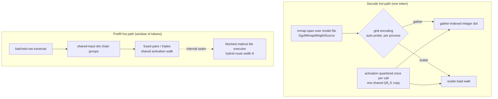
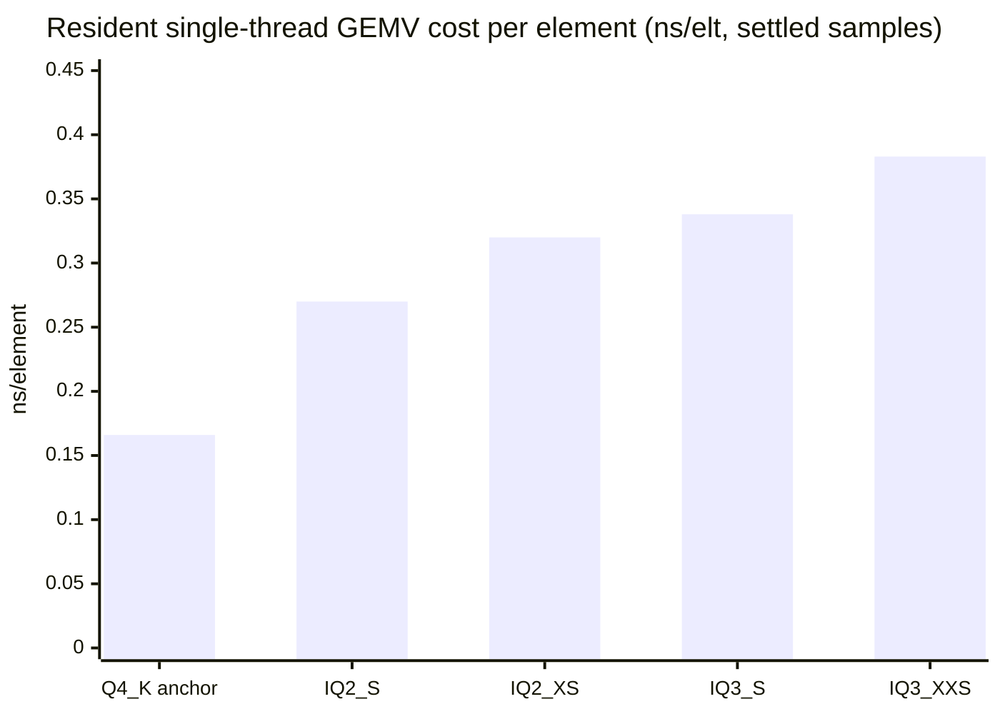
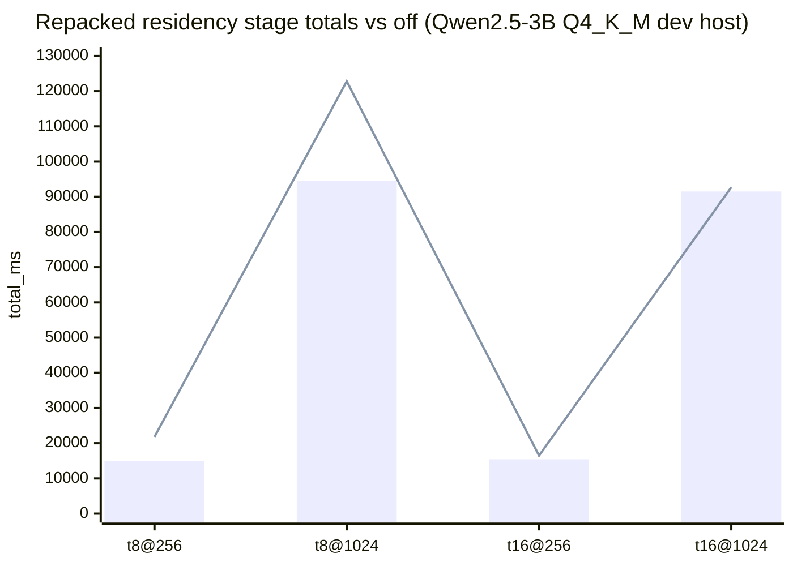

# Tricks and tweaks

Scope: the hot-path techniques this build actually runs, each with the wall it solves, where it lives in `src/`, what a committed measurement says about it (with posture), and its status today — default behavior, internal pin, or unpromoted candidate. As of 2026-11-27. Kernel mechanics are owned by [cpu-kernels](cpu-kernels.md); this page catalogizes *why* each technique exists and where the evidence sits.

Node legend: solid nodes are default behavior today; the dashed edge is a measured-but-unpromoted candidate for Q4_K single-matrix and fused-pair passes. KV-side techniques (block pools, quantized-KV formats) belong to [kv-cache](kv-cache.md); residency tiers to [residency-and-budgets](residency-and-budgets.md).

## 1. Zero-copy mmap spans instead of loaded weight buffers

**Wall.** A multi-gigabyte GGUF must serve without a second copy in RAM, and split models must not be reassembled into memory.

**Technique.** `src/Lair.Loader/GgufMmapWeightSource.cs` maps the file (or each physical shard separately for an assembled split) read-only: every tensor resolution returns a span at `shard.DataStart + tensor.Offset` — "No whole-model copy exists." Nothing in this build's placement code locks, prefaults, or migrates model-file pages; NUMA behavior is first-touch discipline through pinned workers only (`NumaPlacement.PagePlacementAdvisory`, see [cpu-kernels](cpu-kernels.md)). Page-cache residency does the rest.

**Measured effect.** `gemv-file` prints peak working set per process so a cost claim never hides its memory: on the live-decode re-pin, peak working sets were 1430.9 MB (Q4_K_M), 1344.2 MB (IQ4_XS), and 1222.0 MB (mixed-tier UD file) under a declared 4 GB ceiling (`bench/reports/sub4bit-cost-repin-2026-11-17.md`; posture: serving with `thread_quota: 8`, engine `threads: 0`, one server at a time). The kernel-comparison artifact shows the traversal trade directly: gemv peak RSS 1,353.8 MB vs tiled 1,222.8 MB on the IQ4_XS fixture (`reports/kernel-comparison-2026-11-14/`).

**Status.** Default for all GGUF loading; no locking knob exists and none is described — a host that wants pages pinned has to do it outside LAIR, which this build states rather than emulates.

## 2. Process-wide auto grid probe: gather vs scalar weight loads

**Wall.** Sub-4-bit i-quants load weights through nibble/gather paths whose speed depends on the actual CPU; a fixed encoding choice would be wrong on some hosts.

**Technique.** `src/Lair.Backends.Cpu/CpuBackend+Grid.cs` — `ResolveAutoGrid` runs one synthetic sub-4-bit GEMV benchmark per process (128×1024 rows, 6 interleaved best-of passes over generated weights through two forced backends with row hints off), then caches the answer for later auto opens; forced opens never consult it. Acceptance is conservative on both sides: one clear collapse (`gatherBestTicks > scalarBestTicks * 6 / 5` on any format) keeps scalar, and overall gather must win by a margin — `gatherTotalTicks * 25 < scalarTotalTicks * 24`.

**Measured effect.** The probe resolves real serving differences: in the corrected quota-8 live runs, Q4_K_M and the mixed-tier file resolved `gather` while IQ4_XS resolved `scalar`, even though all bench processes on the same build resolved `gather` (`bench/reports/sub4bit-cost-repin-2026-11-17.md`, "Selection variance" section — posture: Release bench, `--threads 8 --reps 200 --max-rows 256`). The report records each run's actual startup selection instead of treating one global encoding as fixed.

**Status.** Default under `auto`; ISA/grid overrides exist as explicit pins (documented on [cpu-kernels](cpu-kernels.md)). Prefetch hints ride the same posture (`resolvedPrefetch=auto` → `prefetchHints=on` in the same runs); a prefetch instruction "performs no read and changes nothing," so hint failure is harmless by construction.

## 3. Integer-dot GEMV with one shared Q8_K activation copy per call

**Wall.** Sub-4-bit formats measured at roughly 6.5× dense cost when each row re-dequantized into float multiplies.

**Technique.** Production quantizes the activation vector **once per `Gemv`/`GemvBatch` call** and shares that single Q8_K copy across every row of the traversal; rows then run integer dots against stored weights instead of per-row dequantization (`src/Lair.Backends.Cpu/CpuBackend.cs`). The gate proving this is production, not a test-side fiction: `tests/Lair.Tests/KernelTests.cs` requires an FP-activation oracle over the *same* stored weights to land visibly away from the kernels' totals while the backend stays bit-exact against the published reference — "a float dot … would move both numbers together and break one gate loudly instead of hiding inside a tolerance band."

**Measured effect.** The penalty is gone at kernel level: settled per-element costs are ~1.5–2.3× the Q4_K baseline, not 6.5× (`bench/reports/sub4bit-cost-repin-2026-11-17.md`; posture: resident single-threaded GEMV summary against pinned fixtures `Llama-3.2-1B-Instruct-Q4_K_M.gguf` / `-IQ4_XS.gguf` / `-UD-IQ3_XXS.gguf`, Release build, settled high-repetition runs):

| Format (in UD file) | ns/GEMV summary | ns/elt | vs Q4_K baseline 0.164 ns/elt |
|---|---:|---:|---:|
| IQ2_S | 553.0 | 0.270 | ≈1.50–1.51× settled (summary ≈1.65× with warm-up skew) |
| IQ2_XS | 655.3 | 0.320 | ≈1.95× |
| IQ3_S | 692.1 | 0.338 | ≈2.06–2.07× |
| IQ3_XXS | 783.9 | 0.383 | ≈2.32–2.35× — recorded as a premise miss, not smoothed into "≤2×" |

Live decode on the same re-pin: IQ4_XS fastest at ≈16.46 monitor-windowed tok/s vs Q4_K_M ≈12.43 and mixed-tier UD ≈12.97 (posture as in entry 1; client-aggregate numbers are reported but labeled confounded by differing output lengths — the monitor window is the primary comparison).

**Status.** Default for all quantized GEMV/GEMM paths; raw tables retained beside the report (`bench/reports/gemv-mvp5-*-reps200-2026-11-17.txt`). `IQ2_XXS` remains correctness-covered by Kernel/Parity fixtures with no dedicated speed fixture — explicitly recorded as a coverage gap, not claimed.

## 4. Shared-input dot chain groups: one operand pass feeds several accumulators

**Wall.** Attention scores and shared-dot batches re-read the common vector once per accumulator; wide batches spill register-resident chains.

**Technique.** `CpuKernelTuning.SharedInputDotChainGroup` (`src/Lair.Backends.Cpu/CpuKernelTuning.cs`) states how many consecutive inputs of a shared-operand dot keep their own accumulator chain beside one load of the common vector's chunk; 0 keeps every such dot individual, and pinning wider than eight refuses: "a shared-dot chain group wider than eight spills accumulators past the vector posture's register budget." The auto posture resolves to width 8 on a vector host (bench arm labels `default`/`auto8`, pinned arms `off`/`g2`/`g4`/`on`).

**Measured effect.** Same-session stage medians, attention kernel time (`reports/2026-11-26T03-12-26Z-optimize-prefill-chain-group-widths/summary.md`; posture `threads=32 rowWidth=64 lengths 128,256 kernels gemv,tiled`, Xeon-class local lane):

| Shape | auto (8) | off (individual dots) | pinned 2 | pinned 4 | on (8) |
|---|---:|---:|---:|---:|---:|
| gemv @128 attention_kernel_ms | 107.27 | 120.78 | 125.41 | 108.35 | 106.97 |
| gemv @256 | 548.03 | 609.93 | 616.44 | 538.86 | 527.83 |
| tiled @128 | 143.63 | 156.06 | 179.69 | 138.97 | 130.71 |
| tiled @256 | 528.13 | 606.71 | 605.10 | 558.33 | 505.85 |

The width-8 arms beat `off` at every shape; the sweep exists precisely because narrower pins are *not* uniformly better (pinned 2 loses to off on gemv@256).

**Status.** Width 8 default with vector posture; widths selectable through internal tuning keys and bench pin `--attention-batch-dots off|on`. [measurement-harnesses](measurement-harnesses.md) owns how the arms were run.

## 5. Blocked matmul tile executor + hybrid dense-matrix route (promoted for covered formats)

**Wall.** A batched GEMV pass re-reads its activation batch once per chain group; a blocked matmul reads one activation vector per eight-column chunk and feeds all eight tile rows' accumulator chains from it. For window-sized batches the second walk is cheaper — but only where a real blocked kernel exists for the format.

**Technique.** `MatmulRouteBatchWidth` (auto = 8 with vector posture, 0 without) hands eligible batched passes to the shared `RunMatmulDispatch` tile executor (`src/Lair.Backends.Cpu/CpuBackend.cs`, `CpuBackend+Gemm.cs`). The format coverage was extended rather than faked: Q6_K gained genuine blocked kernels (`GemmQ6KAvx2`, `GemmQ6KScalar`) "same ascending group/chunk walk, FMA association, and scalar-tail cleanup as the existing per-row Q6_K kernels," so `prefill_kernel=gemm` selects cleanly for Q6_K windows. Bit identity is proven, not asserted: 19 new cases in `tests/Lair.Tests/Q6KGemmRouteTests.cs` pin bit-for-bit equality between hybrid tile route and batched-row scratch route across five shapes including ragged column tails (137/264/300), counts 8..64, threaded vs single-thread under forced tiny row blocks.

**Measured effect.** `feed_forward_down_ms` medians, alternating arms (`reports/2026-11-25T16-11-55Z-optimize-prefill-q6k-gemm/summary.md`; posture: `qwen2.5-3b-instruct-q4_k_m.gguf`, 2,104,932,768 bytes, local CPU lane `threads=32 rowWidth=64`, kernels gemv/tiled, lengths 128/256; stage medians from alternating rounds):

| Shape | route off | hybrid (width 8) | separation |
|---|---:|---:|---|
| gemv @128 down_ms | 373.1 | 334.9 (−10.2%) | full sample separation |
| gemv @256 down_ms | 734.0 | 672.7 (−8.4%) | every hybrid below every off |
| tiled @128 down_ms | 387.6 | 344.2 (−11.2%) | full sample separation |
| tiled @256 down_ms | 774.6 | 681.1 (−12.1%) | every hybrid below every off |

Window totals moved only −2.4…−3.2% and window throughput was noise-indeterminate at medians — the report states this plainly rather than promoting the substage win to a headline number, consistent with its ±10–35% documented inter-process band (calibrated ~±5% between behaviorally identical arms).

```mermaid
xychart-beta
    title "Q6_K hybrid route: feed_forward_down_ms medians (off vs tile width 8)"
    x-axis ["gemv@128", "tiled@128", "gemv@256", "tiled@256"]
    y-axis "ms" 0 --> 800
    bar [373.1, 387.6, 734.0, 774.6]
    bar [334.9, 344.2, 672.7, 681.1]
```

**Status.** Default at width 8 for formats the blocked matmul genuinely covers (Q8_0/Q4_K/IQ4_XS and now Q6_K; `prefill_kernel=gemm` capability gates green). The auto width was chosen from prior tile-reuse measurements with a dedicated 4/16/32 sweep recorded as not-yet-run — the bench pin exists for that re-confirmation.

## 6. Fused shared-input pairs and triples (QKV triple, gate/up pair)

**Wall.** Q/K/V reads of one hidden vector, and gate/up reads feeding one MLP block, each traverse the same activation twice or three times independently.

**Technique.** Shared-input fusion walks a group through one staged traversal: the batched Q/K/V **triple** is intact in this build (baseline for committed prefill work at `reports/optimize-prefill-qkv-triple-fusion-2026-11-25T16-06-41Z/`), and gate/up run as a fused pair whose two staged rows share one activation pass. Phi-3's single qkv buffer is read as three head-region slices, with its gate living inside `blk.N.ffn_up.weight` where the file has no separate gate tensor at all (`tests/Lair.Tests/ParityTests.cs` fixture description; profile semantics owned by [model-profiles](model-profiles.md)).

**Measured effect.** Fusion itself is carried as a bit-identity invariant rather than a speed headline: whatever route and chain-group width runs, "each matrix's outputs keep that format's own ascending chunk walk, FMA association, and scalar-tail cleanup," so a pair on either traversal is byte-identical to its two independent batched passes (`src/Lair.Backends.Cpu/CpuKernelTuning.cs` documentation; proven per-route in `Q6KGemmRouteTests`). The stage profile shows the consequence: after entry 5, gate/up remains the *larger* FFN substage (down 672 vs gate_up 775 ms hybrid at gemv@256), and causal attention stays the dominant window substage (~42% of a gemv length-256 window) — which is exactly why the pair route below exists as a seam. The committed fusion report's own arm medians (gemv128 84.9, gemv256 53.6, tiled128 65.9, tiled256 70.8 batchedTok/s) sit below current hybrid numbers at every shape, but those baselines came from a different host session and are labeled directional reference only in `reports/2026-11-25T16-11-55Z-optimize-prefill-q6k-gemm/summary.md`.

**Status.** Triple and pair traversals are default behavior; handing fused pairs to the tile executor (`PairMatmulRouteBatchWidth`, bench pin `--pair-matmul-route off|on|N`) resolves to 0 — "no posture promotes it: the fused pair traversal stays in force until a target-host measurement separates the two routes for pairs."

## 7. Stated-but-unpromoted crossovers as internal seams (Q4_K single-matrix route)

**Wall.** A local AVX2-class stage profile showed single-matrix Q4_K passes taking the tile route cheaper — but on a *different* host than the serving lane, and window totals could not confirm it.

**Technique.** `MatmulRouteBatchWidthQ4K` (`src/Lair.Backends.Cpu/CpuKernelTuning.cs`) states the crossover only through an internal pin; the resolved value is 0: "no auto posture promotes this format … a hybrid width above the batch ceiling never dispatches" refuses on out-of-range pins naming the qualified key `engine.cpu.tuning.matmul_route_batch_width_q4k`. This keeps the candidate measurable without promoting it from one host's profile.

**Measured effect.** The committed strict re-pair (`reports/2026-11-27T03-09-24Z-optimize-prefill-q4k-route-repair-xeon-t8/summary.md`; posture from its `commands.md`: fixture `qwen2.5-3b-instruct-q4_k_m.gguf` on a Xeon CPU-only lane, `--threads 8 --widths 64`, lengths 128 and 256, kernels gemv/tiled, arms `off`/`on`/`16`, 2 warmup rounds then 5 measured rounds interleaved back-to-back in one session with arm order rotated on odd rounds) is the verdict this build quotes: **no candidate arm separates on `total_ms` at any shape.** Its pooled worst-case intra-arm `total_ms` spreads are 25.53% for `off`, 34.20% for `on`, and 26.04% for `16`; every delta sits inside its own arm's band:

| Shape | off median (ms) | on median / delta vs own band | 16 median / delta vs own band |
|---|---:|---:|---:|
| gemv @128 | 9,650.9 | 8,910.4 — −7.67% vs ±34.20% | 9,863.4 — +2.20% vs ±26.04% |
| gemv @256 | 23,375.3 | 22,982.1 — −1.68% vs ±13.39% | 21,724.6 — −7.06% vs ±8.54% |
| tiled @128 | 10,050.4 | 11,416.9 — +13.60% vs ±18.54% | 10,785.4 — +7.31% vs ±16.81% |
| tiled @256 | 23,053.4 | 22,430.6 — −2.70% vs ±7.74% | 23,354.6 — +1.31% vs ±11.08% |

The artifact's own interpretation column answers "separates beyond own spread: no" for all eight candidate readings, including the two apparent wins (`gemv@128 on` at −7.67%, `gemv@256 16` at −7.06%) and the one clear-looking regression (`tiled@128 on` at +13.60%). Stage medians are recorded beside each arm in that summary (for example gemv @256 `attention_weight`: off 3,659.7 / on 3,168.7 / 16 3,015.5 ms) but the artifact computes bands over `total_ms` only, so those columns carry no separation verdict and are not read as wins. The same lane's first interleaved pass (`reports/2026-11-27T02-28-33Z-optimize-prefill-q4k-route-ab-interleaved-xeon-t8/summary.md`) had put `gemv @128 on` at 8,734.2 against `off` 10,360.6 under spreads of 22.64% and 20.22%; the repair run's warmup-plus-order-rotation design superseded it as the citable posture, and [cpu-kernels](cpu-kernels.md) carries that earlier pass. A later re-pair exists locally but is not committed on this branch, so no number from it is quotable here.

**Status.** Unpromoted candidate, open by pin only (`--q4k-matmul-route off|on|N`). The committed re-pairs already measure it on the serving-class Xeon lane and none separates at window totals, so promotion stays blocked until a committed run puts a `total_ms` delta outside its own arm's spread — recorded as a decision, not left implicit.

### 7b. Integer-domain Q4_K batched dot (same seam discipline)

**Wall.** The pinned reference dots a Q4_K row against quantized activations entirely in integer lanes (`pmaddubsw`/`pmaddwd`) where LAIR's float kernels dequantize per element; the question is whether that shape amortizes better across chain groups for wide batches.

**Technique.** `Q4KIntegerDotBatchWidth` states the seam: at a stated count **and only on an AVX2-resolved backend**, one Q4_K batch pass stages its activations through ordinary Q8_K blocks, builds one exact activation group-sum table per `(batch vector, super-block, group)` for the whole call beside that staging, unpacks each block's eight mins once, and dots nibbles against those shared operands in exact int32 lanes with a fixed per-block float fold (`src/Lair.Backends.Cpu/CpuBackend+Q4KIntegerDot.cs`). A chain-group pass shares one weight traversal across its accumulator chains — register-budget groups stay live across the row, narrower or ragged tails stage each chain's lane totals through stack slots instead of reusing registers. Outputs intentionally diverge from the float kernels by activation-quantization loss; what must hold bit-for-bit is the variant's own reproducibility across batch order, chain grouping, and worker count. Vnni or Scalar resolutions never run it whatever a seam states.

**Measured effect.** `q4k-widebatch --integer-dot` times this arm beside the auto/streaming/tile float routes with divergence classified rather than asserted identical (`bench/Lair.Bench/Q4KWideBatchBench.cs`); `--integer-chain-group 1..8` adds stated-width integer arms over the same rows so candidate groupings share one run's settle and rotation schedule. Local dev-host attribution runs (threads 8, counts 8..64, both Qwen2.5-3B feed-forward shapes) still show the full-width resolved group losing to today's auto and tile traversals at these batch widths — whether it lands beside or ahead of the deliberately degraded streaming arm varies with run posture — while narrower stated groups pay the weight-traversal cost back inside each run. Those logs are dev-host attribution runs outside this branch's committed artifacts, so no number from them is quotable as a claim here; promotion stays refused pending target-host validation like its sibling seam above.

**Status.** Landed-but-unpromoted: measurable by pin (`Q4KIntegerDotBatchWidth` qualified key), never selected by any auto posture, and in local attribution runs behind today's default scratch/tile dense traversals at the measured counts even after sharing activation group sums across chains.

### 7c. Dispatch-schedule seam: static contiguous row ranges (llama-style per-thread blocks)

**Wall.** Wide thread quotas show run-to-run collapse on batched dense passes — a pinned-host record puts the `q4k-widebatch` auto arm at count 8, threads 32 in an 84.03% dispersion band (`reports/2026-11-27T14-14-58Z-optimize-q4k-widebatch-xeon-pinning/summary.md`). The llama-style claim is that handing each thread a fixed contiguous span of canonical rows, instead of letting workers race for scheduling blocks, removes the hand-off that such collapses were attributed to.

**Technique.** `StaticRowPartitionBatchWidth` (`src/Lair.Backends.Cpu/CpuKernelTuning.cs`) states the crossover; every resolved posture sets it to 0, so a threaded dense dispatch keeps dynamic block claiming unless a run pins a width in `[1..64]`, and an out-of-range pin refuses by naming `engine.cpu.tuning.static_row_partition_batch_width`. When engaged, participant 0 is the calling thread and pool worker *i* hosts participant *i+1*, each owning one contiguous range of canonical blocks over this dispatch's rows (`CpuBackend.StaticPartitionRange`); a claimed range is cleared so no wake-up re-walks it, `WorkerPool.RunStatic` refuses when the pool cannot host `participants − 1` workers, and only single-matrix dense batched passes take part — fused pair/triple traversals, shared-input dot batching, single-vector `GEMV` decode, and unthreaded calls stay on dynamic claiming by construction (`src/Lair.Backends.Cpu/CpuBackend.cs`, `RunThreadedDispatch`). Kernels are untouched: which executor walks a row changes, the arithmetic does not.

**Measured effect.** Dev-host attribution run `reports/2026-11-28T05-48-20Z-probe-static-row-partitioning-local/` (AVX2-resolved backend, explicit quota `threads=32` → `workers=32`, unpinned placement; synthetic pinned Q4_K tensors at `11008x2048` and `2048x11008`, counts 8/16/32/64, `--static-partition 8 --reps 7`, arms bit-parity-checked per count; plus a real-model arm on `models/qwen2.5-3b-instruct-q4_k_m.gguf` at lengths 1024/2048). Static ranges are slower in every measured cell and no more stable:

| Shape / count | auto med (band) | static-w8 med (band) | Δ |
|---|---:|---:|---:|
| gate/up @32 | 3.016 ms (23%) / 2.704 ms (10%) | 3.648 ms (29%) / 3.147 ms (19%) | +21% / +16% |
| gate/up @64 | 4.925 ms (6%) / 4.739 ms (23%) | 6.093 ms (54%) / 6.426 ms (28%) | +24% / +36% |
| down @32 | 2.353 ms (14%) / 2.399 ms (20%) | 3.054 ms (42%) / 2.620 ms (38%) | +30% / +9% |
| down @64 | 4.606 ms (16%) / 5.053 ms (20%) | 6.031 ms (13%) / 5.749 ms (5%) | +31% / +14% |

(gate/up `11008x2048`, down `2048x11008`; two identical repeat runs A/B.) The wide-quota instability reproduced on this host too — both runs put the *auto* arm at count 16 in a 472%/484% band while counts 32/64 sat near 10–25%, and the static arms inherited bands of 571%/609% at that same count. Reading: at `workers=32` on logical processors completion is straggler-bound under either schedule, so a fixed span buys no stability and forfeits the stealing that absorbs jitter. The real-model arm agrees directionally: single-matrix windows slow (`feed_forward_down` +16.7% at 1024, +17.1% at 2048; `attention_output` +14.0%/+15.1%) while the fused gate/up window — which cannot take the seam — moves −5.5%/−5.3%. These are dev-host attribution numbers from committed evidence `reports/2026-11-28T05-48-20Z-probe-static-row-partitioning-local/`, and target-host follow-up `reports/2026-11-28T06-03-03Z-probe-static-row-partitioning-xeon-t8-ht32/` confirms the same promotion refusal on Xeon: static ranges sometimes tighten isolated pathological bands, but tile-route execution and dynamic claiming remain materially better at useful wide counts.

**Status.** Landed-but-unpromoted: resolvable only by pin (`--static-row-partition off|on|N` in `prefill-profile`, `--static-partition W[,…]` in `q4k-widebatch`), auto 0 everywhere, and behind dynamic claiming at every posture measured so far. Closed as a null candidate after local + Xeon attribution; the static schedule does not earn promotion even where it tightens pathological low-count bands.

### 7d. Budget-gated repacked Q4_K residency (measurement seam)

**Wall.** Synthetic wide-batch attribution showed a resident repacked Q4_K read can beat the unpromoted integer-dot arm in some cells and occasionally sit near `auto`/`tile`, but real model forwards also pay activation staging, duplicate-copy bytes, and many small dense passes. The question is whether budgeted residency buys stage-level prefill cost rather than just isolated kernel throughput.

**Technique.** `Q4KRepackedResidencyBatchWidth` (`src/Lair.Backends.Cpu/CpuKernelTuning.cs`) resolves to 0 at every posture; no public YAML key states it, and no engine open prepares a resident copy by default. Preparation is explicit: `CpuBackend.PrepareDenseQ4KResidency(...)` admits one dense Q4_K matrix on an AVX2 integer-dot backend under a caller-stated weights-budget cap in MB, using the same budget arithmetic as `src/Lair.Models/Q4KRepackedResidencyGate.cs` (144 packed bytes per super-block/row versus 272 resident repacked bytes per 256-element super-block/row). Over-cap requests refuse with both cost totals and the ceiling; duplicate source spans also refuse. Measurement engagement is separate: `EnableQ4KRepackedResidencyMeasurements(...)` only permits ordinary dense batched Q4_K passes to consult already-prepared copies, keyed by `(source pointer, length)` in `_q4kResidencyBySource`. The hook runs after input/output validation and before the normal stride/route selection; if no prepared copy matches or engagement is disabled, today's float traversal continues unchanged. `CpuBackend.Dispose()` releases residency before pool disposal. Bench pins force comparable AVX2 posture for stated off/on arms (`prefill-profile --repacked-residency off\|on\|N`) and can print per-tensor refusal facts instead of narrowing copies (`--repacked-cap-mb auto\|N`).

**Measured effect.** Local dev-host attribution `reports/2026-11-28T07-13-37Z-probe-repacked-q4k-residency-local/` (Windows 11 / i9-13900K, .NET Release bench, AVX2-only synthetic backends for residency arms) shows mixed kernel-level results:

| Threads | Shape / count | Best float med | Repacked-w8 med (band) | Reading |
|---:|---|---:|---:|---|
| 8 | `11008x2048` @32 | auto 4.246 ms (27.58%) | 5.426 ms (21.59%) | slower than float routes |
| 8 | `11008x2048` @64 | auto 7.467 ms (12.43%) | 7.536 ms (8.84%) | near tie, inside noise |
| 8 | `2048x11008` @32 | auto 4.517 ms (17.23%) | 4.974 ms (19.96%) | slower than float routes |
| 8 | `2048x11008` @64 | tile 8.660 ms (15.08%) | 9.118 ms (9.32%) | slower than tile, faster than auto/integer |
| 16 | `11008x2048` @32 | tile 3.859 ms (25.73%) | 6.224 ms (45.42%) | clear regression |
| 16 | `11008x2048` @64 | auto 5.908 ms (19.74%) / tile 6.126 ms (11.71%) | 5.589 ms (15.03%) | candidate win, but wide band |
| 16 | `2048x11008` @32 | tile 3.486 ms (18.47%) | 3.649 ms (17.80%) | near tie / slight regression |
| 16 | `2048x11008` @64 | tile 5.850 ms (6.04%) | 7.039 ms (15.88%) | slower than tile, faster than auto/integer |

Full-model stage totals tell the promotion story more clearly: fixture `qwen2.5-3b-instruct-q4_k_m.gguf` on this dev host, kernel `gemv`, resolved row width 32, lengths 256 and 1024, reps=3 with `--stage-profile`; stated repacked arms prepare 216 dense Q4_K profile matrices totaling 2,506,752,000 resident bytes.

| Threads | Length | off total_ms | on total_ms | Δ |
|---:|---:|---:|---:|---:|
| 8 | 256 | 14,872.3 | 21,799.9 | +46.6% |
| 8 | 1024 | 94,514.9 | 122,811.2 | +29.9% |
| 16 | 256 | 15,438.5 | 16,480.7 | +6.7% |
| 16 | 1024 | 91,505.3 | 92,715.5 | +1.3% |

The table is authoritative if a renderer lacks `xychart-beta`. Peak working set rises from about 2.03 GB in the off arms to about 4.41 GB in the on arms because prepared repacked Q4_K matrices remain backend-owned while the model forward reads them. At threads=8, stage substages regress together (`feed_forward_down` +40.9% at length 256 and +21.9% at 1024; `attention_output` +39.0%/+20.5%). At threads=16 the result is mixed: only `feed_forward_down` @1024 improves slightly (−4.3%), while window total still moves worse by +1.3%.

**Status.** Landed-but-unpromoted measurement seam, locally null/regressive and target-host mixed by posture: pinned node0 physical-core threads=8 wins are band-separated at length 256/1024 (`reports/2026-11-28T08-45-16Z-probe-repacked-q4k-residency-xeon-t8-phys8-interleaved-l256` medians −4.44% total, −25.60% attention output, −10.00% feed-forward down; `reports/2026-11-28T08-59-17Z-probe-repacked-q4k-residency-xeon-t8-phys8-interleaved-l1024` medians −5.01%, −27.41%, −6.30%), node0 HT threads=16 is mostly band-separated positive at length 1024 (`reports/2026-11-28T09-47-58Z-probe-repacked-q4k-residency-xeon-t16-node0ht-interleaved-l1024`: total −4.53% and attention_output −21.97% with separated bands; feed_forward_down −7.67 median but ranges overlap slightly), while unpinned threads=32 length 1024 is null/mixed/regressive (`reports/2026-11-28T10-20-40Z-probe-repacked-q4k-residency-xeon-unpinned-t32-interleaved-l1024`: total −0.23% noisy overlap; attention_output +0.61%, feed_forward_down +3.65%) with the same ~+2390 MB peak-memory cost. Auto posture remains 0 everywhere, Parity goldens remain untouched because default traversal never engages the resident route, and candidate D is closed for promotion/default change in this phase as a landed-but-unpromoted measurement seam only; future reopening requires NUMA-aware residency placement policy plus fresh attribution against unpinned/cross-NUMA postures.

## 8. Ascending-walk bit identity: the invariant that makes every route swap safe

**Wall.** Fusing, tiling, batching, and ISA switching all risk reordering accumulation — which would break golden parity against pinned llama.cpp b12032.

**Technique.** Every kernel variant in `src/Lair.Backends.Cpu/` preserves the format's own ascending group/chunk walk, operand association order, and scalar-tail cleanup; route decisions choose *which executor* walks those chunks, never how they combine. The CUDA side gets the same discipline as a near-tie guarantee (`tests/Lair.Tests/CudaNearTieArgMaxTests.cs`): candidates separated by one fp16 mantissa step (~9.7e-4 relative) must resolve to identical argmax across CPU and CUDA chains, with separation 5×–2000× the recorded per-format bands (2e-6 IQ4_NL/IQ4_XS; 1e-6 Q8_0/Q5_0 family), while a deliberately true-tie lane bounds divergence at 4× band against a scalar CPU oracle. Semantics detail belongs to [cuda-backend](cuda-backend.md).

**Measured effect.** This is what makes the tolerance bands in [measurement-harnesses](measurement-harnesses.md) meaningful: parity failures localize to forward math, never to kernel reassociation; entry 5's route landed with *zero* introduced tolerance ("No output-bit tolerance introduced anywhere").

**Status.** Default invariant across all promoted and candidate routes.

## 9. PLE hot-row arenas: parity-checked copies on huge-page asks that report honestly

**Wall.** A ~28.8 GB n-gram table cannot be loaded; only the rows a policy selects should become resident, under a declared byte ceiling — without pretending the host gave you memory it didn't.

**Technique.** `src/Lair.Loader/PleHotRowProvider.cs` admits exactly its selection into an aligned anonymous arena (`mmap(MAP_PRIVATE|MAP_ANONYMOUS)` madvise'd `MADV_HUGEPAGE` on Linux; plain committed elsewhere — "the requested backing reports as not applied rather than emulated"); every copy is parity-checked against its source span before counting as resident, and hits/misses are tallied so throughput attributes to what actually ran. Ceiling gating divides declared `ple.caps.dram_mb` by the table's own row stride (`src/Lair.Models/PleResidencyGate.cs`) — admission and budgeting share one division "so they can never disagree about how many rows fit," and a clamped selection reports as refused rather than silently narrowed. Explicit hugetlb pages are never reserved or required.

**Measured effect.** Committed policy runs on disk-backed Xeon shards (`reports/2026-11-22T05-35-09Z/bench.json`; posture: `Qwen3.8-Flash-Next-GSQ-RCO-IQ3_XXS` shard pair, 65,536 tokens, Zipf and uniform arms): the 32 MiB hot-slot arena admitted 372,827 rows; backing facts recorded `madvise_hugepage_succeeded: true`, `explicit_hugetlb_used: false`, and full transparent-page coverage in `smaps` (`smaps_anon_hugepages_bytes_over_arena = 33554432`) on a host whose THP posture is `always [madvise] never` with `HugePages_Total=0`. The measured policy candidate is hot-slot residency plus NUMA-local first-touch; promotion of prefetch overlap waits behind direct stall measurement, and the harness states that gate rather than claiming past it.

**Status.** Measurement lanes (`ple-latency`, `ple-policy`) landed; production forward integration for flagship files remains open — stated as unfinished, not glossed. Details on [residency-and-budgets](residency-and-budgets.md).

## 10. Honest refusals that double as tweaks

Several "tweaks" are decisions to *not* do something, kept visible: no mlock/prefaulting (entry 1); no synthetic stand-in for real-file or idle-GPU measurement ([measurement-harnesses](measurement-harnesses.md) refusal table); no Q5_K CPU blocked matmul invented to satisfy a capability test — when Q6_K gained one, the refusal lanes were re-pinned to Q5_K instead (`reports/2026-11-25T16-11-55Z-optimize-prefill-q6k-gemm/summary.md`); and per-element cost premises that miss (IQ3_XXS at ≈2.3×) are recorded as misses rather than smoothed into assertions. Each refusal names its key or substrate, which is what lets a later measurement reopen the question without re-deriving posture from scratch.

## See also

[cpu-kernels](cpu-kernels.md) · [quantization](quantization.md) · [kv-cache](kv-cache.md) · [cuda-backend](cuda-backend.md) · [residency-and-budgets](residency-and-budgets.md) · [model-profiles](model-profiles.md) · [measurement-harnesses](measurement-harnesses.md)
