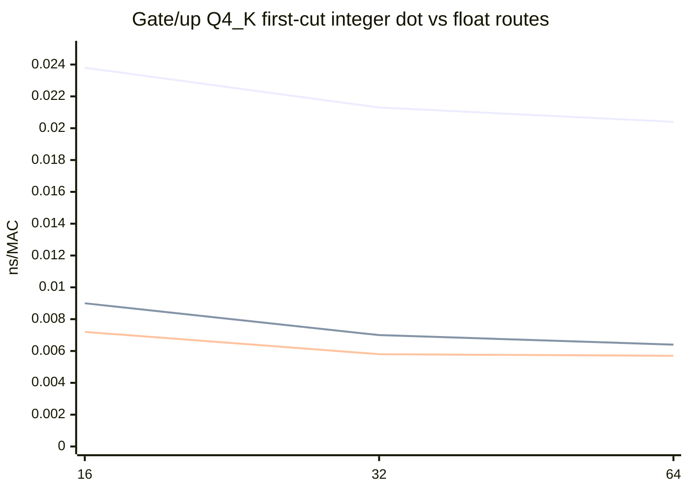
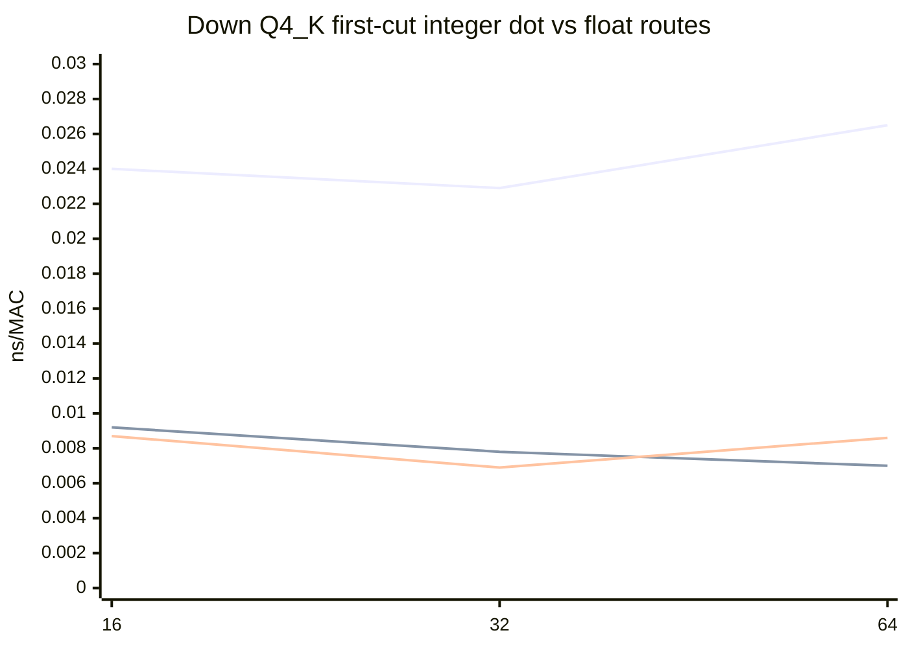

# Integer-domain Q4_K dot variant — local seam attribution 2026-11-28 (headline extract)

Posture: dev box CPU lane, `q4k-widebatch` bench seam with the new pin `--integer-dot`, threads=8, counts 8/16/32/64, rounds=5 per arm with settle passes and rotated arms; shapes gate/up `11008x2048` and down `2048x11008`. Raw log committed under `logs/q4k-widebatch-integerdot-t8.txt`; this file is a headline extract.

## Medians (lower ms better)

| shape | count | auto ns/MAC | tile ns/MAC | integer-dot ns/MAC | integer med_ms vs best float med_ms |
|---:|---:|---:|---:|---:|---|
| gate/up 11008x2048 | 8 | 0.1413 (cold arm) | **0.0210** / 3.79 ms | 0.0444 / 8.01 ms | ~2.1× slower than tile |
| gate/up | 16 | **0.0072** / 2.59 ms | 0.0090 / 3.25 ms | 0.0238 / 8.58 ms | ~3.3× slower than auto |
| gate/up | 32 | **0.0058** / 4.16 ms | 0.0070 / 5.08 ms | 0.0213 / 15.37 ms | ~3.0× slower than auto |
| gate/up | 64 | **0.0057** / 8.19 ms | 0.0064 / 9.26 ms | 0.0204 / 29.41 ms | ~3.6× slower than auto |
| down 2048x11008 | 8 | **0.0085** / 1.53 ms | 0.0099 / 1.78 ms | 0.0242 / 4.37 ms | ~2.9× slower than auto |
| down | 16 | **0.0087** / 3.14 ms | 0.0092 / 3.33 ms | 0.0240 / 8.67 ms | ~2.8× slower |
| down | 32 | **0.0069** / 5.00 ms | 0.0078 / 5.66 ms | 0.0229 / 16.49 ms | ~3.3× slower |

## What the numbers say (and what they do not)
- The first-cut integer variant is **not competitive on this host**: it loses to float `auto`/`tile` at every count ≥8, and its ns/MAC stays flat (~0.021–0.024) across counts while the float paths improve 3× from count 8→64. That signature says the variant currently walks each weight row **without sharing one traversal across accumulator chains** — LAIR's structural advantage (chain groups of 8, DN-M7-15/DN-M7-16) is not yet wired into it, which is exactly what candidate B must add before any conclusion about the integer idea.
- Outputs intentionally diverge from float kernels by activation quantization; the seam classifies divergence (`differing_elements`, `max_abs_diff`) rather than asserting parity. No golden files were touched: with auto resolution at 0 (variant never selected on this AVX-VNNI host) and only forced-pin arms exercising it, the Parity gate stays untouched — DN-M7-16's promotion contract is unmet by design here.
- Gates re-run by the main agent in this worktree before committing: build clean; `Category=DenseWeightFusion|Kernel|CpuTuning|Profile&Category!=Cuda` 510/510 unchanged baseline; `Category=Kernel|CpuTuning` **710/710**, which includes the new integer-dot determinism, selection-semantics, pin-refusal and exactness cases; `Category=Parity` 154 passed with zero divergences.

## Decision posture
Landed-but-unpromoted internal seam only: `Q4KIntegerDotBatchWidth` auto-resolves to 0 at every posture, runs solely when a stated width is reached and the ISA oracle resolved AVX2 (VNNI/scalar keep float kernels bit-for-bit). No promotion claim; candidate B (chain-group amortization inside the integer variant) must land and separate locally before any `lair-lab` attribution run or parity classification question becomes real.

## Mermaid charts for this directory’s raw log

```mermaid
xychart-beta
    title "Count-64 first-cut integer dot medians (lower better)"
    x-axis ["auto", "tile", "integer-dot"]
    y-axis "median ms" 0 --> 40
    bar "gate/up 11008x2048" [8.192, 9.257, 29.410]
    bar "down 2048x11008" [12.348, 10.050, 38.259]
```

Later candidate-B comparison with chain-group arms is in `reports/2026-11-28T03-50-04Z-optimize-q4k-integer-chain-groups-local/summary.md`.
