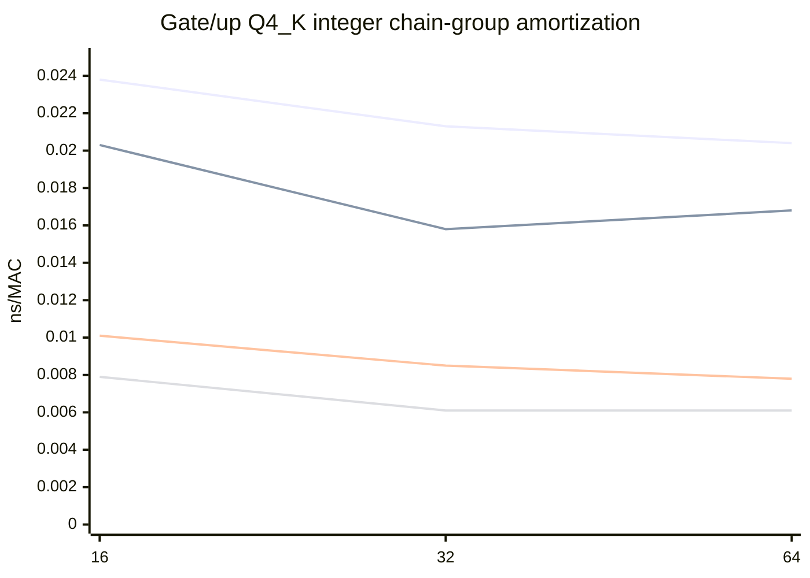
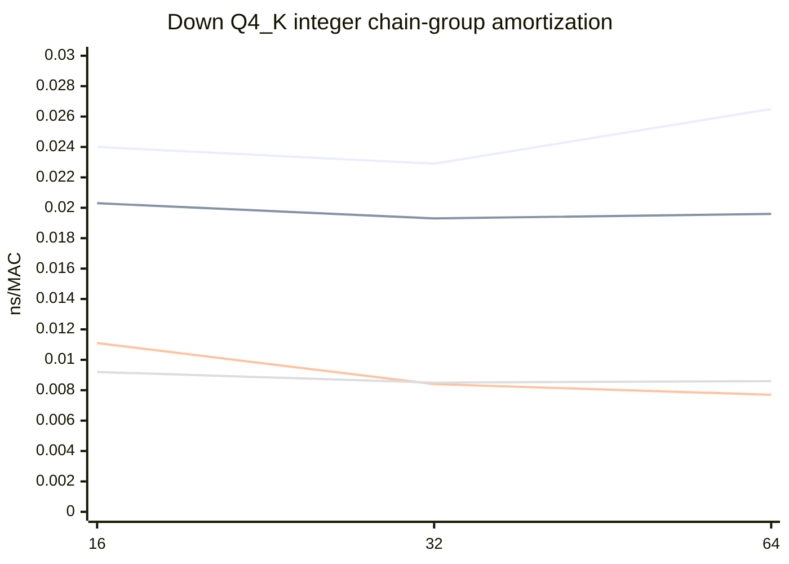

# Candidate B — integer Q4_K chain-group attribution 2026-11-28

Posture: local dev-box CPU lane, synthetic `q4k-widebatch` kernel seam only (not a real-model window run), threads=8, counts 8/16/32/64, recorded rounds=5 per arm with the harness’s settle passes and rotated timing arms. Shapes are Qwen-shaped feed-forward widths: gate/up `11008x2048` and down `2048x11008`. The integer executor is pinned to an AVX2-only posture (`--integer-dot`, plus optional `--integer-chain-group 2,4` arms); auto-resolved Q4_K float paths remain selected in production because `Q4KIntegerDotBatchWidth = 0`.

## Main-verified gates
```powershell
dotnet build Lair.sln --nologo
dotnet test Lair.sln --filter "Category=DenseWeightFusion|Kernel|CpuTuning|Profile&Category!=Cuda" -c Release
dotnet test Lair.sln --filter "Category=Kernel|CpuTuning&Category!=Cuda" -c Release
dotnet test Lair.sln --filter Category=Parity -c Release
```

Results: build clean; exact CPU combo **510/510** unchanged; non-CUDA kernel/tuning gate **710/710**; Parity **154/154**. The integer variant is not auto-selected on this AVX-VNNI dev box, so no pinned Parity goldens were regenerated. Bench integer arms classify divergence from float arms instead of asserting bit parity; the logged count-64 gate/up run reports `arms_bit_parity=bit_identical` for float arms and expected activation-quantization divergence for all integer arms.

## Gate/up medians (`11008x2048`)

| count | candidate A integer (historical) ns/MAC / ms | candidate B full 8-chain ns/MAC / ms | `integer-g4` ns/MAC / ms | `integer-g2` ns/MAC / ms | float auto ns/MAC / ms | float tile ns/MAC / ms |
|---:|---:|---:|---:|---:|---:|---:|
| 16 | **0.0238** / 8.575 | **0.0203** / 7.307 | 0.0371 / 13.397 | 0.0613 / 22.095 | 0.0079 / 2.837 | 0.0101 / 3.626 |
| 32 | **0.0213** / 15.369 | **0.0158** / 11.386 | 0.0362 / 26.110 | 0.0634 / 45.724 | 0.0061 / 4.385 | 0.0085 / 6.160 |
| 64 | **0.0204** / 29.410 | **0.0168** / 24.287 | 0.0353 / 50.991 | 0.0614 / 88.564 | 0.0061 / 8.766 | 0.0078 / 11.298 |

## Down medians (`2048x11008`)

| count | candidate A integer (historical) ns/MAC / ms | candidate B full 8-chain ns/MAC / ms | `integer-g4` ns/MAC / ms | `integer-g2` ns/MAC / ms | float auto ns/MAC / ms | float tile ns/MAC / ms |
|---:|---:|---:|---:|---:|---:|---:|
| 16 | **0.0240** / 8.671 | **0.0203** / 7.310 | 0.0411 / 14.840 | 0.0674 / 24.316 | 0.0092 / 3.320 | 0.0111 / 3.992 |
| 32 | **0.0229** / 16.485 | **0.0193** / 13.930 | 0.0381 / 27.485 | 0.0675 / 48.718 | 0.0085 / 6.125 | 0.0084 / 6.062 |
| 64 | **0.0265** / 38.259 | **0.0196** / 28.305 | 0.0393 / 56.769 | 0.0662 / 95.508 | 0.0086 / 12.346 | 0.0077 / 11.105 |

## Mermaid line charts — ns/MAC trend across counts (lower better)





## Mermaid bar comparison — count-64 med_ms (lower better)

```mermaid
xychart-beta
    title "Count-64 integer chain-group and float route medians"
    x-axis ["auto", "tile", "integer g8", "integer g4", "integer g2"]
    y-axis "median ms" 0 --> 100
    bar "gate/up 11008x2048" [8.766, 11.298, 24.287, 50.991, 88.564]
    bar "down 2048x11008" [12.346, 11.105, 28.305, 56.769, 95.508]
```



## What this says
Candidate B fixes the structural flaw in candidate A: a full eight-chain integer group now shares one nibble-unpack pass and both scale shuffles across all chains, unpacks block mins once for the whole group, and uses a staged activation-group-sum table instead of re-deriving min/group work per chain. That moves gate/up count 32 from candidate A’s `0.0213` ns/MAC to candidate B’s full-chain `0.0158`, and down count 64 from `0.0265` to `0.0196`. The narrower pinned groups (`g4`, `g2`) are much slower because they stage accumulators through stack lanes instead of keeping eight int32 lane vectors live; full register-budget grouping is the useful posture locally.

This does **not** justify promotion: candidate B still loses to float `auto`/`tile` at every measured wide count, and integer outputs intentionally diverge from float paths because activations are quantized through Q8_K staging. The local result now justifies a target-host seam A/B before closing the integer idea — Broadwell may expose instruction-shape differences that the dev box hides — but it does not justify changing any production posture or promoting `Q4KIntegerDotBatchWidth` above 0 yet.
