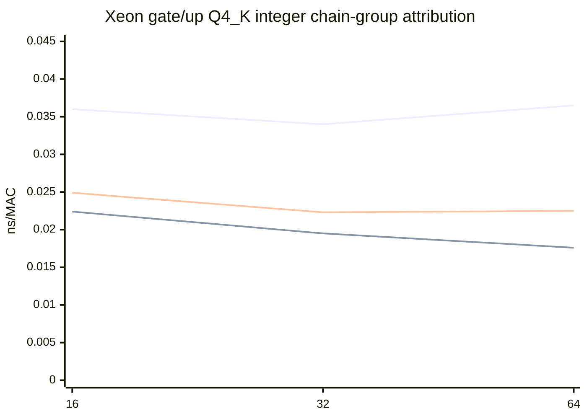
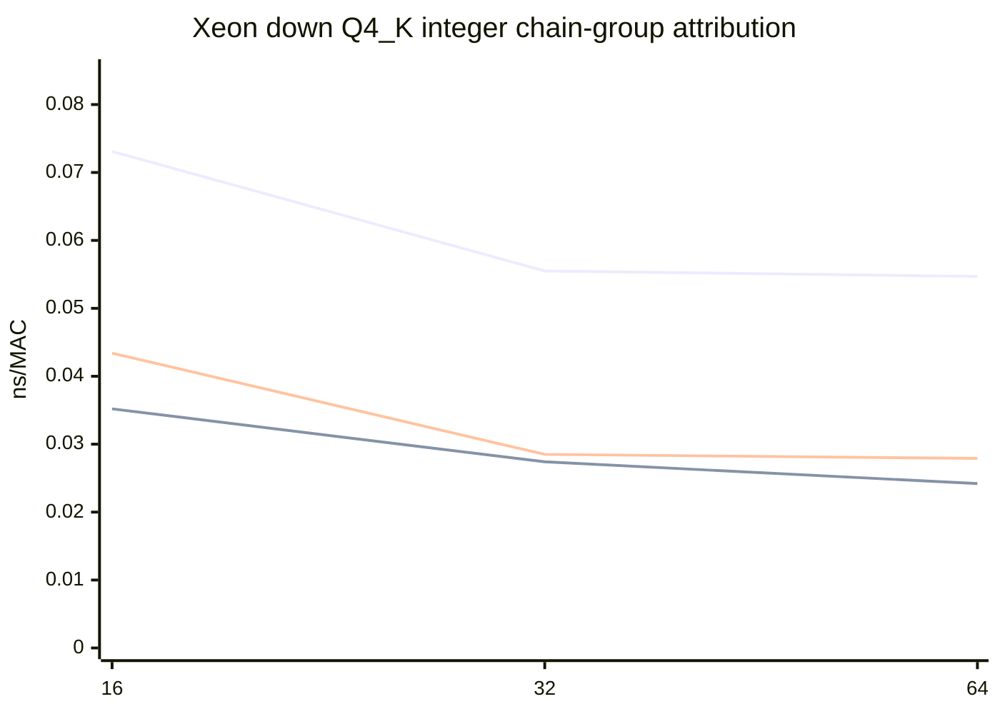

# Candidate B — Xeon Q4_K chain-group attribution 2026-11-28

Posture: `lair-lab` host, synthetic `q4k-widebatch` kernel seam only (not a real-model window run), taskset to node0 physical cores (`taskset -c 0-15`), threads=8, counts 8/16/32/64 recorded at rounds=5 per arm with the harness’s settle passes and rotated timing arms. Shapes are gate/up `11008x2048` and down `2048x11008`. The build used for this run was host worktree `/root/lair-measurements/qwen25-small-cpu/repo-q4k-intchain` at commit `a875eb6d63092b6db577e4ff7ff25cf1a9564a6e`; only `bench/Lair.Bench.csproj` was built because full solution build fails on this host when `Lair.Host` tries to run missing `npm install`.

## Gate/up medians (`11008x2048`)

| count | auto ns/MAC / ms | tile ns/MAC / ms | integer full 8-chain ns/MAC / ms | `integer-g4` ns/MAC / ms | `integer-g2` ns/MAC / ms |
|---:|---:|---:|---:|---:|---:|
| 16 | **0.0249** / 8.979 | **0.0224** / 8.079 | 0.0360 / 12.996 | 0.0619 / 22.311 | 0.1050 / 37.885 |
| 32 | **0.0223** / 16.109 | **0.0195** / 14.079 | 0.0340 / 24.529 | 0.0596 / 42.989 | 0.1022 / 73.720 |
| 64 | **0.0225** / 32.413 | **0.0176** / 25.463 | 0.0365 / 52.733 | 0.0621 / 89.539 | 0.1045 / 150.737 |

## Down medians (`2048x11008`)

| count | auto ns/MAC / ms | tile ns/MAC / ms | integer full 8-chain ns/MAC / ms | `integer-g4` ns/MAC / ms | `integer-g2` ns/MAC / ms |
|---:|---:|---:|---:|---:|---:|
| 16 | **0.0434** / 15.665 | **0.0352** / 12.703 | 0.0731 / 26.369 | 0.1063 / 38.341 | 0.1786 / 64.433 |
| 32 | **0.0285** / 20.576 | **0.0274** / 19.788 | 0.0555 / 40.065 | 0.0937 / 67.606 | 0.1597 / 115.193 |
| 64 | **0.0279** / 40.233 | **0.0242** / 34.988 | 0.0547 / 78.923 | 0.0727 / 104.852 | 0.1571 / 226.691 |

## Mermaid line charts — ns/MAC trend across counts (lower better)

## Mermaid bar comparison — count-64 med_ms (lower better)

```mermaid
xychart-beta
    title "Xeon count-64 integer chain-group and float route medians"
    x-axis ["auto", "tile", "integer g8", "integer g4", "integer g2"]
    y-axis "median ms" 0 --> 230
    bar "gate/up 11008x2048" [32.413, 25.463, 52.733, 89.539, 150.737]
    bar "down 2048x11008" [40.233, 34.988, 78.923, 104.852, 226.691]
```

## Divergence classification
Float arms stayed bit-identical in the harness guard (`arms_bit_parity=bit_identical`). Integer arms diverge from float paths as expected because Q8_K activation staging changes numeric operands relative to current FP32 batched dot traversal; representative logged classifications include:
- gate/up count 64: `integer_divergence=[differing_elements=704509/704512,max_abs_diff=1.057E+001]` and same for `integer-g2` / `integer-g4`.
- down count 64: `integer_divergence=[differing_elements=131071/131072,max_abs_diff=2.280E+001]` and same for narrower integer arms.

## Decision posture
Candidate B fixed candidate A’s missing chain sharing, but the Xeon seam attribution confirms it is **not competitive enough to promote** on this AVX2 host: full eight-chain execution remains roughly 1.5–2× slower than float `auto`/`tile` at wide counts, and narrower pinned groups are far worse because they stage accumulators through stack lanes instead of keeping eight int32 lane vectors live. The integer-domain Q4_K idea should stay landed-but-unpromoted or be closed as a current-path candidate; no production posture change is justified from this evidence. Next optimization work moves to the static contiguous row-partitioning dispatch probe rather than further chain-group tuning on unpromised kernels.
