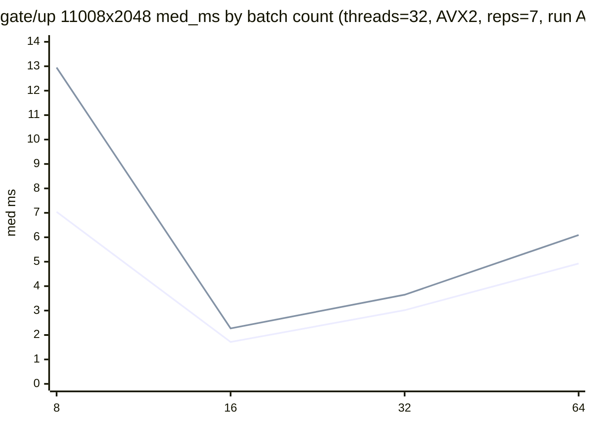

# Probe: static contiguous row partitioning for CPU worker dispatch

As of 2026-11-28. Measurement seam only: an unpromoted schedule crossover (`engine.cpu.tuning.static_row_partition_batch_width`, auto `0` at every resolved posture) that lets a run put threaded dense batched dispatches on llama-style contiguous per-participant row ranges instead of dynamic scheduling-block claiming. Kernels, arithmetic, and default postures are untouched; the seam changes only who walks which rows.

## Verdict

**Keep unpromoted.** On this host (dev box, AVX2-only kernel path, explicit `threads=32` quota → `workers=32`, unpinned placement) static contiguous partitioning is a throughput **regression at every measured count and shape**, and it does not systematically reduce run-to-run dispersion. The auto posture stays as resolved (`static_row_partition_batch_width = 0`, i.e. dynamic claiming everywhere). This mirrors the earlier integer chain-group candidate: landed seam, measurement evidence against promotion.

## Kernel-level A/B (bench `q4k-widebatch`)

Posture: synthetic pinned Q4_K tensors at Qwen2.5-3B feed-forward widths (`11008x2048` gate/up with `stride_bytes=1152`, `packed_mib=12.09`; `2048x11008` down), explicit quota `threads=32` → published arm facts `[static_row_partition_batch_width=8,row_block=16,parallel_row_threshold=256,workers=32]`, AVX2 selection, unpinned threads. Arms share one settle/rotation schedule per run; every count line reports `arms_bit_parity=bit_identical` across `auto`/`streaming`/`tile`/`static-w8`. Run A and run B are the same command repeated (`--reps 7`).

### gate/up `11008x2048`, med_ms (band_pct = max−min as a fraction of that median)

| count | auto med / band (A, B) | static-w8 med / band (A, B) | Δ static vs auto (A / B) |
|---|---|---|---|
| 8 | 7.042 / 17.8 %, 7.199 / 18.4 % | 12.948 / 13.3 %, 13.546 / 22.0 % | +84 % / +88 % |
| 16 | 1.714 / 472 %, 1.641 / 484 % | 2.270 / 571 %, 2.136 / 609 % | +32 % / +30 % |
| 32 | 3.016 / 23 %, 2.704 / 10 % | 3.648 / 29 %, 3.147 / 19 % | +21 % / +16 % |
| 64 | 4.925 / 6.4 %, 4.739 / 23 % | 6.093 / 54 %, 6.426 / 28 % | +24 % / +36 % |

### down `2048x11008`, med_ms (band_pct)

| count | auto med / band (A, B) | static-w8 med / band (A, B) | Δ static vs auto (A / B) |
|---|---|---|---|
| 8 | 1.199 / 28 %, 1.145 / 19 % | 1.279 / 20 %, 1.381 / 24 % | +6.7 % / +21 % |
| 16 | 1.606 / 16 %, 1.553 / 16 % | 1.777 / 25 %, 1.961 / 42 % | +11 % / +26 % |
| 32 | 2.353 / 14 %, 2.399 / 20 % | 3.054 / 42 %, 2.620 / 38 % | +30 % / +9 % |
| 64 | 4.606 / 16 %, 5.053 / 20 % | 6.031 / 13 %, 5.749 / 5.1 % | +31 % / +14 % |

`ns_per_mac` follows the same shape: gate/up count 8 goes `0.039 → 0.072`, effective weight throughput `1.80 → 0.98 GB/s`; at count 64, `585 → 474 GFLOP/s`. Static is never faster in any cell of either run.

First series `auto`, second `static-w8`. Same posture and tool as the tables above; full lines in `logs/srp-runA-t32.log` / `logs/srp-runB-t32.log`.

### What the dispersion numbers say about the probe premise

- The recorded wide-quota instability reproduces on this host: run A/B both show a pathological **auto** band at count 16 (472 % and 484 %, max round ≈9.4–9.6 ms against a ≈1.7 ms median), i.e. the collapse signature is not Xeon-specific in kind, though its location across counts differs from the pinned-host record (`reports/2026-11-27T14-14-58Z-optimize-q4k-widebatch-xeon-pinning`: threads=32 auto arm dispersion 84 % at count 8).
- Static partitioning does not remove it: the same runs show static bands of 571 % and 609 % at that count, and static bands stay within a few points of auto elsewhere while being slower. Where static *was* tighter (down count 64 in run B: 5.1 % vs 20 %), its median was still 14 % behind.
- Reading: with `workers=32` on logical processors, completion time is straggler-bound under **both** schedules; removing block hand-off removes no host-level jitter and instead fixes each participant's share in advance, so a slow participant cannot be helped by its neighbours. Throughput loss (16–88 % here) is the cost of that inflexibility.

## End-to-end wide-batch dense prefill (bench `prefill-profile`)

Posture: `models/qwen2.5-3b-instruct-q4_k_m.gguf` (`arch=qwen2`, 36 layers, hidden 2048), `--threads 32 --lengths 1024,2048 --reps 2 --stage-profile`, one invocation per arm; `off` = dynamic claiming (what every posture resolves to by default), `on` = static contiguous ranges at width 8. Fused gate/up pairs refuse the seam by design, so their windows are noise controls for single-matrix paths.

| length | window | off ms | on ms | Δ |
|---|---|---|---|---|
| 1024 | attention_weight (single-matrix dense) | 4014.0 | 4312.8 | +7.4 % |
| 1024 | attention_projection | 1983.4 | 1997.2 | +0.7 % |
| 1024 | attention_output (single-matrix dense) | 2030.6 | 2315.6 | +14.0 % |
| 1024 | feed_forward_weight (single-matrix dense) | 15677.4 | 16339.2 | +4.2 % |
| 1024 | feed_forward_gate_up (fused pair — refuses the seam) | 8815.1 | 8327.3 | −5.5 % (noise control) |
| 1024 | feed_forward_down (single-matrix dense) | 6862.4 | 8011.9 | **+16.7 %** |
| 1024 | total batched prefill | 36399.5 | 37065.9 | +1.8 % |
| 2048 | attention_weight (single-matrix dense) | 8305.7 | 8983.9 | +8.2 % |
| 2048 | attention_projection | 4083.2 | 4123.0 | +1.0 % |
| 2048 | attention_output (single-matrix dense) | 4222.5 | 4860.9 | +15.1 % |
| 2048 | feed_forward_weight | 32491.2 | 33960.6 | +4.5 % |
| 2048 | feed_forward_gate_up (fused pair — refuses the seam) | 18269.5 | 17308.2 | −5.3 % (noise control) |
| 2048 | feed_forward_down | 14221.7 | 16652.4 | **+17.1 %** |
| 2048 | total batched prefill | 100314.1 | 101124.4 | +0.8 % |

Window sums exceed the total because stage windows are per-forward-call accumulations over two reps, and `attention_kernel_ms` (off 13913.8 / on 13625.8 at 1024; off 54043.2 / on 52705.2 at 2048) sits inside the attention weight/projection/output windows rather than beside them — it is not a seam-eligible dense dispatch, so its small movement is noise. The single-matrix dense windows move together in one direction: down +16.7 %/+17.1 %, output +14.0 %/+15.1 %, attention weight +7.4 %/+8.2 %, feed-forward weight +4.2 %/+4.5 %. The fused-pair gate/up window, which cannot take the seam at all, moves −5.5 %/−5.3 %, i.e. it is not evidence for or against the arm beyond host jitter.

```mermaid
xychart-beta
    title "prefill-profile feed_forward_down ms, threads=32 (off = dynamic claiming, on = static width 8)"
    x-axis ["len 1024", "len 2048"]
    y-axis "ms" 6000 --> 17500
    bar [6862.4, 14221.7]
    bar [8011.9, 16652.4]
```

Bars: `off` then `on`, same model file/context/thread quota/stage profiler as the table; source logs in this report directory.

## Gates run for this seam

| gate | filter | result |
|---|---|---|
| new dispatch-schedule suite | `FullyQualifiedName~StaticRowDispatchTests` (Release) | 95 passed, 0 failed — bit parity across formats × thread postures {2,5,8} × counts [8,17,32,64], ragged `row_block` 1/7/64 with wider quotas, blocked-matmul and public `GemmBatch` parity, Q4_K tile crossover coexistence, resolve auto-0/pin/refusal wording for `-1` and `65`, gate engagement via the dispatch tally, fused-pair non-engagement, quota re-resolution determinism |
| CPU kernel/tuning regression | `Category=Kernel|CpuTuning&Category!=Cuda` (Release) | 805 passed, 0 failed |
| fusion + profile adjacency | `Category=DenseWeightFusion|Kernel|CpuTuning|Profile&Category!=Cuda` (Release) | 510 passed, 0 failed |
| golden accuracy | `Category=Parity` (Release) | 154 passed, 0 failed |

## What remains open

- The pinned-Xeon claim that wide-quota auto arms collapse is **not addressed by this seam on this host**; if it matters for the deployment posture, the next step is a re-run of these same two bench verbs on the pinned lane — either through engine pinning (`models[].placement.core_set`, per `docs/user/reference/CONFIG.md`) or external masking as that lane's own record did with `taskset` cpu lists (`reports/2026-11-27T14-14-58Z-optimize-q4k-widebatch-xeon-pinning/commands.md`) — not a code change. This dev box has no affinity knob exposed by the bench verbs themselves, so its numbers stay unpinned-attribution numbers.
- No promotion, no config default change, no route change: the knob stays auto-`0`, refusals stay `[0..64]` with key-named errors (`engine.cpu.tuning.static_row_partition_batch_width`), and fused pair/triple traversals, shared-input dot batching, single-vector `Gemv` decode, and unthreaded calls remain outside the seam by construction.
