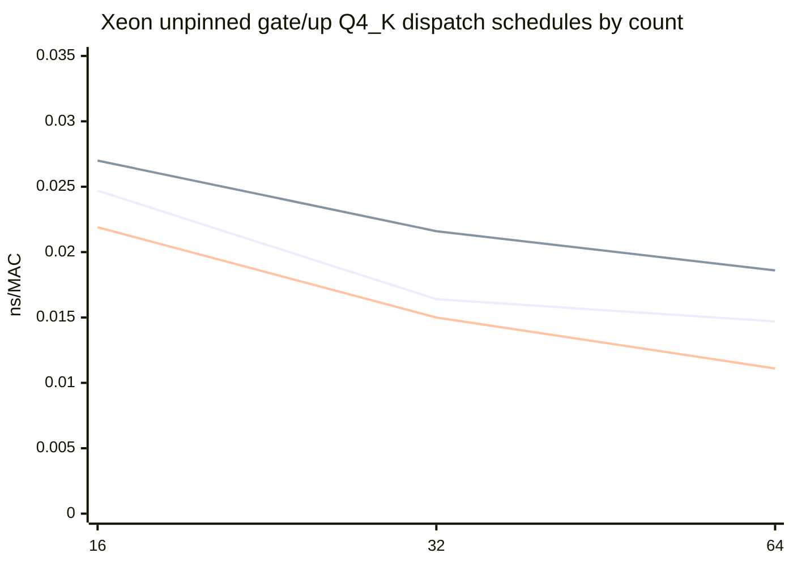
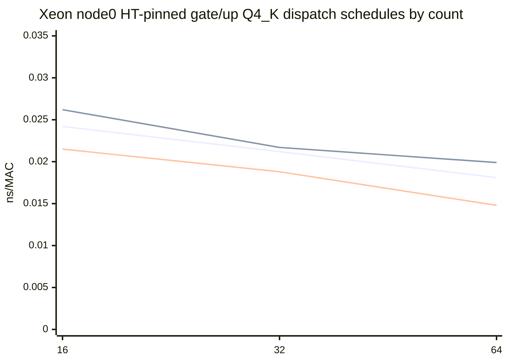

# Probe: Xeon static contiguous row partitioning — 2026-11-28

As of 2026-11-28. This is the target-host attribution follow-up to `reports/2026-11-28T05-48-20Z-probe-static-row-partitioning-local`. It tests whether LAIR’s landed-but-unpromoted static row partition seam (`engine.cpu.tuning.static_row_partition_batch_width`, auto 0) behaves differently on `lair-lab` than it did locally.

Posture: synthetic Q4_K feed-forward widths `11008x2048` and `2048x11008`; bench `q4k-widebatch --threads 32 --counts 8,16,32,64 --static-partition 8 --reps 7`. Two arms:
- unpinned threads=32 (`logs/wb-t32-unpinned-static-target-arms.log`), matching the earlier wide-quota collapse signature posture.
- node0 HT-pinned threads=32 with `taskset -c 0-15,32-47` (`logs/wb-t32-node0ht-static-target-arms.log`).

Host topology from prior pinned-host record: node0 physical CPUs `0-15`, siblings `32-47`; node1 physical CPUs `16-31`, siblings `48-63`. All float-class arms (`auto`, `streaming`, `tile`, `static-w8`) were bit-parity-checked by the harness at each count.

## Verdict
**Closed as landed-but-unpromoted.** The static schedule does not earn promotion on Xeon: it sometimes tightens a pathological low-count band, but its medians are behind dynamic `auto` and usually far behind tile-route execution at useful wide counts. Dynamic claiming remains the resolved posture everywhere (`static_row_partition_batch_width = 0`).

## Unpinned threads=32 — gate/up `11008x2048`, med_ms / band_pct
| count | auto | static-w8 | tile |
|---:|---:|---:|---:|
| 8 | 11.675 / **1111.9 %** | 17.737 / 196.2 % | 7.396 / 77.7 % |
| 16 | 8.917 / 52.6 % | 9.724 / 57.1 % | **7.894** / 27.1 % |
| 32 | **11.837** / 41.4 % | 15.610 / 24.1 % | 10.812 / 24.7 % |
| 64 | 21.273 / 23.7 % | 26.863 / 30.8 % | **15.974** / 39.4 % |

## Unpinned threads=32 — down `2048x11008`, med_ms / band_pct
| count | auto | static-w8 | tile |
|---:|---:|---:|---:|
| 8 | **6.071** / 173.1 % | 8.399 / 49.1 % | 6.021 / 45.2 % |
| 16 | **7.374** / 33.1 % | 12.204 / 75.4 % | 6.456 / 25.6 % |
| 32 | 13.298 / 22.4 % | 16.075 / 43.5 % | **10.681** / 15.0 % |
| 64 | 21.515 / 25.9 % | 29.660 / 27.6 % | **16.486** / 18.8 % |

## Node0 HT-pinned threads=32 — gate/up `11008x2048`, med_ms / band_pct
| count | auto | static-w8 | tile |
|---:|---:|---:|---:|
| 8 | 39.460 / **119.5 %** | 38.483 / 133.1 % | **8.114** / 98.3 % |
| 16 | 8.713 / 60.1 % | 9.456 / **19.5 %** | **7.756** / 23.0 % |
| 32 | **15.287** / 45.3 % | 15.662 / 49.7 % | 13.569 / 24.3 % |
| 64 | **26.164** / 22.7 % | 28.784 / 36.1 % | 21.420 / 26.6 % |

## Node0 HT-pinned threads=32 — down `2048x11008`, med_ms / band_pct
| count | auto | static-w8 | tile |
|---:|---:|---:|---:|
| 8 | 6.403 / **112.3 %** | 8.139 / **21.3 %** | **5.985** / 35.9 % |
| 16 | **8.864** / 30.3 % | 9.126 / 37.3 % | 7.708 / 19.8 % |
| 32 | 16.452 / **20.0 %** | 19.279 / 35.6 % | **12.127** / 27.5 % |
| 64 | 28.183 / 26.6 % | **27.685** / **12.3 %** | 19.656 / 12.6 % |

## Mermaid bar comparison — count-64 med_ms (lower better)

```mermaid
xychart-beta
    title "Xeon unpinned threads=32, Q4_K count-64 dispatch schedules"
    x-axis ["auto", "static-w8", "tile"]
    y-axis "median ms" 0 --> 31
    bar "gate/up 11008x2048" [21.273, 26.863, 15.974]
    bar "down 2048x11008" [21.515, 29.660, 16.486]
```

```mermaid
xychart-beta
    title "Xeon node0 HT-pinned threads=32, Q4_K count-64 dispatch schedules"
    x-axis ["auto", "static-w8", "tile"]
    y-axis "median ms" 0 --> 31
    bar "gate/up 11008x2048" [26.164, 28.784, 21.420]
    bar "down 2048x11008" [28.183, 27.685, 19.656]
```

## Mermaid line charts — wide-count ns/MAC (lower better)

## Reading
- The original wide-quota instability reproduces strongly on `lair-lab`: unpinned gate/up count 8 has an auto band of **1111.9 %**, and node0 HT-pinned gate/up count 8 still shows a **119.5 %** auto band with a pathological median (`39.460 ms` against min `5.671 ms`).
- Static partitioning can reduce dispersion in isolated cells — notably node0 HT down count 8 (21.3 % vs auto 112.3 %) and gate/up count 16 (19.5 % vs auto 60.1 %) — but it does not make the schedule competitive: tile-route execution is materially faster at useful wide counts, and static often has worse medians than dynamic claiming elsewhere.
- The only apparent near-win is HT-pinned down count 64 (`static-w8` median `27.685 ms`, band 12.3 %) versus auto `28.183 ms`; tile still wins at `19.656 ms`, and the static/auto gap is small relative to host bands, so this does not justify promotion or default posture change.

## Decision
Candidate C remains landed-but-unpromoted with no production/default/route change: dynamic block claiming stays resolved everywhere, fused pair/triple traversals/shared-input dots/single-vector decode remain outside the seam by construction, and out-of-range pins continue to refuse explicitly. The static contiguous row-partition probe is closed as a null candidate on both local dev-box and Xeon attribution; future dispatch work should target placement/residency or repacked substrates rather than replacing dynamic claiming with fixed ranges.
