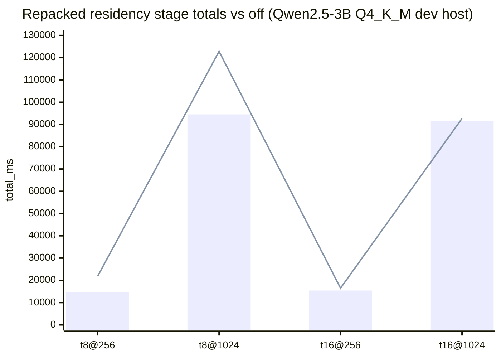

# Repacked Q4_K residency probe — local dev-host attribution

Date: 2026-11-28  
Branch/worktree: `phase/mvp7` in `.agent-worktrees\mvp7`  
Verdict: **landed measurement seam only; unpromoted and locally null/regressive for real-model prefill stage totals.** Default posture remains unchanged.

## Posture

| Item | Value |
|---|---|
| OS | Microsoft Windows 11 Pro |
| CPU | 13th Gen Intel Core i9-13900K, 32 logical processors |
| Memory | 63.7 GB total physical memory |
| Tooling | .NET SDK `10.0.403`; `Lair.Bench` Release build from this worktree |
| Full-model fixture | `C:\source\gitlab.scorchedhands.com\personal\LAIR\models\qwen2.5-3b-instruct-q4_k_m.gguf`, 2,104,932,768 bytes |
| Model posture from bench header | qwen2, layers=36, hidden=2048, heads=16, kvHeads=2, headDim=128, vocab=151936, avx2=True |
| Synthetic shapes | `11008x2048` gate/up-like shape and `2048x11008` down-projection shape; refusal demo uses ragged `5000x256` |
| Repacked arm width | stated `8`; resolved `engine.cpu.tuning.q4k_repacked_residency_batch_width = 8` for the measurement backend only |

## Synthetic wide-batch Q4_K result

These synthetic runs used AVX2-only backends, forced integer-dot comparison, and a repacked residency arm at width 8. Float arms (`auto`, `streaming`, `tile`) remain bit-identical to one another in each measured count group; the integer-domain and repacked arms diverge from float routes by activation quantization loss and are classified rather than asserted identical.

| Threads | Shape / count | Auto med (band) | Tile med (band) | Integer-dot med (band) | Repacked-w8 med/min/max/stddev/band | ns/MAC, GFLOP/s, GB/s | Δ vs best float route |
|---:|---|---:|---:|---:|---:|---:|---:|
| 8 | `11008x2048` @32 | 4.246 ms (27.58%) | 4.927 ms (22.07%) | 14.293 ms (3.88%) | 5.426 / 4.783 / 5.955 / 0.4402 ms (21.59%) | 0.0075, 265.888, 2.337 | +27.8% vs auto |
| 8 | `11008x2048` @64 | 7.467 ms (12.43%) | 8.409 ms (12.78%) | 28.133 ms (10.85%) | 7.536 / 7.176 / 7.842 / 0.2752 ms (8.84%) | 0.0052, 382.925, 1.683 | +0.9% vs auto |
| 8 | `2048x11008` @32 | 4.517 ms (17.23%) | 4.915 ms (27.07%) | 16.009 ms (8.12%) | 4.974 / 4.332 / 5.324 / 0.3699 ms (19.96%) | 0.0069, 290.100, 2.550 | +10.1% vs auto |
| 8 | `2048x11008` @64 | 11.632 ms (17.49%) | 8.660 ms (15.08%) | 31.337 ms (9.54%) | 9.118 / 8.656 / 9.506 / 0.3077 ms (9.32%) | 0.0063, 316.489, 1.391 | +5.3% vs tile |
| 16 | `11008x2048` @32 | 19.665 ms (9.32%) | 3.859 ms (25.73%) | 10.659 ms (32.23%) | 6.224 / 3.717 / 6.544 / 1.1736 ms (45.42%) | 0.0086, 231.826, 2.038 | +61.7% vs tile |
| 16 | `11008x2048` @64 | 5.908 ms (19.74%) | 6.126 ms (11.71%) | 17.147 ms (8.70%) | 5.589 / 5.053 / 5.893 / 0.3065 ms (15.03%) | 0.0039, 516.333, 2.269 | −5.4% vs auto |
| 16 | `2048x11008` @32 | 3.661 ms (12.45%) | 3.486 ms (18.47%) | 9.758 ms (7.60%) | 3.649 / 3.511 / 4.161 / 0.2799 ms (17.80%) | 0.0051, 395.375, 3.475 | +4.7% vs tile |
| 16 | `2048x11008` @64 | 7.170 ms (10.32%) | 5.850 ms (6.04%) | 18.785 ms (3.55%) | 7.039 / 6.488 / 7.606 / 0.4543 ms (15.88%) | 0.0049, 409.962, 1.802 | +20.3% vs tile |

Divergence classification from the same synthetic logs:

| Shape / count | Integer-domain divergence | Repacked-w8 divergence |
|---|---:|---:|
| `11008x2048` @32 | 352,254/352,256 differing elements; max abs diff 1.013E+001 | 352,254/352,256 differing elements; max abs diff 1.013E+001 |
| `11008x2048` @64 | 704,509/704,512 differing elements; max abs diff 1.057E+001 | 704,509/704,512 differing elements; max abs diff 1.057E+001 |
| `2048x11008` @32 | 65,536/65,536 differing elements; max abs diff 2.280E+001 | 65,536/65,536 differing elements; max abs diff 2.280E+001 |
| `2048x11008` @64 | 131,071/131,072 differing elements; max abs diff 2.280E+001 | 131,071/131,072 differing elements; max abs diff 2.280E+001 |

## Budget refusal semantics demo

The ragged shape `5000x256` with a stated cap of 1 MiB refused before timing the repacked arm:

```text
repacked Q4_K residency refused: format Q4_K dense matrix 5000x256 costs 720000 packed bytes (144-byte super-blocks, 144 per row) and its resident copy adds 1360000 bytes (272 per 256-element super-block, 272 per row), above the stated 'weights.caps.dram_mb' ceiling of 1 megabytes (1048576 bytes) — no repacked rows are admitted and nothing falls back to a narrower copy.
```

This confirms the gate's intended refusal posture: over-cap residency requests stop rather than silently narrowing, borrowing another budget resource, or falling back to a smaller resident set.

## Full-model prefill stage totals

The full-model runs used `--stage-profile`, lengths 256 and 1024, reps=3, kernel `gemv`, resolved row width 32, sub-batches 8 at length 256 and 32 at length 1024. The stated repacked arm forces the measurement backend to AVX2-only posture in both off/on pairs so the comparison is not mixed with this host's default VNNI-resolved integer-dot path.

`forwardCalls=3` below means each substage value is a sum across three timed forward calls, not an independently sampled median/min/max for that substage. Therefore these stage totals are directional attribution numbers; they do not carry per-substage dispersion bands like synthetic arm logs.

| Threads | Length | Arm | total_ms | feed_forward_weight_ms | gate_up_ms | down_ms | attention_output_ms | logits_head_ms |
|---:|---:|---|---:|---:|---:|---:|---:|---:|
| 8 | 256 | off | 14,872.287 | 10,359.169 | 5,389.389 | 4,969.780 | 897.192 | 61.420 |
| 8 | 256 | on | 21,799.947 | 15,467.016 | 8,466.933 | 7,000.084 | 1,246.980 | 115.739 |
| 8 | 1024 | off | 94,514.869 | 51,299.813 | 26,863.790 | 24,436.023 | 4,364.066 | 69.344 |
| 8 | 1024 | on | 122,811.180 | 64,173.506 | 34,392.126 | 29,781.379 | 5,258.806 | 109.317 |
| 16 | 256 | off | 15,438.530 | 9,297.589 | 4,624.456 | 4,673.133 | 874.385 | 53.353 |
| 16 | 256 | on | 16,480.745 | 10,097.812 | 5,416.591 | 4,681.220 | 1,010.779 | 64.584 |
| 16 | 1024 | off | 91,505.331 | 38,350.219 | 19,212.729 | 19,137.490 | 3,673.850 | 56.865 |
| 16 | 1024 | on | 92,715.487 | 39,532.915 | 21,224.317 | 18,308.598 | 3,995.797 | 65.121 |

Window-total deltas:

| Threads | Length | off total_ms | on total_ms | Δ |
|---:|---:|---:|---:|---:|
| 8 | 256 | 14,872.287 | 21,799.947 | +46.6% |
| 8 | 1024 | 94,514.869 | 122,811.180 | +29.9% |
| 16 | 256 | 15,438.530 | 16,480.745 | +6.7% |
| 16 | 1024 | 91,505.331 | 92,715.487 | +1.3% |



## Residency facts from full-model runs

| Threads | Arm | Stated width | Cap mode | Admitted matrices | Refused matrices | Resident backend bytes | Process peak working set MB |
|---:|---|---:|---|---:|---:|---:|---:|
| 8 | off | 0 | auto | 0 | 0 | 0 | 2,028.0 |
| 8 | on | 8 | auto | 216 | 0 | 2,506,752,000 | 4,405.8 |
| 16 | off | 0 | auto | 0 | 0 | 0 | 2,028.9 |
| 16 | on | 8 | auto | 216 | 0 | 2,506,752,000 | 4,413.2 |

The `on` arms prepare resident copies for dense Q4_K profile weights under per-tensor exact-fit rounded-up MB caps: attention/MLP tensors plus output-head/lm_head-shaped tensors are considered by the bench helper. The backend then owns those prepared matrices until disposal; the bench-owned mmap weight source remains active through candidate measurement so ordinary engine forward passes can consult already-prepared copies when engaged.

## Reading

- Synthetic wide-batch Q4_K attribution shows resident repacked reads can beat some unpromoted integer-dot cells and occasionally sit near auto/tile routes, but they do not form a consistent win across thread quotas or shapes.
- Full-model prefill stage totals regress overall in this local dev-host posture: threads=8 is clearly slower, while threads=16 is mixed with only `feed_forward_down` at length 1024 improving slightly and window total still moving worse by +1.3%.
- Peak working set rises from roughly 2.0 GB to roughly 4.4 GB for the full-model on-arm posture because the backend holds about 2,506,752,000 repacked bytes in addition to mapped model/activation/KV working sets. That cost is material even before considering speed nullity/regression.
- The seam remains useful as a measurement substrate: it proves budget gating, refusal wording, duplicate-source protection, AVX2-rung engagement refusal on VNNI backends, and default-posture non-engagement are real code paths rather than aspirational vocabulary.

## Promotion posture

Do **not** promote this candidate from these numbers: no public YAML knob exists for `engine.cpu.tuning.q4k_repacked_residency_batch_width`, every resolved auto posture keeps it at 0, Parity goldens remain untouched because default traversal never engages the resident route, and real-model local attribution is null/regressive. A future target-host interleaved stage-profile run would need to put a window or substage delta outside its own noise band before any promotion language could be written.
