# Probe: Xeon budget-gated repacked Q4_K residency — 2026-11-28

As of 2026-11-28. This is the target-host follow-up to `reports/2026-11-28T07-13-37Z-probe-repacked-q4k-residency-local`. It tests whether LAIR’s landed-but-unpromoted budget-gated repacked Q4_K residency seam (`engine.cpu.tuning.q4k_repacked_residency_batch_width`, auto 0) behaves differently on `lair-lab` than it did locally.

Posture: host worktree at commit `47efa42`; bench-only Release build; fixture `qwen2.5-3b-instruct-q4_k_m.gguf`; node0 physical-core pinning via `taskset -c 0-15`; kernel `gemv`, row width 64, threads=8, lengths 128 and 256, reps=3, stage profile enabled. Off arm is the default resolved route; on arm pins comparable AVX2 integer-dot posture and prepares dense Q4_K matrices under auto per-tensor caps (`admitted_matrices=216`, `resident_backend_bytes=2506752000`).

## Verdict
**Unpromoted — target-host directional signal, but not promotion-ready.** The Xeon stage windows show the candidate’s intended wins in specific substages: `feed_forward_down_ms` improves at both lengths and `attention_output_ms` improves strongly. However totals are mixed (length 128 regresses, length 256 improves), peak working set rises by about **2392 MB**, and this is a single reps=3 sequential A/B without repeated alternating bands. That is enough to keep the candidate open for a higher-power same-build interleaved pass; it is not enough to promote or default-change anything.

## Stage-window deltas (lower better)
| Length | Metric | off ms | on ms | Δ |
|---:|---|---:|---:|---:|
| 128 | total_ms | **31,824.3** | 33,156.0 | **+4.17%** |
| 128 | feed_forward_down_ms | **11,102.1** | 11,355.1 | +2.28% |
| 128 | attention_output_ms | 2,429.0 | **2,070.2** | −14.77% |
| 256 | total_ms | 71,726.8 | **68,450.9** | −4.57% |
| 256 | feed_forward_down_ms | 24,680.3 | **22,840.1** | −7.46% |
| 256 | attention_output_ms | 5,416.4 | **4,131.5** | −23.73% |

## Memory posture
`off`: `peakWorkingSetMb=2028.6`, no resident Q4_K copies admitted (`resident_backend_bytes=0`).  
`on`: `peakWorkingSetMb=4421.0`, 216 dense Q4_K matrices admitted, `resident_backend_bytes=2506752000`.

## Mermaid bar comparison — stage totals (lower better)

```mermaid
xychart-beta
    title "Xeon physical-core threads8 repacked residency total_ms"
    x-axis ["length 128", "length 256"]
    y-axis "total ms" 0 --> 75000
    bar "off (dynamic/resolved)" [31824.3, 71726.8]
    bar "on (repacked residency)" [33156.0, 68450.9]
```

## Mermaid bar comparison — candidate target substages (lower better)

```mermaid
xychart-beta
    title "Xeon repacked residency feed_forward_down_ms"
    x-axis ["length 128", "length 256"]
    y-axis "ms" 0 --> 27000
    bar "off (dynamic/resolved)" [11102.1, 24680.3]
    bar "on (repacked residency)" [11355.1, 22840.1]
```

## Reading and next decision
- The candidate is not a local null only: on the Xeon lane it moves several dense substages in the intended direction (`feed_forward_down_ms` at both lengths; `attention_output_ms` strongly). That justifies keeping the seam landed for further attribution despite the local real-model regression.
- It also pays a large memory cost and can regress short-length total windows, so promotion is not justified from this single reps=3 pass. The next measurement should be same-build alternating interleaved A/B with enough rounds to produce per-arm bands (for example lengths 128/256 or longer, `--reps >= 5` plus repeated passes) before any promotion/default posture change or close/revert decision is made.
