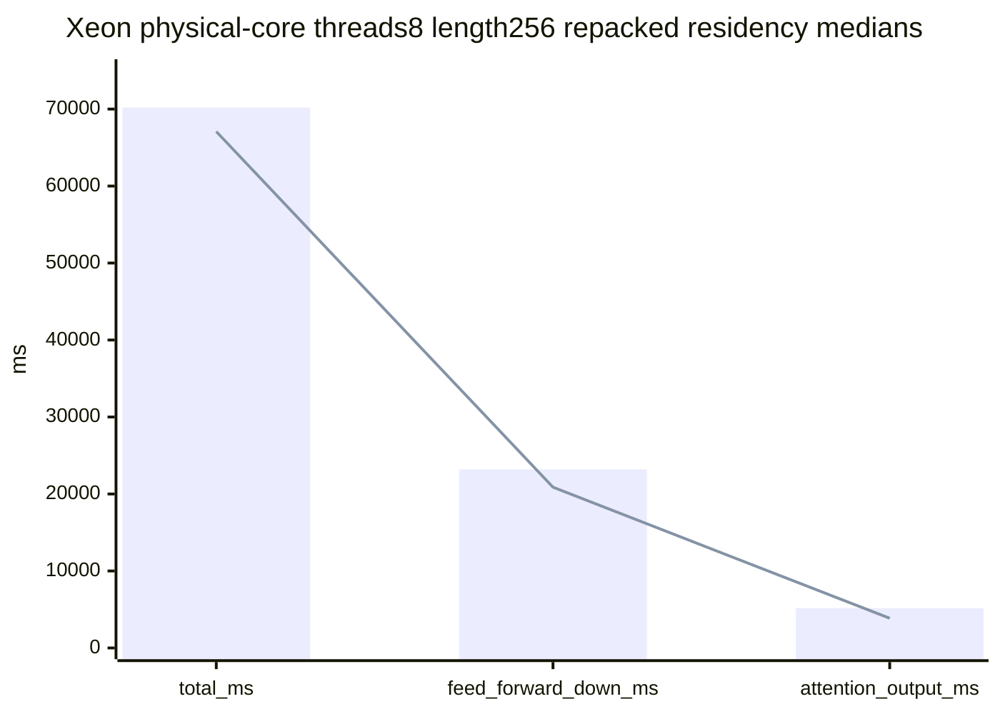

# Probe: Xeon interleaved repacked Q4_K residency length 256 — 2026-11-28

As of 2026-11-28. This is the band-separated follow-up to `reports/2026-11-28T08-34-00Z-probe-repacked-q4k-residency-xeon-t8-phys8`. It tests whether the Xeon length 256 stage-window improvement seen in the first reps=3 off/on run survives ordering noise.

Posture: host worktree at commit `47efa42`; bench-only Release build reused; fixture `qwen2.5-3b-instruct-q4_k_m.gguf`; node0 physical-core pinning via `taskset -c 0-15`; kernel `gemv`, row width 64, threads=8, length 256 only, reps=3 per invocation; three alternating off/on rounds (`off-r1`, `on-r1`, `off-r2`, `on-r2`, `off-r3`, `on-r3`). The on arm admits all dense Q4_K profile matrices: 216 matrices totaling 2,506,752,000 resident bytes.

## Verdict
**Target-host length-256 signal is band-separated, but candidate remains unpromoted.** Across three interleaved rounds, every on-arm value for `total_ms`, `attention_output_ms`, and `feed_forward_down_ms` is lower than the corresponding off-arm range: total improves by **4.44%**, attention output by **25.60%**, and feed-forward down by **10.00%** at medians. Peak working set rises from about **2012 MB** to about **4404 MB**. That is stronger than the earlier single sequential run, but it still does not justify a default posture change because the candidate has local null/regressive evidence, pays ~2392 MB peak memory, and this band-separated result covers only threads=8 physical-core pinning at length 256.

## Medians (lower better)
| Metric | off median ms | on median ms | Δ | Band separation? |
|---|---:|---:|---:|---|
| total_ms | 70,200.645 | **67,080.603** | −4.44% | yes — max on < min off |
| attention_output_ms | 5,179.978 | **3,853.939** | −25.60% | yes — max on < min off |
| feed_forward_down_ms | 23,199.659 | **20,880.823** | −10.00% | yes — max on < min off |

## Ranges (lower better)
| Metric | off range ms | on range ms |
|---|---:|---:|
| total_ms | 68,068.490 – 71,669.936 | **64,517.882 – 67,252.470** |
| attention_output_ms | 5,059.633 – 5,246.869 | **3,736.751 – 3,886.567** |
| feed_forward_down_ms | 22,386.754 – 24,051.682 | **19,183.136 – 22,069.505** |

## Memory posture
`off`: peak working set range `2012.0–2014.0 MB`, no resident Q4_K copies admitted (`resident_backend_bytes=0`).  
`on`: peak working set range `4403.7–4405.2 MB`, 216 dense Q4_K matrices admitted, `resident_backend_bytes=2506752000`.

## Mermaid bar comparison — interleaved medians (lower better)

## Decision boundary
The length-256 physical-core Xeon result is real enough to keep candidate D open and worth measuring further; it is not promotion evidence by itself. Before any default posture change or close/revert decision, the longer-length interleaved pass must be inspected because local threads=8/16 regressions were strongest at length 1024, and memory cost may behave differently there. A promotion claim would need target-host wins across more than one useful length/posture without an unacceptable residency/memory penalty.
