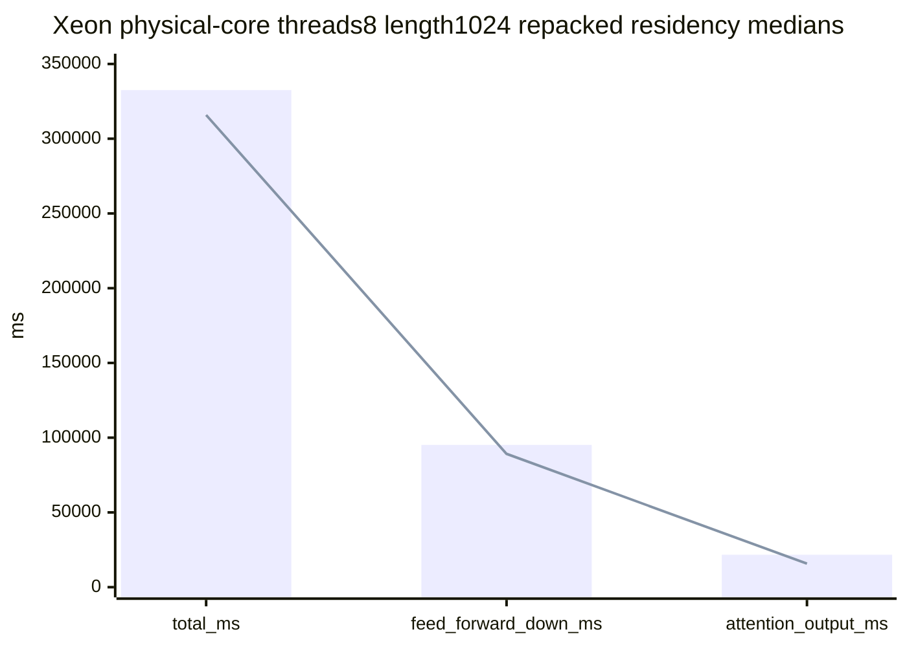

# Probe: Xeon interleaved repacked Q4_K residency length 1024 — 2026-11-28

As of 2026-11-28. This is the longer-context follow-up to `reports/2026-11-28T08-45-16Z-probe-repacked-q4k-residency-xeon-t8-phys8-interleaved-l256`. It tests whether the candidate’s Xeon signal survives the local regression region where threads=8 had previously regressed most strongly.

Posture: host worktree at commit `47efa42`; bench-only Release build reused; fixture `qwen2.5-3b-instruct-q4_k_m.gguf`; node0 physical-core pinning via `taskset -c 0-15`; kernel `gemv`, row width 64, threads=8, length 1024 only, reps=3 per invocation; three alternating off/on rounds (`off-r1`, `on-r1`, `off-r2`, `on-r2`, `off-r3`, `on-r3`). The on arm admits all dense Q4_K profile matrices: 216 matrices totaling 2,506,752,000 resident bytes.

## Verdict
**Target-host length-1024 signal is band-separated and stronger than the earlier local null at this posture.** Across three interleaved rounds, every on-arm value for `total_ms`, `attention_output_ms`, and `feed_forward_down_ms` is lower than the corresponding off-arm range: total improves by **5.01%**, attention output by **27.41%**, and feed-forward down by **6.30%** at medians. Peak working set rises from about **2167 MB** to about **4559 MB**. Candidate D remains open/unpromoted because the memory cost is large, this posture covers only threads=8 physical-core pinning on one host, and HT/thread-count behavior has not yet been attributed.

## Medians (lower better)
| Metric | off median ms | on median ms | Δ | Band separation? |
|---|---:|---:|---:|---|
| total_ms | 332,519.291 | **315,852.759** | −5.01% | yes — max on < min off |
| attention_output_ms | 21,669.566 | **15,729.268** | −27.41% | yes — max on < min off |
| feed_forward_down_ms | 95,172.725 | **89,180.257** | −6.30% | yes — max on < min off |

## Ranges (lower better)
| Metric | off range ms | on range ms |
|---|---:|---:|
| total_ms | 329,326.589 – 333,092.161 | **306,701.575 – 321,310.293** |
| attention_output_ms | 21,426.875 – 21,755.742 | **15,672.752 – 16,606.176** |
| feed_forward_down_ms | 94,382.510 – 99,113.415 | **79,026.911 – 92,096.118** |

## Memory posture
`off`: peak working set range `2166.0–2168.5 MB`, no resident Q4_K copies admitted (`resident_backend_bytes=0`).  
`on`: peak working set range `4558.1–4559.5 MB`, 216 dense Q4_K matrices admitted, `resident_backend_bytes=2506752000`.

## Mermaid bar comparison — interleaved medians (lower better)

## Decision boundary
The Xeon physical-core threads=8 result now improves at both length 256 and length 1024 with separated bands. That is enough to keep candidate D open for promotion consideration, but not enough to promote or default-change yet: the next required evidence is HT/thread-count attribution (node0 HT `taskset -c 0-15,32-47`, threads=16) because memory pressure and NUMA behavior can change with hyperthreading/core count. A promotion/default posture would need a stable win across useful thread postures or an explicit budget gate that refuses residency when the host cannot afford it without penalty.
