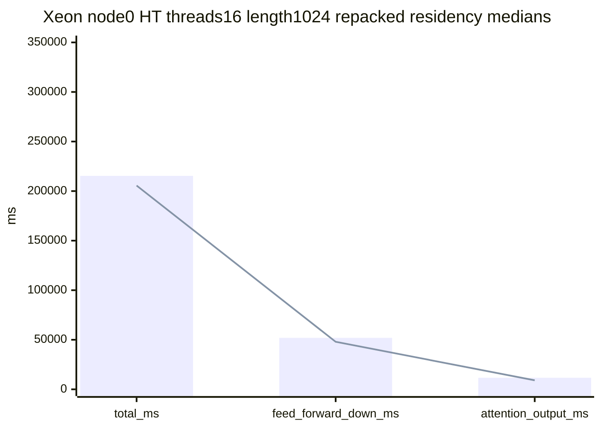

# Probe: Xeon interleaved repacked Q4_K residency node0 HT threads 16 — 2026-11-28

As of 2026-11-28. This is the hyperthread/core-count follow-up to `reports/2026-11-28T08-59-17Z-probe-repacked-q4k-residency-xeon-t8-phys8-interleaved-l1024`. It tests whether candidate D survives node0 HT pinning (`taskset -c 0-15,32-47`) at threads=16 and length 1024.

Posture: host worktree at commit `47efa42`; bench-only Release build reused; fixture `qwen2.5-3b-instruct-q4_k_m.gguf`; kernel `gemv`, row width 64, threads=16, length 1024 only, reps=3 per invocation; three alternating off/on rounds (`off-r1`, `on-r1`, `off-r2`, `on-r2`, `off-r3`, `on-r3`). The on arm admits all dense Q4_K profile matrices: 216 matrices totaling 2,506,752,000 resident bytes.

## Verdict
**Node0 HT threads=16 length-1024 signal is positive and mostly band-separated.** Total_ms and attention_output_ms have fully separated on/off bands; feed_forward_down improves at median (−7.67%) but its three-round ranges overlap slightly (`on` max 50,307 ms vs `off` min 49,542 ms). Peak working set rises from about **2166 MB** to about **4562 MB**. Candidate D remains open/unpromoted pending unpinned cross-NUMA attribution before any default posture change.

## Medians (lower better)
| Metric | off median ms | on median ms | Δ | Band separation? |
|---|---:|---:|---:|---|
| total_ms | 215,351.074 | **205,585.929** | −4.53% | yes — max on < min off |
| attention_output_ms | 11,660.465 | **9,098.638** | −21.97% | yes — max on < min off |
| feed_forward_down_ms | 51,921.492 | **47,937.766** | −7.67% | partial — ranges overlap slightly |

## Ranges (lower better)
| Metric | off range ms | on range ms |
|---|---:|---:|
| total_ms | 213,055.600 – 216,020.697 | **202,979.931 – 210,999.667** |
| attention_output_ms | 11,653.022 – 11,703.687 | **8,990.705 – 9,754.248** |
| feed_forward_down_ms | 49,542.623 – 52,595.287 | 46,024.601 – **50,307.355** |

## Memory posture
`off`: peak working set range `2164.8–2166.3 MB`, no resident Q4_K copies admitted (`resident_backend_bytes=0`).  
`on`: peak working set range `4562.0–4563.0 MB`, 216 dense Q4_K matrices admitted, `resident_backend_bytes=2506752000`.

## Mermaid bar comparison — interleaved medians (lower better)

## Decision boundary
The candidate is no longer just a physical-core artifact: node0 HT threads=16 also improves total and attention output with separated bands at length 1024. The remaining unresolved question is cross-NUMA/unpinned behavior, because resident Q4_K copies could become remote-host memory under scheduler placement. An unpinned threads=32 interleaved pass on the same host worktree was queued before this summary; its outcome must be interpreted before any promotion/default posture change or close/revert decision.
