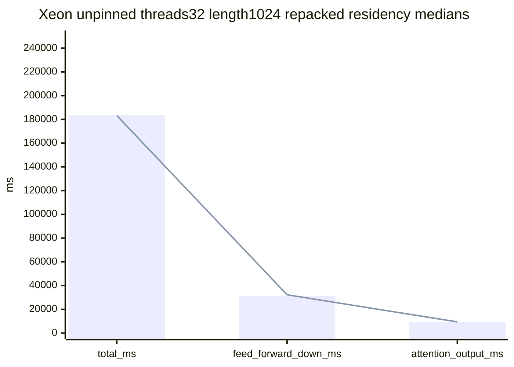

# Probe: Xeon interleaved repacked Q4_K residency unpinned threads 32 — 2026-11-28

As of 2026-11-28. This is the cross-NUMA/unpinned follow-up to `reports/2026-11-28T09-47-58Z-probe-repacked-q4k-residency-xeon-t16-node0ht-interleaved-l1024`. It tests whether candidate D’s node-local Xeon wins survive unpinned scheduler placement across both sockets at threads=32.

Posture: host worktree at commit `47efa42`; bench-only Release build reused; fixture `qwen2.5-3b-instruct-q4_k_m.gguf`; kernel `gemv`, row width 64, threads=32, unpinned process affinity (all host CPUs allowed), length 1024 only, reps=3 per invocation; three alternating off/on rounds (`off-r1`, `on-r1`, `off-r2`, `on-r2`, `off-r3`, `on-r3`). The on arm admits all dense Q4_K profile matrices: 216 matrices totaling 2,506,752,000 resident bytes.

## Verdict
**Cross-NUMA/unpinned attribution is null/mixed/regressive; candidate D is not promotion-safe.** Total_ms improves only by **0.23%** at median with overlapping bands and noisy round order. `attention_output_ms` regresses **+0.61%**, and `feed_forward_down_ms` regresses **+3.65%** while peak working set rises from about **2157 MB** to about **4547 MB**. Combined with local AVX-VNNI null/regressive evidence, this closes candidate D for promotion/default posture as a landed-but-unpromoted measurement seam only; it remains useful as internal evidence for a future NUMA-aware residency-placement policy.

## Medians (lower better)
| Metric | off median ms | on median ms | Δ | Band separation? |
|---|---:|---:|---:|---|
| total_ms | 183,634.426 | **183,220.916** | −0.23% | no — ranges overlap and round order is noisy |
| attention_output_ms | **9,393.624** | 9,450.811 | +0.61% | no — off median lower |
| feed_forward_down_ms | **31,094.101** | 32,230.565 | +3.65% | no — ranges overlap and on is worse at median |

## Ranges (lower better)
| Metric | off range ms | on range ms |
|---|---:|---:|
| total_ms | 177,372.037 – 192,579.320 | 179,506.014 – 187,589.844 |
| attention_output_ms | **9,203.767 – 9,418.333** | 9,234.230 – 9,540.108 |
| feed_forward_down_ms | **30,702.376 – 32,690.487** | 30,909.764 – 32,404.534 |

## Memory posture
`off`: peak working set range `2154.3–2159.1 MB`, no resident Q4_K copies admitted (`resident_backend_bytes=0`).  
`on`: peak working set range `4546.6–4550.1 MB`, 216 dense Q4_K matrices admitted, `resident_backend_bytes=2506752000`.

## Mermaid bar comparison — unpinned medians (lower better)

## Decision boundary
The pinned node-local Xeon wins are real, but unpinned cross-NUMA behavior is not safe enough for a default posture change: scheduler placement can make resident Q4_K copies remote-host memory and erase the benefit while retaining the +~2390 MB cost. Candidate D should remain auto 0 / internal measurement seam only. A future reopening would need a residency-placement policy that guarantees node-local first-touch or otherwise budgets/pins residency before enabling it by default, plus fresh attribution against unpinned/cross-NUMA postures and local AVX-VNNI regression evidence.
